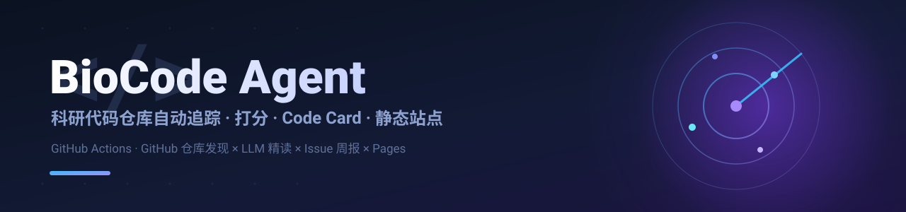

  

<h1 align="center">BioCode Agent</h1>

  <strong>科研代码仓库（GitHub repo）自动追踪 + AI 精读模板</strong> 
  用 GitHub Actions 每周自动「替你搜一遍研究领域」：每日免费元数据流 + 每周关键词盲搜 → 合并去重 → LLM 按 README 打分 → 高分仓库 <b>代码语料摘录</b>（源码/文档/构建文件；数据与二进制不入库）+ AI wiki（DeepWiki · Code Wiki · zread）快照归档 → LLM 生成一张「Code Card」→ 开一条 GitHub Issue 周报 → 部署一个可全文检索的 Pages 站点。

  
  
  
  
  
  

  <a href="#-三步上手">三步上手</a> ·
  <a href="#-设计思路">设计思路</a> ·
  <a href="#-流水线各阶段">流水线</a> ·
  <a href="#-无-ai-时的降级行为">无 AI 降级</a> ·
  <a href="#-code-card-与站点">Code Card 与站点</a> ·
  <a href="#-搜索要点">搜索要点</a> ·
  <a href="#-密钥与仓库配置">密钥与配置</a> ·
  <a href="#-本地运行与调试">本地运行</a> ·
  <a href="#-部署清单">部署清单</a> ·
  <a href="#-faq">FAQ</a>

> **模板即实例。** 仓库内的 `config.yaml`、`prompts.yaml`、`queries/` 与 `monitor/lists/` 已内置一套完整可跑的示例——以 **「固有无序区 / 无序蛋白（IDR/IDP）× 相分离 / 生物分子凝聚体」** 为默认课题。拿到后你只需改**几个文件**：`config.yaml`（换课题与检索式）、`prompts.yaml`（换领域措辞）、`monitor/lists/*.txt`（换你关注的领域内的大佬 / 课题组）、`queries/search_repos.yaml`（可选，换盲搜式）。核心驱动为自研工具 [ghresearcher](https://github.com/MaybeBio/GhResearcher) 与 [repowiki-cli](https://github.com/MaybeBio/Repowiki-cli)。

---

> 由自研代码+Agent推送模板 [Daily-Code-Agent-Template](https://github.com/MaybeBio/Daily-Code-Agent-Template) 生成

追踪 无序蛋白 (IDP/IDR) × 分子互作 × AI / 物理模拟方法 方向的计算GitHub项目
