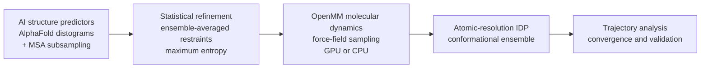

This page introduces **bAIes-IDP-OpenMM** at a conceptual level: what the project is, the scientific problem it solves, how its workflow fits together, and the technology stack a beginner needs to have in place. No prior experience with molecular dynamics or AI structure prediction is assumed. By the end of this page you will understand the project's purpose and know exactly where to go next in the documentation.

## What Is bAIes-IDP-OpenMM?

bAIes-IDP-OpenMM is the **OpenMM implementation of bAIes**, a method that produces *atomic resolution ensemble predictions of intrinsically disordered proteins using AI structure predictors*. Rather than predicting a single rigid 3D structure, bAIes combines the statistical power of AlphaFold-family predictors with physics-based molecular dynamics sampling to generate a **distribution of conformations** that describes how these flexible proteins actually behave in solution. The method is peer-reviewed: it was published in *Nature Communications* with an accompanying preprint, both of which the README asks users to cite.


Sources: [README.md](README.md#L3-L13)

## Why Ensembles Instead of a Single Structure?

Beginners arriving from classical structural biology are used to one protein → one structure. **Intrinsically disordered proteins (IDPs) break that assumption**: they do not fold into a single stable shape, so any single prediction is fundamentally incomplete. bAIes therefore targets the correct object of study — the *conformational ensemble* — by propagating AI-derived restraints into an OpenMM simulation that samples many valid conformations. This reframing (from "a structure" to "an ensemble") is the single most important conceptual shift before reading further; the scientific details are developed step by step in the [Intrinsically Disordered Protein Ensembles](6-intrinsically-disordered-protein-ensembles) chapter.

Sources: [README.md](README.md#L7)

## The bAIes Workflow at a Glance

Before examining the diagram, note the prerequisite idea: bAIes is a **pipeline**, not a monolithic program. Each stage transforms an output of the previous stage, and each stage is covered in depth by its own chapter in this documentation. The following diagram shows the four conceptual stages end to end:



Reading left to right: **AI structure predictors** supply distance information (distograms) and sequence-alignment statistics; **statistical refinement** converts those predictions into ensemble-averaged restraints under maximum-entropy principles; **OpenMM molecular dynamics** physically samples conformations consistent with those restraints using a standard force field; and **analysis** assesses convergence and validates against experiment. Each arrow corresponds to a documented workflow, so a beginner can study the pipeline incrementally rather than all at once.

Sources: [README.md](README.md#L7)

## Technology Stack and Requirements

The installation footprint is deliberately minimal: per the README, *"to run bAIes with OpenMM, you just need a python environment with OpenMM installed."* There are no bespoke compiled dependencies in this repository — the environment is a standard conda environment with pinned versions chosen for reproducibility:

| Component | Pinned Version | Role | Notes |
|---|---|---|---|
| Python | 3.13 | Runtime environment | Created via conda (`conda create -n baies python=3.13`) |
| OpenMM | 8.3 | Molecular dynamics engine | Installed from `conda-forge` |
| CUDA | 13 | GPU acceleration | Set to a version supported by **both** your GPU driver and OpenMM; omit entirely on machines without a GPU to get the CPU build |
| Installation check | — | `python -m openmm.testInstallation` | Confirms OpenMM sees your hardware before you run anything |

The pinning strategy (`openmm=8.3 cuda-version=13`) is the one configuration decision beginners most often get wrong.

> [!TIP]
> The `cuda-version` pin is a **dual constraint**, not a preference: it must be supported by both your NVIDIA driver (check with `nvidia-smi`) and your OpenMM release. If you omit the pin on a GPU-less machine, conda silently falls back to the CPU build — which is valid, but orders of magnitude slower for production ensembles.

Sources: [README.md](README.md#L16-L41)

## Repository Structure

This repository has an intentionally small footprint — it serves as the project's public entry point, carrying the visual abstract, the canonical citation list, and the environment setup guide:

```
bAIes-IDP-OpenMM/
├── README.md              # Project identity, citation list, environment setup guide
└── Visual_Abstract.png    # One-figure summary of the bAIes ensemble workflow
```

Notably, the README's final section ("Run bAIes") contains a heading but no inline execution commands within this repository. That is a deliberate structural signal, not an omission to worry about.

> [!TIP]
> This repository is the **documentation and identity companion** — the runnable code and its operational instructions live in the companion repository. If you cannot find a script here, you are not lost; you are looking in the right repo for the wrong artifact. The [Companion Repository Resources](4-companion-repository-resources) page maps where everything executable lives.

Sources: [README.md](README.md#L1-L5), [README.md](README.md#L43-L44)

## Key Publications

Two publications define the method's scientific authority, and the README explicitly requests that both be cited by users of the tool:

| Publication | Venue | Year | DOI |
|---|---|---|---|
| *Atomic resolution ensembles of intrinsically disordered with AlphaFold* | Nature Communications | 2026 | [10.1038/s41467-026-69172-y](https://doi.org/10.1038/s41467-026-69172-y) |
| *Leveraging state-of-the-art AI structure predictors to generate atomic resolution ensembles of intrinsically disordered proteins* | bioRxiv (preprint) | 2026 | [10.64898/2026.11.10.765624](https://doi.org/10.64898/2026.11.10.765624) |

Sources: [README.md](README.md#L9-L13)

## Your Learning Path

The documentation is organized so that each chapter's prerequisites are the chapters before it. For a beginner, the following progression moves from *doing* to *understanding* without skipping foundations:

| Step | Page | Why Read It Now |
|---|---|---|
| 1 | [Quick Start](2-quick-start) | Get a working environment and your first run, using the conda/OpenMM stack described above |
| 2 | [GPU and CUDA Setup](3-gpu-and-cuda-setup) | Resolve the `cuda-version` driver/OpenMM compatibility question before it costs you hours |
| 3 | [Companion Repository Resources](4-companion-repository-resources) | Locate the actual runnable code that this companion repository points to |
| 4 | [Architecture Overview](5-architecture-overview) | Expand the four-stage pipeline diagram above into the real system architecture |
| 5 | [Intrinsically Disordered Protein Ensembles](6-intrinsically-disordered-protein-ensembles) | Begin the Scientific Foundations track that underpins every restraint in the pipeline |

Once steps 1–5 are complete, the *OpenMM Implementation* chapters ([Simulation Pipeline Walkthrough](11-simulation-pipeline-walkthrough), [Custom Distance Restraint Forces](12-custom-distance-restraint-forces)) are the natural continuation, followed by the *Reproducibility Workflows* ([End-to-End Ensemble Generation](15-end-to-end-ensemble-generation), [Benchmark Simulation Reproduction](16-benchmark-simulation-reproduction)).
