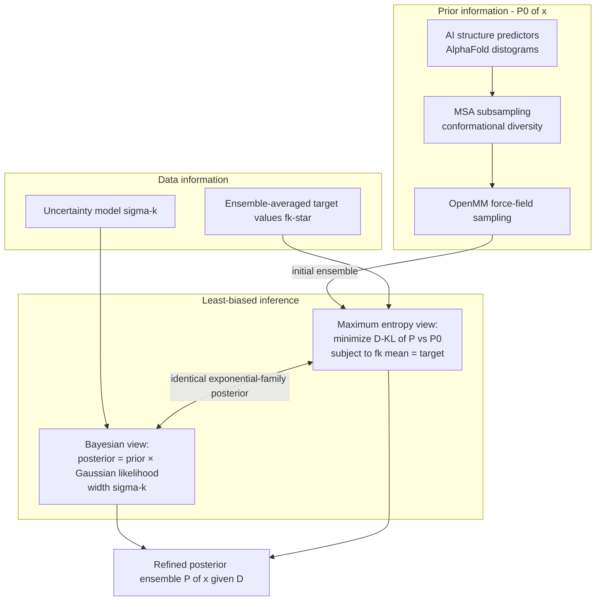
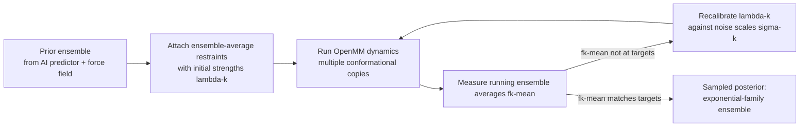

This page documents the inference principle that binds the bAIes workflow together: given a prior ensemble generated from AI structure predictors and sparse, ensemble-averaged data, how do we produce the **least-biased refined posterior**? Previous pages established *where* the prior comes from ([Intrinsically Disordered Protein Ensembles](6-intrinsically-disordered-protein-ensembles), [AlphaFold Distograms and Distance Distributions](7-alphafold-distograms-and-distance-distributions), [MSA Subsampling Strategy](8-msa-subsampling-strategy)) and *what* is restrained ([Ensemble-Averaged Restraints Theory](9-ensemble-averaged-restraints-theory)). This page establishes *why the refinement rule itself is well-founded*.

The repository itself is intentionally lean—it hosts the OpenMM implementation entry point and the canonical visual abstract, with the scientific formalization carried by the two cited publications.


Sources: [README.md](README.md#L1-L13), [Visual_Abstract.png](Visual_Abstract.png)

## The Inverse Problem: Why Ensembles Demand a Refinement Principle

Intrinsically disordered proteins occupy enormous conformational spaces, and the experimental observables available to characterize them are few and **ensemble-averaged**—a single measurement constrains a distribution over millions of conformations, not a single structure. This inverse problem is radically underdetermined: infinitely many ensembles match the data, and most of them are physically absurd in ways the data cannot detect. bAIes confronts this by supplying two independent information sources: a **generative prior** from AI structure predictors (AlphaFold-derived ensembles, diversified via MSA subsampling) and **data** in the form of ensemble-averaged distance restraints. The remaining question is purely one of inference: what update rule merges these sources without injecting bias that neither source justifies? Maximum entropy is that rule, and Bayesian refinement is its probabilistic restatement. This is precisely the framing under which bAIes is published—atomic-resolution IDP ensembles derived from AI predictors, with the inference machinery executed inside OpenMM simulations.

Sources: [README.md](README.md#L7-L13)

## The Maximum Entropy Solution: Least-Biased Updating

The maximum entropy principle selects, among all ensembles consistent with the data, the one closest to the prior in the Kullback–Leibler sense. Formally, we minimize `D_KL(P ‖ P₀)` subject to the moment conditions `⟨fₖ⟩_P = fₖ*`, where `P₀(x)` is the prior ensemble, `fₖ(x)` are the restrained observables, and `fₖ*` their target values. The analytic solution is an **exponential-family distribution**:

```
Maximum entropy form:
    P(x | D) ∝ P₀(x) · exp( −Σₖ λₖ · fₖ(x) )

with the Lagrange multipliers λₖ fixed by the constraints:
    ⟨fₖ⟩_P = fₖ*   for every restrained observable k
```

Three properties make this form operationally decisive. First, the posterior is the prior *modulated*—conformations that satisfy the restraints are upweighted, those that violate them are downweighted, and nothing else changes; no structural information enters beyond what the data demands. Second, the solution is parameterized entirely by the multipliers `λₖ`, so the entire refinement reduces to calibrating one scalar per observable. Third, `λₖ → 0` recovers the prior exactly, making the entropy term a built-in **regularizer against overfitting**: the weaker the restraint, the more the ensemble defaults to what the AI predictor believed before seeing any data. These properties are what distinguish principled refinement from ad-hoc reweighting, and they follow the formalization given in the cited bAIes publications.

Sources: [README.md](README.md#L9-L13)

## The Bayesian Reading: Prior × Likelihood

The identical posterior emerges from a Bayesian treatment in which each ensemble-averaged observable carries a Gaussian likelihood whose width `σₖ` encodes experimental and model uncertainty:

```
Bayesian form:
    P(x | D) ∝ P₀(x) · exp( −Σₖ (⟨fₖ⟩ − fₖ*)² / (2σₖ²) )
```

The two formulations are **not alternatives but two coordinate systems on the same posterior**. In the maximum-entropy view, `λₖ` is a Lagrange multiplier and the data enter as hard moment constraints. In the Bayesian view, `λₖ` is implicitly calibrated by the inverse noise scale—noisier data (larger `σₖ`) produce weaker effective restraints—so the likelihood automatically implements the entropy term's regularizing behavior. The Bayesian reading adds two capabilities the pure MaxEnt view leaves implicit: an explicit home for **uncertainty modeling** (the `σₖ` parameters absorb experimental error and predictor error alike), and a route to **hyperparameter inference** through the marginal likelihood, which arbitrates between trusting the prior and trusting the data. For an advanced implementer, the practical consequence is that restraint tolerance and restraint strength are not independent knobs—they are two projections of the same inference calibration.

Sources: [README.md](README.md#L9-L13)

## Equivalence Map: From Inference to OpenMM

The following concept diagram traces how the prior-generation machinery documented earlier in this catalog and the data channel converge into a single exponential-family posterior, shown in both inferential readings:



The table below is the operative translation layer for anyone implementing or auditing this pipeline—the left columns are inference quantities, the right column is where each lives in the bAIes execution model:

| Inference quantity | Maximum-entropy reading | Bayesian reading | bAIes realization |
|---|---|---|---|
| `P₀(x)` | Reference measure | Prior belief | AI-predictor ensemble (distograms + MSA subsampling) sampled under the force field |
| `fₖ(x)` | Constraint functional | Data-generating observable | Collective variable inside an ensemble-averaged custom restraint |
| `λₖ` | Lagrange multiplier | Strength calibrated by noise scale `σₖ` | Restraint force constant |
| `⟨fₖ⟩_P = fₖ*` | Moment-matching condition | Likelihood optimum | Equilibrium enforced by the ensemble-average restraint during dynamics |
| Entropy term `−D_KL(P‖P₀)` | Objective regularizer | Log prior density | Deviations decay back toward the AI prior when restraint strength relaxes |

The repository establishes the execution substrate for this mapping: bAIes runs as an OpenMM simulation, meaning the posterior is never evaluated analytically—it is *sampled*, with the exponential family realized as an energy landscape `U_total(x) = U_forcefield(x) + Σₖ λₖ fₖ(x)` explored at thermal equilibrium.

Sources: [README.md](README.md#L7-L13), [README.md](README.md#L16-L35)

> [!TIP]
> An ensemble-average restraint pushes every individual conformation as if it were the whole ensemble, yet its correctness is only defined by the running ensemble average. Never validate or tune such a restraint against a single frame—doing so silently converts a maximum-entropy ensemble refinement into an overfitting per-structure fit.

## The Refinement Loop in Practice

Because the posterior is an energy landscape, refinement in bAIes is an iterative sampling procedure rather than a closed-form calculation:



The calibration of `λₖ` (equivalently, the restraint force constants) constitutes a **thermodynamic path** from prior to posterior: at zero strength the simulation samples `P₀` exactly, and as strength rises the trajectory ensemble slides toward the data-consistent posterior. This path structure is what later pages exploit for quality control—restraint convergence and the sensitivity of derived observables to `λ` are the operational tests of whether the refinement is trustworthy. The procedural handoff is exact: this page supplies the *why* of the loop, while the mechanics of the custom forces that implement `fₖ(x)` inside OpenMM are documented in [Custom Distance Restraint Forces](12-custom-distance-restraint-forces) and the full execution sequence in [Simulation Pipeline Walkthrough](11-simulation-pipeline-walkthrough).

Sources: [README.md](README.md#L16-L43)

> [!TIP]
> λ and σ are coupled, not independent: λ → 0 recovers the AI prior exactly, while raising λ without noise-aware calibration silently overfits to the restraint targets. The entropy term is your only structural guard—track the KL divergence of the running ensemble back to the prior throughout refinement.

## Strategy Comparison: Where bAIes Sits Among Ensemble-Refinement Approaches

The design choice embodied in bAIes is best understood by contrast. Each row is a legitimate strategy; the columns expose why ensemble-averaged Bayesian restraints dominate for IDPs, where ensemble variance is itself a physical observable:

| Strategy | What is constrained | Bias introduced | Overfitting risk | Fit for IDP ensembles |
|---|---|---|---|---|
| Unbiased force-field MD | Nothing | Force-field bias only | None from data | Insufficient—sampling rarely converges on IDP scales |
| Per-conformation restraints | Each structure against data independently | Destroys ensemble variance; overcounts data by N copies | Severe | Poor—collapses the very heterogeneity under study |
| MaxEnt reweighting of fixed conformers | Weights only; conformers frozen | Minimal in weight space | Moderate | Limited—blind to states absent from the prior conformer pool |
| **Bayesian ensemble-averaged restraints (bAIes)** | Ensemble averages only | Minimal-biased update of a *generative sampler* | Controlled by noise model + entropy regularizer | Strong—variance remains dynamic, prior diversity is exploitable |

Two pros/cons axes deserve emphasis. **Pros** of the bAIes scheme: it preserves ensemble width as a sampled property rather than a fit parameter; it degrades gracefully to the AI prior under weak data; and every inferential quantity has a one-to-one force-level counterpart, making the method auditable inside a standard OpenMM run. **Cons**: correctness is inherited—if the prior or the force field is systematically wrong, the posterior cannot repair it; and restraint calibration inherits the uncertainty model, so a mis-set `σₖ` propagates directly into biased `λₖ`. These residual failure modes define exactly what the validation pages probe: [Ensemble Convergence Assessment](19-ensemble-convergence-assessment) tests sampling adequacy, and [Experimental Validation Approaches](20-experimental-validation-approaches) tests out-of-sample predictive power.

Sources: [README.md](README.md#L7-L13)

## Operational Consequences for the bAIes Workflow

For the advanced implementer, the inference framework established above translates into concrete engineering discipline at three points in the pipeline. **Restraint design**: each restrained observable must be a genuine ensemble-average functional (`fₖ` evaluated over the running ensemble), and its OpenMM force must compute the same functional that the inference assumed—any mismatch between the paper's `fₖ` and the force's internal definition is an untracked bias. **Calibration**: restraint strength is not a free aesthetic parameter; it is `λₖ` fixed by moment matching, modulated by the noise scale, so calibration procedures must converge before derived quantities are trusted. **Interpretation**: because the posterior is exponential-family, every property of the refined ensemble is `P₀`-baseline plus a restraint-induced tilt—attributing a feature of the final ensemble to "the data" without checking its presence in the prior is the classic post-hoc attribution error this framework exists to prevent. The multi-domain generalization of these rules, where restraints must remain ensemble-averaged across domain boundaries, is treated in [Multi-Domain Protein Extensions](17-multi-domain-protein-extensions).

Sources: [README.md](README.md#L7-L13), [README.md](README.md#L9-L13)

## Summary and Reading Path

Maximum entropy and Bayesian refinement are the single mathematical object at the center of bAIes: `P(x|D) ∝ P₀(x)·exp(−Σₖ λₖ fₖ(x))`, where the AI-predictor ensemble is the prior, ensemble-averaged distance restraints are the data, and OpenMM dynamics is the sampler that realizes the exponential-family posterior at equilibrium. The entropy term guarantees least-biased updating and bounds overfitting; the Bayesian likelihood gives the uncertainty model that calibrates restraint strength; and the thermodynamic path in `λ` converts inference into a simulation protocol. You now have the theory layer—proceed to its mechanics: the restraint functional formalism in [Ensemble-Averaged Restraints Theory](9-ensemble-averaged-restraints-theory), its force-level implementation in [Custom Distance Restraint Forces](12-custom-distance-restraint-forces), and the end-to-end execution in [Simulation Pipeline Walkthrough](11-simulation-pipeline-walkthrough). For environment setup before running anything, return to [GPU and CUDA Setup](3-gpu-and-cuda-setup).
