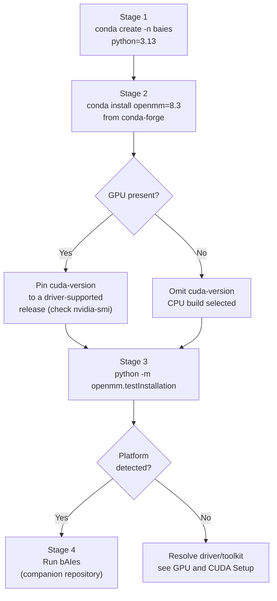

This page walks through the **simulation pipeline** of bAIes-IDP-OpenMM exactly as it is defined in the repository: from provisioning a Python environment, through installing and platform-selecting OpenMM, to hardware verification and the entry point for running bAIes. Because the `main` branch of COSBlab/bAIes-IDP-OpenMM serves as the project's landing repository (installation instructions plus a visual abstract), this walkthrough documents the verifiable pipeline contract in the README and maps each stage to the dedicated Deep Dive pages that cover the implementation internals.

Sources: [README.md](README.md#L1-L13)

## Repository Footprint and Where the Pipeline Lives

The repository contains precisely two artifacts: [README.md](README.md), which carries the title, citation requirements, and installation instructions, and `Visual_Abstract.png`, the graphical summary of the method. This is an intentional split: the landing repository defines *how to enter the pipeline*, while the executable pipeline components are reached via the companion repository referenced in the catalog. The README positions the project as the "OpenMM implementation of bAIes: Atomic resolution ensemble predictions of Intrinsically Disordered [Proteins] using AI structure predictors," with two citations (a Nature Communications article and a BioRxiv preprint) that must accompany any use of the tool.

Sources: [README.md](README.md#L1-L13)

```
bAIes-IDP-OpenMM/
├── README.md            # title, citations, installation instructions (44 lines)
└── Visual_Abstract.png  # graphical abstract of the bAIes method
```


Sources: [README.md](README.md#L3-L5)

## The Pipeline at a Glance

The README defines a **linear four-stage pipeline** with one branching decision. You create an isolated conda environment, install OpenMM from conda-forge (choosing a CUDA build only if a GPU is present), verify that OpenMM sees your hardware, and then run bAIes. The following flowchart is a prerequisite for reading the rest of this page: each node corresponds to a command block in the README, and the two diamond decision nodes reflect the GPU/CPU fork documented at installation time and the pass/fail gate of the verification step.



Sources: [README.md](README.md#L16-L44)

## Stage 1 — Environment Provisioning

The pipeline begins with an isolated conda environment named `baies` pinned to **Python 3.13**. This isolation is the first guardrail of the pipeline: it prevents conflicts between OpenMM's compiled dependencies and anything else in your system Python, and it gives you a clean scope for version pinning in the next stage.

```bash
conda create -n baies python=3.13
conda activate baies
```

| Parameter | Value | Role in the pipeline |
|---|---|---|
| Environment name | `baies` | Isolates all simulation dependencies |
| Interpreter pin | `python=3.13` | Fixes the runtime version for OpenMM 8.x |
| Activation | `conda activate baies` | Scopes subsequent installs and runs |

Sources: [README.md](README.md#L20-L27)

## Stage 2 — Installing OpenMM and Selecting the Compute Platform

The second stage installs the simulation engine itself: **OpenMM 8.3 from the conda-forge channel**, with an optional `cuda-version=13` pin. The README is explicit about the semantics of this pin: it "selects the CUDA build of OpenMM" and must be set to a CUDA version supported by *both* your GPU driver and your OpenMM release, which you check with `nvidia-smi`. On a machine without a GPU, the pin is omitted and the CPU build is installed instead.

```bash
conda install -c conda-forge openmm=8.3 cuda-version=13
```

| Install parameter | Value | Function |
|---|---|---|
| Channel | `-c conda-forge` | Source for the OpenMM builds |
| Engine pin | `openmm=8.3` | Fixes the simulation engine version |
| Build selector | `cuda-version=13` | Selects the CUDA build of OpenMM |
| CPU fallback | omit `cuda-version` | Yields the CPU build |

The fork in this stage is the single most consequential decision in the setup pipeline, because the pin is an *install-time build selector*, not a runtime preference. The comparison below is the complete decision matrix as documented in the README:

| Decision input | GPU path | CPU path |
|---|---|---|
| `cuda-version` pin | Set to a version supported by your driver **and** your OpenMM release (example given: 13) | Omitted entirely |
| Driver check | `nvidia-smi` before installing | Not applicable |
| Resulting build | CUDA build of OpenMM | CPU build of OpenMM |
| Verification (Stage 3) | `python -m openmm.testInstallation` | Same command |

> [!TIP]
> The `cuda-version` pin operates at **install time**: it selects which compiled build of OpenMM conda delivers, and the README requires it to be compatible with both your GPU driver and your OpenMM release. If you later move the campaign to different hardware, the correct move is to reinstall with a different pin — not to reconfigure the running environment.

Sources: [README.md](README.md#L29-L35)

## Stage 3 — Verifying Hardware Visibility

Before any simulation runs, the pipeline inserts a **verification gate**: `python -m openmm.testInstallation`. The README frames this as the check that "OpenMM sees your hardware," which makes it the authoritative confirmation that the Stage 2 build selector actually matches the machine. A passing result validates the entire setup chain (environment → build → platform); a failing result means the pipeline is blocked at the driver/toolkit level and you should consult the dedicated GPU setup page before spending compute time.

```bash
python -m openmm.testInstallation
```

> [!TIP]
> Treat this command as the **hard gate before long ensemble runs**. Because bAIes campaigns generate multi-ensemble trajectories, a platform mismatch discovered after launch wastes far more than the seconds this check takes — run it as the final step of every new environment you build.

Sources: [README.md](README.md#L36-L41)

## Stage 4 — The Run Entry Point

The README's third installation section is the heading "Run bAIes." — and it is the terminal line of the file. Verification of the file confirms it ends at exactly 44 lines, so the executable entry point (scripts, inputs, and driver code for the simulation campaign) is **not shipped in this landing repository**; it is reached through the companion repository. This is a deliberate contract: the landing repo guarantees your environment is correct, while [Companion Repository Resources](4-companion-repository-resources) is the documented route to the runnable pipeline artifacts.

Sources: [README.md](README.md#L43-L44)

## Mapping Pipeline Stages to the Documentation Catalog

With the setup pipeline verified end-to-end, the table below anchors each stage — and the stages that begin once bAIes is running — to its dedicated Deep Dive page. Use it to jump from the walkthrough into implementation internals without re-reading the catalog:

| Pipeline stage | Scope | Dedicated page |
|---|---|---|
| Driver/toolkit provisioning | CUDA build matching | [GPU and CUDA Setup](3-gpu-and-cuda-setup) |
| Runnable pipeline artifacts | Where the code lives | [Companion Repository Resources](4-companion-repository-resources) |
| Ensemble-averaged restraints | Custom force implementation | [Custom Distance Restraint Forces](12-custom-distance-restraint-forces) |
| System construction | Force field and platform assembly | [Force Field and System Preparation](13-force-field-and-system-preparation) |
| Time propagation | Integrator and thermostat choice | [Integrators and Thermostats](14-integrators-and-thermostats) |
| Full campaign execution | Ensemble generation workflow | [End-to-End Ensemble Generation](15-end-to-end-ensemble-generation) |
| Fidelity assurance | Reproducing published results | [Benchmark Simulation Reproduction](16-benchmark-simulation-reproduction) |

Sources: [README.md](README.md#L1-L13), [README.md](README.md#L16-L44)

## Suggested Progression

The natural reading order mirrors the pipeline itself. First resolve hardware questions with [GPU and CUDA Setup](3-gpu-and-cuda-setup), since the Stage 2 `cuda-version` fork depends on your driver. Then locate the runnable artifacts via [Companion Repository Resources](4-companion-repository-resources) to complete Stage 4. With the pipeline running, move into the OpenMM Implementation track — [Custom Distance Restraint Forces](12-custom-distance-restraint-forces), [Force Field and System Preparation](13-force-field-and-system-preparation), and [Integrators and Thermostats](14-integrators-and-thermostats) — before executing a complete campaign through [End-to-End Ensemble Generation](15-end-to-end-ensemble-generation) and validating it against published benchmarks in [Benchmark Simulation Reproduction](16-benchmark-simulation-reproduction).
