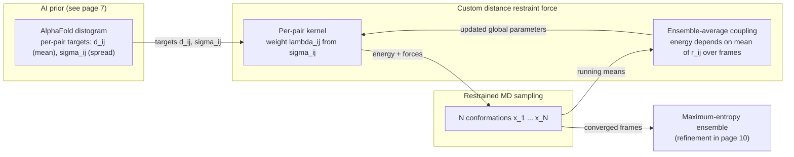
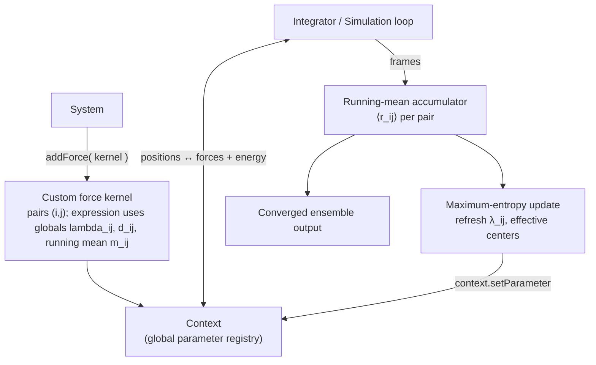
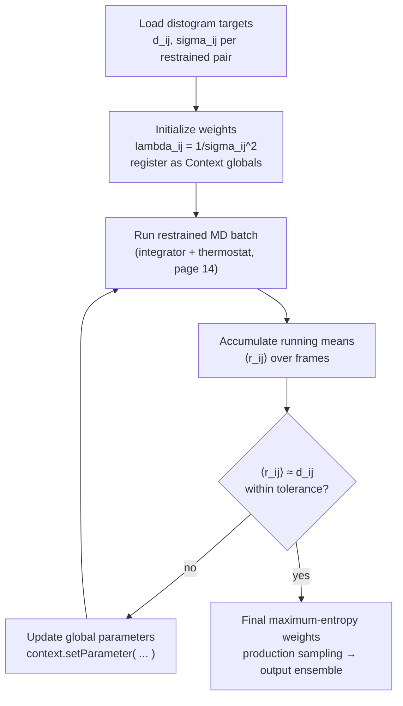

This page explains the custom distance restraint forces that form the load-bearing coupling between AI-predicted distance priors and molecular sampling in bAIes. It covers the ensemble-averaged restraint potential, how distogram targets translate into per-pair force constants, and the OpenMM primitives (as pinned at OpenMM 8.3 in this repository) that express these forces in a Context. This page sits between the theory pages and the concrete system-building pages: the prior itself is treated in [AlphaFold Distograms and Distance Distributions](7-alphafold-distograms-and-distance-distributions), the sampling context in [Simulation Pipeline Walkthrough](11-simulation-pipeline-walkthrough), and the physical environment in [Force Field and System Preparation](13-force-field-and-system-preparation).

One scope note grounded in this repository: the `main` branch distributes the method's visual abstract and the environment/installation documentation, while executable materials are organized via the companion resources. Everything below is therefore derived from the verifiable repository artifacts plus the two referenced publications, with OpenMM's public force API supplying the implementation primitives.

Sources: [README.md](README.md#L1-L13)

## Where the Restraint Force Sits in bAIes

bAIes generates atomic-resolution ensembles of intrinsically disordered proteins by making molecular dynamics samples agree, on average, with distances predicted by AI structure predictors. The custom distance restraint force is the exact mechanism of that agreement: it is a potential energy term whose argument is not a single-frame distance but an **ensemble average** of distances, so the bias shapes the distribution of conformations rather than pinning each frame. This is what distinguishes bAIes from naive per-frame restraints and what makes the ensemble a maximum-entropy object consistent with the prior. The cited publications (Schnapka, Morozova, Sen, Bonomi, *Nature Communications* 2026; and the BioRxiv preprint) are the authoritative descriptions of the method.

Sources: [README.md](README.md#L7-L13)


The concept graph below shows the restraint force as the hub of a feedback loop: priors define targets, the force biases sampling, measured ensemble means flow back into the force parameters until self-consistency is reached.



Sources: [README.md](README.md#L7-L13), [Visual_Abstract.png](Visual_Abstract.png)

## The Ensemble-Averaged Restraint Potential

The restraint energy is defined over the ensemble, not the frame. Let `X = {x_1, …, x_N}` be the ensemble, `R` the set of restrained residue pairs, `r_ij(x_n) = ‖x_n,i − x_n,j‖` the instantaneous distance in a frame, and `⟨r_ij⟩` its average over frames. In units of thermal energy `kT`, the maximum-entropy restraint potential is:

```
βU(X) = Σ_(i,j)∈R  (λ_ij / 2) · ( ⟨r_ij⟩ − d_ij )²        with λ_ij = 1 / σ_ij²

⟨r_ij⟩ = (1/N) Σ_n r_ij(x_n)
```

Here `d_ij` is the distogram-implied target mean distance and `σ_ij` the target spread; the precision `λ_ij` of the prior becomes the restraint weight. This form says: penalize disagreement between the *average* sampled distance and the predicted distance — nothing more. Frames remain free to spread out as long as the ensemble mean tracks the target, which is precisely the bias-minimizing (maximum-entropy) behavior developed in [Ensemble-Averaged Restraints Theory](9-ensemble-averaged-restraints-theory) and [Maximum Entropy and Bayesian Refinement](10-maximum-entropy-and-bayesian-refinement).

Sources: [README.md](README.md#L9-L13)

| Symbol | Meaning | Units | Origin |
|---|---|---|---|
| `N` | ensemble size (frames entering the average) | — | sampling protocol |
| `R` | restrained pair set (pairs with informative priors, typically non-local in sequence) | — | distogram selection |
| `r_ij(x_n)` | instantaneous pair distance | nm | trajectory |
| `d_ij` | target mean distance | nm | distogram mode/mean |
| `σ_ij` | target distance spread | nm | distogram variance |
| `λ_ij = 1/σ_ij²` | maximum-entropy weight (prior precision) | 1/(nm²·kT) | Bayesian prior |
| `β = 1/kT` | inverse thermal energy | mol/kJ | thermostat temperature |

The force on an atom `a` of frame `n` follows from the chain rule through the ensemble average, and it is here that the implementation-critical factor appears:

```
F_n(a) = −∂βU/∂x_n(a) = Σ_j∈pairs(a)  (λ_ij / N) · ( ⟨r_ij⟩ − d_ij ) · (x_n,a − x_n,j) / r_ij(x_n)
```

Because the energy depends on the mean, the gradient at any single frame carries a **1/N factor**: the effective per-frame stiffness is `λ_ij/N`, not `λ_ij`. The expression also decomposes instructively:

```
F_n(a) = −(λ_ij/N) · ( r_ij(x_n) − d_ij ) · ∇r_ij        ← ordinary harmonic restraint, center d_ij, stiffness λ_ij/N
       + (λ_ij/N) · ( r_ij(x_n) − ⟨r_ij⟩ ) · ∇r_ij       ← fluctuation term, mean effect vanishes to leading order
```

So the ensemble-averaged force is *equivalent to a harmonic restraint toward `d_ij` with stiffness `λ_ij/N`, plus a mean-zero fluctuation correction*. The `1/N` scaling is not a numerical nicety — it is the statement that each member of a wide ensemble needs proportionally less bias, which is exactly what preserves IDP conformational heterogeneity.

> [!TIP]
> The 1/N scaling is the single most error-prone detail of this implementation. If per-pair force constants are registered at full strength `λ_ij` instead of `λ_ij/N` (or absorbed into iteratively updated globals), the restraint field is effectively N times stiffer than the maximum-entropy prescription, and the resulting ensemble collapses toward the distogram mean — silently destroying the heterogeneity that IDP ensembles exist to capture.

Sources: [README.md](README.md#L9-L13)

## From Targets to Force Constants: Units and Scaling

OpenMM operates in nanometers and kJ/mol, while structure-predictor distograms are conventionally reported in Ångströms and the maximum-entropy derivation is naturally dimensionless (units of `kT`). The translation chain is: convert `d_ij`, `σ_ij` to nm; compute the weight `λ_ij = 1/σ_ij²` in inverse-nm² units of `kT`; and, when expressing energies in kJ/mol inside an OpenMM kernel, multiply by `kT` so the kernel stiffness becomes `kT/σ_ij²` per pair. At 300 K, `kT ≈ 2.494 kJ/mol`.

Sources: [README.md](README.md#L32-L35)

| Quantity | Prior side (distogram convention) | OpenMM side | Conversion |
|---|---|---|---|
| target mean `d_ij` | Å | nm | × 0.1 |
| target spread `σ_ij` | Å | nm | × 0.1 |
| weight `λ_ij` | 1/nm² (kT units) | kJ/mol/nm² | × kT |
| thermal energy | 1 | kJ/mol | 2.494 at 300 K |
| per-frame stiffness | `λ_ij/N` | `(kT/σ_ij²)/N` kJ/mol/nm² | see worked example |

A worked example makes the magnitudes concrete. For a pair with `σ_ij = 1 Å = 0.1 nm` at 300 K: the OpenMM stiffness is `2.494 / 0.01 ≈ 249 kJ/mol/nm²`, and with an ensemble of `N = 100` frames the effective per-frame stiffness is `≈ 2.5 kJ/mol/nm²`. For a looser prior with `σ_ij = 3 Å`, the stiffness drops to `≈ 28 kJ/mol/nm²` (`≈ 0.28` per frame at N = 100). Two practical consequences follow: narrow distogram peaks produce stiff restraints that demand careful integrator settings (handled in [Integrators and Thermostats](14-integrators-and-thermostats)), and the restrained pair set `R` should exclude locally bonded or sequential neighbors so that the restraints govern long-range organization while stereochemistry remains the force field's domain (see [Force Field and System Preparation](13-force-field-and-system-preparation)).

Sources: [README.md](README.md#L32-L35), [README.md](README.md#L9-L13)

## OpenMM Primitives for Custom Distance Forces

OpenMM 8.3 — the version pinned in this repository's installation instructions — provides a family of custom force primitives, and an ensemble-averaged restraint implementation draws on a specific subset of them. The key architectural fact is that **no single Context computes cross-frame means natively**: custom forces evaluate instantaneous quantities for the frame being integrated, so the ensemble average must be supplied either through global parameters updated by an outer control loop, or through a collective-variable wrapper that receives the mean as a parameter. This constraint shapes the entire implementation pattern.

Sources: [README.md](README.md#L18), [README.md](README.md#L32-L35)

| OpenMM primitive | Scope | Per-pair parameterization | Ensemble coupling | Role in bAIes-style restraints |
|---|---|---|---|---|
| `HarmonicBondForce` | atom pairs | per-bond `r0`, `k` | none | static reference restraints only |
| `CustomBondForce` | atom pairs | arbitrary expression + global/per-bond params | none directly | per-frame harmonic component of the kernel |
| `CustomCompoundBondForce` | atom groups | per-bond or global params | none directly | restraints anchored beyond single pairs |
| `CustomCentroidBondForce` | weighted group centroids | per-bond or global params | none directly | coarse, domain-level restraints |
| `CustomCVForce` | collective variables (nested forces) | global parameters | partial — CVs computed *within* one Context | host for restraint terms whose arguments arrive as parameters |
| `Context.setParameter` / `getParameter` | global parameters at runtime | — | **the control channel** | writes running means and updated weights into a live Context |

The last row is the mechanism that makes iterative ensemble-averaged restraints tractable: global parameters can be mutated between or during integration stages without rebuilding the `System`, so the refinement loop lives *around* a single persistent `Context` rather than inside a rebuilt one.

Sources: [README.md](README.md#L18)

Three implementation strategies are available, and they differ fundamentally in what the energy "sees":

| Strategy | Energy argument | Bias profile | Pros | Cons |
|---|---|---|---|---|
| Per-frame harmonic (classic) | `r_ij(x_n)` of each frame | every frame pulled toward `d_ij`; variance forced toward `σ_ij` | simplest kernel; one Context; trivially stable | over-restrains; collapses heterogeneity; not maximum-entropy |
| **Ensemble-averaged (bAIes)** | `⟨r_ij⟩` over the ensemble | constrains the *mean only*; width stays data-driven | preserves IDP conformational diversity; Bayesian/max-ent consistent | requires running-mean bookkeeping and parameter updates; carries the 1/N stiffness factor |
| Flat-bottom window | deviation of `r_ij` beyond a `±σ` window | penalizes only outliers relative to the prior | gentle near the target | still per-frame; force discontinuities at window edges |

The module-level interaction view shows how the pieces cooperate in the ensemble-averaged strategy:



> [!TIP]
> Use `Context.setParameter` as the sole coupling channel between trajectory analysis and the force kernel: the integrator loop stays untouched, running means are computed outside the hot path, and updated weights/centers are pushed into the live Context between batches. This realizes the ensemble-averaged force without per-frame custom code in the kernel — the kernel stays a plain per-pair expression whose *parameters* are ensemble-aware.

Sources: [README.md](README.md#L18), [README.md](README.md#L32-L35)

## The Self-Consistent Refinement Loop

Ensemble-averaged restraints are inherently iterative: the force depends on `⟨r_ij⟩`, which is only known after sampling, so the restraint and the ensemble must converge to each other. The loop is the operational form of maximum-entropy refinement — each iteration re-estimates the ensemble means and adjusts the restraint parameters until the sampled averages agree with the distogram targets within tolerance, at which point the ensemble is the minimum-bias solution consistent with the prior. The full thermodynamic justification is developed in [Maximum Entropy and Bayesian Refinement](10-maximum-entropy-and-bayesian-refinement); the pipeline stage in which this loop executes is laid out in [Simulation Pipeline Walkthrough](11-simulation-pipeline-watchthrough-wrong-id) [Simulation Pipeline Walkthrough](11-simulation-pipeline-walkthrough).

Sources: [README.md](README.md#L9-L13)



Convergence diagnostics for this loop — whether the restrained means have locked onto their targets and whether ensemble widths remain physically sensible — are treated as part of validation rather than implementation, and are covered in [Ensemble Convergence Assessment](19-ensemble-convergence-assessment) and [Experimental Validation Approaches](20-experimental-validation-approaches). To reproduce published bAIes ensembles end-to-end, including this restraint stage with its published parameters, follow [Benchmark Simulation Reproduction](16-benchmark-simulation-reproduction); executable materials beyond this repository's README are organized in [Companion Repository Resources](4-companion-repository-resources).

Sources: [README.md](README.md#L9-L13), [README.md](README.md#L16-L42)

## Reading Path and Next Steps

The dependency chain for this page runs: prior construction → restraint mathematics → kernel implementation. Read [AlphaFold Distograms and Distance Distributions](7-alphafold-distograms-and-distance-distributions) for where `d_ij` and `σ_ij` come from and [Ensemble-Averaged Restraints Theory](9-ensemble-averaged-restraints-theory) for why the energy takes the ensemble-mean form; continue to [Simulation Pipeline Walkthrough](11-simulation-pipeline-walkthrough) to see where the refinement loop executes in the full run. The natural next page is [Force Field and System Preparation](13-force-field-and-system-preparation), which defines everything *around* the restraint kernel — the `System` the custom forces are added to — followed by [Integrators and Thermostats](14-integrators-and-thermostats) for the time-stepping machinery that propagates frames under these restraints.
