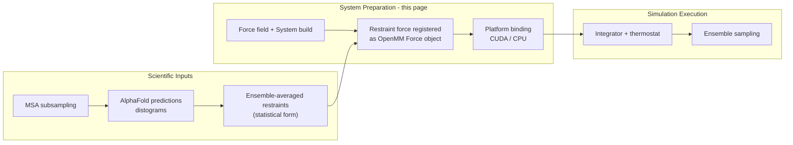
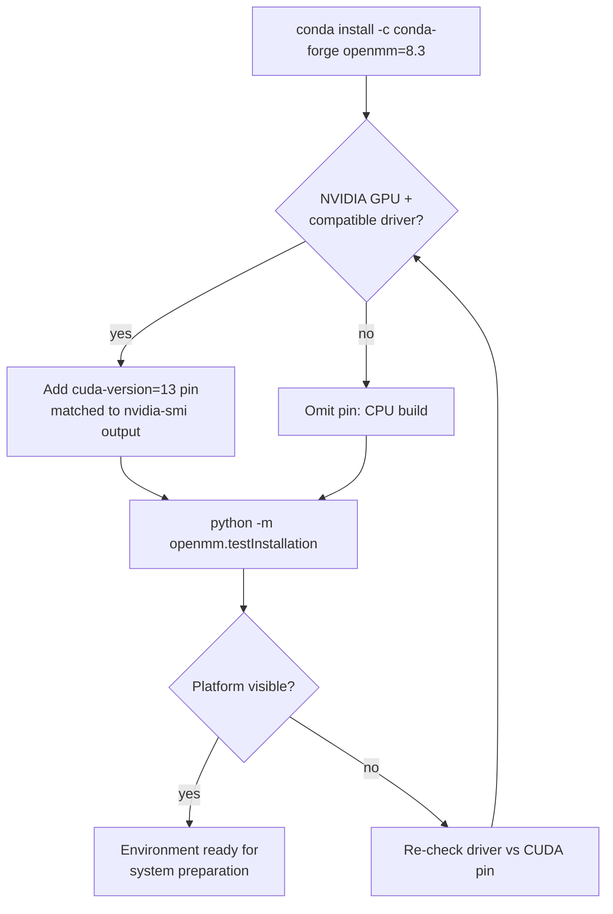
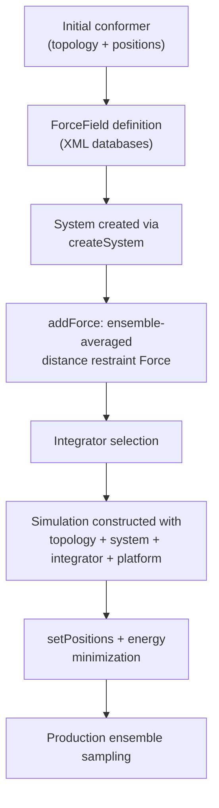

This page documents the **force field and system preparation** stage of the bAIes OpenMM implementation: the point in the pipeline where the physical model of the protein, the ensemble-averaged restraints, and the execution hardware are fused into a single OpenMM `System` object. Because this repository serves as the project landing page — its root contains only `README.md` and `Visual_Abstract.png` — the concrete force field XML definitions and preparation scripts live in the companion repository. What is fully verifiable here is the **pinned runtime contract** that every prepared system depends on, and this page documents that contract alongside the canonical OpenMM system assembly sequence the implementation follows.

Sources: [README.md](README.md#L1-L7), [README.md](README.md#L16-L18)

## Where System Preparation Sits in the bAIes Pipeline

The README defines bAIes in one sentence: *"OpenMM implementation of bAIes: Atomic resolution ensemble predictions of Intrinsically Disordered using AI structure predictors"* — meaning the pipeline converts AI-structure-predictor outputs (distograms, MSA-subsampled predictions) into physically sampled atomic-resolution ensembles. System preparation is the architectural bridge between these two worlds: upstream scientific inputs are statistical (distance distributions, ensemble-averaged restraints), while downstream execution demands a concrete OpenMM `System` with forces, particles, and a bound hardware platform. Preparation is where the statistical model **becomes** a physical potential.



| Pipeline stage | Concern | Catalog deep-dive |
|---|---|---|
| Upstream: MSA subsampling → distograms | Statistical distance distributions | [AlphaFold Distograms and Distance Distributions](7-alphafold-distograms-and-distance-distributions), [MSA Subsampling Strategy](8-msa-subsampling-strategy) |
| Restraint formulation | Ensemble-averaged potential theory | [Ensemble-Averaged Restraints Theory](9-ensemble-averaged-restraints-theory) |
| **System preparation (this page)** | Force field, `System` assembly, platform binding | — |
| Restraint force implementation | Custom `Force` subclass internals | [Custom Distance Restraint Forces](12-custom-distance-restraint-forces) |
| Downstream: integration | Thermostat and integrator selection | [Integrators and Thermostats](14-integrators-and-thermostats) |

Sources: [README.md](README.md#L7), [README.md](README.md#L9-L13)

## The Pinned Runtime Contract

The README's installation philosophy is deliberately minimal: *"To run bAIes with OpenMM, you just need a python environment with OpenMM installed."* No external molecular-mechanics toolchain is declared as a dependency. This has a direct consequence for force field handling: parameter resolution is delegated entirely to OpenMM's own `ForceField` machinery — its bundled XML force field databases and any XMLs supplied by the bAIes code base. The concrete force field file identifiers used by bAIes are defined in the companion repository, not in this landing repo.

| Component | Pinned value | Declared role | Source |
|---|---|---|---|
| Python | `python=3.13` | Base environment | [README.md](README.md#L20-L27) |
| OpenMM | `openmm=8.3` | Simulation engine, `ForceField`, `System` API | [README.md](README.md#L29-L33) |
| CUDA build pin | `cuda-version=13` | Selects the CUDA build of OpenMM | [README.md](README.md#L31-L35) |
| Package channel | `-c conda-forge` | Package source | [README.md](README.md#L31-L33) |

These pins are not incidental hygiene — they are part of the reproducibility contract. `System` construction behavior (API surface, platform availability, default units and constraints handling) is version-dependent, so the exact OpenMM release used during system preparation must match the release used during production sampling. The Reproducibility Workflows section of this catalog ([Benchmark Simulation Reproduction](16-benchmark-simulation-reproduction)) depends on this pin being honored.

Sources: [README.md](README.md#L16-L35)

## Hardware Binding: Choosing the CUDA or CPU Build

The `cuda-version=13` pin in the install command does something subtle that intermediate developers frequently misread: it selects **which build artifact of OpenMM conda installs**, not which driver your machine runs. The README states the contract explicitly: the pin must be set *"to a CUDA version that is supported by both your GPU driver and your OpenMM release (check with `nvidia-smi`)"*. Omitting the pin yields the CPU build instead. Because a prepared `Simulation` object is constructed with an explicit `Platform`, this build choice is made **before** system preparation ever runs — it determines which platforms are visible to `Platform.getPlatformByName`.



| Build variant | Install modifier | When to choose | Verification |
|---|---|---|---|
| CUDA build | `cuda-version=13` (or driver-compatible version) | GPU-accelerated ensemble sampling — the intended production path for IDP ensembles | `python -m openmm.testInstallation` reports CUDA platform |
| CPU build | omit `cuda-version` | Machines without a GPU, as stated in the README | `python -m openmm.testInstallation` reports CPU platform |

> [!TIP]
> The `cuda-version=13` pin is a **build selector**, not a driver guarantee. The README's compatibility rule requires the pin to satisfy *two* constraints simultaneously — your installed GPU driver (check `nvidia-smi`) *and* the supported range of OpenMM 8.3. A mismatch produces an environment where `testInstallation` succeeds but the CUDA platform is unusable at `Simulation` construction time.

For full driver installation and platform troubleshooting, see [GPU and CUDA Setup](3-gpu-and-cuda-setup).

Sources: [README.md](README.md#L29-L41)

## Anatomy of the OpenMM System Assembly Sequence

Within OpenMM 8.x, system preparation is a strictly ordered assembly of five artifacts. The bAIes implementation follows this canonical sequence; the ordering is not stylistic — OpenMM's API requires it, because every component is baked into an immutable `Context` at `Simulation` construction.



| Stage | OpenMM object | Responsibility in bAIes | Deep-dive page |
|---|---|---|---|
| 1. Molecular definition | `PDBFile` / `Topology` | Atom graph and initial coordinates of the disordered chain | [Simulation Pipeline Walkthrough](11-simulation-pipeline-walkthrough) |
| 2. Force field resolution | `ForceField` | Maps topology to bonded/nonbonded parameters | Companion repository ([Companion Repository Resources](4-companion-repository-resources)) |
| 3. System materialization | `System` (`createSystem`) | Particle masses, exceptions, nonbonded settings | — |
| 4. Restraint registration | `System.addForce(...)` | Injects the ensemble-averaged distance restraint as a `Force` | [Custom Distance Restraint Forces](12-custom-distance-restraint-forces) |
| 5. Time propagation engine | `Integrator` | Thermostat and timestep for ensemble sampling | [Integrators and Thermostats](14-integrators-and-thermostats) |
| 6. Hardware binding | `Simulation` + `Platform` | Freezes the full model onto CUDA or CPU | This page, Hardware Binding section |

The assembly contract, illustrative of the OpenMM API surface this implementation uses (concrete force field XML identifiers, restraint parameters, and thermostat settings are defined in the companion repository):

```python
from openmm.app import PDBFile, ForceField, Simulation, HBonds, NoCutoff
from openmm import unit, LangevinMiddleIntegrator
from openmm.platform import Platform

pdb = PDBFile("idp_conformer.pdb")
forcefield = ForceField(/* force field XMLs — defined in companion repo */)

# Stage 3: System materialization
system = forcefield.createSystem(pdb.topology,
                                 nonbondedMethod=NoCutoff,
                                 constraints=HBonds)

# Stage 4: Ensemble-averaged restraint becomes part of the physical model
system.addForce(build_baies_restraint_force())   # Custom Force subclass

# Stages 5-6: propagation engine + hardware binding
integrator = LangevinMiddleIntegrator(300*unit.kelvin,
                                      1/unit.picosecond,
                                      0.004*unit.picoseconds)
platform = Platform.getPlatformByName("CUDA")    # or "CPU" build
simulation = Simulation(pdb.topology, system, integrator, platform)
simulation.context.setPositions(pdb.positions)
simulation.minimizeEnergy()
```

> [!TIP]
> Forces **must** be registered via `system.addForce()` *before* the `Simulation`/`Context` is constructed. A `Context` snapshots the system's force field at creation; there is no supported path to inject the bAIes restraint force into a live context. This makes system preparation the single point where the physical model — protein force field plus AI-derived restraints — is permanently frozen for the run.

Sources: [README.md](README.md#L7), [README.md](README.md#L16-L18), [README.md](README.md#L43-L44)

## IDP-Specific Preparation Considerations

Two properties of the bAIes method, stated in the README's one-line description, directly shape how system preparation differs from conventional single-structure MD setup. First, bAIes produces *ensembles* from *AI structure predictors*: the restraint potential encodes **ensemble-averaged** statistics rather than per-conformation distances. In preparation terms, this means the restraint enters as an OpenMM `Force` object during `System` assembly (stage 4 above) — the point where distogram-derived statistics are converted into a differentiable physical potential. The statistical justification is covered in [Ensemble-Averaged Restraints Theory](9-ensemble-averaged-restraints-theory); the force mechanics in [Custom Distance Restraint Forces](12-custom-distance-restraint-forces).

Second, the prepared `System` is the **reusable engine** for ensemble generation: because restraints are ensemble-averaged, the same force field + restraint configuration propagates many trajectory members, so preparation cost is amortized across the full ensemble rather than repeated per conformer. This is what makes the end-to-end workflow in [End-to-End Ensemble Generation](15-end-to-end-ensemble-generation) practical.

Sources: [README.md](README.md#L7), [README.md](README.md#L9-L13)

## Pre-Flight Verification Checklist

Before any prepared `System` is trusted for production sampling, the README prescribes a short verification sequence. Note that the README's final section, `### 3. Run bAIes.` (line 43), currently contains no inline run instructions — the runnable entry points ship with the code in the companion repository.

| Check | Command / expectation | Source |
|---|---|---|
| Environment active | `conda activate baies` (Python 3.13 environment exists) | [README.md](README.md#L20-L27) |
| OpenMM present at pinned version | `openmm=8.3` installed from conda-forge | [README.md](README.md#L29-L33) |
| Hardware visibility | `python -m openmm.testInstallation` lists expected platform(s) | [README.md](README.md#L37-L41) |
| Driver/CUDA pin coherence | `nvidia-smi` version compatible with `cuda-version=13` | [README.md](README.md#L31-L35) |
| Citation attribution | References loaded for use in derived publications | [README.md](README.md#L9-L13) |

Sources: [README.md](README.md#L20-L44)

## Reading Progression

Within the *OpenMM Implementation* track, the natural flow is: **[Simulation Pipeline Walkthrough](11-simulation-pipeline-walkthrough)** for the end-to-end execution sequence, then **[Custom Distance Restraint Forces](12-custom-distance-restraint-forces)** for the internals of stage 4 above, then **[Integrators and Thermostats](14-integrators-and-thermostats)** for stage 5. To obtain the actual force field definitions and preparation scripts referenced throughout this page, see **[Companion Repository Resources](4-companion-repository-resources)**. For the statistical foundations that motivate the restraint registered during preparation, work through **[Ensemble-Averaged Restraints Theory](9-ensemble-averaged-restraints-theory)**; for platform-level troubleshooting, see **[GPU and CUDA Setup](3-gpu-and-cuda-setup)**; and to observe the prepared system in a reproducible production run, continue to **[Benchmark Simulation Reproduction](16-benchmark-simulation-reproduction)**.
