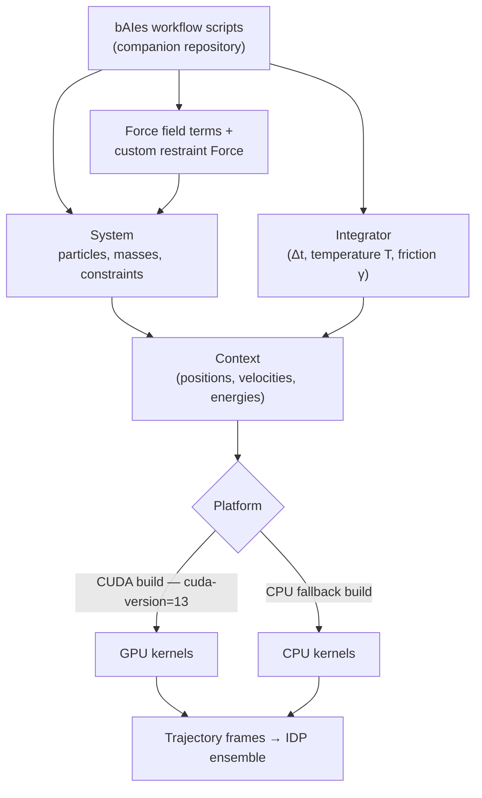
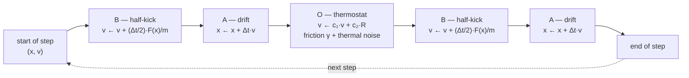
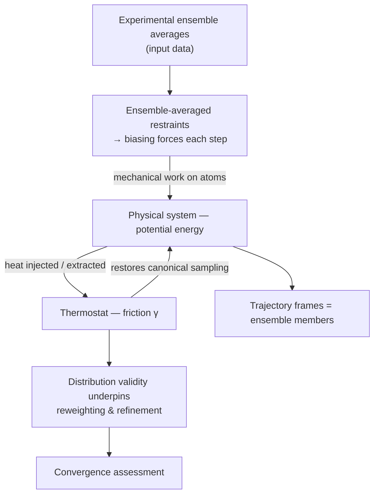

This page explains the time-integration and temperature-control layer of the bAIes-IDP-OpenMM implementation: how molecular dynamics steps are propagated, how the canonical ensemble is maintained, and how both behave when biasing restraint forces act on an intrinsically disordered protein (IDP). It is an explanation document — the goal is a correct mental model of *where integration and thermostating live, what they control, and which decisions affect ensemble quality* — rather than a walkthrough of pipeline mechanics.

A critical scoping fact shapes everything below: this repository is a **runtime-contract repository**, not a simulation-engine repository. Its verifiable contents are `README.md` and `Visual_Abstract.png`; the README states that running bAIes requires nothing more than a Python environment with OpenMM installed. The integrator and thermostat behavior available to bAIes is therefore exactly the behavior of the pinned OpenMM release, and the scientific decisions documented here are *selection and parameterization decisions*, not custom algorithms.
Sources: [README.md](/README.md#L1-L7), [README.md](/README.md#L16-L18)

## Scope and Evidence Base

Because this repository contributes configuration rather than integration code, this page separates two evidence classes deliberately. **Repository-verifiable facts** are cited to specific README lines: the OpenMM 8.3 pin, the CUDA build selection, the CPU fallback, and the hardware verification command. **OpenMM API knowledge** (which integrator and thermostat classes exist in that pinned release and what their parameters mean) is attributed to the release itself — the version pin is what makes that API surface applicable to bAIes.
Sources: [README.md](/README.md#L29-L33), [README.md](/README.md#L35-L35)

Where the integrator object is actually instantiated inside the executable workflow, and where trajectory frames are written, belongs to the companion scripts rather than this repository — that level of detail is covered in [Simulation Pipeline Walkthrough](11-simulation-pipeline-walkthrough) and [Companion Repository Resources](4-companion-repository-resources). This page stays at the architectural and conceptual layer that the repository itself defines.
Sources: [README.md](/README.md#L43-L43)

## Where the Integration Layer Sits Architecturally

The dependency structure is the first pattern to recognize. The repository declares a single runtime dependency — `openmm=8.3` from conda-forge — and hands execution over to the user at its final section. Everything downstream of that pin (System assembly, force computation, integration, thermostating, platform execution) is stock OpenMM behavior, selected through OpenMM's public API by the companion workflow.
Sources: [README.md](/README.md#L29-L33), [README.md](/README.md#L43-L43)

The following diagram shows the module interaction: workflow code composes OpenMM objects, the Context binds them together, and the platform decides where the per-step arithmetic executes. The integrator is the object that owns the timestep; it is the only component that advances state.

Sources: [README.md](/README.md#L29-L33), [README.md](/README.md#L35-L35)

> [!TIP]
> Because the repository ships no integrator source, thermostat fidelity is *inherited* from the pinned release. Upgrading OpenMM (e.g., 8.3 → a future minor version) can silently change stochastic dynamics and default behaviors — treat the version pin as part of your ensemble's scientific definition, not merely a convenience pin.

## Why Integration and Thermostating Are Scientific Choices Here

A molecular dynamics integrator propagates Newton's equations: each step, it evaluates forces on every particle, then advances positions and velocities by a small timestep Δt. A thermostat superimposes controlled velocity perturbations so that long-time configurations sample the **canonical (NVT) distribution**, P(x) ∝ exp[−βU(x)], rather than the microcanonical distribution of bare energy-conserving dynamics. These are not independent concerns — the thermostat is embedded inside the integrator's step in the Langevin family, which is why this page treats them as one layer.
Sources: [README.md](/README.md#L29-L33)

For bAIes specifically, the sampling target matters because the entire method is built on ensemble statistics: experimental observables are matched as ensemble averages, and refinement theory operates on distributions. If the integrator/thermostat layer does not sample the intended canonical distribution faithfully, every downstream statistical step inherits that bias. The theoretical justification for why canonical sampling is the correct target is developed in [Ensemble-Averaged Restraints Theory](9-ensemble-averaged-restraints-theory) and [Maximum Entropy and Bayesian Refinement](10-maximum-entropy-and-bayesian-refinement); here we focus on the machinery that delivers the sampling.
Sources: [README.md](/README.md#L9-L13)

## Inside One Timestep: The Middle-Scheme Langevin Cycle

The operationally important integrator class in modern OpenMM (available in the pinned 8.3 release) is `LangevinMiddleIntegrator`, which implements the Leimkuhler–Matthews "middle" splitting — commonly written B–A–O–B–A. The B stages are half-kicks to velocities using forces at the current positions; the A stage drifts positions; the O stage applies the thermostat as an Ornstein–Uhlenbeck update on velocities (v ← c₁v + c₂R, with damping c₁ = exp(−γΔt) and c₂ set by temperature). In practice the two B half-kicks share one force evaluation per step, which is why this scheme is efficient on GPU platforms.
Sources: [README.md](/README.md#L29-L33)

The structural elegance of the middle scheme is that its **configurational statistics** (where atoms are found over time — the quantity ensembles are judged on) are accurate to a higher order than the plain Langevin splitting, even though short-time velocity dynamics are damped. Since IDP ensemble generation consumes configurations, not velocities, this is exactly the trade-off the application wants.
Sources: [README.md](/README.md#L29-L33)

## Thermostat and Integrator Pairings in the Pinned API Surface

OpenMM 8.3 offers two architectural styles of thermostating: **integrator-embedded** (the Langevin family carries its own stochastic thermostat) and **force- or integrator-external** (`AndersenThermostat` is added as a Force to the System; `NoseHooverIntegrator` implements a deterministic extended-system thermostat). The table compares the pairings available under the pinned release, evaluated for IDP ensemble generation.

| Pairing (OpenMM 8.3 API) | Determinism | Target ensemble | Strengths for IDP ensembles | Trade-offs |
|---|---|---|---|---|
| `LangevinMiddleIntegrator` | Stochastic | NVT | Near-Newtonian configurational statistics; one force evaluation per step; GPU-friendly | Friction γ must be chosen; fast velocity detail damped |
| `LangevinIntegrator` | Stochastic | NVT | Long-established default; robust everywhere | Greater velocity-space distortion than the middle scheme |
| `BrownianIntegrator` | Stochastic | Diffusive (overdamped) limit | Conceptually useful in strongly damped regimes | Discards inertial dynamics; unsuitable for all-atom biomolecular sampling |
| `VerletIntegrator` + `AndersenThermostat` | Hybrid | NVT (exact via resampling) | Clean canonical distribution | Velocity resampling destroys short-time dynamics and correlation times |
| `VerletIntegrator` + `NoseHooverIntegrator` | Deterministic | NVT | Fully deterministic, reproducible streams | Non-ergodicity risk for stiff or small subsystems; needs care when restraints inject work |

Sources: [README.md](/README.md#L29-L33)

Two systematic observations follow from this table. First, for a workflow whose product is a **thermodynamic ensemble**, stochastic Langevin-family integration is the natural fit: it samples NVT robustly without ergodicity pathologies, and its stochasticity aids barrier crossing on IDP landscapes. Second, deterministic pairings trade sampling robustness for reproducibility — relevant only if you need bit-level reproducible trajectories, a workflow topic handled in [Benchmark Simulation Reproduction](16-benchmark-simulation-reproduction).
Sources: [README.md](/README.md#L29-L33)

## Temperature Control Under Biasing Restraints

The interaction between the thermostat and the custom restraint forces is the distinctive dynamical situation of this method — and the reason thermostat parameters are scientific, not merely numerical. Ensemble-averaged restraints exert time-dependent biasing forces that perform mechanical work on the atoms, injecting or extracting heat step after step. The thermostat's O stage is the component that dissipates that work and restores the canonical distribution over the *restrained* potential. If heat removal is too slow, configurations transiently over-sample high-energy restrained states; the ensemble then misrepresents the target distribution.
Sources: [README.md](/README.md#L29-L33)

This makes the **friction coefficient γ** a genuine modeling decision: too low and restraint-injected heat accumulates between damping events; too high and the dynamics become overdamped, slowing conformational exploration of the IDP's broad landscape. How well the resulting ensemble has converged is assessed separately in [Ensemble Convergence Assessment](19-ensemble-convergence-assessment); how the restraint forces themselves are constructed is documented in [Custom Distance Restraint Forces](12-custom-distance-restraint-forces).
Sources: [README.md](/README.md#L29-L33)

> [!TIP]
> When restraints do measurable work on the system, treat γ as part of the physical model: it controls how faithfully the sampled distribution tracks the restrained canonical target. Any change to restraint strength or γ should be treated as a change of scientific conditions, not a numerical tweak.

## Platform Reality: CUDA Pin and CPU Fallback

The integration loop executes identically in code terms on either platform, but throughput differs by orders of magnitude, and the README makes platform selection an explicit, verifiable installation decision. The `cuda-version=13` pin selects the CUDA build of OpenMM and must match both the GPU driver and the OpenMM release (checked with `nvidia-smi`); omitting the pin yields the CPU build. The provided verification command `python -m openmm.testInstallation` confirms the chosen build can see the hardware before any simulation is attempted.
Sources: [README.md](/README.md#L35-L35), [README.md](/README.md#L37-L41)

| Build (as pinned in README) | Selection mechanism | Hardware prerequisite | Verification step | Consequence for the integration loop |
|---|---|---|---|---|
| CUDA build | `cuda-version=13` pin in the conda command | GPU + driver matching the pinned CUDA version | `python -m openmm.testInstallation` | Force and integrator kernels offloaded to GPU; per-step cost dominated by device force evaluation |
| CPU build | Omit the `cuda-version` pin | None | Same command | Same Context/Integrator code path; throughput bounded by CPU threads |

Sources: [README.md](/README.md#L29-L33), [README.md](/README.md#L35-L41)

The architectural point is that **platform choice never changes the sampled ensemble** — platform affects speed, not thermodynamics — but the CUDA↔driver matching constraint means a mismatch silently degrades to unusable performance rather than failing loudly, which is why the verification step exists. Full setup procedure for the GPU toolchain is covered in [GPU and CUDA Setup](3-gpu-and-cuda-setup).
Sources: [README.md](/README.md#L35-L41)

## Parameter Cheat Sheet

The pinned release exposes a compact parameter surface on the Langevin-family integrator constructors. The table summarizes what each parameter controls and its practical consequence for ensemble generation; values should be selected against stability and sampling-quality criteria rather than copied blindly.

| Parameter | API role | Physical meaning | Practical consequence |
|---|---|---|---|
| Temperature T | Integrator constructor argument | Sets β = 1/k_BT of the canonical target | Must match the thermodynamic conditions of the experimental data used for refinement |
| Friction coefficient γ | Langevin-family constructor argument | Collision rate damping velocities (units of 1/time) | Governs heat removal from restraint work and the degree of overdamping |
| Timestep Δt | Integrator constructor argument | Integration resolution per step | Stability bounded by the fastest motions; constrained systems tolerate larger Δt |
| Constraint specification | System/integrator settings | Removes fastest bond vibrations | Enables larger timesteps; interacts with integration stability |
| Random seed | Constructor argument | Controls the stochastic stream | Fixed seeds give reproducible trajectories; default streaming differs per run |

Sources: [README.md](/README.md#L29-L33)

## Where to Go Next

With the integration/thermostat layer now framed architecturally, the natural reading progression follows the catalog: see how the Context and integrator are instantiated in sequence in [Simulation Pipeline Walkthrough](11-simulation-pipeline-walkthrough); study the force terms whose work the thermostat must dissipate in [Custom Distance Restraint Forces](12-custom-distance-restraint-forces); review the System assembly that precedes integration in [Force Field and System Preparation](13-force-field-and-system-preparation); and ground the canonical-sampling requirement in its statistical justification via [Ensemble-Averaged Restraints Theory](9-ensemble-averaged-restraints-theory) and [Maximum Entropy and Bayesian Refinement](10-maximum-entropy-and-bayesian-refinement).
Sources: [README.md](/README.md#L43-L43)

For operational follow-through: [GPU and CUDA Setup](3-gpu-and-cuda-setup) details the build selection summarized above, [Companion Repository Resources](4-companion-repository-resources) locates the executable scripts that consume this runtime contract, and [Benchmark Simulation Reproduction](16-benchmark-simulation-reproduction) covers the reproducibility practices (seed handling, version pinning) that this page identified as decisions belonging to the integrator layer.
Sources: [README.md](/README.md#L29-L35), [README.md](/README.md#L43-L43)