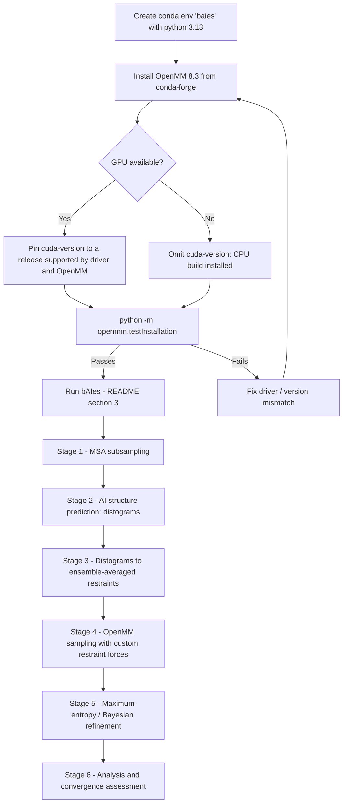
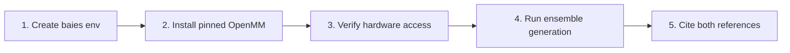

This page is the reproducibility playbook for **bAIes-IDP-OpenMM**: it walks you through the complete generation of an atomic-resolution intrinsically disordered protein (IDP) ensemble, from a verified environment to a validated final ensemble. The repository implements the OpenMM engine of bAIes — ensemble predictions of IDPs driven by AI structure predictors — while the AI prediction stage is documented separately in [Companion Repository Resources](4-companion-repository-resources). Everything on this page is anchored to the repository's README; stage internals are delegated to their dedicated deep-dive pages via cross-references.

Sources: [README.md](README.md#L1-L7), [Visual_Abstract.png](Visual_Abstract.png)

## The Method at a Glance

bAIes operates as a **two-engine architecture**. The first engine is an AI structure predictor whose subsampled predictions yield distograms; the second engine is OpenMM, which samples a conformational ensemble consistent with ensemble-averaged distance restraints under a physical force field. The repository you are working in implements the second engine — the README defines it as the "OpenMM implementation of bAIes," requiring nothing more than a Python environment with OpenMM installed. The Visual Abstract below summarizes the full pipeline as published.


Sources: [README.md](README.md#L3-L7), [README.md](README.md#L18)

The end-to-end workflow decomposes into six stages, which the documentation set treats as its structural backbone: scientific foundations first, OpenMM implementation second, analysis and validation last. The flowchart shows the full path from environment setup to a citable ensemble — notice that the environment verification gate (upper half) is a hard precondition for every downstream stage.



Sources: [README.md](README.md#L16-L44)

Each stage produces a concrete artifact consumed by the next — this artifact chain is what makes the ensemble reproducible: a broken or unverified handoff invalidates everything downstream. Use the table to trace any failure to its originating stage before debugging.

| Stage | Consumes | Produces | Deep dive |
|---|---|---|---|
| 1. MSA subsampling | Native sequence alignment | Diversified alignment subsets | [MSA Subsampling Strategy](8-msa-subsampling-strategy) |
| 2. AI structure prediction | Alignment subsets | Per-subset distograms | [AlphaFold Distograms and Distance Distributions](7-alphafold-distograms-and-distance-distributions) |
| 3. Restraint conversion | Distograms | Ensemble-averaged distance restraints | [Ensemble-Averaged Restraints Theory](9-ensemble-averaged-restraints-theory) |
| 4. OpenMM sampling | Restraints + force field | Restrained MD trajectories | [Simulation Pipeline Walkthrough](11-simulation-pipeline-walkthrough) |
| 5. Refinement | Trajectories | Reweighted, maximally uniform ensemble | [Maximum Entropy and Bayesian Refinement](10-maximum-entropy-and-bayesian-refinement) |
| 6. Validation | Ensemble | Structural metrics, convergence report | [Ensemble Convergence Assessment](19-ensemble-convergence-assessment) |

Sources: [README.md](README.md#L7), [README.md](README.md#L9-L13)

## Prerequisites: A Pinned Environment

The README's installation contract is deliberately minimal: **a Python environment with OpenMM is the only hard dependency**. Reproducibility, however, depends on pinning three things — the interpreter, the simulation engine release, and the hardware build target. Create a dedicated `baies` environment first, then install OpenMM from the `conda-forge` channel.

```bash
conda create -n baies python=3.13
conda activate baies
conda install -c conda-forge openmm=8.3 cuda-version=13
```

Sources: [README.md](README.md#L16-L33)

> [!TIP]
> The `cuda-version` pin does double duty: it selects the CUDA build of OpenMM **and** must be simultaneously supported by your GPU driver and your OpenMM release. Run `nvidia-smi` first to learn which CUDA versions your driver accepts — this single check prevents the most common installation failure.

The configuration surface is small, which is an asset for reproducibility: every axis of variation is explicit and shown below.

| Option | Value | Effect |
|---|---|---|
| Environment name | `baies` | Isolates the exact dependency set from other projects |
| Python version | `python=3.13` | Fixes the interpreter for all bAIes scripts |
| OpenMM release | `openmm=8.3` | Pins the simulation engine version |
| Hardware target | `cuda-version=13` (adjustable) | Selects the CUDA build; must match driver **and** OpenMM release |
| CPU fallback | omit `cuda-version` | Installs the CPU build on machines without a GPU |

Sources: [README.md](README.md#L24-L35)

## The Verification Gate

No run should start before OpenMM confirms it can see your hardware. The README prescribes one command as the gate between installation and execution: `python -m openmm.testInstallation`. If it reports a working GPU (or CPU) backend, proceed to the run stage; if it fails, the mismatch is almost always between the pinned `cuda-version` and what the driver supports — resolve it with `nvidia-smi`, re-pin, and reinstall.

Sources: [README.md](README.md#L35-L41)

The difference between an ad-hoc setup and the reproducible contract is entirely procedural — same tooling, but every axis pinned and every step gated:

| Step | Naive setup (before) | Reproducible contract (after) |
|---|---|---|
| Interpreter | Whatever Python is active | Dedicated `baies` env with `python=3.13` |
| Engine install | `conda install openmm` (floating release) | `conda install -c conda-forge openmm=8.3` |
| Hardware target | Default build, unchecked | `cuda-version` matched to driver via `nvidia-smi` |
| Pre-flight check | Assume install works | `python -m openmm.testInstallation` must pass |

Sources: [README.md](README.md#L24-L41)



Sources: [README.md](README.md#L16-L44)

## Running bAIes and Recovering from Failures

With the gate passed, execution begins at **README section 3 ("Run bAIes")**, which assumes the environment from steps 1–2 is active and verified. From there, the end-to-end run is an orchestration exercise: stages 1–2 are handled by the AI predictor side (documented in [Companion Repository Resources](4-companion-repository-resources)), their distogram outputs are converted into restraints (stage 3), and stages 4–6 execute inside this repository's OpenMM engine — the restraint force implementation, system preparation, and integrator choices are covered in [Custom Distance Restraint Forces](12-custom-distance-restraint-forces), [Force Field and System Preparation](13-force-field-and-system-preparation), and [Integrators and Thermostats](14-integrators-and-thermostats) respectively.

Sources: [README.md](README.md#L43-L44), [README.md](README.md#L18)

Because the environment contract is minimal, the failure surface is small and predictable. Map symptoms to the table before touching anything else:

| Symptom | Likely cause | Fix |
|---|---|---|
| OpenMM cannot find the GPU after install | Pinned `cuda-version` exceeds driver support | Check `nvidia-smi`, re-pin to a supported version, reinstall |
| CUDA build installed on a GPU-less machine | `cuda-version` specified unnecessarily | Omit the pin to obtain the CPU build |
| Verification passes but hardware unclear | Backend never inspected directly | Re-read `testInstallation` output; it names the active platform |
| Results not comparable across machines | Environment left unpinned | Recreate the `baies` env with `python=3.13` + `openmm=8.3` exactly as documented |

Sources: [README.md](README.md#L35-L41)

> [!TIP]
> Treat `testInstallation` as a **contract gate**, not a formality: the README structures the workflow as install → verify → run, meaning every ensemble you generate should be traceable to an environment that passed verification on that machine.

Sources: [README.md](README.md#L37-L44)

## Reproducibility Checklist and Attribution

An ensemble is only publishable if its provenance is complete. The README makes attribution non-optional: any use of bAIes requires citing both the Nature Communications paper on atomic-resolution IDP ensembles with AlphaFold (Schnapka, Morozova, Sen, Bonomi) and the bioRxiv preprint on leveraging AI structure predictors for IDP ensembles (Schnapka, Portal, Bonomi). Fold this into your workflow as the final, mandatory stage.

Sources: [README.md](README.md#L9-L13)

Before declaring an ensemble "generated end-to-end," confirm every line of this checklist — each item maps to a verifiable repository contract established above:

| # | Checklist item | Evidence |
|---|---|---|
| 1 | Dedicated `baies` env exists with `python=3.13` | README §1 |
| 2 | OpenMM installed pinned at `8.3` from `conda-forge` | README §2 |
| 3 | `cuda-version` matches driver (`nvidia-smi`) or CPU fallback used | README §2 note |
| 4 | `python -m openmm.testInstallation` passed on the target machine | README §2 check |
| 5 | Both references cited in resulting publication | README header citations |

Sources: [README.md](README.md#L9-L44)

## Where to Go Next

The natural continuation of this workflow is empirical: reproduce the paper's benchmark systems end-to-end with [Benchmark Simulation Reproduction](16-benchmark-simulation-reproduction), then interrogate the resulting trajectories with [Trajectory Analysis Toolkit](18-trajectory-analysis-toolkit) and quantify sampling quality with [Ensemble Convergence Assessment](19-ensemble-convergence-assessment). If your target protein spans multiple chains or folded domains, consult [Multi-Domain Protein Extensions](17-multi-domain-protein-extensions) before running stage 1.
