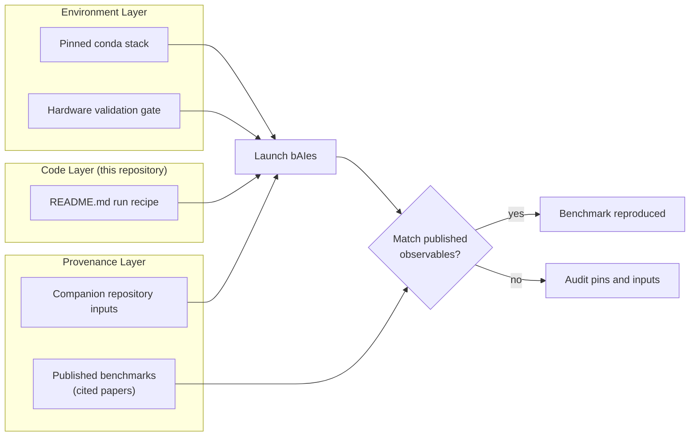
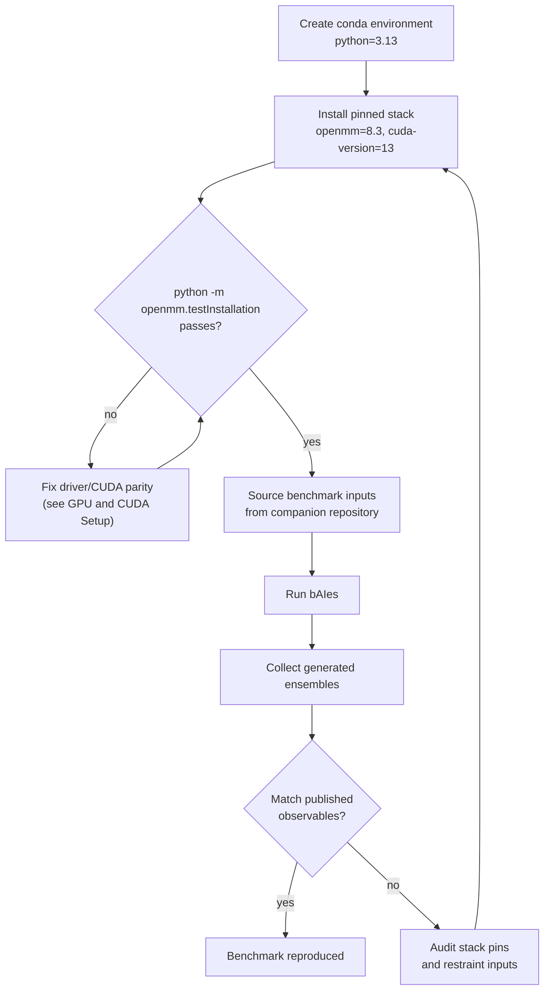

Benchmark reproduction in **bAIes-IDP-OpenMM** means regenerating the intrinsically disordered protein (IDP) ensembles reported in the project's peer-reviewed publications, under a software environment that matches the authors' setup as closely as possible. This page walks you through the reproduction workflow: establishing environment parity, validating your hardware, sourcing the benchmark provenance, launching the simulation, and validating the output against published observables. It is the checkpoint between [End-to-End Ensemble Generation](15-end-to-end-ensemble-generation) (which covers the generation mechanics) and the analysis pages that follow.

The repository itself is deliberately minimal — a `README.md` run recipe and a visual abstract. Reproducibility therefore rests on a three-layer contract: the **code layer** (this repository's run instructions), the **provenance layer** (the cited papers and companion resources), and the **environment layer** (pinned dependency versions plus a hardware validation gate). Reproduction succeeds only when all three layers align.

Sources: [README.md](/README.md#L1-L7), [README.md](/README.md#L9-L13)

## What "Benchmark Reproduction" Means Here

The benchmark systems are defined by the project's publications, not by data files inside this repository. The README's citation block is the authoritative provenance anchor — it names the Nature Communications paper (Schnapka, Morozova, Sen, Bonomi, 2026) describing atomic-resolution IDP ensembles built from AlphaFold, and the BioRxiv preprint (Schnapka, Portal, Bonomi, 2026) on leveraging AI structure predictors. Both carry DOIs, so every reproduced ensemble can be traced to a citable scientific result. When you reproduce a benchmark, you are reproducing the simulations behind those references — which is also why the README asks that you cite them when using the tool.

Sources: [README.md](/README.md#L7-L13)

The visual abstract summarizes the ensemble-generation concept that the benchmarks exercise:


Sources: [README.md](/README.md#L3-L5), [Visual_Abstract.png](/Visual_Abstract.png)

The three layers of the reproduction contract interact as follows:



Sources: [README.md](/README.md#L1-L13)

## The Reproduction Pipeline at a Glance

The full workflow is a loop: build the environment, prove the hardware, import provenance, run, and compare. The comparison stage either confirms reproduction or sends you back to audit the environment pins and input provenance — stale CUDA builds and mismatched restraint inputs are the two most common reproduction failure modes.



Sources: [README.md](/README.md#L16-L44)

## Step 1 — Establish Environment Parity

The README prescribes exactly two commands to construct the runtime: create a conda environment with Python 3.13, then install OpenMM 8.3 from conda-forge with a CUDA version pin. These pins are the environment contract — every element is chosen so your installation behaves like the authors'.

```bash
conda create -n baies python=3.13
conda activate baies
conda install -c conda-forge openmm=8.3 cuda-version=13
```

Sources: [README.md](/README.md#L20-L33)

| Component | Pinned value | Role in reproduction |
|---|---|---|
| Environment manager | conda (`baies` environment) | Isolates the exact dependency set from system Python |
| Python | `3.13` | Interpreter version fixed at environment creation |
| OpenMM | `8.3` | Simulation engine version matched to the benchmarks |
| CUDA build | `cuda-version=13` | Selects the GPU-accelerated OpenMM build variant |
| Channel | `conda-forge` | Single authoritative package source |

Sources: [README.md](/README.md#L25-L33)

The `cuda-version` pin deserves special attention because it does more than install a library — it selects which *build variant* of OpenMM you get. The README specifies three rules: the CUDA version must be supported by **both** your GPU driver and your OpenMM release (verify with `nvidia-smi`), and on a machine without a GPU you should omit the pin entirely to obtain the CPU build. A benchmark launched on the CPU build is not equivalent to a GPU-build benchmark in throughput terms, so record which build you ran alongside your results.

> [!TIP]
> When reproducing benchmarks on GPU hardware, resolve the `cuda-version` value *before* installing: run `nvidia-smi` first, note the maximum CUDA version your driver supports, and pin `cuda-version` to a version both your driver and OpenMM 8.3 support. Installing first and checking later is the most common cause of a failing hardware gate.

Sources: [README.md](/README.md#L31-L35)

The contrast between ad-hoc and parity-pinned installation:

| Aspect | Ad-hoc install | Parity-pinned install (README recipe) |
|---|---|---|
| Python version | Whatever the base env provides | `python=3.13` fixed |
| OpenMM version | Latest available | `openmm=8.3` matched to publications |
| Build variant | Uncontrolled | Explicit CUDA/CPU selection via `cuda-version` |
| Reproduction fidelity | Uncertain — versions drift silently | Auditable — every pin is a recorded variable |
| Failure diagnosis | Ambiguous ("works on my machine") | Pins narrow the search space to driver/hardware |

Sources: [README.md](/README.md#L24-L35)

If you need driver-level configuration beyond the version pin, the detailed procedure lives in [GPU and CUDA Setup](3-gpu-and-cuda-setup) — this page treats the pin as a given.

## Step 2 — Validate the Compute Gate

Before launching any benchmark, run OpenMM's self-test. The README places this check immediately after installation for a reason: it proves OpenMM can actually see and use your hardware before you spend compute time on a run that would silently fall back to an unintended platform.

```bash
python -m openmm.testInstallation
```

Sources: [README.md](/README.md#L37-L41)

Treat this as a hard gate in the reproduction pipeline, not an optional sanity check:

| Gate | Command | Expected outcome before proceeding |
|---|---|---|
| Installation integrity | `conda list` in the `baies` env | `openmm 8.3` present from conda-forge |
| Platform visibility | `python -m openmm.testInstallation` | OpenMM reports the expected CUDA/GPU (or CPU) platform |
| Driver compatibility | `nvidia-smi` | Driver supports the CUDA version you pinned |

Sources: [README.md](/README.md#L31-L41)

> [!TIP]
> Run `python -m openmm.testInstallation` inside the freshly activated `baies` environment — not the base environment. Running it from the wrong interpreter reports a healthy installation for an environment you are not actually going to use, which defeats the purpose of the gate.

Sources: [README.md](/README.md#L20-L41)

## Step 3 — Source the Benchmark Provenance

Because this repository ships no input data, the benchmark inputs — system definitions, restraint data derived from AlphaFold distograms, and the ensemble-averaged restraint specifications — come from the provenance layer. The README's citation block is your entry point into that layer: the Nature Communications paper and the BioRxiv preprint define which systems constitute the benchmarks and what results you are reproducing toward. The companion repository resources that supply the runnable inputs are documented separately in [Companion Repository Resources](4-companion-repository-resources).

The recommended practice is to record your provenance chain before launching: note the DOI of the paper whose benchmark you are targeting, the commit of this repository, and the exact pins from Step 1. This makes any discrepancy between your ensemble and the published one diagnosable rather than mysterious.

Sources: [README.md](/README.md#L7-L13)

## Step 4 — Launch and Validate Against Published Results

With the gate passed and inputs in hand, the README's final step is simply "Run bAIes" — the OpenMM implementation is executed as a Python module from the activated environment, following the run mechanics detailed in [End-to-End Ensemble Generation](15-end-to-end-ensemble-generation) and the pipeline architecture in [Simulation Pipeline Walkthrough](11-simulation-pipeline-walkthrough).

Sources: [README.md](/README.md#L43-L44)

Validation closes the loop. The generated ensembles should be compared against the observables reported in the cited publications — this is where the analysis toolchain takes over:

- Structural and trajectory-level checks: [Trajectory Analysis Toolkit](18-trajectory-analysis-toolkit)
- Sampling sufficiency checks: [Ensemble Convergence Assessment](19-ensemble-convergence-assessment)
| Cross-checks against experimental data: [Experimental Validation Approaches](20-experimental-validation-approaches)

A reproduction is complete when the ensembles match the published observables within the tolerance appropriate for stochastic molecular dynamics — expect statistical variation across runs rather than bit-identical trajectories, and use the convergence assessment to distinguish sampling noise from systematic environment mismatch.

Sources: [README.md](/README.md#L9-L13), [README.md](/README.md#L43-L44)

## Troubleshooting Reproduction Failures

Reproduction failures cluster into three families — environment, hardware, and provenance. Diagnose in that order:

| Symptom | Likely layer | Resolution |
|---|---|---|
| `testInstallation` reports no GPU platform | Hardware | Verify driver with `nvidia-smi`; adjust `cuda-version` pin to a mutually supported version |
| Install resolves to CPU build unexpectedly | Environment | You omitted or misspelled the `cuda-version` pin; reinstall with `conda install -c conda-forge openmm=8.3 cuda-version=13` (omit pin only for intentional CPU runs) |
| Version conflicts during install | Environment | Confirm you are in the fresh `baies` env, not base; recreate with `conda create -n baies python=3.13` |
| Ensembles deviate systematically from published results | Provenance | Audit input provenance via [Companion Repository Resources](4-companion-repository-resources); confirm the restraint inputs match the cited paper's systems |
| Results vary run-to-run | Expected behavior | Stochastic MD variation — assess with [Ensemble Convergence Assessment](19-ensemble-convergence-assessment) rather than debugging |

Sources: [README.md](/README.md#L24-L44)

## Next Steps

A successful benchmark reproduction certifies your environment and workflow. From here:

1. Scale the validated recipe to your own systems: [Multi-Domain Protein Extensions](17-multi-domain-protein-extensions)
2. Understand why the pipeline produces the ensembles it does: [Ensemble-Averaged Restraints Theory](9-ensemble-averaged-restraints-theory) and [Maximum Entropy and Bayesian Refinement](10-maximum-entropy-and-bayesian-refinement)
3. Deepen your analysis of the reproduced ensembles: [Ensemble Convergence Assessment](19-ensemble-convergence-assessment)
