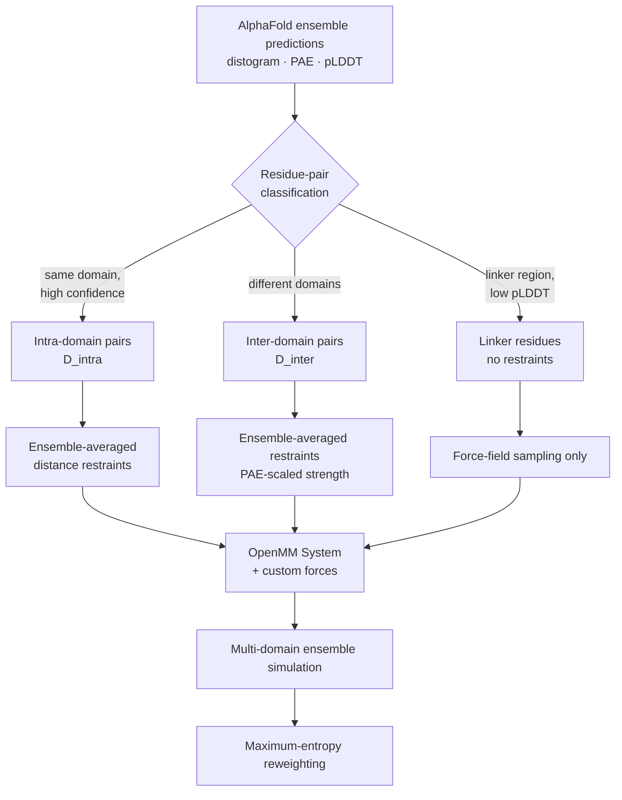
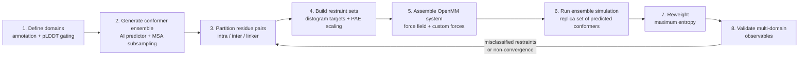

This page extends the bAIes–OpenMM reproducibility workflow from single-chain IDP ensembles to **multi-domain architectures**: proteins containing folded, ordered domains connected by disordered linkers. It covers the domain-aware restraint decomposition, the modified pipeline stages, system assembly patterns, and the validation observables that are specific to multi-domain ensembles. Single-domain mechanics are deliberately not repeated here — they are owned by [End-to-End Ensemble Generation](15-end-to-end-ensemble-generation) and [Benchmark Simulation Reproduction](16-benchmark-simulation-reproduction).

The figure above shows the bAIes concept in full: AI structure predictors generate conformer diversity, and an OpenMM simulation realizes the ensemble at atomic resolution. The multi-domain extension changes **where** in this loop restraints are applied, not the loop itself. The method identity — "OpenMM implementation of bAIes: Atomic resolution ensemble predictions of Intrinsically Disordered using AI structure predictors" — is stated verbatim in the repository README, and the governing publications are the Nature Communications paper (Schnapka, Morozova, Sen, Bonomi, 2026) and its BioRxiv preprint, both listed in the citation block.

Sources: [README.md](README.md#L7-L13), [Visual_Abstract.png](Visual_Abstract.png)

**Prerequisites before proceeding**: a working `baies` conda environment with OpenMM 8.3 (the README pins `openmm=8.3` from conda-forge, with `cuda-version=13` selecting the GPU build; verify with `python -m openmm.testInstallation`). Note that the README's own "3. Run bAIes." section is a stub — the operational run procedures are consolidated in this catalog's Reproducibility Workflows pages, which is why this page exists.

Sources: [README.md](README.md#L16-L44), [GPU and CUDA Setup](3-gpu-and-cuda-setup)

## Scope: What Changes for Multi-Domain Chains

A single-domain IDP workflow applies one restraint field to the whole chain, because predictor confidence (pLDDT) is uniformly low and the distogram is treated as a single ensemble target. A multi-domain chain breaks that assumption in three ways at once. Ordered domains show **high local confidence** — their intra-domain geometry should be stabilized. Domain–domain relative geometry shows **intermediate, block-structured confidence** in the Predicted Aligned Error (PAE) — inter-domain distances carry real signal but with higher uncertainty. Linkers show **low pLDDT** — restraining them destroys the entropic behavior that makes the ensemble meaningful.

The design consequence is a **partitioned restraint architecture**: the residue-pair space is split into three disjoint classes, each with its own restraint policy. Everything else in the pipeline — force field selection, integrator choice, ensemble-averaged restraint formalism, maximum-entropy reweighting — is inherited unchanged from the Deep Dive pages.

Sources: [README.md](README.md#L7-L13), [Intrinsically Disordered Protein Ensembles](6-intrinsically-disordered-protein-ensembles)

The diagram below shows how the AI predictor's outputs are classified into restraint classes for a two-domain chain. Read it left to right: predictor outputs enter the classification node, each class exits with a distinct policy, and all policies converge into the same OpenMM system.

Sources: [README.md](README.md#L7-L13), [AlphaFold Distograms and Distance Distributions](7-alphafold-distograms-and-distance-distributions)

### Restraint class taxonomy

| Class | Residue pairs | AI-derived source | Restraint policy | Role in the ensemble |
|---|---|---|---|---|
| **Intra-domain** (`D_intra`) | Both residues inside one ordered domain | Distogram, high-confidence band | Standard ensemble-averaged distance restraints | Preserves each domain's fold across the ensemble |
| **Inter-domain** (`D_inter`) | Residues in different domains | Distogram + PAE block confidence | Ensemble-averaged, **PAE-scaled** strength | Constrains relative domain arrangement without freezing orientation |
| **Linker** | Low-pLDDT linker residues | None — deliberately excluded | **No restraints**; force field only | Preserves entropic, polymer-like linker behavior |

The classification criterion for ordered-vs-disordered is predictor confidence, not annotation alone: a region annotated as a domain but predicted with low pLDDT should be treated as a linker, and vice versa. This gating rule is what keeps the partition consistent with the ensemble the predictor actually supports.

Sources: [README.md](README.md#L7-L13), [Ensemble-Averaged Restraints Theory](9-ensemble-averaged-restraints-theory)

> [!TIP]
> The single most common failure mode in multi-domain setups is leakage: linker residue pairs accidentally surviving into `D_intra` because the partition used sequence annotations without applying the pLDDT gate. The symptom is a collapsed linker — global Rg drops below any single predicted conformer. Always audit the three pair sets for disjointness before system assembly.

## Step-by-Step Workflow

The workflow below is the multi-domain variant of the end-to-end pipeline. Steps 2, 4, 5, and 7 reuse machinery documented in dedicated pages; steps 1, 3, 6, and 8 are the multi-domain-specific additions. The feedback edge from validation back to pair partitioning is intentional — multi-domain ensembles are the configuration where restraint misclassification most often surfaces, so iteration through step 3 is expected practice.

Sources: [README.md](README.md#L7-L13), [End-to-End Ensemble Generation](15-end-to-end-ensemble-generation)

| Stage | Input | Output | Key multi-domain decision |
|---|---|---|---|
| 1. Domain definition | Sequence + domain annotations + pLDDT profile | Reconciled domain map | Predicted confidence overrides annotation at boundaries |
| 2. Conformer generation | Sequence / MSA | Conformer set | Subsampling depth controls inter-domain diversity — see [MSA Subsampling Strategy](8-msa-subsampling-strategy) |
| 3. Pair partition | Distogram, PAE, pLDDT | Three disjoint pair sets | Audit disjointness; PAE block structure informs inter-domain confidence |
| 4. Restraint construction | Pair sets + conformer set | Restraint parameters | Targets are **ensemble averages** over conformers, per [Ensemble-Averaged Restraints Theory](9-ensemble-averaged-restraints-theory) |
| 5. System assembly | Conformer coordinates, force field, restraints | OpenMM `System` | Inherited from [Force Field and System Preparation](13-force-field-and-system-preparation) |
| 6. Simulation | System, integrator, thermostat | Trajectories | Inter-domain exchange is slow — thermostat choice matters, see [Integrators and Thermostats](14-integrators-and-thermostats) |
| 7. Reweighting | Trajectories + AI ensemble averages | Conformer weights | Same max-ent machinery as single-domain — see [Maximum Entropy and Bayesian Refinement](10-maximum-entropy-and-bayesian-refinement) |
| 8. Validation | Weighted trajectories | Ensemble statistics | Inter-domain observables are the decisive tests — see section below |

Sources: [README.md](README.md#L16-L44), [Simulation Pipeline Walkthrough](11-simulation-pipeline-walkthrough)

## System Assembly: Restraint Specification Before and After

The code-level mechanism for restraint forces is unchanged — this page only changes **which pairs each force object receives**. The concrete custom-force implementation is owned by [Custom Distance Restraint Forces](12-custom-distance-restraint-forces); the table below shows the specification pattern at the configuration level. Treat it as the structural contract between stage 3 (partition) and stage 5 (assembly).

| Aspect | Single-domain baseline (pages 15–16) | Multi-domain extension (this page) |
|---|---|---|
| Distogram-derived restraint scope | Whole chain, all intra-chain pairs | Restricted to `D_intra` pairs only |
| Additional restraint classes | None | New `D_inter` set with PAE-scaled strengths |
| Linker handling | Uniform policy across the chain | Explicitly excluded from all restraint sets |
| Force object count | One ensemble-restraint force | One per class (minimum two), disjoint pair lists |
| Restraint target definition | Average over conformer set, whole chain | Per-class averages: intra-domain from all conformers, inter-domain likewise, but weighted by PAE confidence |

Sources: [README.md](README.md#L7-L13), [Custom Distance Restraint Forces](12-custom-distance-restraint-forces), [Benchmark Simulation Reproduction](16-benchmark-simulation-reproduction)

Two assembly rules follow from the partition architecture. First, restraint forces must receive **disjoint** pair lists — a pair appearing in both `D_intra` and `D_inter` (impossible geometrically, but a real risk from off-by-one boundary handling at domain edges) double-counts its restraint energy. Second, restraint parameters must be computed from the **same conformer set** that stage 2 produced; recomputing targets from a fresh predictor run silently desynchronizes the restraint targets from the ensemble being simulated, which is precisely the failure mode that ensemble-averaged restraint theory exists to prevent.

Sources: [README.md](README.md#L7-L13), [Ensemble-Averaged Restraints Theory](9-ensemble-averaged-restraints-theory)

## Running and Reweighting the Multi-Domain Ensemble

Execution infrastructure is fully inherited. The simulation runs on the same GPU OpenMM build installed per the README (`openmm=8.3`, CUDA 13 for GPU builds, CPU build available without the pin), the same integrator/thermostat configuration documented on the OpenMM Implementation pages, and the same maximum-entropy reweighting step. Multi-domain systems differ only in **sampling demand**: relative domain orientation is a slower degree of freedom than local fluctuations, so the ensemble must start from a conformer set that already spans meaningful orientational diversity — which is exactly what the MSA subsampling stage contributes.

Sources: [README.md](README.md#L16-L41), [Integrators and Thermostats](14-integrators-and-thermostats), [Maximum Entropy and Bayesian Refinement](10-maximum-entropy-and-bayesian-refinement)

This is the point where the ensemble-averaged formulation stops being a theoretical nicety. Inter-domain restraints carry the risk that their target collapses to the *point prediction* of a single AlphaFold output — one orientation, one set of domain distances. The bAIes ensemble-averaged restraint formalism is what prevents this, by tying the restraint target to the distribution of AI-generated conformers rather than any single prediction.

Sources: [README.md](README.md#L7-L13), [Ensemble-Averaged Restraints Theory](9-ensemble-averaged-restraints-theory)

> [!TIP]
> Inter-domain restraints must be applied as ensemble-averaged restraints across the full conformer set, never as independent per-conformer harmonic pins. Per-conformer pinning welds each trajectory to its starting prediction's orientation, and the pooled ensemble then reproduces the *breadth of the starting conformers* rather than a physically equilibrated orientational distribution — the simulation contributes nothing beyond stage 2.

## Validating Multi-Domain Ensembles

Validation inherits the single-domain toolkit and adds inter-domain observables that have no single-domain analogue. The decisive tests for a multi-domain ensemble are distributional, not scalar: a single mean domain–domain distance tells you almost nothing; the **shape** of its distribution is what distinguishes a genuine orientational ensemble from a collapsed or over-restrained one.

| Observable | Definition | Multi-domain expectation | Assessment page |
|---|---|---|---|
| Global Rg | Radius of gyration of the full chain | Broader distribution than a single-domain chain of equal length | [Trajectory Analysis Toolkit](18-trajectory-analysis-toolkit) |
| Domain–domain distance | Center-of-mass distance between domains | Multi-peaked / broad distribution reflecting orientational diversity | [Trajectory Analysis Toolkit](18-trajectory-analysis-toolkit) |
| Inter-domain contact frequency | Fraction of ensemble conformers containing inter-domain contacts | Sparse, consistent with PAE confidence pattern | [Experimental Validation Approaches](20-experimental-validation-approaches) |
| Linker end-to-end distance | Distance between the two domain boundary residues | Polymer-like scaling; no contact-driven collapse | [Ensemble Convergence Assessment](19-ensemble-convergence-assessment) |
| Per-domain RMSD to predictor conformers | Intra-domain structural deviation | Tight — intra-domain restraints should hold the fold | [Ensemble Convergence Assessment](19-ensemble-convergence-assessment) |

Sources: [README.md](README.md#L7-L13), [Visual_Abstract.png](Visual_Abstract.png)

Convergence must be assessed **per observable class**. An ensemble can converge in intra-domain geometry while inter-domain distances are still drifting — the two classes equilibrate on different timescales, so a single global convergence verdict is invalid for multi-domain systems. The convergence assessment methodology is documented on its dedicated page; apply it separately to the intra-domain and inter-domain observable groups defined above.

Sources: [README.md](README.md#L16-L44), [Ensemble Convergence Assessment](19-ensemble-convergence-assessment)

## Troubleshooting

Multi-domain systems concentrate four failure modes that single-domain workflows rarely expose. The table maps each symptom to its root cause in the restraint partition or simulation setup, with the corrective action pointing at the owning pipeline stage.

| Symptom | Likely cause | Corrective action |
|---|---|---|
| Linker collapses onto a domain; global Rg below any predicted conformer | Linker pairs leaked into `D_intra` (missing pLDDT gate) | Re-audit pair-set disjointness at stage 3; re-gate by pLDDT |
| Domains distort; per-domain RMSD to predictor conformers grows | `D_inter` strengths dominate `D_intra`; inter-domain restraints deforming folds | Reduce inter-domain scaling; verify PAE-based confidence weighting at stage 4 |
| Pooled ensemble shows one frozen domain orientation | Per-conformer pinning used instead of ensemble-averaged restraints | Switch to ensemble-averaged formulation per [Ensemble-Averaged Restraints Theory](9-ensemble-averaged-restraints-theory) |
| Inter-domain distances non-convergent across trajectory blocks | Orientational sampling too slow; conformer seeds too similar | Deepen MSA subsampling diversity per [MSA Subsampling Strategy](8-msa-subsampling-strategy); revisit thermostat per [Integrators and Thermostats](14-integrators-and-thermostats) |

Sources: [README.md](README.md#L7-L13), [AlphaFold Distograms and Distance Distributions](7-alphafold-distograms-and-distance-distributions)

For benchmark input data and reference configurations to reproduce multi-domain cases, check the companion materials catalogued on [Companion Repository Resources](4-companion-repository-resources); the main repository itself ships only the README and visual abstract, with the executable workflow logic distributed across the Deep Dive documentation.

Sources: [README.md](README.md#L1-L44), [Companion Repository Resources](4-companion-repository-resources)

## Where to Go Next

With a multi-domain ensemble generated and reweighted, the natural progression follows the catalog's Analysis and Validation track: compute trajectory statistics with [Trajectory Analysis Toolkit](18-trajectory-analysis-toolkit), confirm both intra- and inter-domain observables have converged via [Ensemble Convergence Assessment](19-ensemble-convergence-assessment), and benchmark the ensemble against experimental data using [Experimental Validation Approaches](20-experimental-validation-approaches). If you arrived here without first reproducing a single-domain benchmark, work through [Benchmark Simulation Reproduction](16-benchmark-simulation-reproduction) before debugging multi-domain failures — it isolates pipeline defects that multi-domain complexity would otherwise mask.
