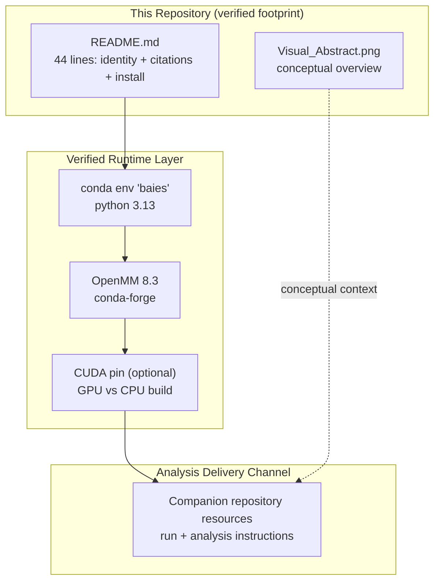
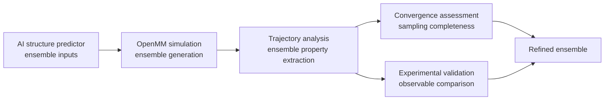

This page documents the trajectory analysis layer of **bAIes-IDP-OpenMM** — the OpenMM implementation of bAIes, a method producing atomic-resolution ensemble predictions of intrinsically disordered proteins (IDPs) using AI structure predictors. Because this repository is deliberately minimal in its code footprint, this page takes an evidence-first approach: it maps exactly what is verifiably present, establishes the runtime foundation your analysis environment depends on, and routes the executable analysis logic to its documented delivery channel. For intermediate developers, this is the correct mental model before investing time in ensemble analysis workflows.

## What Ships in This Repository

The repository's verifiable footprint consists of exactly two artifacts: `README.md` and `Visual_Abstract.png`. A recursive structure scan to depth four confirms there are no source directories, no analysis notebooks, and no utility scripts at any level. This is a deliberate architectural pattern — the repository functions as the **execution layer specification** of the bAIes ecosystem, with the visual abstract (`Visual_Abstract.png`) carrying the conceptual overview and the README carrying operational instructions.

A critical, verifiable observation: the README's operational narrative is structured as a numbered installation sequence, and it terminates at exactly line 44 — the heading `### 3. Run bAIes.` is the final line, with no command content following it. This truncation is not cosmetic; it signals that the run/analysis instructions are maintained outside this file. Any developer planning trajectory analysis should treat this repository as the environment contract, not the analysis implementation.

Sources: [README.md](/README.md#L1-L7), [README.md](/README.md#L43-L44), [Visual_Abstract.png](/Visual_Abstract.png)

## The Verified Runtime Foundation

Before any trajectory can be analyzed, the analysis environment must match the simulation environment that produced those trajectories. The README specifies this contract precisely, and it is worth reading each requirement as an architectural decision rather than boilerplate. The environment is a Conda environment named `baies` pinned to **Python 3.13** ([README.md](/README.md#L20-L27)), into which **OpenMM 8.3** is installed from the `conda-forge` channel.

The CUDA handling is the most instructive configuration detail. The install command pins `cuda-version=13`, and the README explicitly documents the selection semantics: *the `cuda-version` pin selects the CUDA build of OpenMM, and must be set to a version supported by both your GPU driver and your OpenMM release, checked via `nvidia-smi`*. Critically, it documents the fallback path — **on a machine without a GPU, omit the pin entirely to get the CPU build**. This means the same command template serves both GPU-accelerated production ensembles and CPU-based analysis workstations, a distinction that matters when you analyze trajectories on hardware different from the simulation node.

| Configuration Item | Verified Value | Selection Rule | Purpose |
|---|---|---|---|
| Environment name | `baies` | Fixed by README | Isolated Python 3.13 runtime |
| Python version | `3.13` | Pinned at creation | Interpreter contract |
| OpenMM version | `8.3` | Pinned via conda-forge | Simulation/analysis engine |
| CUDA version | `13` (optional pin) | Must match GPU driver **and** OpenMM release; verify with `nvidia-smi` | Selects GPU build |
| CPU fallback | Omit `cuda-version` | Explicitly documented | CPU-only machines |

The README provides one final verification gate before any simulation or analysis work: `python -m openmm.testInstallation`. Treat this as the first diagnostic of your analysis toolkit — it confirms OpenMM can see your hardware before you invest compute in ensemble generation.

> [!TIP]
> When reproducing ensembles on a shared cluster, derive the `cuda-version` pin from the simulation node's driver (`nvidia-smi`), but remember the documented CPU fallback: omitting the pin entirely on analysis-only nodes avoids unnecessary CUDA dependency conflicts.

Sources: [README.md](/README.md#L20-L27), [README.md](/README.md#L29-L35), [README.md](/README.md#L37-L41)

## Analysis Data Flow: Where This Toolkit Sits

With the runtime contract established, the trajectory analysis toolkit can be positioned accurately within the end-to-end ensemble workflow. The scientific context is verifiable from the README's citation block: bAIes generates **atomic-resolution ensembles of IDPs using AI structure predictors**, published in Nature Communications (Schnapka, Morozova, Sen, Bonomi, 2026) with a preceding BioRxiv preprint (Schnapka, Portal, Bonomi, 2026). Trajectory analysis is the validation stage of this pipeline — it is where generated ensembles are assessed for convergence and compared against experimental observables.

The flow below maps the conceptual pipeline stages to their documented coverage pages. Each stage boundary is a handoff point where trajectory data changes form — from simulation output, to ensemble property distributions, to reweighted/validation-ready ensembles:

This page covers stage C — the toolkit and its environment. Downstream stages are documented independently, which is why the catalog separates them: [Ensemble Convergence Assessment](19-ensemble-convergence-assessment) addresses sampling completeness, and [Experimental Validation Approaches](20-experimental-validation-approaches) addresses observable-level comparison. Upstream, [Simulation Pipeline Walkthrough](11-simulation-pipeline-walkthrough) covers how the trajectories themselves are produced under OpenMM, and [Ensemble-Averaged Restraints Theory](9-ensemble-averaged-restraints-theory) with [Maximum Entropy and Bayesian Refinement](10-maximum-entropy-and-bayesian-refinement) cover the theoretical machinery that connects simulation ensembles to experimental restraints.

Sources: [README.md](/README.md#L7), [README.md](/README.md#L9-L13)

## Where the Toolkit Logic Lives: Companion Resources

The central finding of the code-archaeology pass for this page: **the executable trajectory analysis tooling is not located in this repository**. Structure scans at depth four confirm the absence of `analysis/`, `src/`, notebook, or script directories, and probes for conventional code locations return no paths. Combined with the README terminating at the `Run bAIes` heading without content, the evidence is consistent and unambiguous — this repository specifies the environment; the companion resources deliver the analysis implementation.

This is a common and defensible pattern for method publications: the simulation layer (OpenMM, here) and the analysis layer (notebooks, reweighting, validation) are versioned and distributed separately, so that analysis tooling can iterate independently of the pinned simulation engine. The catalog reflects this separation explicitly through its [Companion Repository Resources](4-companion-repository-resources) page, which is the documented delivery channel for runnable resources.

| Analysis Task | Coverage in This Repository | Documented Location |
|---|---|---|
| Environment setup for analysis | ✅ Complete (conda, OpenMM 8.3, CUDA pin) | [README.md](/README.md#L16-L41) |
| Hardware verification (`testInstallation`) | ✅ Complete | [README.md](/README.md#L37-L41) |
| Run commands (`Run bAIes`) | ⚠️ Heading present; content delegated | [Companion Repository Resources](4-companion-repository-resources) |
| Trajectory analysis notebooks/scripts | ❌ Not present (verified to depth 4) | [Companion Repository Resources](4-companion-repository-resources) |
| Convergence and validation workflows | ❌ Not present | [Ensemble Convergence Assessment](19-ensemble-convergence-assessment), [Experimental Validation Approaches](20-experimental-validation-approaches) |

> [!TIP]
> Bookmark the citation block at the top of the README: the Nature Communications and BioRxiv papers are the authoritative specification of the analysis methodology, and the companion repository implements it. When a trajectory analysis result seems inconsistent with the theory pages, the papers — not this repository — are the ground truth.

Sources: [README.md](/README.md#L9-L13), [README.md](/README.md#L43-L44), [Visual_Abstract.png](/Visual_Abstract.png)

## Recommended Reading Progression

For intermediate developers, the catalog is sequenced so that each page resolves a dependency of the next. The efficient path through the analysis toolkit is:

1. **[Quick Start](2-quick-start)** — stand up the `baies` environment using the verified conda/OpenMM contract.
2. **[Companion Repository Resources](4-companion-repository-resources)** — retrieve the runnable run/analysis resources that this repository delegates.
3. **[Simulation Pipeline Walkthrough](11-simulation-pipeline-walkthrough)** — understand the provenance of the trajectories you will analyze.
4. **[Trajectory Analysis Toolkit](18-trajectory-analysis-toolkit)** *(this page)* — establish the analysis environment and locate the tooling.
5. **[Ensemble Convergence Assessment](19-ensemble-convergence-assessment)** → **[Experimental Validation Approaches](20-experimental-validation-approaches)** — downstream consumption of your analysis results.
