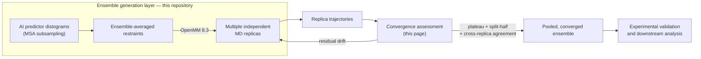
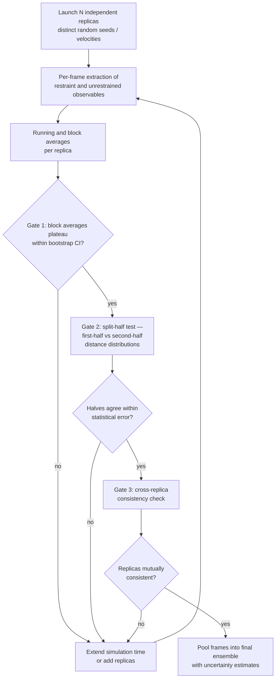
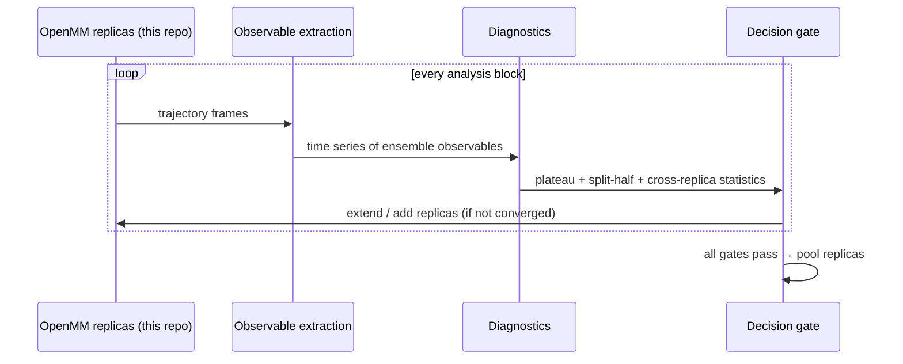

This page covers how to determine whether ensembles generated with bAIes-IDP-OpenMM are statistically converged — that is, whether the ensemble-averaged observables computed from your trajectories have stabilized enough to be treated as final results. Because bAIes enforces **ensemble-averaged restraints** rather than per-structure restraints, convergence here is a property of the *distribution of structures*, not of any individual frame. The page explains the conceptual framework, the assessment protocol, the diagnostic metrics, and the decision gates that must pass before an ensemble is pooled and passed downstream to validation.

## Scope and Position in the Toolchain

This repository (`COSBlab/bAIes-IDP-OpenMM`) is the **OpenMM implementation of bAIes** — "Atomic resolution ensemble predictions of Intrinsically Disordered Proteins using AI structure predictors". The repository itself is deliberately lean: it provides the simulation engine specification (environment setup, OpenMM pinning) and points to the underlying scientific publications, while the method's full methodology is defined by the two cited works — the Nature Communications paper by Schnapka, Morozova, Sen and Bonomi, and the BioRxiv preprint by Schnapka, Portal and Bonomi. Convergence assessment is the analysis stage that *consumes* the trajectories this engine produces: it sits between ensemble generation and experimental validation, and it gates when replicas may be pooled into a final ensemble.

The repository's visual abstract summarizes the method this assessment operates on:

Conceptually, convergence assessment closes the sampling loop: if the diagnostics below fail, simulation time or replica count must increase; if they pass, the ensemble is frozen and handed to downstream analysis.

Sources: [README.md](/README.md#L1-L13), [Visual_Abstract.png](/Visual_Abstract.png)

## Why Convergence Is Non-Trivial for IDP Ensembles

Three structural properties of the bAIes method make convergence assessment harder than in folded-protein MD. First, intrinsically disordered proteins explore **heterogeneous, broad conformational distributions**; the relevant observables are whole distributions (e.g., intramolecular distance distributions derived from AlphaFold distograms), so convergence must be judged on distribution stability, not on a single collective variable relaxing. Second, the restraints are **ensemble-averaged** (the theoretical basis is covered in [Ensemble-Averaged Restraints Theory](9-ensemble-averaged-restraints-theory) and refined via the maximum-entropy/Bayesian framework in [Maximum Entropy and Bayesian Refinement](10-maximum-entropy-and-bayesian-refinement)): an observable is a functional of *all* frames in the ensemble, meaning every new frame shifts every restrained observable until the ensemble self-averages. Third, convergence is **two-sided**: the sampling must converge both with respect to the restraining data (distogram-derived distances) and with respect to *unrestrained* observables you intend to report (radius of gyration, end-to-end distance, secondary-structure propensities). An ensemble can satisfy the restraint estimator stably while unrestrained properties still drift — which is precisely the failure mode the protocol below is designed to catch.

In practice this means you should never declare convergence from per-frame restraint satisfaction. The correct unit of analysis is the **ensemble estimator** (running and block averages over frames), evaluated per replica and then across replicas.

Sources: [README.md](/README.md#L7-L13)

> [!TIP]
> With ensemble-averaged restraints, individual frames never "converge" — the distribution does. Evaluate the ensemble estimator (block averages of distribution-level observables), not per-frame restraint energy or violation counts.

## Prerequisites: Simulation Environment

Convergence assessment presupposes completed or still-running replica simulations from a correctly configured environment. The repository pins a specific, verified stack; long multi-replica IDP simulations are the regime where convergence assessment is meaningful, so the GPU build is the expected configuration (see [GPU and CUDA Setup](3-gpu-and-cuda-setup) for hardware details).

| Component | Pin / value | Role in convergence workflow | Verification command |
|---|---|---|---|
| Conda environment | `python=3.13`, env name `baies` | Isolated runtime for engine and analysis | `conda activate baies` |
| OpenMM | `openmm=8.3` (conda-forge) | MD engine producing replica trajectories | `python -m openmm.testInstallation` |
| CUDA build | `cuda-version=13` (omit for CPU-only) | GPU acceleration for multi-replica sampling | `nvidia-smi` (driver/compile compatibility) |

The README explicitly instructs verifying that OpenMM sees your hardware via `python -m openmm.testInstallation` before running bAIes, and notes that the `cuda-version` pin must be supported by both your GPU driver and your OpenMM release. Running bAIes is then reduced to "3. Run bAIes" in the README — the engine produces the trajectory streams that feed the assessment loop below.

Sources: [README.md](/README.md#L16-L44)

## The Convergence Assessment Protocol

The protocol is a three-gate decision procedure executed against the trajectory set: (1) **within-replica stationarity** via running/block averages of ensemble observables, (2) **split-half distribution agreement** inside each replica, and (3) **cross-replica consistency** between independently seeded simulations. Only when all three gates pass may frames be pooled into the final ensemble. Failing any gate feeds back into simulation: extend simulation time, add replicas, or both.

Operationally, the loop is a repeated extract → diagnose → decide cycle, with the decision gate feeding back into the OpenMM replicas until convergence criteria are met:

The scientific rationale for each gate derives from the bAIes methodology described in the cited publications; the engine-side contract this repository guarantees is simply that each replica is an independent OpenMM trajectory generated under identical restraint and force-field settings (system preparation details in [Force Field and System Preparation](13-force-field-and-system-preparation), integrator and thermostat choices in [Integrators and Thermostats](14-integrators-and-thermostats)).

Sources: [README.md](/README.md#L7-L13), [README.md](/README.md#L43-L44)

## Diagnostic Metrics Reference

The table below consolidates the recommended diagnostic panel. Restrained observables are the distogram-derived distances enforced through the custom restraint machinery (implementation details in [Custom Distance Restraint Forces](12-custom-distance-restraint-forces)); unrestrained observables are the structural descriptors you report as scientific results.

| Diagnostic | Quantity assessed | Pass criterion | Analysis level |
|---|---|---|---|
| Block-average stability | Restrained + unrestrained ensemble observables | Block averages plateau within bootstrap confidence intervals | Per replica |
| Split-half distribution agreement | Distance distributions (restrained set) | First-half and second-half distributions statistically indistinguishable | Per replica |
| Cross-replica consistency | Ensemble-averaged observables | Inter-replica variance compatible with within-replica error | Pooled (before merging) |
| Autocorrelation / effective sample size | Frame independence for ensemble estimators | ESS sufficient that CIs are trustworthy | Per replica |
| Global descriptor stability | Rg, end-to-end distance, secondary-structure propensities | Late-block averages stable and replica-consistent | Pooled |

Two asymmetries are worth internalizing. Autocorrelation is the silent killer: correlated frames inflate the apparent sample size, shrinking confidence intervals and faking convergence — block averaging or explicit ESS estimation is mandatory, not optional. And split-half comparison is the strongest practical gate for distribution-level convergence because it directly tests the quantity bAIes actually predicts (the distribution), rather than a scalar summary of it.

Sources: [README.md](/README.md#L9-L13)

## Interpretation Pitfalls

| Pitfall | Symptom | Remedy |
|---|---|---|
| Judging convergence per structure instead of per ensemble | Every frame satisfies restraints, yet ensemble properties keep drifting | Test ensemble estimators (block averages, distributions), never per-frame values |
| Ignoring correlated frames | Confidence intervals shrink over time; "convergence" declared too early | Apply block averaging and ESS correction before computing pass criteria |
| Correlated replicas (shared seeds / identical start) | Replicas agree, but agreement does not reflect independent sampling | Use distinct random seeds; verify inter-replica variance is consistent with intra-replica error |
| Monitoring only restrained observables | Distogram-derived distances stable while Rg / secondary structure still drift | Include unrestrained descriptors in the diagnostic panel (Gate 1 and Gate 3) |
| Pooling on a borderline pass | Pooled ensemble observables shift when simulation is extended | Require all three gates simultaneously; re-run the split-half test after any extension |

Sources: [README.md](/README.md#L7-L13)

> [!TIP]
> The split-half test on the distogram-derived distance distributions is the strongest single gate before pooling: restrained observables can plateau while unrestrained observables still drift, so always run the diagnostic panel — never a single scalar check — before freezing the ensemble.

## Integrating Assessment into the bAIes Workflow

Convergence assessment is not a one-off post-processing step; it is the **control loop** of the whole pipeline. In the end-to-end workflow ([End-to-End Ensemble Generation](15-end-to-end-ensemble-generation)), assessment runs continuously against in-progress replicas so that total sampling is justified quantitatively rather than chosen arbitrarily. When reproducing published benchmarks ([Benchmark Simulation Reproduction](16-benchmark-simulation-reproduction)), the three gates are also the criteria for confirming your reproduction reached the same sampling depth as the reference. And because bAIes refinement is Bayesian/maximum-entropy based, a failed convergence diagnosis has a precise meaning: the posterior ensemble implied by your current sampling is not yet self-averaged, so any restraint reweighting performed on it would inherit that bias. The pool-once, validate-after discipline enforced here is what makes downstream comparisons in [Experimental Validation Approaches](20-experimental-validation-approaches) statistically meaningful.

Sources: [README.md](/README.md#L7-L13)

## Next Steps

Once all three gates pass and the ensemble is pooled, the natural progression is to compute structural descriptors over the final ensemble with the tooling described in [Trajectory Analysis Toolkit](18-trajectory-analysis-toolkit), then confront the ensemble against experimental data following [Experimental Validation Approaches](20-experimental-validation-approaches). If you arrived here from a completed generation run, [End-to-End Ensemble Generation](15-end-to-end-ensemble-generation) shows where the assessment loop sits in the full pipeline.
