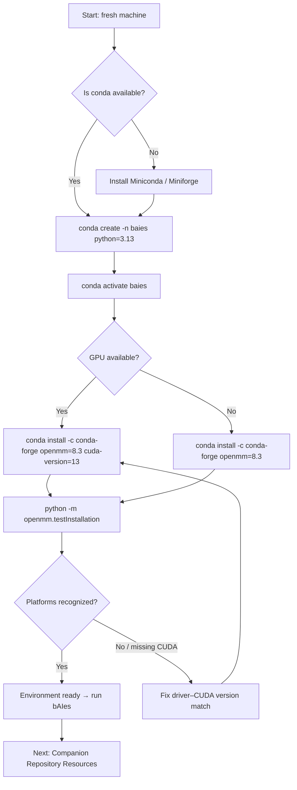

This page walks you from an empty machine to a verified, simulation-ready **bAIes-IDP-OpenMM** environment in three steps. The repository is intentionally lightweight — it ships a single `README.md` containing the canonical setup instructions and one visual abstract — so this Quick Start translates that README into a beginner-friendly, verified walkthrough. By the end, you will have a working OpenMM installation that recognizes your hardware and will know exactly which documentation page to open next.

## What This Repository Gives You

Before installing anything, it helps to know the shape of what you are working with. The repository root contains exactly two artifacts: the `README.md` documentation file and `Visual_Abstract.png`, the project's visual summary. This minimal structure is deliberate — bAIes-IDP-OpenMM is the **OpenMM implementation** of the bAIes method for generating atomic-resolution ensembles of intrinsically disordered proteins using AI structure predictors, and the actual simulation logic is consumed from its companion resources rather than duplicated here.

```
bAIes-IDP-OpenMM/
├── README.md            # Canonical installation instructions (44 lines)
└── Visual_Abstract.png  # Project visual abstract (1000px wide, centered)
```


Sources: [README.md](README.md#L1-L7), [Visual_Abstract.png](Visual_Abstract.png)

## Quick Start Flow at a Glance

The entire setup path is a linear dependency chain: create an isolated Python environment, install the OpenMM engine (choosing a GPU or CPU build), verify that OpenMM can actually see your hardware, then proceed to running simulations. The Mermaid diagram below makes this decision structure explicit — note that there is only one true branching point (GPU vs. CPU) and one verification gate before you are ready to run.



Read this diagram top-down: every box on the main path is a command you will run in the sections below, and the only loops are failure-recovery paths. If you are on a CPU-only machine, you simply skip the GPU branch entirely.

Sources: [README.md](README.md#L16-L41)

## Step 1: Create an Isolated Python Environment

The README prescribes Conda as the environment manager and targets **Python 3.13** inside a dedicated environment named `baies`. Run these two commands in your terminal:

```bash
conda create -n baies python=3.13
conda activate baies
```

The isolation matters for reproducibility: molecular dynamics dependencies (OpenMM, CUDA runtime bindings) have strict version interactions with the base interpreter, and a dedicated `baies` environment prevents conflicts with any other Python tooling on your system. If `conda` is not yet installed on your machine, install Miniconda or Miniforge first, then return to these commands.

| Setting | Value | Role in the setup |
|---|---|---|
| Environment name | `baies` | Isolated namespace for all bAIes dependencies |
| Python version | `3.13` | Interpreter version the OpenMM 8.3 stack targets |
| Activation command | `conda activate baies` | Required before every subsequent step |

> [!TIP]
> Always confirm your prompt shows `(baies)` after running `conda activate baies`. Every following command in this guide assumes it executes inside that environment — installing OpenMM into `base` by accident is the most common beginner misstep.

Sources: [README.md](README.md#L20-L27)

## Step 2: Install OpenMM — Choose GPU or CPU

This is the single most consequential decision of the Quick Start, because OpenMM is distributed in **different builds depending on the CUDA version you pin**. The README's canonical GPU command is:

```bash
conda install -c conda-forge openmm=8.3 cuda-version=13
```

The `cuda-version=13` pin does not install CUDA itself — it **selects which CUDA build of OpenMM** conda-forge delivers. That build must be compatible with both your GPU driver and your OpenMM release; the README directs you to check your driver's supported CUDA ceiling with `nvidia-smi` and pick a pin your hardware can actually satisfy. On a machine without a GPU, simply omit the pin entirely and conda resolves the CPU build:

| Deployment target | Install command | Build selected |
|---|---|---|
| GPU workstation / cluster node | `conda install -c conda-forge openmm=8.3 cuda-version=13` | CUDA-accelerated OpenMM build |
| CPU-only machine (laptop, CI, quick validation) | `conda install -c conda-forge openmm=8.3` | CPU OpenMM build |

> [!TIP]
> Think of the `cuda-version` pin as a compatibility contract between three parties: your NVIDIA driver (what `nvidia-smi` reports), the OpenMM release you request (8.3), and the CUDA build conda-forge ships. If any link mismatches, installation succeeds but runtime platform selection fails — which is exactly why Step 3's verification exists.

Sources: [README.md](README.md#L29-L35)

## Step 3: Verify the Installation

Before running any simulation, confirm that OpenMM can see your hardware using the built-in diagnostic:

```bash
python -m openmm.testInstallation
```

This command enumerates the compute platforms OpenMM has compiled in and reports whether your GPU is detected. The interpretation is straightforward:

| Verification outcome | Meaning | Action |
|---|---|---|
| CUDA platform listed, GPU detected | GPU build installed and driver-compatible | You are ready to run |
| Only CPU / Reference platforms listed | CPU build installed (expected if you omitted the pin) | Fine for CPU workflows; add CUDA later if needed |
| CUDA platform listed but GPU not detected | Driver–CUDA version mismatch | Re-check `nvidia-smi`, revisit the pin, or see the GPU setup page |
| `ModuleNotFoundError` for `openmm` | Install landed in the wrong environment | Re-run `conda activate baies`, reinstall |

Hardware-specific issues — driver versions, CUDA toolkit alignment, multi-GPU selection — are deliberately out of scope here and are covered in depth by the next Getting Started page.

Sources: [README.md](README.md#L37-L41)

## After Setup: Running bAIes

The README's installation sequence concludes with a third step titled **"Run bAIes"** — this is the transition point from environment preparation to actual ensemble generation. The important, verifiable fact for a beginner is that this repository provides the OpenMM *implementation context* rather than a self-contained run script at its root; the executable workflow materials live in the companion repository that accompanies the published papers. The two references below are what the README asks you to cite when you use the tool:

| Reference | Venue | Role |
|---|---|---|
| Schnapka, Morozova, Sen, Bonomi — *Atomic resolution ensembles of intrinsically disordered proteins with AlphaFold* | Nature Communications (2026) | Primary method publication |
| Schnapka, Portal, Bonomi — *Leveraging state-of-the-art AI structure predictors…* | bioRxiv (2026) | Preprint describing the AI-predictor ensemble approach |

With a verified environment, your productive next move is to acquire the runnable scripts and input data, then follow the full simulation pipeline. Both are routed through the catalog pages listed below.

Sources: [README.md](README.md#L9-L13), [README.md](README.md#L43-L44)

## Recommended Reading Path

Your position in the documentation catalog is the second Getting Started page. The strongest progression for a beginner after completing this Quick Start is:

| Order | Page | Why read it next |
|---|---|---|
| 1 | [GPU and CUDA Setup](3-gpu-and-cuda-setup) | If your verification revealed platform problems, or you want driver/CUDA alignment explained properly |
| 2 | [Companion Repository Resources](4-companion-repository-resources) | To obtain the runnable scripts and inputs referenced by "Run bAIes" |
| 3 | [Simulation Pipeline Walkthrough](11-simulation-pipeline-walkthrough) | Once you have scripts in hand, to understand the ensemble-generation stages end to end |
| Optional | [Intrinsically Disordered Protein Ensembles](6-intrinsically-disordered-protein-ensembles) | For the scientific "why" behind what you are about to simulate |
