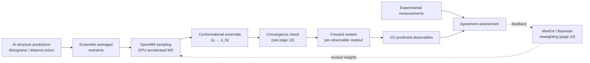
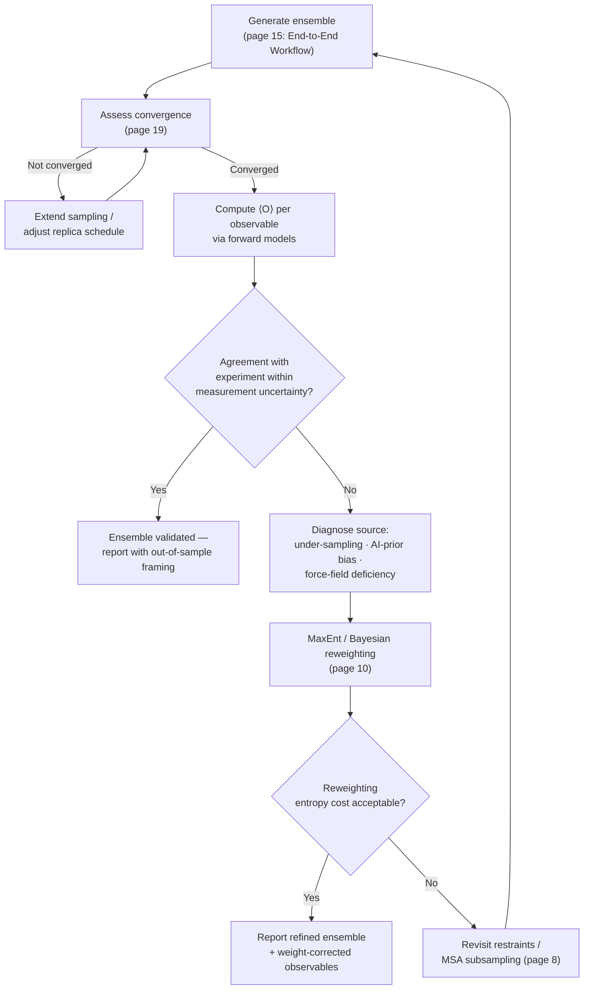

This page explains how ensembles generated by the bAIes-OpenMM workflow are validated against experimental data. It operates at the conceptual level of the *Analysis and Validation* section: what it means for a heterogeneous intrinsically disordered protein (IDP) ensemble to agree with experiment, which observable classes carry validation power, and how the validation loop closes back into ensemble refinement. Because this repository snapshot ships exactly two artifacts — [README.md](/README.md#L1-L44) and [Visual_Abstract.png](/Visual_Abstract.png) — the page is explicit about the epistemic boundary between what the repository verifiably contains and the methodology established by the project's canonical references.

## Validation in the bAIes Method: Why Ensembles Require Ensemble-Level Validation

The repository defines its subject in a single line: an "OpenMM implementation of bAIes: Atomic resolution ensemble predictions of Intrinsically Disordered using AI structure predictors" [README](/README.md#L7). This framing dictates the validation problem. A conventional structural prediction is validated by comparing one conformation against one experimental measurement. An IDP ensemble cannot be validated this way: the object under test is a probability distribution over conformations, so every experimental observable must be compared against its ensemble average, and any single-structure metric — RMSD to a "reference fold," for instance — is meaningless for a system whose defining property is the absence of one.

This is the same mathematical object that appears on the generation side of the pipeline. The restraint theory formalized in [Ensemble-Averaged Restraints Theory](9-ensemble-averaged-restraints-theory) and applied through the OpenMM sampling stages ([Simulation Pipeline Walkthrough](11-simulation-pipeline-walkthrough)) enforces agreement between ensemble averages and target distributions derived from AI predictors ([AlphaFold Distograms and Distance Distributions](7-alphafold-distograms-and-distance-distributions)). Validation inverts that operator: instead of using a target distribution to *drive* sampling, a forward model *reads out* observables from the sampled ensemble, and those readouts are compared against laboratory measurements.

The following diagram maps validation into the full pipeline. Read it left-to-right as the generation path (AI priors → restraints → OpenMM sampling → ensemble), then through the forward models into the agreement assessment; the dashed feedback edge is where [Maximum Entropy and Bayesian Refinement](10-maximum-entropy-and-bayesian-refinement) closes the loop:

The convergence gate before validation is deliberate: comparing a non-converged ensemble against experiment conflates sampling error with model error. The convergence criteria themselves belong to [Ensemble Convergence Assessment](19-ensemble-convergence-assessment); here they appear only as the precondition that must hold before any experimental comparison is interpreted.

Sources: [README.md](/README.md#L7-L13), [Visual_Abstract.png](/Visual_Abstract.png)

## The Repository's Verifiable Validation Assets

An advanced developer arriving at this repository should first establish precisely what is present. The top-level structure contains two files — the README and the visual abstract — with no analysis scripts, no validation notebooks, and no experimental data files in this snapshot. The README's executable contract runs from environment creation through OpenMM installation to the final heading "Run bAIes" [README](/README.md#L16-L44), meaning the reproducibility surface of this repository is the *generation* stage; the validation materials are anchored instead in the two citations the README designates as the canonical references to use "when using this tool" [README](/README.md#L9-L13).

| Reference | Venue | Role in validation |
|---|---|---|
| V. Schnapka, T. Morozova, S. Sen, M. Bonomi — *Atomic resolution ensembles of intrinsically disordered with AlphaFold* | Nature Communications (2026), doi: 10.1038/s41467-026-69172-y | Peer-reviewed anchor: method definition and validation results |
| V. Schnapka, N. Portal, M. Bonomi — *Leveraging state-of-the-art AI structure predictors to generate atomic resolution ensembles of IDPs* | BioRxiv (2026), doi: 10.64898/2026.11.10.765624 | Extended study: predictor-agnostic ensemble validation |

The visual abstract is the repository's single visual statement of the method's central claim, and it functions as a compressed validation map: an AI-predicted, atomically resolved IDP ensemble positioned against experimental ground truth. It is worth embedding here because it is the fastest way to internalize what "validated" means in this project before consulting the papers:

> [!TIP]
> The reproducibility contract of this repository is asymmetric by design: sampling is reproducible from the README alone, but experimental validation is reproducible only through the two cited publications. When extending the tool to a new protein, treat the papers' validation protocol as the specification — this repository is the generation engine, not the test suite. Where executable companion materials exist, they are indexed in [Companion Repository Resources](4-companion-repository-resources).

Sources: [README.md](/README.md#L9-L44), [Visual_Abstract.png](/Visual_Abstract.png)

## Ensemble Averaging: The Operator That Makes Validation Well-Posed

Every validation claim in this project reduces to evaluating one operator. Given an ensemble of conformations x₁ … x_N sampled under the restrained potential, the predicted value of an experimental observable O is its weighted average:

  ⟨O⟩_ensemble = Σₖ wₖ · O(xₖ)

where wₖ is the statistical weight of conformation k — uniform (1/N) for an unbiased ensemble, or the MaxEnt/Bayesian-revised weights of [Maximum Entropy and Bayesian Refinement](10-maximum-entropy-and-bayesian-refinement) after reweighting. The forward model O(x) translates atomic coordinates into the experimental observable's units: scattering amplitudes for SAXS profiles, isotropic chemical shifts, distance distributions for PRE/FRET readouts. Validation is then the comparison of ⟨O⟩_ensemble against the measured ⟨O⟩_experiment, aggregated over all observables into a single agreement score (typically a χ²-like residual).

The structural symmetry between the two directions of this operator is the key conceptual insight of this page:

| Direction | Operator usage | Data role | Failure mode guarded against |
|---|---|---|---|
| Generation (restraints) | Target distributions *drive* sampling via [Ensemble-Averaged Restraints Theory](9-ensemble-averaged-restraints-theory) | AI priors act as pseudo-data | Ensemble collapses to a single conformation |
| Validation (forward models) | Observables are *read out* from the sampled ensemble | Laboratory measurements act as ground truth | Non-converged or over-restrained ensemble masquerading as agreement |

The practical consequence for developers: any code path that computes an ensemble average for restraint enforcement can, with a different O(x), compute the same ensemble average for validation. This is why the readout logic conceptually overlaps with the [Trajectory Analysis Toolkit](18-trajectory-analysis-toolkit) — the toolkit supplies trajectory-level computation, while this page supplies the experimental grounding.

> [!TIP]
> Weight interpretation is the highest-risk detail in this operator. Before reweighting, wₖ = 1/N reflects the unrestrained sampling density; after MaxEnt refinement, weights encode corrections relative to the AI prior — so ⟨O⟩ computed with uniform weights over a *reweighted* structure set silently double-counts the refinement. Always pair a weight vector with the ensemble state that produced it.

Sources: [README.md](/README.md#L7-L13), [Visual_Abstract.png](/Visual_Abstract.png)

## Observable Classes That Carry Validation Power for IDP Ensembles

The canonical references frame validation across experimental techniques whose averaging windows match IDP dynamics [README](/README.md#L9-L13). The table below organizes the standard observable classes for atomic-resolution IDP ensembles — it is methodology anchored in the cited literature, not code present in this snapshot, and each row states what the observable reports and the timescale over which the experiment inherently averages. The timescale column matters because it determines which parts of the conformational distribution an observable can actually constrain.

| Observable class | Technique | What it reports on | Inherent averaging window |
|---|---|---|---|
| Global dimensions (R_g, D_max, P(r)) | SAXS | Ensemble-averaged size and shape distribution | Full ensemble (minutes–hours acquisition) |
| Local secondary-structure propensity | NMR chemical shifts | Fractional helicity / extended content per residue | Fast exchange (per-residue average) |
| Long-range contact statistics | PRE, FRET | Distance distributions beyond local range | µs–ms weighted averages |
| Global secondary-structure content | Circular dichroism | Bulk helix/coil fraction | Full ensemble average |
| Atomic-resolution distributions | Ensemble vs. AI-predicted priors | Whether sampled heterogeneity matches the distogram-derived targets | Model-internal (pages 7–9) |

The last row is deliberately included because bAIes adds an internal validation layer unique to this method: the sampled ensemble can be compared against the very AlphaFold-derived distributions that seeded it, closing the audit loop between what the AI predictors assert about the IDP ([AlphaFold Distograms and Distance Distributions](7-alphafold-distograms-and-distance-distributions), [MSA Subsampling Strategy](8-msa-subsampling-strategy)) and what restrained OpenMM sampling actually produced ([Force Field and System Preparation](13-force-field-and-system-preparation)).

Sources: [README.md](/README.md#L9-L13), [Visual_Abstract.png](/Visual_Abstract.png)

## Validation Strategies: Three Modes and Their Trade-offs

For an advanced developer planning a study, the decision that matters most is *when* experimental data enters the pipeline. The literature the project cites supports three modes, which differ in whether experimental data is used during generation, after generation, or not at all. This choice determines whether the resulting agreement is evidence of predictive power or merely evidence of data fitting — a distinction reviewers of the cited journals will enforce.

| Strategy | When experimental data is used | What agreement demonstrates | Principal risk | Appropriate context |
|---|---|---|---|---|
| Pure prediction (out-of-sample) | Never — ensemble generated from AI priors only | Genuine predictive power of the AI-prior + restraint method | None in interpretation; under-sampling remains possible | Benchmarks, novel proteins, publication claims |
| Post-hoc reweighting (MaxEnt/Bayesian) | After sampling, via weight correction | That a modest weight correction reconciles ensemble and experiment | Overfitting when observables ≫ effective ensemble diversity | Refinement of an existing ensemble |
| Restraint-integrated sampling | During sampling, as additional restraints | That the ensemble is consistent with data used to produce it | Data double-counting; agreement is circular | Data-rich cases where consistency is the deliverable |

The first mode is the only one that constitutes validation in the strict sense; the second is implemented by the refinement machinery of [Maximum Entropy and Bayesian Refinement](10-maximum-entropy-and-bayesian-refinement) and is best reported as *refinement consistent with experiment* rather than *prediction validated by experiment*; the third blends validation into generation and should be reported as a fitted model. A rigorous bAIes study typically executes mode one for the headline claim and mode two where experimental data of high quality is available — which is precisely the division of labor reflected between the project's generation pipeline and its refinement theory.

Sources: [README.md](/README.md#L9-L13), [Visual_Abstract.png](/Visual_Abstract.png)

## The Practical Validation Workflow

Assembling the preceding concepts yields the operational sequence an advanced developer follows after ensemble generation ([End-to-End Ensemble Generation](15-end-to-end-ensemble-generation)). Each decision node below corresponds to a cognitive boundary where misinterpretation is possible, which is why the flowchart separates convergence (sampling adequacy), agreement (model adequacy), and refinement (corrective action):

Two branches deserve emphasis. The *not converged* exit before validation exists because a divergent ensemble makes every downstream agreement number noise — the remediation loop belongs to the integrator and thermostat configuration space of [Integrators and Thermostats](14-integrators-and-thermostats). The *entropy cost* gate after reweighting exists because MaxEnt corrections that distort weights far from uniform are evidence that the AI-prior-restrained ensemble was structurally wrong, not merely under-sampled — at that point the correct action is upstream, in the distogram interpretation or MSA depth, not more refinement. Benchmark-level reproduction of the published validation numbers follows the protocols in [Benchmark Simulation Reproduction](16-benchmark-simulation-reproduction).

Sources: [README.md](/README.md#L9-L13), [Visual_Abstract.png](/Visual_Abstract.png)

## Position Within the Analysis and Validation Section

This page completes the section's three-step arc: the [Trajectory Analysis Toolkit](18-trajectory-analysis-toolkit) extracts structure from raw trajectories, [Ensemble Convergence Assessment](19-ensemble-convergence-assessment) certifies that extraction was performed on a stationary ensemble, and this page confronts the certified ensemble with laboratory reality. The dependency direction is strict — validation inherits the assumptions of both predecessors, so disagreements detected here must be diagnosed by walking backward through the section, not by re-running comparisons on the same ensemble.

For continued reading, the exact catalog progression is: return to [Ensemble-Averaged Restraints Theory](9-ensemble-averaged-restraints-theory) to see the validation operator from the generation side, study [Maximum Entropy and Bayesian Refinement](10-maximum-entropy-and-bayesian-refinement) for the corrective mathematics referenced throughout this page, then consult [Companion Repository Resources](4-companion-repository-resources) to locate executable validation materials beyond this snapshot, and [Overview](1-overview) or [Quick Start](2-quick-start) if the generation-side environment setup needs revisiting.
