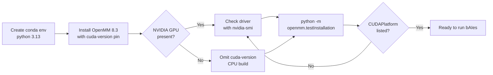
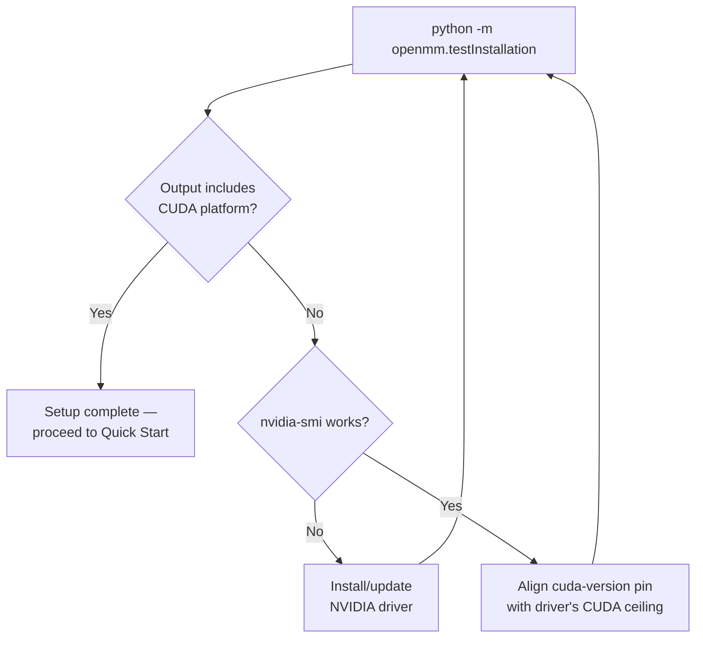

This page explains how to prepare a CUDA-capable environment for **bAIes-IDP-OpenMM**, the OpenMM implementation of bAIes — a method that generates atomic-resolution ensembles of intrinsically disordered proteins (IDPs) using AI structure predictors. Because the repository ships simulation logic rather than a compiled binary, everything about GPU support flows through one decision point: how you install OpenMM. By the end of this page you will have a conda environment with the CUDA build of OpenMM 8.3 and verified GPU visibility.


## Why the GPU Matters Here

bAIes produces *ensembles* — many independent molecular dynamics trajectories of the same disordered protein — and OpenMM is the engine that runs them. OpenMM can execute force-field computations either on the CPU or, when built with CUDA support, on NVIDIA GPUs. For ensemble generation the GPU path is what makes the workflow practical, which is why the project's installation instructions explicitly target the CUDA build rather than treating it as optional. The good news: from your perspective as a user, enabling GPU acceleration is a single `conda install` flag, not a manual CUDA Toolkit installation.

The whole setup reduces to three sequential steps — create an environment, install the CUDA-enabled OpenMM, verify the hardware is visible.



*The flowchart above shows the decision structure: the only branch point is whether an NVIDIA GPU exists; everything else is a linear sequence.*

Sources: [README.md](/README.md#L16-L35)

## Prerequisites: An NVIDIA GPU and Its Driver

Before touching conda, confirm you have an NVIDIA GPU whose **driver** supports a CUDA version. The README tells you exactly how to check: run `nvidia-smi`. This single command answers two questions at once — whether a driver is installed at all, and which CUDA versions it can support (look at the "CUDA Version" shown in the top-right of its output).

It is worth understanding the division of labor here, because it confuses many beginners: the **driver** is the system-level NVIDIA software that must already be on your machine, while the **CUDA runtime** that OpenMM links against is delivered by conda as part of the `cuda-version`-pinned package. That is why the instructions ask you to validate compatibility against `nvidia-smi` (the driver) and not against `nvcc` (a compiler check that is irrelevant here). In practice this means you never install NVIDIA's CUDA Toolkit manually for this project — you only need to make sure your driver is recent enough for the CUDA version you pin.

| Check | Command | What success looks like | What failure means |
|---|---|---|---|
| Driver present | `nvidia-smi` | GPU name, driver version, and a supported "CUDA Version" printed | Driver missing → install/update NVIDIA driver before continuing |
| CUDA ceiling | Same `nvidia-smi` output | The listed CUDA Version ≥ the `cuda-version` you plan to pin | Driver too old → either update the driver or pin a lower `cuda-version` |

Sources: [README.md](/README.md#L35)

## Step 1 — Create a Dedicated Python Environment

The instructions begin by isolating the project in its own conda environment named `baies`, pinned to Python 3.13. A dedicated environment matters because OpenMM's CUDA build pulls in a specific set of CUDA runtime libraries; keeping them in an isolated environment prevents conflicts with other scientific Python stacks on the same machine.

```bash
conda create -n baies python=3.13
conda activate baies
```

Everything in the remaining steps assumes the `baies` environment is **active** — run the verification command in the next section from inside it, not from `base`.

> [!TIP]
> The `cuda-version` pin does double duty: it simultaneously selects the GPU-enabled *build* of OpenMM and constrains which CUDA runtime libraries conda may install. One flag controls both the binary and its CUDA dependencies.

Sources: [README.md](/README.md#L20-L27)

## Step 2 — Install the CUDA Build of OpenMM

With the environment active, install OpenMM from the `conda-forge` channel, pinned to version 8.3 with CUDA support selected by the `cuda-version=13` pin:

```bash
conda install -c conda-forge openmm=8.3 cuda-version=13
```

Each piece of this command has a distinct role, summarized below.

| Command fragment | Purpose |
|---|---|
| `-c conda-forge` | Community channel that distributes the OpenMM CUDA builds |
| `openmm=8.3` | Pins the OpenMM release so behavior matches the published method |
| `cuda-version=13` | Selects the CUDA build of OpenMM and the matching CUDA runtime |
| *(omitting `cuda-version`)* | Produces the CPU-only build — the documented fallback for machines without a GPU |

The README is explicit about how to choose the pin value: **set `cuda-version` to a CUDA version supported by both your GPU driver and your OpenMM release**, and check that compatibility with `nvidia-smi`. Concretely, if `nvidia-smi` reports a CUDA ceiling of 13.x, pin `cuda-version=13`; if your driver is older and reports a lower ceiling, pin that lower version instead. If there is no GPU at all, simply omit the pin and conda resolves to the CPU build — the setup then still completes, just without GPU acceleration.

Sources: [README.md](/README.md#L29-L35)

## Step 3 — Verify the Installation

The final step is a built-in self-test that reports which compute platforms your OpenMM installation can actually see:

```bash
python -m openmm.testInstallation
```

Run this from inside the activated `baies` environment. A successful CUDA setup prints the available platforms and includes the CUDA platform among them — that entry is your confirmation that OpenMM, the conda-delivered CUDA runtime, and your NVIDIA driver are all mutually compatible. This test is the objective end-point of setup: if it lists CUDA, bAIes simulations can run on the GPU; if it does not, return to the driver check and revisit your `cuda-version` pin.



*The verification loop: a missing CUDA platform almost always traces back to either a missing driver or a pin/driver mismatch — both fixable without reinstalling the environment from scratch.*

Sources: [README.md](/README.md#L35-L41)

## Troubleshooting Reference

The failure modes you are likely to encounter map directly onto the two compatibility requirements the README states — driver support and OpenMM-release support. Use this table to diagnose from symptom to fix.

| Symptom | Likely cause | Fix |
|---|---|---|
| `nvidia-smi` command not found | No NVIDIA driver installed | Install the driver from NVIDIA before any conda work |
| `nvidia-smi` reports a lower CUDA Version than your pin | Driver older than the pinned CUDA version | Lower the `cuda-version` pin, or update the driver |
| `testInstallation` shows no CUDA platform | CPU build installed, or pin/driver mismatch | Re-run the install with the correct `cuda-version` pin |
| conda solves slowly or fails on `openmm=8.3 cuda-version=13` | Pin combination unavailable for your platform | Relax to a `cuda-version` your driver supports; OpenMM 8.3 remains fixed |
| Machine has no GPU at all | — | Omit the `cuda-version` pin entirely for the CPU build |

> [!TIP]
> Diagnose in dependency order: driver first (`nvidia-smi`), then the pin (`cuda-version`), then the platform list (`testInstallation`). Skipping straight to reinstalling OpenMM wastes time when the actual problem is a stale driver.

Sources: [README.md](/README.md#L29-L41)

## Where to Go Next

With a verified CUDA-enabled OpenMM environment, you have completed the hardware-facing half of getting started. The logical progression through the catalog is: revisit [Overview](1-overview) if you want the conceptual framing of the bAIes method, then follow [Quick Start](2-quick-start) to put this environment to work running bAIes, and consult [Companion Repository Resources](4-companion-repository-resources) for the associated materials that complement this codebase. When you are ready to understand what happens under the hood once simulations start running on the GPU, continue into the Deep Dive with [Architecture Overview](5-architecture-overview).
