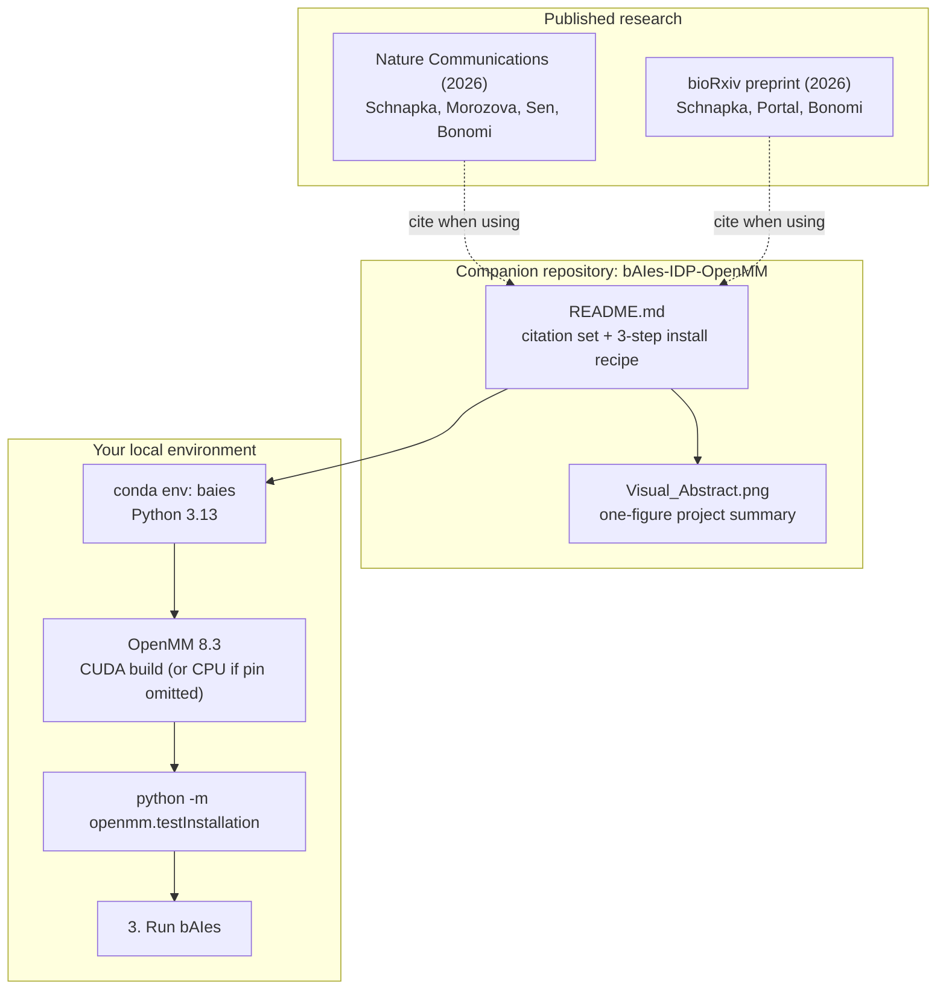
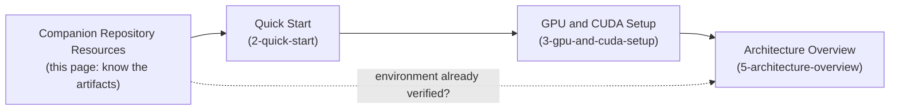

Every documentation set in this catalog ultimately points back to one physical place: the **COSBlab/bAIes-IDP-OpenMM companion repository**. This page is your guided inventory of that repository — what files it ships, what each artifact is for, and how each one connects to the research papers and to the rest of this documentation. Unlike the hands-on walkthroughs elsewhere in the catalog, this page is deliberately an *inventory and orientation* page: by the end, you will know exactly which resource answers which question, and where to go next.

Sources: [README.md](/README.md#L1-L7)

## What the Companion Repository Contains

The repository is **minimal by design**. At the root there are exactly two artifacts: `README.md` and `Visual_Abstract.png`. Nothing else is required to understand what the tool is, cite it correctly, and prepare a working environment. This is the defining trait of a *companion repository*: rather than bundling heavyweight code dumps, it travels alongside the published papers and carries only the two things a reader needs first — a graphical summary and a trustworthy setup/citation guide.

```
bAIes-IDP-OpenMM/
├── README.md            # 44 lines: visual abstract embed, citations, installation recipe
└── Visual_Abstract.png  # graphical summary rendered at the top of the README
```

Sources: [README.md](/README.md#L1-L5)

The following architecture overview shows how the repository's two artifacts act as a **bridge**: the publications point to the README, the README renders the visual abstract and prescribes the environment recipe, and that recipe materializes as a runnable OpenMM setup on your machine.



Sources: [README.md](/README.md#L1-L44)

| Resource | Location | Format | Role |
|---|---|---|---|
| `README.md` | Repository root | Markdown (44 lines) | Canonical citation list and installation recipe; rendered on the repository landing page |
| `Visual_Abstract.png` | Repository root | PNG image | Single-figure summary of the bAIes-IDP-OpenMM approach, embedded at the top of the README at width 1000 |

Sources: [README.md](/README.md#L1-L5)

> [!TIP]
> Because the README is the repository's *single source of truth*, treat it as the authoritative reference whenever this documentation and the README disagree — the README ships with the code and travels with the papers.

## The Visual Abstract at a Glance

The first resource you encounter is `Visual_Abstract.png`, embedded directly at the top of the README inside a centered `<p align="center">` block and displayed at width 1000. It is the fastest way to grasp, in one figure, what "OpenMM implementation of bAIes: Atomic resolution ensemble predictions of Intrinsically Disordered using AI structure predictors" actually looks like as a workflow. For a beginner, this image is the ideal zero-effort orientation step before any reading.


Sources: [README.md](/README.md#L3-L7), [Visual_Abstract.png](/Visual_Abstract.png)

## Citation Resources: The Reference Set

The README explicitly requests that you **cite two references when using this tool**. This is not an optional courtesy — it is the academic contract of a companion repository: the code you run is the executable evidence for the claims in these papers. The citation section sits at the very top of the README, immediately after the description, which signals its importance.

Sources: [README.md](/README.md#9-L13)

| # | Reference | Authors | Venue (Year) | DOI |
|---|---|---|---|---|
| 1 | *Atomic resolution ensembles of intrinsically disordered with Alphafold* | V. Schnapka, T. Morozova, S. Sen, M. Bonomi | Nature Communications (2026) | [10.1038/s41467-026-69172-y](https://doi.org/10.1038/s41467-026-69172-y) |
| 2 | *Leveraging state-of-the-art AI structure predictors to generate atomic resolution ensembles of intrinsically disordered proteins* | V. Schnapka, N. Portal, M. Bonomi | bioRxiv (2026) | [10.64898/2026.11.10.765624](https://doi.org/10.64898/2026.11.10.765624) |

The two references play complementary roles: the **Nature Communications** paper is the peer-reviewed primary publication, while the **bioRxiv** preprint documents the methodological approach of leveraging AI structure predictors for IDP ensembles. Together they form the complete citation footprint of the bAIes-IDP-OpenMM implementation.

Sources: [README.md](/README.md#L9-L13)

## The README as Your Setup Source of Truth

Beyond citations, the README's second payload is its **Installation instructions** section — a three-step recipe that takes you from an empty machine to a verified OpenMM environment. The recipe is intentionally compact; each step maps onto a dedicated page in this catalog's Get Started track, so the README works as a checklist while the catalog provides the narrative depth.

Sources: [README.md](/README.md#L16-L44)

| README step | Command | Purpose | Deep dive in this catalog |
|---|---|---|---|
| 1. Create a new environment | `conda create -n baies python=3.13` then `conda activate baies` | Isolated Python 3.13 environment named `baies` | [Quick Start](2-quick-start) |
| 2. Install OpenMM and dependencies | `conda install -c conda-forge openmm=8.3 cuda-version=13` | Installs OpenMM 8.3 from conda-forge; the `cuda-version` pin selects the CUDA build | [GPU and CUDA Setup](3-gpu-and-cuda-setup) |
| 3. Run bAIes | Final section of the recipe — hands off to launching bAIes | End of setup, start of simulation work | [Simulation Pipeline Walkthrough](11-simulation-pipeline-walkthrough) |

Sources: [README.md](/README.md#L20-L44)

Two details inside step 2 deserve special attention for beginners. First, the `cuda-version` pin is what selects the **CUDA build of OpenMM**: the README advises setting it to a CUDA version supported by *both* your GPU driver and your OpenMM release (checkable with `nvidia-smi`), and notes that omitting the pin entirely yields the **CPU build** on a machine without a GPU. Second, the README prescribes a built-in verification command so you never discover hardware problems mid-simulation.

```bash
python -m openmm.testInstallation
```

Sources: [README.md](/README.md#L29-L41)

> [!TIP]
> The `cuda-version=13` pin and the `openmm.testInstallation` check are the README's two safety rails: run the check immediately after installing, because it is the cheapest way to confirm OpenMM actually sees your GPU before investing hours in simulations.

Note the division of labor between this page and the hands-on guides: here we documented *what the README contains and why*; the actual step-by-step execution lives in [Quick Start](2-quick-start), hardware-specific configuration details live in [GPU and CUDA Setup](3-gpu-and-cuda-setup), and the simulation workflow itself begins in [Simulation Pipeline Walkthrough](11-simulation-pipeline-walkthrough).

Sources: [README.md](/README.md#L16-L44)

## How These Resources Fit the Documentation Track

With the inventory complete, the logical reading progression is short. This page is the final stop of the Get Started track's *orientation* phase — from here, your path depends on whether your environment is already verified.



- If you have **not yet built the environment**, follow the README recipe using [Quick Start](2-quick-start) as your narrated companion.
- If OpenMM is installed but your **GPU is not detected**, resolve it with [GPU and CUDA Setup](3-gpu-and-cuda-setup) — the README's `testInstallation` step is exactly the check that page helps you pass.
- If your environment is verified and you want to understand *how* the implementation is organized, cross the threshold into the Deep Dive track with [Architecture Overview](5-architecture-overview).
