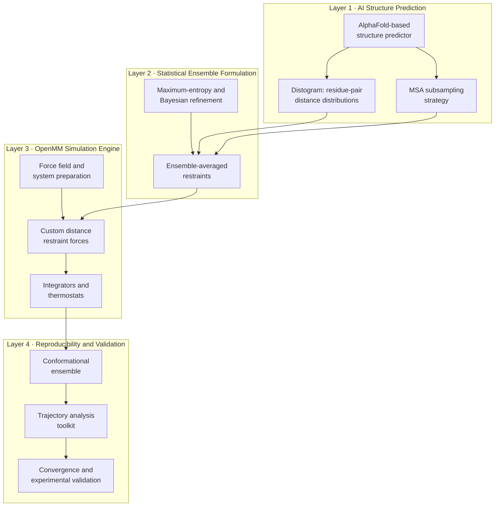
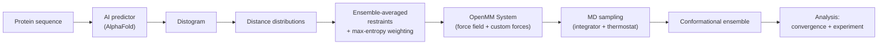

This page maps the conceptual architecture of **bAIes-IDP-OpenMM** — the system identity, its four architectural layers, the end-to-end data flow from AI structure prediction to a validated conformational ensemble, and the runtime topology that hosts it. Every architectural claim below is anchored to the repository's README, its visual abstract, or the Deep Dive catalog; no undocumented behavior is inferred.

## What This Repository Is

The repository self-identifies as an *"OpenMM implementation of bAIes: Atomic resolution ensemble predictions of Intrinsically Disordered using AI structure predictors"* — a single sentence that already encodes the full architectural contract: an **AI structure predictor** supplies structural information, and an **OpenMM molecular dynamics engine** converts it into **atomic-resolution ensembles** of intrinsically disordered proteins (IDPs). The methodology is grounded in two peer-reviewed/published works cited in the README: a Nature Communications paper on atomic resolution ensembles of IDPs with AlphaFold, and a BioRxiv preprint on leveraging state-of-the-art AI structure predictors for IDP ensemble generation. The graph below is the repository's own one-figure summary of this pipeline.


Sources: [README.md](README.md#L1-L13)

## Physical Repository Layout

The repository ships as a deliberately lean distribution: a README that carries the installation contract and citation record, plus a single graphical asset. The executable surface is anchored in the README's final section (`### 3. Run bAIes`), which marks the runtime entry point, while the conda-based provisioning in Section 2 resolves the actual engine — the code runtime is environment-delivered rather than vendored in-tree.

```
bAIes-IDP-OpenMM/
├── README.md            # System identity, citations, environment provisioning, run entry
└── Visual_Abstract.png  # Graphical abstract of the bAIes methodology
```

Sources: [README.md](README.md#L3-L5), [README.md](README.md#L43-L44)

## Conceptual Architecture: The Four Layers

**Prerequisite for the diagram**: bAIes is a two-stage methodology (prediction → simulation) wrapped in a statistical formulation stage and a validation stage. The following diagram is a conceptual map — it organizes the topics the project itself documents (via its citations and Deep Dive catalog) into four layers, with arrows denoting the direction of information flow. Each node corresponds to a documented concern, not to a specific named file in this distribution.



The layer-to-responsibility mapping below cross-validates this diagram against the README's scope statements and shows exactly where each concern is elaborated in the Deep Dive catalog.

| Layer | Responsibility | Verifiable Grounding | Deep Dive Coverage |
|---|---|---|---|
| 1 · AI Structure Prediction | Produce residue-residue distance information from AI predictors | "AI structure predictors"; AlphaFold citation | [AlphaFold Distograms and Distance Distributions](7-alphafold-distograms-and-distance-distributions), [MSA Subsampling Strategy](8-msa-subsampling-strategy) |
| 2 · Statistical Ensemble Formulation | Convert distance information into ensemble-averaged restraints with max-entropy weighting | Ensemble-based IDP ensemble methodology (citations) | [Ensemble-Averaged Restraints Theory](9-ensemble-averaged-restraints-theory), [Maximum Entropy and Bayesian Refinement](10-maximum-entropy-and-bayesian-refinement) |
| 3 · OpenMM Simulation Engine | Sample restrained conformations via MD | "OpenMM implementation of bAIes" | [Simulation Pipeline Walkthrough](11-simulation-pipeline-walkthrough), [Custom Distance Restraint Forces](12-custom-distance-restraint-forces), [Force Field and System Preparation](13-force-field-and-system-preparation), [Integrators and Thermostats](14-integrators-and-thermostats) |
| 4 · Reproducibility and Validation | Reproduce benchmarks; assess ensemble quality | Atomic-resolution IDP ensembles (citations) | [Benchmark Simulation Reproduction](16-benchmark-simulation-reproduction), [Trajectory Analysis Toolkit](18-trajectory-analysis-toolkit), [Ensemble Convergence Assessment](19-ensemble-convergence-assessment), [Experimental Validation Approaches](20-experimental-validation-approaches) |

Sources: [README.md](README.md#L7-L13)

## End-to-End Data Flow

**Prerequisite for the diagram**: this view traces a single unit of work through the architecture — a protein sequence entering Layer 1 and a validated ensemble leaving Layer 4. It complements the layered map above by making the transformation chain linear and explicit, which is the correct mental model when reasoning about how a restraint derived from a distogram ultimately constrains an OpenMM trajectory.



Reading the chain left to right: the AI predictor's raw output is a **distogram** — probabilistic distance information between residue pairs — which Layer 2 recasts as ensemble-averaged restraints (an essential distinction for IDPs, where a single distance cannot describe a disordered chain) before Layer 3 enforces them as custom forces inside OpenMM and samples thermodynamically consistent conformations. Layer 4 then closes the loop by checking that the sampled ensemble converges and agrees with experimental observables.

Sources: [README.md](README.md#L7-L13)

## Runtime Topology and Environment Configuration

The runtime contract is environment-centric: the README provisions everything through a conda environment with a pinned Python version and a conda-forge OpenMM build. Two build variants exist — a GPU build selected by the `cuda-version` pin, and a CPU build obtained by omitting the pin — and a built-in hardware verification command gates any simulation work on the resolved build actually seeing the hardware.

| Configuration Option | Documented Setting | Architectural Role |
|---|---|---|
| Python version | `python=3.13` | Base interpreter for the environment |
| MD engine | `openmm=8.3` (conda-forge) | The simulation engine of Layer 3 |
| Acceleration pin | `cuda-version=13` | Selects the CUDA build of OpenMM |
| CPU fallback | Omit `cuda-version` | Yields the CPU-only OpenMM build |
| Hardware gate | `python -m openmm.testInstallation` | Verifies the engine sees the GPU/CPU before use |

> [!TIP]
> The `cuda-version` pin is resolved at environment-creation time, not simulation time: it must be a CUDA version supported by **both** your GPU driver and your OpenMM release — check the driver ceiling with `nvidia-smi` before pinning. Omitting the pin entirely is the documented path to a CPU build on GPU-less machines.

Sources: [README.md](README.md#L16-L41)

## Architectural Invariants for Developers

Two invariants follow directly from the documented contract and should shape how you reason about the system. First, **build selection precedes execution**: the CUDA/CPU variant is fixed when the conda environment resolves, so architecture-level decisions about acceleration are made once per environment, then verified via `testInstallation` rather than re-decided per run. Second, **the predictor and the engine are decoupled layers**: the README's framing ("using AI structure predictors" feeding an "OpenMM implementation") means distance information produced upstream is consumed downstream as restraints — a boundary this catalog deliberately mirrors.

> [!TIP]
> The Deep Dive catalog is itself an architectural artifact: its *Scientific Foundations* → *OpenMM Implementation* → *Reproducibility Workflows* → *Analysis and Validation* subsections correspond one-to-one with Layers 1–4 above. Treat the catalog as the module map when locating any concern in the system.

Sources: [README.md](README.md#L7-L7), [README.md](README.md#L35-L40)

## Navigating the Deep Dive

Before proceeding, confirm you have completed the Get Started track — [Overview](1-overview) for project context, [Quick Start](2-quick-start) for a first runnable pass, and [GPU and CUDA Setup](3-gpu-and-cuda-setup) to concretize the runtime topology above. From here, the recommended progression follows the dependency order of the architecture itself: understand what is being predicted before studying how it is simulated.

| Stage | Reading Order | Pages |
|---|---|---|
| Prerequisites (Get Started) | 1 → 3 | [Overview](1-overview), [Quick Start](2-quick-start), [GPU and CUDA Setup](3-gpu-and-cuda-setup) |
| Layer 1–2 theory (Scientific Foundations) | 4 → 8 | [Intrinsically Disordered Protein Ensembles](6-intrinsically-disordered-protein-ensembles) → [AlphaFold Distograms and Distance Distributions](7-alphafold-distograms-and-distance-distributions) → [MSA Subsampling Strategy](8-msa-subsampling-strategy) → [Ensemble-Averaged Restraints Theory](9-ensemble-averaged-restraints-theory) → [Maximum Entropy and Bayesian Refinement](10-maximum-entropy-and-bayesian-refinement) |
| Layer 3 mechanics (OpenMM Implementation) | 9 → 12 | [Simulation Pipeline Walkthrough](11-simulation-pipeline-walkthrough) → [Custom Distance Restraint Forces](12-custom-distance-restraint-forces) → [Force Field and System Preparation](13-force-field-and-system-preparation) → [Integrators and Thermostats](14-integrators-and-thermostats) |
| Layers 3–4 in practice (Workflows + Validation) | 13 → 19 | [End-to-End Ensemble Generation](15-end-to-end-ensemble-generation) → [Benchmark Simulation Reproduction](16-benchmark-simulation-reproduction) → [Trajectory Analysis Toolkit](18-trajectory-analysis-toolkit) → [Ensemble Convergence Assessment](19-ensemble-convergence-assessment) |

**Your next step**: continue the theory-first path with [Intrinsically Disordered Protein Ensembles](6-intrinsically-disordered-protein-ensembles), which grounds why ensemble representations — and therefore the four-layer architecture above — are required for disordered proteins; developers eager for engine internals may instead jump directly to [Simulation Pipeline Walkthrough](11-simulation-pipeline-walkthrough).
