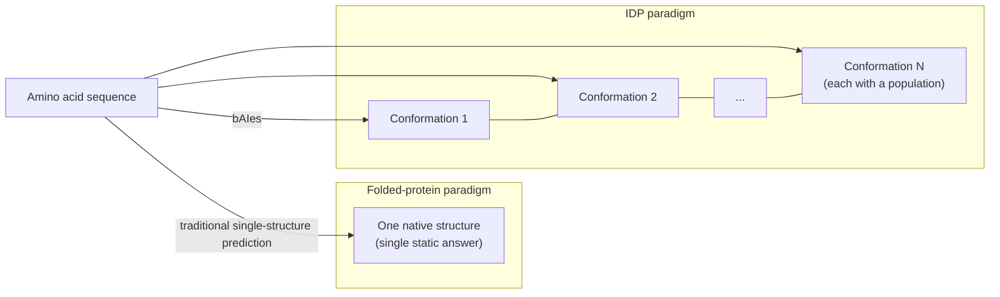
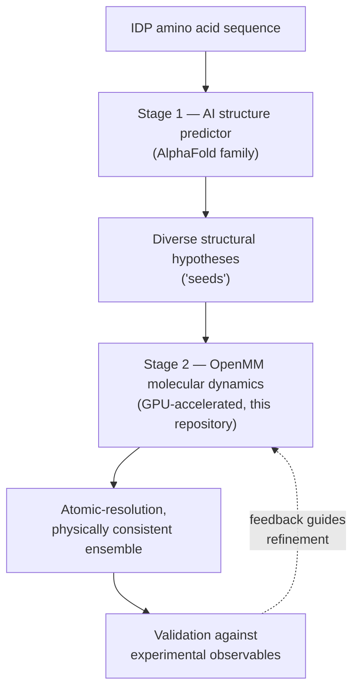

This page establishes the scientific foundation for everything else in the bAIes-IDP-OpenMM documentation: what intrinsically disordered proteins (IDPs) are, why they must be described as **ensembles** rather than single structures, and how this repository combines AI structure predictions with OpenMM molecular dynamics to produce atomic-resolution conformational ensembles. It is written for beginners — no prior structural biology or simulation experience is assumed. After reading it, you will understand *why* this toolchain exists and how its two core stages relate to each other.

Sources: [README.md](README.md#L1-L13)

## The Repository at a Glance

The repository is intentionally lightweight: it consists of a README and a visual abstract, and its README describes it as the **"OpenMM implementation of bAIes: Atomic resolution ensemble predictions of Intrinsically Disordered [Proteins] using AI structure predictors"**. This tells you the division of labor upfront — the heavy predictor-side machinery lives in a companion repository, while this repository provides the molecular dynamics (MD) execution layer that turns AI-generated structural hypotheses into physically consistent ensembles.


The visual abstract above condenses the whole scientific story into one image: AI structure predictors propose atomic-resolution conformations of a disordered protein, and OpenMM simulations refine them into a full ensemble. Every section of the documentation catalog elaborates on one piece of this picture.

Sources: [README.md](README.md#L1-L7), [Visual_Abstract.png](Visual_Abstract.png)

The scientific claims behind the method are anchored in two peer-reviewed/preprint publications referenced in the README: a *Nature Communications* paper on atomic-resolution ensembles of intrinsically disordered proteins with AlphaFold (Schnapka, Morozova, Sen, Bonomi, 2026), and a *BioRxiv* preprint on leveraging state-of-the-art AI structure predictors for IDP ensembles (Schnapka, Portal, Bonomi, 2026). If you later build on this work, the README asks that you cite both.

Sources: [README.md](README.md#L9-L13)

## What Are Intrinsically Disordered Proteins?

Most proteins adopt one stable, well-defined 3D "native" structure — fold them the same way twice and you get essentially the same shape. **Intrinsically disordered proteins (IDPs)** are different: large, functionally important regions of their amino acid sequence never settle into a single stable fold. Instead, an IDP continuously fluctuates among an enormous number of different conformations, and this *disorder itself* is often what makes the protein biologically useful — for example, in molecular recognition and signaling.

Sources: [README.md](README.md#L7), [README.md](README.md#L11-L13)

This distinction changes what "structure" even means for an IDP. The concept relationship below contrasts the two paradigms:



For a folded protein, the question "what does this sequence look like?" has one dominant answer. For an IDP, the honest answer is a **population-weighted set of structures** — an *ensemble* — where no single conformation represents the whole protein, but together they statistically characterize its behavior.

Sources: [README.md](README.md#L7)

## Why Ensembles, Not Structures?

Because an IDP samples many conformations, almost anything you can measure about it in an experiment is an **average over all the conformations present**, weighted by how often each one occurs. A single predicted structure cannot reproduce such averages; only an ensemble can. This is the core motivation for the ensemble approach that bAIes implements and that this repository executes in OpenMM.

Sources: [README.md](README.md#L7), [README.md](README.md#L11-L13)

The table summarizes the paradigm shift in concrete terms:

| Aspect | Single-structure view | Ensemble view (bAIes) |
|---|---|---|
| Output | One 3D model | Many 3D models with populations |
| Disorder | Cannot be represented | Intrinsic to the representation |
| Experimental data | Compared model-by-model | Compared as **ensemble averages** |
| Question answered | "What is the shape?" | "What is the distribution of shapes?" |

> [!TIP]
> When you later read about ensemble-averaged restraints, keep this table in mind: the shift from "compare one structure to data" to "compare a weighted average over structures to data" is exactly what the restraint mathematics in the deep-dive pages formalizes.

Sources: [README.md](README.md#L7), [README.md](README.md#L11-L13)

## The bAIes Strategy: AI Predictions Meet Molecular Simulation

The central insight of bAIes is to repurpose AI structure predictors — designed to output single structures — as generators of **structural hypotheses** for disordered proteins, and then use physics-based molecular dynamics to assemble those hypotheses into a consistent ensemble. The two stages play complementary roles, as this concept map shows:



The two stages divide the problem according to what each tool is good at:

| Stage | Engine | Contribution to the ensemble | Where to learn more |
|---|---|---|---|
| Hypothesis generation | AI structure predictor (AlphaFold family) | Atomic-resolution candidate conformations | [AlphaFold Distograms and Distance Distributions](7-alphafold-distograms-and-distance-distributions) |
| Physical refinement | OpenMM (this repository) | Energetically relaxed, dynamically sampled structures | [Simulation Pipeline Walkthrough](11-simulation-pipeline-walkthrough) |

Sources: [README.md](README.md#L7), [README.md](README.md#L11-L13)

**OpenMM's role** deserves emphasis: it is the physics engine that takes AI-proposed conformations and lets them move under a physical force field, so the final ensemble is not just a collage of predictions but a set of structures that are mutually compatible with molecular mechanics. OpenMM is chosen here for its GPU acceleration — the README's install command pulls a CUDA-enabled build (`openmm=8.3 cuda-version=13`) precisely because MD is computationally demanding, and a GPU makes ensemble-scale simulation practical.

Sources: [README.md](README.md#L29-L35)

> [!TIP]
> The `cuda-version` pin in the install command selects the CUDA build of OpenMM and must match a version supported by *both* your GPU driver and your OpenMM release — the README suggests verifying with `nvidia-smi` and running `python -m openmm.testInstallation` before proceeding. On GPU-less machines, omitting the pin yields a CPU build instead.

Sources: [README.md](README.md#L32-L41)

## Getting Hands-On With This Repository

Because this repository is the execution layer rather than the predictor layer, getting started is deliberately simple: create a Python 3.13 environment, install OpenMM 8.3 with a CUDA pin appropriate for your hardware, verify the installation, and then run bAIes as described in the README. The concrete commands are:

```bash
conda create -n baies python=3.13
conda activate baies
conda install -c conda-forge openmm=8.3 cuda-version=13
python -m openmm.testInstallation
```

| Setting | Value | Why it matters |
|---|---|---|
| Python version | 3.13 | Runtime environment for OpenMM |
| OpenMM version | 8.3 | The MD engine used for ensemble refinement |
| `cuda-version` pin | 13 (adjust to your driver) | Selects GPU build; omit for CPU-only machines |
| Verification | `python -m openmm.testInstallation` | Confirms OpenMM sees your hardware |

Note that the "Run bAIes" section of the README defers to the **companion repository**, which hosts the predictor-side workflow and the pipeline scripts; this repository's job begins once structures are ready for simulation.

Sources: [README.md](README.md#L16-L44)

## How This Page Connects to the Rest of the Documentation

This page gave you the *conceptual* map: IDPs need ensembles, ensembles need both AI-proposed structures and physics-based refinement. The natural progression from here follows the catalog's logic:

| Your goal | Recommended next page |
|---|---|
| Install and run the tool first, theory later | [Quick Start](2-quick-start) |
| Find the predictor-side code and scripts | [Companion Repository Resources](4-companion-repository-resources) |
| Understand how AlphaFold outputs become restraints | [AlphaFold Distograms and Distance Distributions](7-alphafold-distograms-and-distance-distributions) |
| See how subsampling creates ensemble diversity | [MSA Subsampling Strategy](8-msa-subsampling-strategy) |
| Understand the math linking ensembles to data | [Ensemble-Averaged Restraints Theory](9-ensemble-averaged-restraints-theory) |
| Follow the simulation code step by step | [Simulation Pipeline Walkthrough](11-simulation-pipeline-walkthrough) |

A recommended reading order for beginners is: [Overview](1-overview) → [Quick Start](2-quick-start) → [Companion Repository Resources](4-companion-repository-resources) → this page again with the papers in hand → the Scientific Foundations series ([AlphaFold Distograms and Distance Distributions](7-alphafold-distograms-and-distance-distributions), [MSA Subsampling Strategy](8-msa-subsampling-strategy), [Ensemble-Averaged Restraints Theory](9-ensemble-averaged-restraints-theory), [Maximum Entropy and Bayesian Refinement](10-maximum-entropy-and-bayesian-refinement)) → the OpenMM Implementation series starting at [Simulation Pipeline Walkthrough](11-simulation-pipeline-walkthrough).
