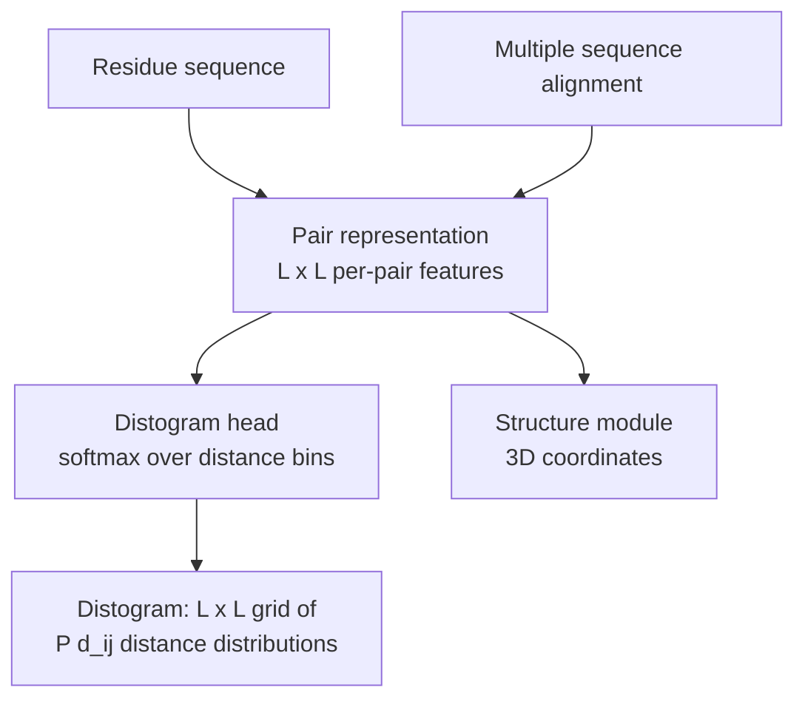
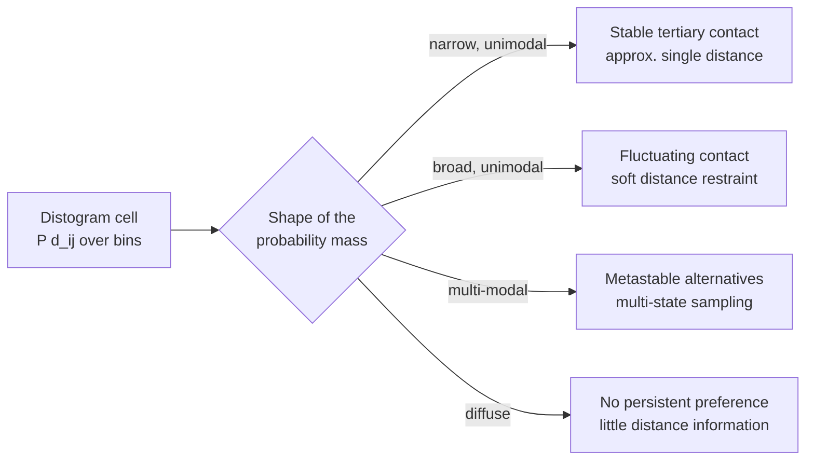
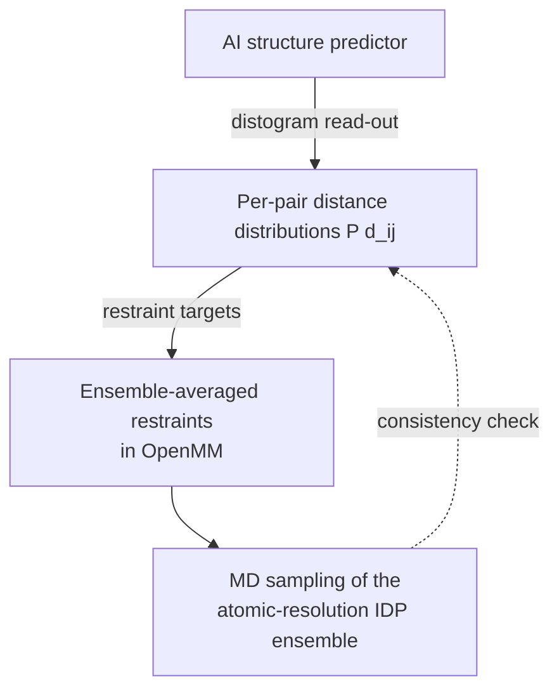

This page is the conceptual bridge between the **predictor stage** of bAIes (what AI structure models compute) and the **simulation stage** (what OpenMM consumes). It explains the *distogram* — AlphaFold's native representation of pairwise distance uncertainty — why, for intrinsically disordered proteins (IDPs), this object is a full **distance distribution** rather than a single distance, and how those distributions become the raw material for ensemble generation. By the end you will know exactly what quantity flows out of the predictor and where the rest of this documentation picks it up.

Sources: [README.md](/README.md#L7), [Visual_Abstract.png](/Visual_Abstract.png)

## Why a Distribution, Not a Structure

The repository describes itself in one line as an *"OpenMM implementation of bAIes: Atomic resolution ensemble predictions of Intrinsically Disordered using AI structure predictors."* Two words in that sentence do the heavy lifting: **ensemble** and **disordered**. A folded protein can be summarized by a single structure; an IDP cannot, because conformational heterogeneity *is* the functional state. Any method that claims atomic-resolution *ensemble* predictions must therefore extract a probability distribution from its predictor, not a point estimate.

Sources: [README.md](/README.md#L7)

The two references the README asks users to cite frame exactly this idea: a Nature Communications paper titled *"Atomic resolution ensembles of intrinsically disordered with Alphafold"* and a preprint on *"Leveraging state-of-the-art AI structure predictors to generate atomic resolution ensembles of intrinsically disordered proteins."* The underlying design philosophy is that the predictor's **internal distance statistics** — not its single-structure 3D output — are the scientifically meaningful quantity for disordered systems.

Sources: [README.md](/README.md#L9-L13)

The visual abstract distills this flow at a glance: predictor → distance statistics → simulated atomic-resolution ensemble.

Sources: [Visual_Abstract.png](/Visual_Abstract.png), [README.md](/README.md#L3-L5)

## The Distogram: AlphaFold's Native Distance Representation

In AlphaFold-class architectures (Jumper et al., 2021 — the literature the bAIes papers build on), the network maintains a **pair representation**: learned features for every residue pair (i, j). This representation is exposed through several output heads, one of which is the **distogram head**. For every residue pair it emits a probability distribution over discrete distance bins — on the order of 64 bins spanning roughly 2–22 Å (sub-Ångström, ≈0.3 Å resolution), with bin probabilities produced by a softmax and summing to 1. Crucially, the distogram and the 3D coordinates from the structure module are **parallel outputs of the same pair representation**; they are two views of the same learned pairwise geometry.

Sources: [README.md](/README.md#L9-L13)

Reading a single cell is straightforward: cell (i, j) of the distogram is a complete probability density over the distance between residues i and j. Its **expectation** gives a mean distance; its **spread** gives distance uncertainty or, in ensemble terms, heterogeneity. Do not confuse the distogram with the *predicted aligned error* (PAE) head — PAE measures pairwise positional confidence for superposition and is a different quantity entirely.

> [!TIP]
> Distogram bins are **probabilities, not distances**. To obtain usable distances you must either take the bin-center expectation of the distribution or sample from it — reading off only the maximum-probability bin discards the variance, which for IDPs is precisely the signal.

Because the distogram keeps the full shape of P(d) instead of collapsing it, it strictly dominates the older **contact map** representation for flexible systems:

| Property | Contact map | Distogram |
|---|---|---|
| Output alphabet | binary {contact, no contact} | probability over ~64 distance bins |
| Effective resolution | threshold-dependent | ≈0.3 Å per bin |
| Flexible / disordered regions | collapse to "no contact" | retain the full shape of P(d) |
| Usable as a restraint | rigid, binary geometry | soft, probabilistic geometry |
| Ensemble information | none | mean, width, and modality per pair |

Sources: [README.md](/README.md#L9-L13)

## Reading the Distogram of a Disordered Protein

For a **folded domain**, most distogram cells show a sharp, unimodal peak: the pair's distance is well-defined, which is exactly why a single predicted structure suffices. For an **IDP**, residue pairs lack persistent tertiary contacts, so the probability mass spreads out — broad, sometimes multi-modal. The distogram cell of a disordered pair is not a failed prediction; it is an honest one.

Sources: [README.md](/README.md#L9-L13)

This is the core premise of bAIes: **the broadness is signal, not noise**. A distogram cell *already is* a distance distribution — there is no need to generate thousands of predicted structures and histogram their pairwise distances. One well-conditioned distogram provides P(d_ij) directly per residue pair, which is what *"leveraging AI structure predictors to generate ensembles"* means at the data level.

Sources: [README.md](/README.md#L9-L13)

| Distogram signature | Interpretation | Ensemble implication |
|---|---|---|
| single narrow peak | stable tertiary contact | near-deterministic geometry |
| broad unimodal | fluctuating proximity | soft restraint with intrinsic width |
| multi-modal | multiple metastable pair geometries | multi-state ensemble sampling |
| diffuse / near-uniform | no persistent distance preference | pair contributes little restraint information |

A useful nuance: IDPs are rarely uniformly disordered. The *pattern* of sharp versus broad cells across the L×L grid is a spatial map of where the chain is locally constrained (residual structure) versus freely fluctuating. These distributions are also **conditioned on the predictor's inputs** — the sequence profile drives how much probability mass concentrates — which is the subject of the next Scientific Foundations page.

Sources: [README.md](/README.md#L9-L13)

## From Distance Distributions to Restraints: Where This Page Ends

Conceptually, the pipeline proceeds in three steps: (1) read out per-pair distance distributions from the predictor, (2) convert them into ensemble-averaged restraints, and (3) sample with OpenMM until the simulated ensemble reproduces the input distributions. The README establishes OpenMM (installed here as version 8.3, with a CUDA-13 build selectable via the `cuda-version` pin) as the simulation engine; the restraint mathematics and force implementation are documented on their own pages rather than here.

Sources: [README.md](/README.md#L7), [README.md](/README.md#L29-L33)

To keep this page focused, the following are deliberately out of scope and covered elsewhere: why IDPs require ensembles at all ([Intrinsically Disordered Protein Ensembles](6-intrinsically-disordered-protein-ensembles)); how varying the input profile modulates the distributions ([MSA Subsampling Strategy](8-msa-subsampling-strategy)); the mathematical form of ensemble-averaged restraints ([Ensemble-Averaged Restraints Theory](9-ensemble-averaged-restraints-theory)); their Bayesian and maximum-entropy refinement ([Maximum Entropy and Bayesian Refinement](10-maximum-entropy-and-bayesian-refinement)); and the OpenMM force objects that implement them ([Custom Distance Restraint Forces](12-custom-distance-restraint-forces)).

Sources: [README.md](/README.md#L7-L13)

## Where Distograms Live in This Codebase

An inventory check matters here: the `main` branch of this repository contains exactly two files — `README.md` and `Visual_Abstract.png`. The README carries the citation block and installation instructions (environment creation, OpenMM via conda-forge, hardware verification with `openmm.testInstallation`), but its run instructions terminate at a bare **"Run bAIes."** heading with no inline steps. The executable predictor runs and distogram tooling are therefore delivered through the companion repository documented at [Companion Repository Resources](4-companion-repository-resources).

Sources: [README.md](/README.md#L16-L41), [README.md](/README.md#L43-L44)

> [!TIP]
> Do not search this repository for distogram-extraction or predictor-inference code — on `main` there is none. The distogram read-out logic ships with the companion resources, and this documentation set treats the distogram→distribution handoff as a conceptual interface between the two.

| Artifact | This repository (`main`) | Companion resources |
|---|---|---|
| README and visual abstract | ✓ ([README.md](/README.md), [Visual_Abstract.png](/Visual_Abstract.png)) | — |
| Citation set (Nat. Comms. + preprint) | ✓ ([README.md](/README.md#L9-L13)) | — |
| OpenMM installation recipe | ✓ ([README.md](/README.md#L29-L41)) | — |
| Predictor runs / distogram outputs | — | see [Companion Repository Resources](4-companion-repository-resources) |
| Simulation and analysis code | — | see [Companion Repository Resources](4-companion-repository-resources) |

Sources: [README.md](/README.md#L1-L44)

## Suggested Reading Progression

This page sits at the center of the Scientific Foundations track. A coherent path through it:

- **Before this page:** [Intrinsically Disordered Protein Ensembles](6-intrinsically-disordered-protein-ensembles) — why heterogeneity demands an ensemble description in the first place.
- **This page:** [AlphaFold Distograms and Distance Distributions](7-alphafold-distograms-and-distance-distributions) — the quantity the predictor actually provides.
- **Next:** [MSA Subsampling Strategy](8-msa-subsampling-strategy) — how conditioning the predictor on varied input profiles diversifies the distance distributions.
- **Then:** [Ensemble-Averaged Restraints Theory](9-ensemble-averaged-restraints-theory) and [Maximum Entropy and Bayesian Refinement](10-maximum-entropy-and-bayesian-refinement) — turning distributions into principled restraints.
- **Implementation:** [Custom Distance Restraint Forces](12-custom-distance-restraint-forces) and [Simulation Pipeline Walkthrough](11-simulation-pipeline-walkthrough) — the OpenMM realization of everything above.
