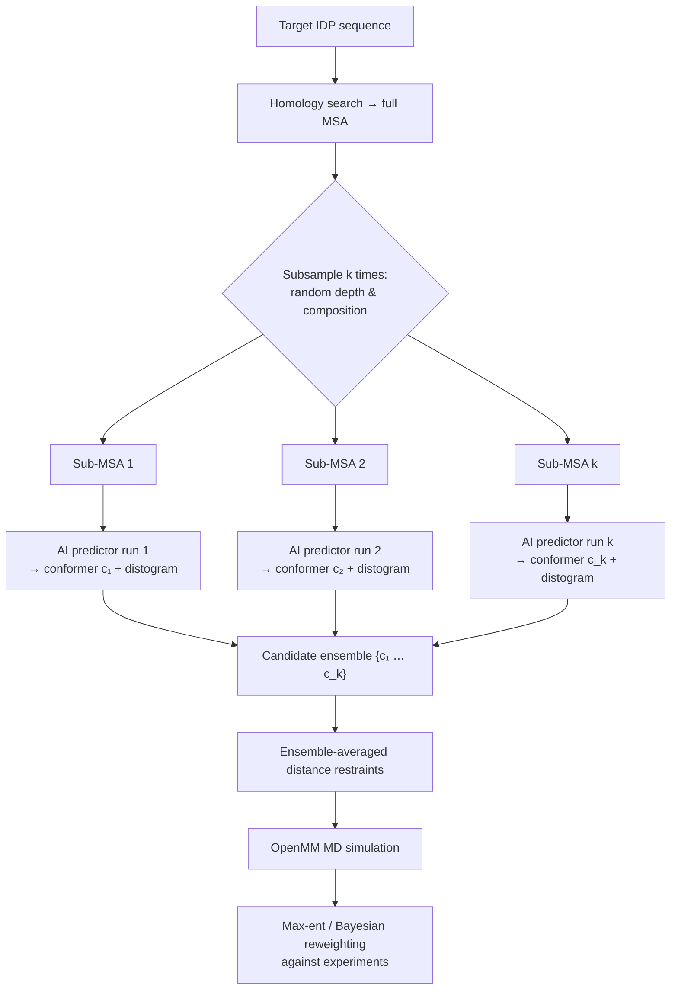
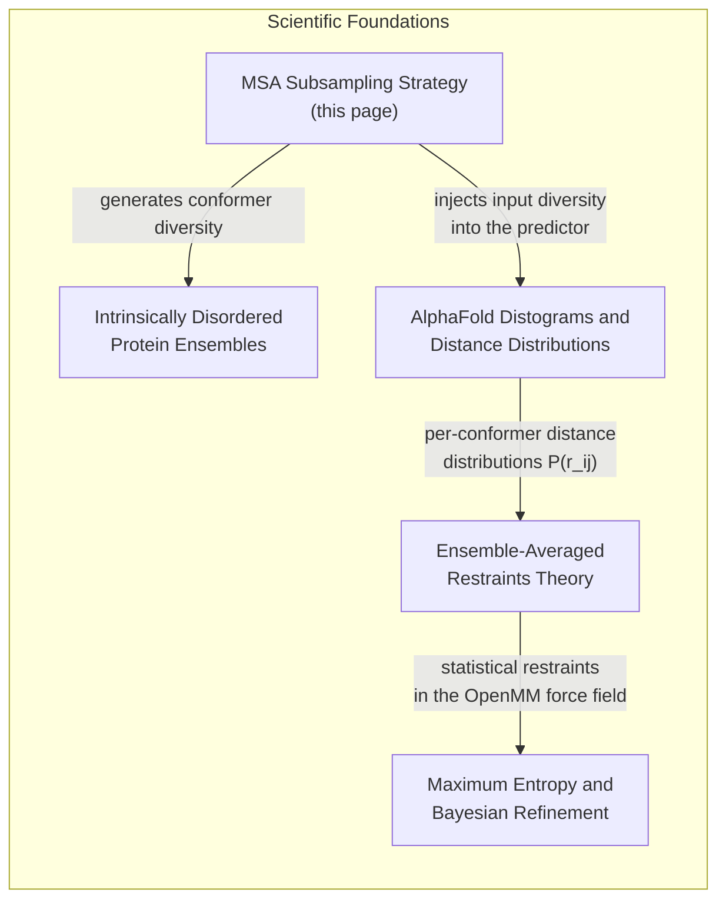
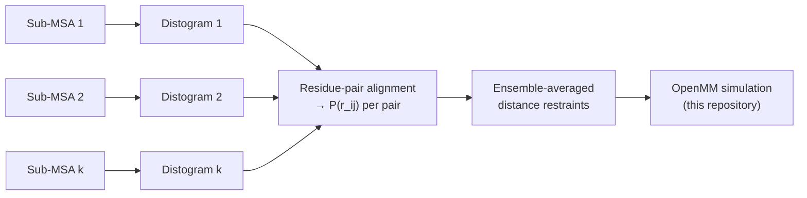

This page explains the scientific engine behind ensemble generation in bAIes: deliberately subsampling the Multiple Sequence Alignment (MSA) before each AI structure predictor run, so that a single predictor becomes a *generator of conformational diversity* for intrinsically disordered proteins (IDPs). Because this repository ships only the OpenMM deployment layer (`README.md` and `Visual_Abstract.png`), this page operates at the conceptual level of the method's Scientific Foundations, using the README's method statement and its cited papers as the verifiable anchors, and hands off implementation specifics to the companion works and adjacent catalog pages.

Sources: [README.md](README.md#L1-L13)

## Where This Page Sits in the bAIes Architecture

The repository defines bAIes as an "OpenMM implementation of bAIes: Atomic resolution ensemble predictions of Intrinsically Disordered using AI structure predictors" — a precise decomposition of the workflow into a predictor stage (producing ensemble members) and an OpenMM stage (sampling and refining them). MSA subsampling is the diversity mechanism of the predictor stage; it sits *upstream* of everything this repository's OpenMM code consumes. Conceptually, the pipeline is:

Sources: [README.md](README.md#L7), [README.md](README.md#L9-L13)

The strategy connects four Foundation pages into one causal chain — subsampling feeds distogram variance, distogram variance becomes restraint distributions, restraints constrain OpenMM sampling, and maximum entropy calibrates the result against experiment:

Sources: [README.md](README.md#L7)

## The Evidence Base: What This Repository Verifies

A precision requirement before diving in: this repository is a **deployment repo**, not a protocol repo. The tree contains exactly two artifacts — a 44-line README and the visual abstract. The README instructs users to build a Python/OpenMM environment and "run bAIes," but the predictor-side MSA protocol (search parameters, subsample sizes, number of models) is specified in the two publications the README mandates citing. The table below maps each claim used in this page to its verifiable anchor, so you can distinguish repository-verified facts from literature-level context.

| Claim used on this page | Verifiable anchor in this repository |
|---|---|
| bAIes = atomic-resolution ensemble predictions of IDPs via AI structure predictors | [README.md](README.md#L7) |
| Method authority: Schnapka, Morozova, Sen & Bonomi, *Nature Communications* (2026) | [README.md](README.md#L9-L11) |
| Method authority: Schnapka, Portal & Bonomi, *BioRxiv* (2026) preprint | [README.md](README.md#L12-L13) |
| Runtime dependency: OpenMM 8.3 (conda-forge), CUDA 13 build or CPU build | [README.md](README.md#L29-L36) |
| Predictor-side MSA/subsampling hyperparameters | **Not in this repo** — defined in the cited papers |

Sources: [README.md](README.md#L7-L13), [README.md](README.md#L29-L36)

> [!TIP]
> When you need the exact subsample sizes or the number of predictor runs, go to the two cited papers (README lines 9–13), not this codebase — the repo's run section terminates immediately after "Run bAIes." with no CLI surface for predictor parameters.

## From Coevolution to Conformation: Why MSA Depth Controls Predicted Order

The first-principles question: why would altering the MSA *input* move the *output* structure at all? AlphaFold-class predictors extract **coevolutionary signal** — correlated substitutions across homologs — from the MSA and compile it into inter-residue distance expectations. The depth of the MSA governs how much of that signal is available: a deep MSA delivers strong, confident coevolution, which the network interprets as evidence for a well-defined, compact fold. An IDP violates this assumption by definition — it has no dominant coevolutionary signature because it has no dominant fold — yet a deep MSA still pushes the predictor toward over-confident, compacted predictions. Subsampling attacks the problem at its input: by randomly truncating the MSA, you withhold coevolutionary evidence, and the predictor's output becomes governed by sequence-intrinsic tendencies (charge patterning, proline content, local propensities) rather than a spurious global fold signal. The method statement in the repository — ensembles "using AI structure predictors" — is precisely this inversion: the predictor's sensitivity to MSA composition, normally a nuisance, is repurposed as a sampling dial.

Sources: [README.md](README.md#L7), [README.md](README.md#L9-L13)

## The Subsampling Mechanism: One Predictor, Many Conformers

With the bias mechanism established, the strategy reduces to a disciplined repetition. Each ensemble member is produced by an independent predictor run on a freshly drawn MSA subsample; no two runs see the same coevolutionary evidence, so no two runs converge on the same distance expectation. The collection of outputs forms the candidate ensemble that the OpenMM layer of this repository then samples and refines. Three design properties make this efficient and principled:

1. **Independent draws, shared sequence.** Every subsample is drawn from the same full MSA of the same target sequence, so all conformers describe the same protein under different evidence conditions — diversity without target drift.
2. **Variance is a feature, not noise.** The spread across predictor runs directly encodes uncertainty in inter-residue distances, which is exactly the quantity the downstream restraint theory consumes (see below).
3. **Throughput scales linearly.** Each predictor run is independent, so ensemble size is set by available compute and desired statistical resolution rather than by any coupling between runs.

The authoritative description of the exact draw procedure lives in the papers the README instructs users to cite; this repository only guarantees the downstream half of the pipeline.

Sources: [README.md](README.md#L7), [README.md](README.md#L9-L13)

## How Subsampled Distograms Become Ensemble Restraints

This is the load-bearing bridge between this page and its neighbors, so the causal chain deserves explicit tracing. Each subsampled predictor run emits not just a 3D conformer but a **distogram** — a probability distribution over inter-residue distances for every residue pair. Because every run saw a different MSA, the distograms differ across the ensemble; aligning them residue-pair-by-residue-pair converts *between-run variance* into *within-ensemble distance distributions* P(r_ij). Those distributions are exactly the input format required by ensemble-averaged restraint theory, which applies them as statistical restraints inside the OpenMM force field, and by maximum-entropy reweighting, which calibrates their relative influence against experimental data. In short: subsampling manufactures the heterogeneity that the restraint and refinement mathematics require.

Sources: [README.md](README.md#L7), [README.md](README.md#L9-L13)

> [!TIP]
> The distance distributions used by the OpenMM restraints do not come from long MD exploration alone — they originate from cross-run distogram variance induced by MSA subsampling. This means the quality of your ensemble restraints is bounded by the diversity of your subsamples, before OpenMM ever executes a timestep.

For the mathematical form of the restraints that consume these distributions, continue to [Ensemble-Averaged Restraints Theory](9-ensemble-averaged-restraints-theory); for the distogram-to-distribution conversion itself, see [AlphaFold Distograms and Distance Distributions](7-alphafold-distograms-and-distance-distributions).

## Strategy Comparison: Subsampling vs Alternative Diversity Mechanisms

To position the choice architecturally, compare the leading mechanisms for extracting conformational diversity from AlphaFold-class predictors. The comparison below is conceptual context anchored in the works this repository cites; the bAIes papers make the design choice for IDP ensembles explicit.

| Diversity mechanism | How it perturbs the predictor | Strengths | Limitations | Role in bAIes |
|---|---|---|---|---|
| **Full-MSA single prediction** (baseline) | None | One high-confidence structure | Deterministic; compacted IDP artifact; no ensemble | Rejected — defeats the purpose |
| **MSA subsampling** (bAIes strategy) | Random depth/composition per run | Uncertainty-aware diversity; linear scaling; yields per-pair distance distributions | Requires per-run compute; subsample calibration needed | **Core ensemble generator** |
| **MSA clustering** (AF-Cluster-style) | One cluster per run | Biologically interpretable sub-states | Clustering granularity is sequence-dependent | Conceptual neighbor; not the bAIes default |
| **Stochastic seed / dropout variation** | Network-level randomness | Zero MSA engineering | Weaker, less interpretable diversity signal | Adjunct, not substitute |

Sources: [README.md](README.md#L7), [README.md](README.md#L9-L13)

The decisive property for IDPs is the last column of the subsampling row: only input-level perturbation produces *quantified distance uncertainty* (a distribution per residue pair) rather than merely *distinct point structures*. An ensemble of point predictions cannot directly parameterize a probabilistic restraint; a family of distograms can. That is the reason a strategy built around MSA variance wins architecturally for the downstream maximum-entropy machinery described in [Maximum Entropy and Bayesian Refinement](10-maximum-entropy-and-bayesian-refinement).

Sources: [README.md](README.md#L9-L13)

## Practical Grounding in This Repository

What can you verify concretely right now? The repository establishes the runtime half of the pipeline with a minimal, reproducible environment contract: a conda environment with Python 3.13, OpenMM 8.3 from conda-forge, and an optional `cuda-version=13` pin selected to match your GPU driver (verified via `nvidia-smi` and `python -m openmm.testInstallation`). On GPU-less machines the pin is simply omitted for the CPU build. The predictor half — where subsampling actually executes — is deliberately externalized: the README's third section ("Run bAIes") contains no parameter surface, directing all method authority to the two citations. This split is architecturally clean: stochasticity lives upstream in the predictor layer, determinism lives downstream in the OpenMM layer.

| Step | Repository-verified instruction | Purpose |
|---|---|---|
| 1 | `conda create -n baies python=3.13` | Isolated runtime environment |
| 2 | `conda install -c conda-forge openmm=8.3 cuda-version=13` | GPU (or CPU) simulation engine |
| 3 | `python -m openmm.testInstallation` | Hardware sanity check |
| 4 | Predictor-side MSA subsampling | **External** — see cited papers |

Sources: [README.md](README.md#L16-L42), [README.md](README.md#L9-L13)

Environment prerequisites and hardware selection are covered in depth in [GPU and CUDA Setup](3-gpu-and-cuda-setup) and [Companion Repository Resources](4-companion-repository-resources).

## Reading Path Forward

The MSA subsampling strategy is the second domino in the bAIes causal chain — it answers *where ensemble diversity comes from*, and everything downstream consumes its output. The recommended progression, matching each page's role in the pipeline: first, ground the IDP ensemble concept itself in [Intrinsically Disordered Protein Ensembles](6-intrinsically-disordered-protein-ensembles); then trace how each subsampled run's distogram is converted into per-pair distributions in [AlphaFold Distograms and Distance Distributions](7-alphafold-distograms-and-distance-distributions); next, formalize those distributions as statistical restraints in [Ensemble-Averaged Restraints Theory](9-ensemble-averaged-restraints-theory); and close the loop with experimental calibration in [Maximum Entropy and Bayesian Refinement](10-maximum-entropy-and-bayesian-refinement). When you are ready to cross from theory to execution, [Simulation Pipeline Walkthrough](11-simulation-pipeline-walkthrough) opens the OpenMM Implementation section of this repository.
