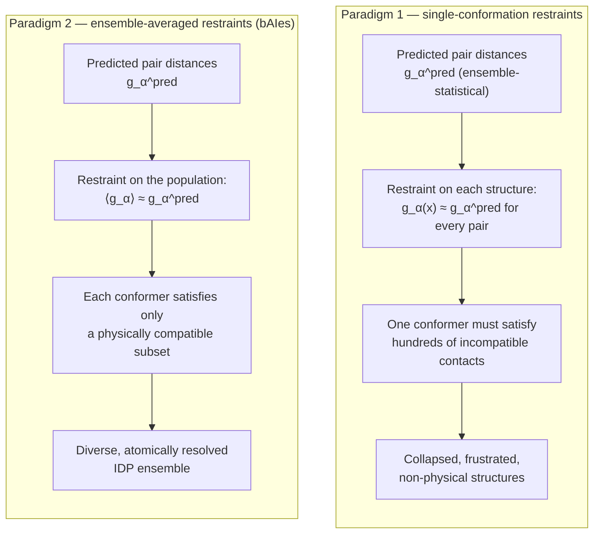
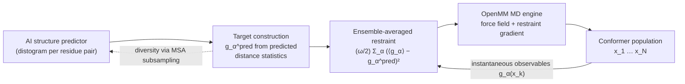
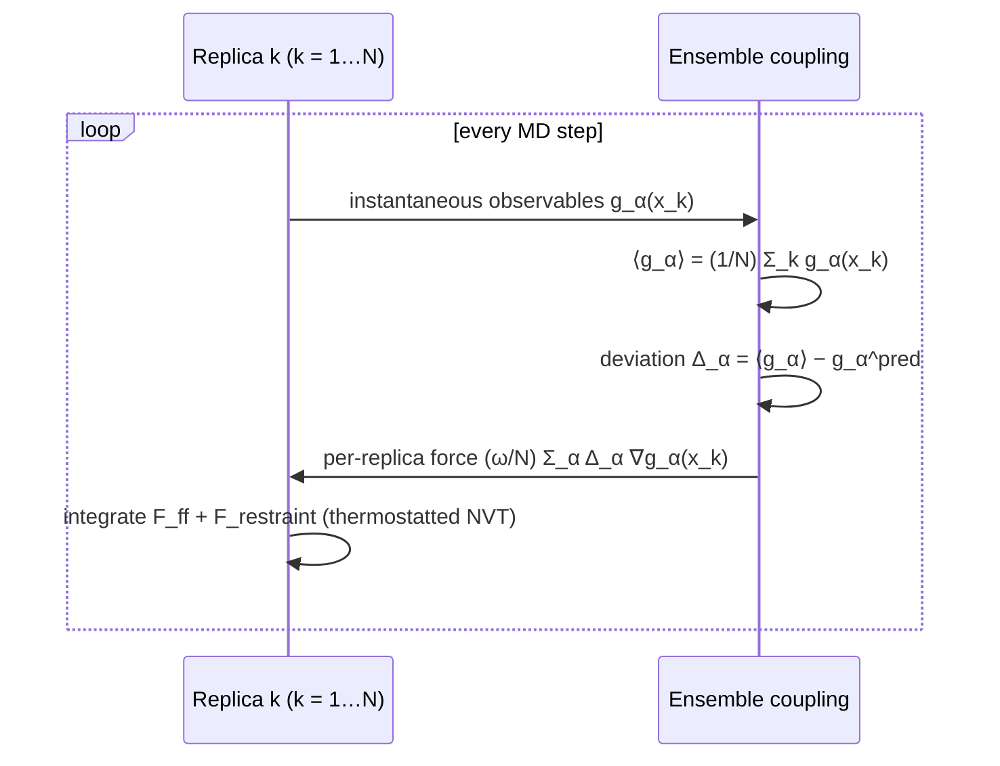

This page explains the theoretical foundation of bAIes: the decision to restrain **ensemble averages** rather than individual conformations. It covers the statistical argument for averaging, the mathematical formulation and its gradient, the flow of information from AI-predicted distance statistics into restraint targets, and the properties and trade-offs that follow. Implementation mechanics are deliberately out of scope here — they live in [Custom Distance Restraint Forces](12-custom-distance-restraint-forces) — and the probabilistic justification of restraint weights is developed in [Maximum Entropy and Bayesian Refinement](10-maximum-entropy-and-bayesian-refinement).

bAIes is defined in the repository as an "OpenMM implementation of bAIes: Atomic resolution ensemble predictions of Intrinsically Disordered using AI structure predictors" — note that *ensemble* is the operative word in the method's own one-line definition. The formalism below is the one described by the two publications the repository asks users to cite.

Sources: [README.md](README.md#L7), [README.md](README.md#L3-L5), [README.md](README.md#L9-L13)

## The Statistical Mismatch: Why One Structure Cannot Absorb Ensemble Data

AlphaFold-style predictors do not output a single truth for an intrinsically disordered protein (IDP); they output *statistics over conformational space* — most prominently the distogram, a per-residue-pair probability distribution over distances. For a folded protein these distributions are sharp enough that one conformation can satisfy nearly all of them simultaneously. For an IDP they are broad and mutually inconsistent by construction: a disordered chain's contact map says "these pairs are sometimes close, in different structures, at different times." If you convert those predictions into per-conformation distance restraints, every generated structure is forced to satisfy *all* predicted contacts *at once*. The result is a population of collapsed, frustrated conformers — structures that satisfy the data statistically but represent no member of the true underlying ensemble.

bAIes resolves this by relocating the statistical obligation from the individual structure to the population: the simulation must reproduce the predicted distances *on average*, across all concurrently sampled conformations. This is not merely a numerical convenience — it aligns the semantics of the restraint with the semantics of the prediction. The predicted quantity describes a distribution; the restrained quantity describes a distribution; the mismatch between them is what drives sampling toward heterogeneous, physically consistent ensembles.

Sources: [README.md](README.md#L7), [README.md](README.md#L11-L13)

The two paradigms differ in what entity is held accountable to the data:

| Dimension | Single-conformation restraints | Ensemble-averaged restraints (bAIes) |
|---|---|---|
| Restrained entity | Each individual structure | The population average ⟨g⟩ |
| Per-structure obligation | Satisfy all restraints simultaneously | Satisfy only a compatible subset |
| Effect on heterogeneity | Collapses ensemble variance | Preserves and shapes it |
| Failure mode | Frustrated, over-packed conformers | None of a single structure; bias shifts to ensemble level |
| Data semantics matched | Treats distributional data as deterministic | Matches distribution-to-distribution |
| Suitable input | Experimentally resolved single structures | Predictor statistics (distograms), ensemble experiments |

Sources: [README.md](README.md#L7), [README.md](README.md#L9-L13)

## The Mathematical Formulation

The formalism operates on $N$ conformations $x_1, \dots, x_N$ simulated concurrently, each carrying the physical force field energy $E_{\mathrm{ff}}(x_k)$. For each restrained quantity — indexed $\alpha$, in practice one per atom pair $(i,j)$ — the predictor supplies a target value $g^{\mathrm{pred}}_\alpha$, and the simulation supplies an instantaneous observable $g_\alpha(x_k)$ measured on every replica. The ensemble average of the observable is

$$\langle g_\alpha \rangle \;=\; \frac{1}{N} \sum_{k=1}^{N} g_\alpha(x_k)$$

and the restraint contributes the following term to the total energy of the coupled system:

$$E_{\mathrm{total}} \;=\; \sum_{k=1}^{N} E_{\mathrm{ff}}(x_k) \;+\; \frac{\omega}{2} \sum_{\alpha} \Big( \langle g_\alpha \rangle - g^{\mathrm{pred}}_\alpha \Big)^{2}$$

The only new object compared to standard MD is the second term: a harmonic penalty on the *deviation between the ensemble average and the predicted target*, scaled by a strength $\omega$. Everything about the method's behavior — its self-regulation, its effect on heterogeneity, its numerical requirements — follows from differentiating this term.

Sources: [README.md](README.md#L7), [README.md](README.md#L9-L13)

The gradient distributes the ensemble-level penalty back onto individual replicas:

$$\frac{\partial E_{\mathrm{total}}}{\partial x_k} \;=\; \nabla_{x_k} E_{\mathrm{ff}}(x_k) \;+\; \frac{\omega}{N} \sum_{\alpha} \Big( \langle g_\alpha \rangle - g^{\mathrm{pred}}_\alpha \Big) \, \nabla_{x_k}\, g_\alpha(x_k)$$

Two structural features of this expression carry the entire theory. First, the **$1/N$ prefactor**: each replica receives only a $1/N$ share of the ensemble deviation, because each replica contributes only a $1/N$ share of the average. Second, the **deviation factor** $\langle g_\alpha \rangle - g^{\mathrm{pred}}_\alpha$ is computed *globally* — it couples all replicas and is identical for every $k$. For a distance observable $g_\alpha(x) = |\mathbf{r}_i - \mathbf{r}_j|$, the inner gradient is simply the unit vector along the pair axis, so the ensemble deviation is converted into ordinary physical-looking forces whose magnitudes are set by population-level agreement rather than by the individual pair distance.

Sources: [README.md](README.md#L7), [README.md](README.md#L9-L13)

The symbols used throughout this page:

| Symbol | Meaning | Role in the theory |
|---|---|---|
| $x_k$ | Coordinates of conformation $k$ | The trajectory being integrated |
| $N$ | Number of concurrent conformations | Ensemble size; sets the $1/N$ force scaling |
| $g_\alpha(x_k)$ | Instantaneous observable (e.g., pair distance) | Measured per replica per step |
| $\langle g_\alpha \rangle$ | Ensemble average of the observable | The quantity actually restrained |
| $g^{\mathrm{pred}}_\alpha$ | Predictor-derived target value | What the average must reproduce |
| $\Delta_\alpha = \langle g_\alpha \rangle - g^{\mathrm{pred}}_\alpha$ | Ensemble deviation | The global coupling signal |
| $\omega$ | Restraint strength | Trades target adherence against heterogeneity |
| $\nabla_{x_k} g_\alpha$ | Gradient of the observable | Converts deviation into per-atom forces |

Sources: [README.md](README.md#L7)

An exact algebraic identity makes the contrast between the paradigms quantitative. If you restrained each replica *individually* against the same target and averaged the resulting energies, you would obtain

$$\frac{1}{N}\sum_{k=1}^{N} \big(g_\alpha(x_k) - g^{\mathrm{pred}}_\alpha\big)^{2} \;=\; \big(\langle g_\alpha \rangle - g^{\mathrm{pred}}_\alpha\big)^{2} \;+\; \mathrm{Var}\big[g_\alpha\big]$$

Naive per-replica restraints therefore secretly restrain two things: the ensemble average **and** the ensemble variance — the second term actively punishes conformational spread. The bAIes restraint drops the variance term by design: heterogeneity is not tolerated as a cost, it is protected as the object of interest.

> [!TIP]
> The **vanishing-force property** is the mechanism that makes ensemble-averaged restraints self-regulating: once $\langle g_\alpha \rangle = g^{\mathrm{pred}}_\alpha$ for a restraint, its gradient contribution is exactly zero *for every replica simultaneously* — regardless of how far any individual structure's distance lies from the target. Individual violations carry no energetic penalty at the ensemble-consistent point, which is precisely what allows the ensemble to stay heterogeneous while matching predictor statistics.

Sources: [README.md](README.md#L7), [README.md](README.md#L9-L13)

## From Predictor Output to Restraint Targets

The restraint theory consumes the predictor output at a well-defined boundary. Upstream, AlphaFold-style predictors produce a distogram — a probability distribution over distances for every residue pair — sharpened or diversified by the MSA information fed to the model. At the boundary, distogram statistics are distilled into concrete scalar targets $g^{\mathrm{pred}}_\alpha$ suitable for the harmonic formulation above. Downstream, OpenMM enforces agreement between the simulated ensemble average and those targets. The details of distogram interpretation belong to [AlphaFold Distograms and Distance Distributions](7-alphafold-distograms-and-distance-distributions), and the mechanism by which different MSA samples produce differently weighted, diversity-enhancing predictions belongs to [MSA Subsampling Strategy](8-msa-subsampling-strategy); here it suffices to note that both feed *distributional* information into targets that only make physical sense when restrained at the ensemble level — which is why the averaging formalism of the previous section is the load-bearing component of the method.

Sources: [README.md](README.md#L7), [README.md](README.md#L9-L13)

Sources: [README.md](README.md#L7)

## Ensemble Feedback During Simulation

During the simulation, the restraint is not a static additive term — it is a closed feedback loop executed every MD step. Each replica's instantaneous observables are collected, the ensemble average is formed globally, the deviation from the predictor targets is computed once, and a $1/N$-scaled gradient is delivered back to every replica, where it is added to the force field forces and integrated under the thermostat. The ensemble deviation $\Delta_\alpha$ acts as a global control signal: when the population drifts toward too much contact (average too short), forces push pairs apart across the whole population; when the population drifts toward too little contact, forces pull pairs together. No single replica is ever told what to be — the population is told what to average.

Sources: [README.md](README.md#L7), [README.md](README.md#L9-L13)

The loop's global coupling has a direct implementation consequence that the theory implies but does not concern itself with: replicas cannot evolve as fully independent simulations, because every step requires communication of observables to form the average and distribution of gradients back. How OpenMM realizes this cross-replica coupling is documented in [Custom Distance Restraint Forces](12-custom-distance-restraint-forces), and the thermostat choices governing the integration are covered in [Integrators and Thermostats](14-integrators-and-thermostats).

> [!TIP]
> The $1/N$ scaling cuts both ways. Statistically, the ensemble average estimated from finite replicas carries noise on the order of $\sigma/\sqrt{N}$, so a larger ensemble yields a quieter, more stable deviation signal and gentler restraint dynamics. Dynamically, however, each individual replica only ever feels a $1/N$ share of that signal — so increasing ensemble size stabilizes the *population* target-tracking while weakening the per-replica pull. Practical runs balance these effects jointly with $\omega$; validating that the population actually converged is the job of [Ensemble Convergence Assessment](19-ensemble-convergence-assessment).

Sources: [README.md](README.md#L7), [README.md](README.md#L9-L13)

## Properties, Trade-offs, and Theoretical Guarantees

The formalism has a coherent profile of strengths and costs, summarized below.

| Property | Consequence | Practical implication |
|---|---|---|
| Distribution-to-distribution semantics | Predicted statistics are interpreted as statistics | Broad distograms yield broad ensembles, as intended |
| Vanishing-force at agreement | Zero restraint force once the average matches | Heterogeneity is preserved at the target point |
| Variance term excluded | Ensemble spread is not penalized | No artificial collapse; spread set by physics + targets |
| $1/N$ gradient scaling | Per-replica pull weakens with ensemble size | Population stability improves with $N$, per-replica influence drops |
| $\sqrt{N}$ averaging noise | Finite-ensemble deviation estimates fluctuate | Requires sufficient $N$ for a smooth control signal |
| Global deviation coupling | Replicas are coupled through $\Delta_\alpha$ | Simulation cost scales with $N$; replicas exchange information |
| Choice of $\omega$ | Single dial trading adherence vs. freedom | Under-restraining ignores data; over-restraining approaches the naive paradigm |
| Correlated restraints | Many pair targets are not independent | Ensemble deviation vectors interfere; effective strength is pair-dependent |

Sources: [README.md](README.md#L7), [README.md](README.md#L9-L13)

The $\omega$ dial has a principled resolution beyond manual tuning. The harmonic-on-average energy can be re-derived as the outcome of a maximum-entropy inference problem: among all ensembles consistent with the predicted observables, the least-biased one is the one that stays maximally close to the physical prior (the force field alone) — and the resulting objective takes precisely the restrained-MD form, with $\omega$ fixed by the statistical weight of the data. This reframing also delivers a Bayesian reading, in which the restraint plays the role of a likelihood term over the ensemble. The full derivation and its refinement machinery are the subject of [Maximum Entropy and Bayesian Refinement](10-maximum-entropy-and-bayesian-refinement); the point to retain here is that the ensemble-average formulation is not one heuristic among several — it is the form that principled ensemble inference takes when operationalized as molecular dynamics.

Sources: [README.md](README.md#L7), [README.md](README.md#L9-L13)

## Where This Fits in bAIes and What to Read Next

Within the bAIes chain — predictor statistics → restraint targets → ensemble MD → analysis and validation — this page is the hinge: it is the stage where *predictor* information, which describes distributions, is translated into *dynamical* forces, which act on coordinates. Everything downstream inherits its semantics from the averaging decision made here. The natural reading order out of this page follows the same information flow: continue to [Maximum Entropy and Bayesian Refinement](10-maximum-entropy-and-bayesian-refinement) for the principled justification of restraint weights, then to [Simulation Pipeline Walkthrough](11-simulation-pipeline-walkthrough) and [Custom Distance Restraint Forces](12-custom-distance-restraint-forces) to see the formalism executed in OpenMM, and finally to [Ensemble Convergence Assessment](19-ensemble-convergence-assessment) to verify that the produced population genuinely satisfies the theory's central promise — predictor statistics reproduced by a heterogeneous, atomically resolved ensemble.
