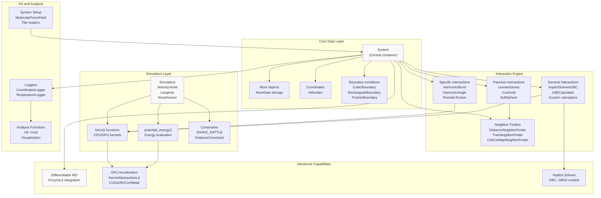
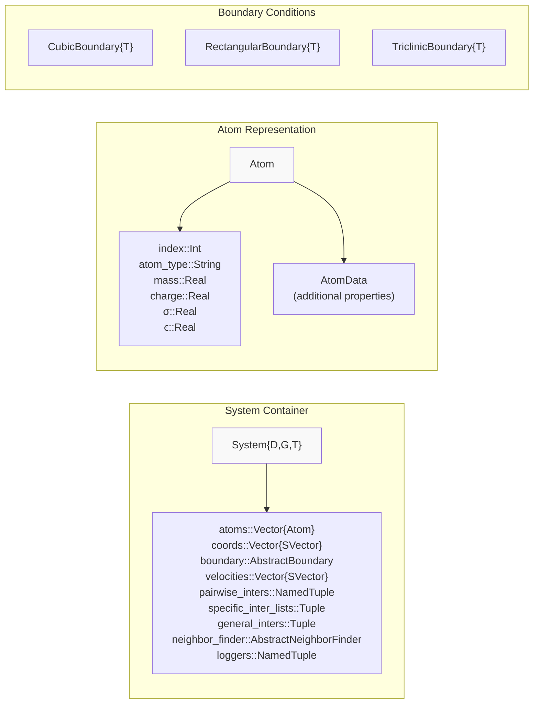
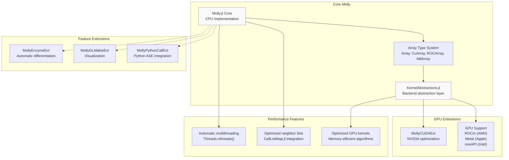
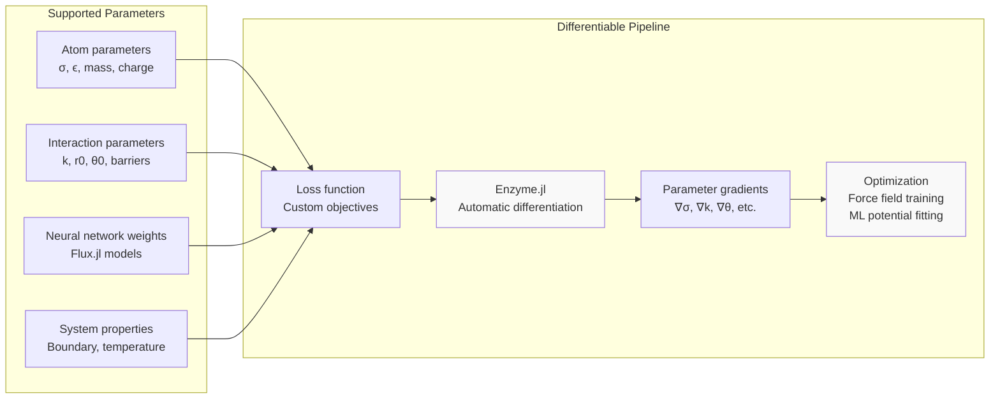

# Overview

<details>
<summary>Relevant source files</summary>

The following files were used as context for generating this wiki page:

- [NEWS.md](NEWS.md)
- [Project.toml](Project.toml)
- [README.md](README.md)
- [docs/src/differentiable.md](docs/src/differentiable.md)
- [docs/src/examples.md](docs/src/examples.md)
- [src/Molly.jl](src/Molly.jl)

</details>


## Purpose and Scope

This document provides a comprehensive overview of Molly.jl, a pure Julia package for molecular dynamics (MD) simulation and broader physical system modeling. It covers the package's architecture, core concepts, key features, and integration points. For specific implementation details of individual components, see the corresponding sections: [Core Architecture](#3) for fundamental data structures, [Interaction System](#4) for molecular interactions, [Simulation Engine](#5) for integration algorithms, and [Advanced Features](#6) for specialized capabilities.

## What is Molly.jl

Molly.jl is a molecular dynamics package written entirely in Julia that enables simulation of physical systems ranging from noble gases to biological macromolecules. The package emphasizes performance, differentiability, and extensibility while maintaining a clean, composable API that leverages Julia's strengths in scientific computing.

**Core Philosophy:**
- **Pure Julia Implementation**: Leverages Julia's performance and ecosystem
- **Differentiable by Design**: Built-in support for automatic differentiation through simulations
- **Hardware Agnostic**: Runs efficiently on CPU and GPU backends
- **Composable Architecture**: Modular design allowing custom interactions, simulators, and analysis tools

Sources: [README.md:10-12](), [src/Molly.jl:1-65]()

## High-Level System Architecture

The following diagram shows the overall architecture and data flow in Molly.jl:

### System Architecture Overview



Sources: [src/Molly.jl:33-64](), [README.md:17-46](), [Project.toml:6-32]()

## Core Components and Code Entities

### Primary Data Structures



Sources: [src/types.jl:1-400](), [src/spatial.jl:1-200]()

### Interaction System Mapping

```mermaid
graph TB
    subgraph "Pairwise Interactions"
        LennardJones["LennardJones{C,S,M,W,F}"]
        Coulomb["Coulomb{C,S,M,W,F}"]
        SoftSphere["SoftSphere{C,F}"]
        Mie["Mie{C,S,M,W,F}"]
    end
    
    subgraph "Specific Interactions"
        HarmonicBond["HarmonicBond{K,R}"]
        HarmonicAngle["HarmonicAngle{K,T}"]
        PeriodicTorsion["PeriodicTorsion{K,N,P}"]
        InteractionList2Atoms["InteractionList2Atoms"]
        InteractionList3Atoms["InteractionList3Atoms"]
        InteractionList4Atoms["InteractionList4Atoms"]
    end
    
    subgraph "Force Functions"
        ForceFunc["force(interaction, vec_ij, atom_i, atom_j, ...)"]
        PotentialFunc["potential_energy(interaction, vec_ij, atom_i, atom_j, ...)"]
        KernelFunc["Kernel implementations<br/>CPU/GPU variants"]
    end
    
    subgraph "Neighbor Finding"
        DistanceNeighborFinder["DistanceNeighborFinder"]
        TreeNeighborFinder["TreeNeighborFinder"]
        CellListMapNeighborFinder["CellListMapNeighborFinder"]
        GPUNeighborFinder["GPUNeighborFinder"]
    end
    
    LennardJones --> ForceFunc
    Coulomb --> ForceFunc
    HarmonicBond --> ForceFunc
    HarmonicAngle --> ForceFunc
    
    ForceFunc --> KernelFunc
    PotentialFunc --> KernelFunc
    
    DistanceNeighborFinder --> ForceFunc
    TreeNeighborFinder --> ForceFunc
    
    style ForceFunc fill:#f9f9f9
    style DistanceNeighborFinder fill:#f9f9f9
```



Sources: [src/interactions/lennard_jones.jl:1-200](), [src/interactions/harmonic_bond.jl:1-100](), [src/neighbors.jl:1-300](), [src/force.jl:1-200]()

## Key Features and Capabilities

### Simulation Capabilities

| Feature Category | Implementations | Key Functions |
|-----------------|----------------|---------------|
| **Integration** | `VelocityVerlet`, `Langevin`, `NoseHoover`, `Verlet` | `simulate!()` |
| **Thermostats** | `AndersenThermostat`, `BerendsenThermostat`, `RescaleThermostat` | `apply_coupling!()` |
| **Barostats** | `MonteCarloBarostat`, `BerendsenBarostat` | `pressure()`, `virial()` |
| **Constraints** | `SHAKE_RATTLE`, `DistanceConstraint` | `apply_position_constraints!()` |
| **Minimization** | `SteepestDescentMinimizer` | Energy minimization |

### Interaction Types

| Category | Available Interactions | File Location |
|----------|----------------------|---------------|
| **Non-bonded** | `LennardJones`, `Coulomb`, `SoftSphere`, `Mie`, `Buckingham` | `src/interactions/` |
| **Bonded** | `HarmonicBond`, `MorseBond`, `FENEBond` | `src/interactions/` |
| **Angles** | `HarmonicAngle`, `CosineAngle` | `src/interactions/` |
| **Torsions** | `PeriodicTorsion`, `RBTorsion` | `src/interactions/` |
| **Special** | `ImplicitSolventOBC`, `ImplicitSolventGBN2`, `ASECalculator` | `src/interactions/` |

Sources: [README.md:17-46](), [src/interactions/](), [NEWS.md:38-42]()

## Hardware Support and Performance

### Multi-Backend Architecture



Sources: [Project.toml:42-47](), [README.md:38-39](), [NEWS.md:20-21](), [NEWS.md:49-54]()

## Differentiable Simulation

Molly.jl provides unique differentiable molecular dynamics capabilities through integration with Enzyme.jl:

### Differentiable Features

| Component | AD Support | Backend |
|-----------|------------|---------|
| **Pairwise Interactions** | ✓ | CPU/GPU |
| **Specific Interactions** | ✓ | CPU/GPU |
| **General Interactions** | ✓ | CPU/GPU |
| **Neighbor Lists** | ✓ | CPU/GPU |
| **Simulators** | ✓ | CPU/GPU |
| **Implicit Solvent** | ✓ | CPU/GPU |



Sources: [docs/src/differentiable.md:1-458](), [NEWS.md:20-28](), [README.md:45]()

## Integration and Ecosystem

### External Package Integration

| Package | Purpose | Integration Point |
|---------|---------|------------------|
| **AtomsBase.jl** | Standard atom interface | `System` constructor, data exchange |
| **AtomsCalculators.jl** | Calculator interface | `MollyCalculator`, `general_inters` |
| **Chemfiles.jl** | File I/O | Coordinate/trajectory reading/writing |
| **CellListMap.jl** | Efficient neighbor finding | `CellListMapNeighborFinder` |
| **SimpleCrystals.jl** | Crystal structure generation | `System` constructor |
| **GLMakie.jl** | Visualization | `visualize()` function |
| **Unitful.jl** | Physical units | Throughout the package |

### File Format Support

- **Input**: PDB, GRO, XML force fields (OpenMM format)
- **Output**: PDB, DCD, XTC trajectories
- **Force Fields**: OpenMM XML, custom definitions

Sources: [Project.toml:6-32](), [README.md:21-22](), [README.md:42-43]()

## Getting Started

The basic workflow in Molly.jl follows this pattern:

1. **System Setup**: Create `System` with atoms, coordinates, interactions
2. **Simulator Selection**: Choose integration algorithm (`VelocityVerlet`, `Langevin`, etc.)
3. **Simulation Execution**: Run with `simulate!(system, simulator, n_steps)`
4. **Analysis**: Use loggers and analysis functions

```julia
# Basic example structure (from README)
sys = System(
    atoms=atoms,
    coords=coords,
    boundary=boundary,
    velocities=velocities,
    pairwise_inters=pairwise_inters,
    loggers=loggers,
)

simulate!(sys, simulator, n_steps)
```

For detailed setup procedures, see [Getting Started](#2). For specific system components, consult [Core Architecture](#3), [Interaction System](#4), and [Simulation Engine](#5).

Sources: [README.md:70-121](), [docs/src/examples.md:1-50]()

---