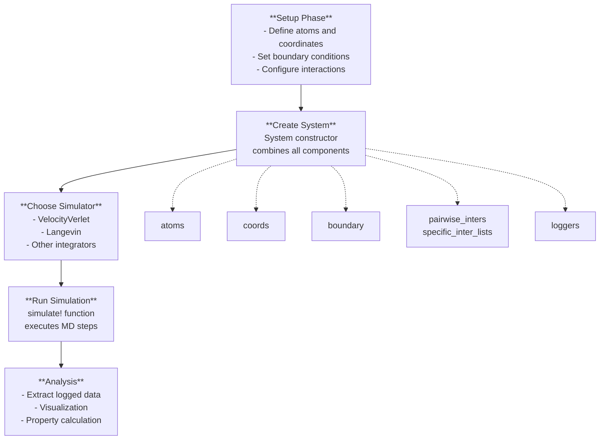
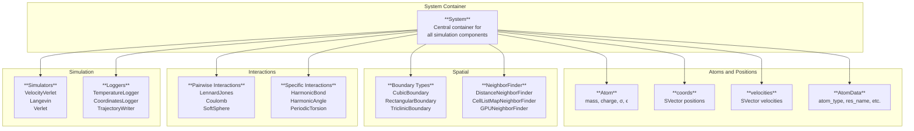

# Getting Started

<details>
<summary>Relevant source files</summary>

The following files were used as context for generating this wiki page:

- [README.md](README.md)
- [docs/src/differentiable.md](docs/src/differentiable.md)
- [docs/src/examples.md](docs/src/examples.md)
- [src/setup.jl](src/setup.jl)
- [test/basic.jl](test/basic.jl)
- [test/energy_conservation.jl](test/energy_conservation.jl)
- [test/protein.jl](test/protein.jl)

</details>


This page provides an introduction to running molecular dynamics simulations with Molly.jl. It covers the essential concepts, core data structures, and basic workflow needed to set up and execute your first simulations. For advanced features like differentiable simulation, see [Differentiable Simulation](#6.2). For detailed API documentation, see [API Reference](#10).

## Installation

Molly.jl requires Julia v1.10 or later. Install from the Julia REPL by entering package mode with `]` and running:

```julia
add Molly
```

For GPU acceleration, you'll also need to install the appropriate GPU packages like `CUDA.jl`, `AMDGPU.jl`, or `Metal.jl`.

Sources: [README.md:59-64]()

## Core Simulation Workflow

The basic workflow for molecular dynamics in Molly.jl follows these key steps:



Sources: [README.md:70-121](), [test/basic.jl:1-99]()

## Core Data Structures

Understanding Molly's key types is essential for setting up simulations:



Sources: [src/setup.jl:136-191](), [test/basic.jl:78-96]()

## Basic Example: Lennard-Jones Fluid

Here's a complete example simulating a simple Lennard-Jones fluid:

```julia
using Molly

# System parameters
n_atoms = 100
boundary = CubicBoundary(2.0u"nm")
temp = 298.0u"K"
atom_mass = 10.0u"g/mol"

# Create atoms with Lennard-Jones parameters
atoms = [Atom(mass=atom_mass, σ=0.3u"nm", ϵ=0.2u"kJ * mol^-1") for i in 1:n_atoms]

# Generate random coordinates and velocities
coords = place_atoms(n_atoms, boundary; min_dist=0.3u"nm")
velocities = [random_velocity(atom_mass, temp) for i in 1:n_atoms]

# Set up interactions and simulator
pairwise_inters = (LennardJones(),)
simulator = VelocityVerlet(
    dt=0.002u"ps",
    coupling=AndersenThermostat(temp, 1.0u"ps"),
)

# Create the system
sys = System(
    atoms=atoms,
    coords=coords,
    boundary=boundary,
    velocities=velocities,
    pairwise_inters=pairwise_inters,
    loggers=(temp=TemperatureLogger(100),),
)

# Run the simulation
simulate!(sys, simulator, 10_000)
```

This example demonstrates the key functions:
- `place_atoms()` for coordinate generation
- `Atom()` constructor for atom definition  
- `System()` constructor to combine components
- `simulate!()` to run the dynamics

Sources: [README.md:70-98](), [src/setup.jl:16-64]()

## Loading Systems from Files

Molly can read molecular systems from coordinate files and force field definitions:

```julia
using Molly

# Load force field from OpenMM XML files
data_dir = joinpath(dirname(pathof(Molly)), "..", "data")
ff = MolecularForceField(
    joinpath(data_dir, "force_fields", "ff99SBildn.xml"),
    joinpath(data_dir, "force_fields", "tip3p_standard.xml"),
)

# Create system from coordinate file and force field
sys = System(
    joinpath(data_dir, "6mrr_equil.pdb"), 
    ff;
    loggers=(
        temp=TemperatureLogger(10),
        writer=TrajectoryWriter(10, "trajectory.pdb"),
    ),
)

# Set initial velocities and run simulation
temp = 298.0u"K" 
random_velocities!(sys, temp)
simulator = VelocityVerlet(
    dt=0.0002u"ps",
    coupling=AndersenThermostat(temp, 1.0u"ps"),
)

simulate!(sys, simulator, 5_000)
```

Key functions for file-based setup:
- `MolecularForceField()` for loading force fields
- `System()` constructor accepting file paths
- `random_velocities!()` for velocity initialization

Sources: [README.md:100-121](), [src/setup.jl:423-470](), [test/protein.jl:3-16]()

## Key Setup Functions

| Function | Purpose | Key Parameters |
|----------|---------|---------------|
| `place_atoms()` | Generate random coordinates | `n_atoms`, `boundary`, `min_dist` |
| `place_diatomics()` | Generate diatomic molecules | `n_molecules`, `bond_length`, `aligned` |
| `Atom()` | Create atom with properties | `mass`, `charge`, `σ`, `ϵ` |
| `System()` | Combine components into system | `atoms`, `coords`, `boundary`, `pairwise_inters` |
| `random_velocity()` | Generate Maxwell-Boltzmann velocity | `mass`, `temperature` |
| `simulate!()` | Run molecular dynamics | `system`, `simulator`, `n_steps` |

Sources: [src/setup.jl:16-129]()

## Common Simulation Patterns

### GPU Acceleration
To run simulations on GPU, specify the array type:

```julia
sys = System(
    # ... other parameters ...
    array_type=CuArray,  # For NVIDIA GPUs
)
```

### Different Boundary Conditions
```julia
# Cubic periodic boundary
boundary = CubicBoundary(5.0u"nm")

# Rectangular boundary  
boundary = RectangularBoundary(4.0u"nm", 5.0u"nm")

# Triclinic boundary
boundary = TriclinicBoundary(
    SVector(2.0, 0.0, 0.0)u"nm",
    SVector(0.5, 1.8, 0.0)u"nm", 
    SVector(0.3, 0.2, 1.5)u"nm",
)
```

### Multiple Interaction Types
```julia
# Combine different pairwise interactions
pairwise_inters = (
    LennardJones(cutoff=DistanceCutoff(1.2u"nm")),
    Coulomb(coulomb_const=138.935u"kJ * mol^-1 * nm"),
)

# Add specific interactions for bonded systems
bonds = InteractionList2Atoms(
    [1, 2], [2, 3],  # atom indices
    [HarmonicBond(k=1000.0u"kJ * mol^-1 * nm^-2", r0=0.1u"nm") for _ in 1:2]
)
specific_inter_lists = (bonds,)
```

Sources: [test/basic.jl:178-215](), [docs/src/examples.md:300-365]()

## Next Steps

After running basic simulations, explore:

- **Force Fields and File I/O** ([7.1](#7.1)): Loading molecular systems from PDB/Gromacs files
- **Advanced Simulators** ([5.1](#5.1)): Langevin dynamics, replica exchange, Monte Carlo
- **GPU Acceleration** ([6.1](#6.1)): High-performance computing on different GPU backends  
- **Analysis and Visualization** ([8](#8)): Processing simulation data and creating visualizations
- **Differentiable Simulation** ([6.2](#6.2)): Using automatic differentiation for parameter optimization

The examples in [examples.md]() demonstrate advanced applications including agent-based modeling, polymer simulations, and neural network potentials.

Sources: [docs/src/examples.md:1-8](), [README.md:17-58]()

---