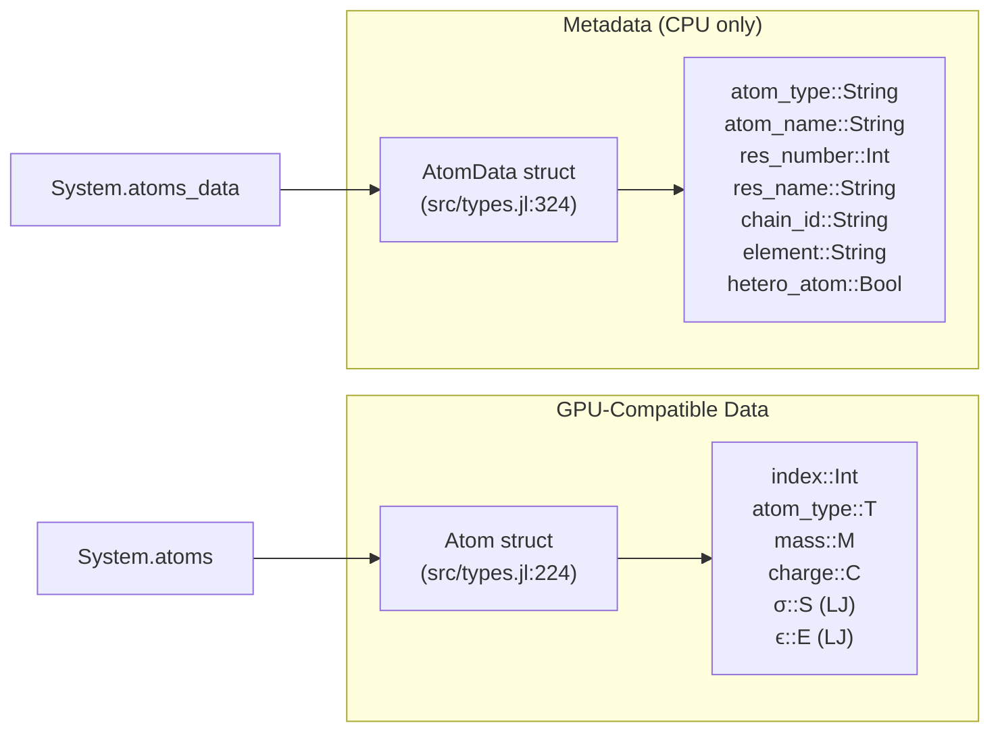
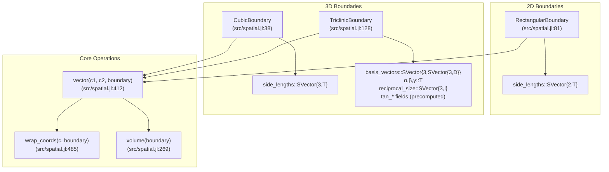
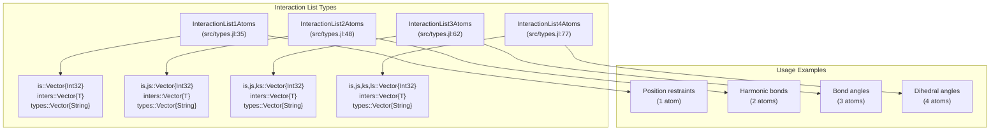
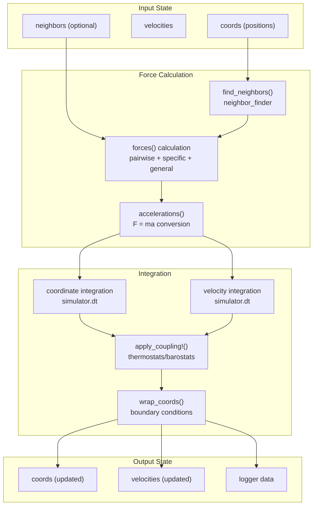
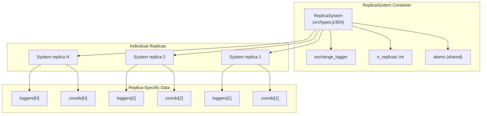

# Core Architecture

Relevant source files

The following files were used as context for generating this wiki page:

- [docs/src/documentation.md](docs/src/documentation.md)
- [src/coupling.jl](src/coupling.jl)
- [src/spatial.jl](src/spatial.jl)
- [src/types.jl](src/types.jl)

This page introduces the fundamental data structures and design patterns that form the foundation of Molly.jl. It covers the central `System` container, core atom and boundary representations, and the overall architectural patterns that enable molecular dynamics simulations. For detailed information about specific components, see [System and Atoms](#3.1), [Spatial Calculations and Boundaries](#3.2), and [Neighbor Finding](#3.3).

## Architecture Overview

Molly.jl follows a modular architecture where molecular dynamics simulations are built from composable components. The design centers around a central `System` container that holds all simulation state and references to interaction types, neighbor finders, and analysis loggers.

### Core System Architecture

```mermaid
graph TB
    subgraph "Central Container"
        System["System struct<br/>(src/types.jl:491)"]
    end
    
    subgraph "Core Data"
        atoms["atoms::Vector{Atom}<br/>(System field)"]
        coords["coords::Vector{SVector}<br/>(System field)"]
        velocities["velocities::Vector{SVector}<br/>(System field)"]
        boundary["boundary::Union{CubicBoundary,<br/>RectangularBoundary,<br/>TriclinicBoundary}<br/>(System field)"]
        masses["masses::Vector<br/>(System field)"]
    end
    
    subgraph "Interaction Components"
        pairwise_inters["pairwise_inters::Tuple<br/>(System field)"]
        specific_inter_lists["specific_inter_lists::Tuple<br/>(System field)"]
        general_inters["general_inters::Tuple<br/>(System field)"]
        neighbor_finder["neighbor_finder<br/>(System field)"]
    end
    
    subgraph "Simulation Control"
        loggers["loggers::NamedTuple<br/>(System field)"]
        constraints["constraints::Tuple<br/>(System field)"]
    end
    
    System --> atoms
    System --> coords
    System --> velocities
    System --> boundary
    System --> masses
    System --> pairwise_inters
    System --> specific_inter_lists
    System --> general_inters
    System --> neighbor_finder
    System --> loggers
    System --> constraints
```

Sources: [src/types.jl:491-610]()

## Central System Container

The `System` struct serves as the primary container for all simulation data and configuration. It implements the AtomsBase.jl `AbstractSystem` interface, making it compatible with the broader Julia molecular simulation ecosystem.

### System Structure and Key Fields

| Field | Type | Purpose |
|-------|------|---------|
| `atoms` | `Vector{Atom}` | Particle data (mass, charge, LJ parameters) |
| `coords` | `Vector{SVector}` | Particle positions |
| `velocities` | `Vector{SVector}` | Particle velocities |
| `boundary` | `Union{CubicBoundary, RectangularBoundary, TriclinicBoundary}` | Simulation box and periodic boundary conditions |
| `pairwise_inters` | `Tuple` | Non-bonded interactions (LJ, Coulomb, etc.) |
| `specific_inter_lists` | `Tuple` | Bonded interactions (bonds, angles, torsions) |
| `general_inters` | `Tuple` | System-wide interactions (implicit solvent, ML potentials) |
| `neighbor_finder` | Various types | Algorithm for finding neighboring particles |
| `loggers` | `NamedTuple` | Data collection and analysis tools |

Sources: [src/types.jl:491-511](), [src/types.jl:513-610]()

The `System` constructor performs extensive validation to ensure consistency between arrays on CPU/GPU, proper unit handling, and correct sizing of all component arrays.

## Atom Representation

Molly.jl uses a dual-layer approach for representing atoms that enables GPU compatibility while maintaining rich metadata:

### Atom and AtomData Split

Sources: [src/types.jl:224-231](), [src/types.jl:324-332]()

This design allows the essential physical parameters (mass, charge, Lennard-Jones parameters) to be stored in a bits-type `Atom` struct that can be efficiently processed on GPUs, while keeping string-based metadata in a separate `AtomData` collection.

## Boundary Conditions and Spatial Framework

The spatial framework in Molly.jl handles periodic boundary conditions and coordinate transformations through specialized boundary types:

### Boundary Type Hierarchy

Sources: [src/spatial.jl:38-49](), [src/spatial.jl:81-92](), [src/spatial.jl:128-173]()

The boundary system provides essential functions like `vector()` for minimum image convention calculations and `wrap_coords()` for ensuring particles remain within the simulation box.

## Interaction System Architecture

Molly.jl organizes interactions into three distinct categories, each with different computational patterns and use cases:

### Interaction Type Organization

| Interaction Type | Examples | Storage | Computational Pattern |
|-----------------|----------|---------|---------------------|
| **Pairwise** | `LennardJones`, `Coulomb` | In `pairwise_inters` tuple | All/most atom pairs, uses neighbor lists |
| **Specific** | `HarmonicBond`, `PeriodicTorsion` | In `InteractionListNAtoms` structs | Explicit atom index lists |
| **General** | `ImplicitSolventOBC`, `ASECalculator` | In `general_inters` tuple | Whole-system access, AtomsCalculators.jl interface |

### Specific Interaction Lists

Sources: [src/types.jl:35-84]()

## Data Flow and Simulation Loop

The architecture enables a clear data flow during simulation where the `System` serves as both input and output for each simulation step:

### Simulation Data Flow

Sources: [src/types.jl:491-610](), [src/spatial.jl:412-500]()

## Advanced System Types

For specialized simulations, Molly.jl provides the `ReplicaSystem` for replica exchange molecular dynamics:

### ReplicaSystem Architecture

The `ReplicaSystem` extends the basic architecture to handle multiple parallel replicas with potentially different conditions (temperature, pressure, Hamiltonians).

Sources: [src/types.jl:854-1044]()

This architecture enables efficient parallel execution of multiple replicas while allowing periodic exchanges between them based on different acceptance criteria.

## Type System and GPU Compatibility

The architecture emphasizes type stability and GPU compatibility through several design choices:

- **Bits types**: Core data structures like `Atom` are designed as bits types for GPU kernel compatibility
- **Static arrays**: Coordinates and velocities use `SVector` for performance and type stability  
- **Array type abstraction**: The `System` tracks its array type (`Array`, `CuArray`, etc.) for dispatch
- **Unit handling**: Comprehensive support for physical units through Unitful.jl integration

Sources: [src/types.jl:1047-1070](), [src/types.jl:599-601]()

This core architecture provides the foundation for all molecular dynamics functionality in Molly.jl, from simple particle simulations to complex biomolecular systems with multiple interaction types and advanced sampling methods.

---