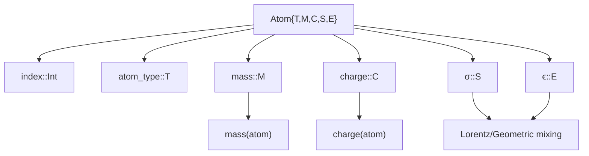
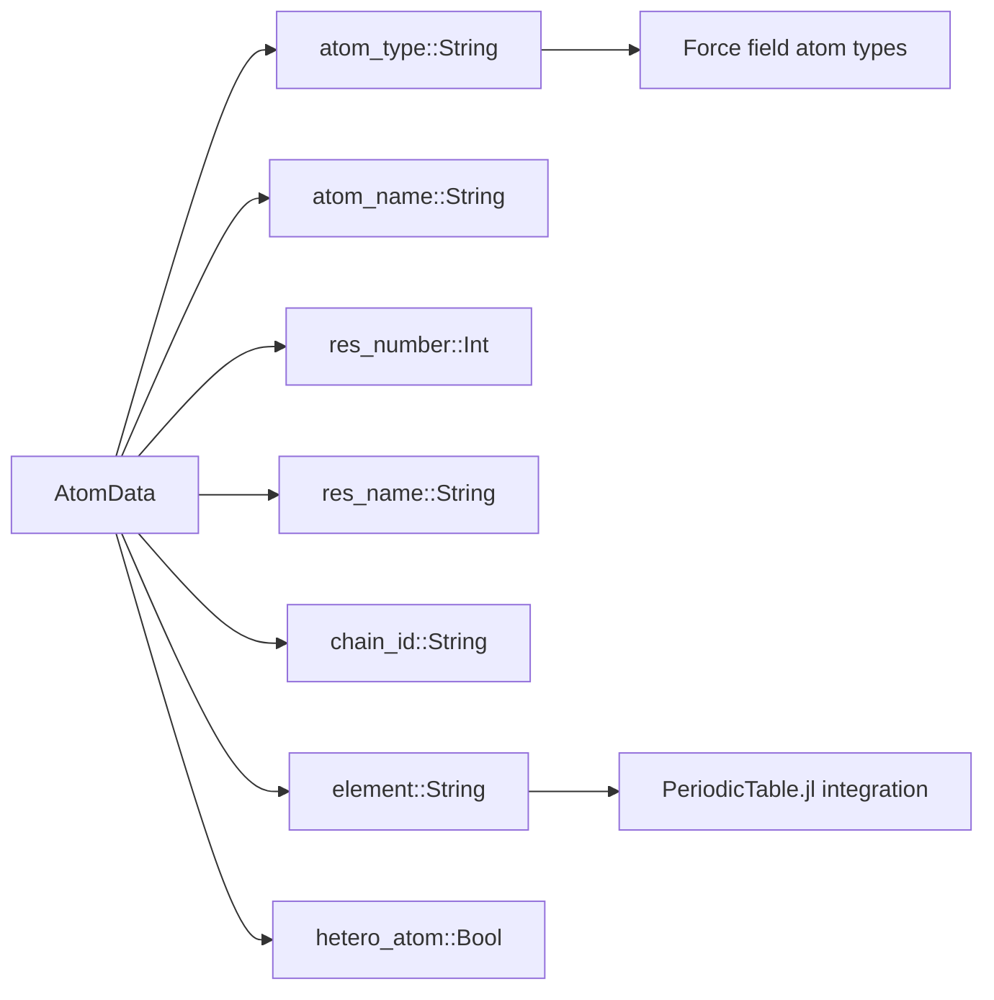
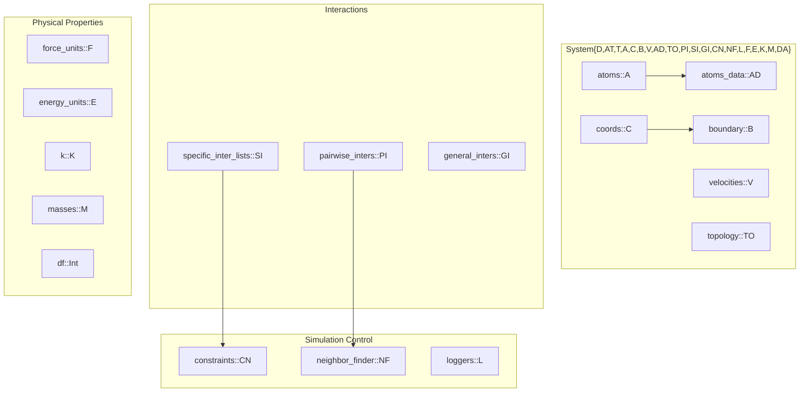
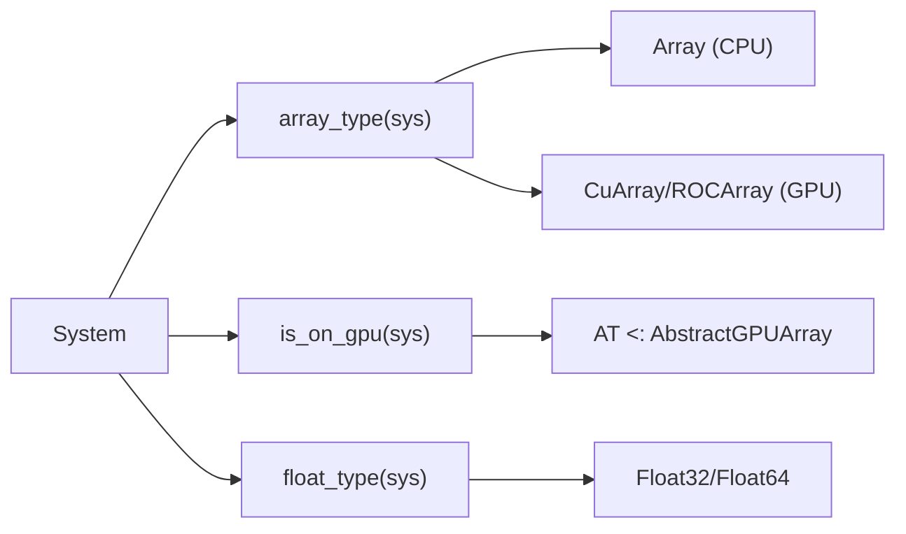
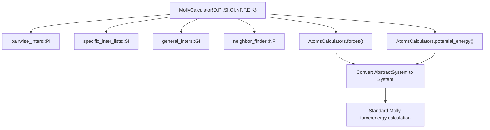

# System and Atoms

<details>
<summary>Relevant source files</summary>

The following files were used as context for generating this wiki page:

- [src/types.jl](src/types.jl)

</details>


This page covers the foundational data structures in Molly.jl: the `Atom` and `System` types that form the core of any molecular dynamics simulation. These structures define how individual atoms and complete molecular systems are represented in memory and accessed throughout the simulation pipeline.

For information about boundary conditions and spatial calculations, see [Spatial Calculations and Boundaries](#3.2). For details on neighbor finding algorithms, see [Neighbor Finding](#3.3). For simulation algorithms that operate on these systems, see [Integrators and Simulators](#5.1).

## The Atom Structure

The `Atom` struct represents individual atoms with their physical properties. It is designed as a bits type to enable GPU compatibility and efficient memory access.



Key properties of `Atom`:

| Property | Type | Purpose | Default |
|----------|------|---------|---------|
| `index` | `Int` | Atom index in system | `1` |
| `atom_type` | `T` | Type identifier | `1` |
| `mass` | `M` | Atomic mass | `1.0u"g/mol"` |
| `charge` | `C` | Partial charge | `0.0` |
| `σ` | `S` | Lennard-Jones size parameter | `0.0u"nm"` |
| `ϵ` | `E` | Lennard-Jones energy parameter | `0.0u"kJ * mol^-1"` |

The `Atom` struct includes built-in mixing rules for Lennard-Jones parameters:
- Lorentz mixing: `(σ₁ + σ₂) / 2`, `(ϵ₁ + ϵ₂) / 2`
- Geometric mixing: `√(σ₁ × σ₂)`, `√(ϵ₁ × ϵ₂)`
- Waldman-Hagler mixing for advanced force fields

**Sources:** [src/types.jl:224-231](), [src/types.jl:262-272](), [src/types.jl:296-314]()

## AtomData Structure

The `AtomData` struct stores non-essential atom information separately from `Atom` to maintain GPU compatibility while preserving detailed molecular information.



This separation allows the core `Atom` struct to remain a bits type (essential for GPU performance) while `AtomData` can contain strings and other non-bits types needed for analysis and visualization.

**Sources:** [src/types.jl:324-332]()

## The System Structure

The `System` struct is the central container that holds all components of a molecular simulation. It implements the AtomsBase.jl `AbstractSystem` interface for interoperability.

### Core System Architecture



### System Type Parameters

The `System` struct uses extensive type parameterization for performance:

| Parameter | Meaning | Example |
|-----------|---------|---------|
| `D` | Spatial dimensions | `3` |
| `AT` | Array type | `Array`, `CuArray` |
| `T` | Float type | `Float64`, `Float32` |
| `A` | Atoms container type | `Vector{Atom}` |
| `C` | Coordinates type | `Vector{SVector{3,Float64}}` |
| `B` | Boundary type | `CubicBoundary` |

**Sources:** [src/types.jl:491-511](), [src/types.jl:513-610]()

## System Construction

### Basic System Constructor

The primary `System` constructor requires minimal arguments but accepts many optional parameters:

```mermaid
graph TD
    constructor["System(atoms, coords, boundary)"] --> validation["Input validation"]
    validation --> type_inference["Type parameter inference"]
    type_inference --> unit_checking["Unit consistency checks"]
    unit_checking --> dof_calculation["Degrees of freedom calculation"]
    dof_calculation --> gpu_checks["GPU compatibility checks"]
    gpu_checks --> system_creation["System{D,AT,T,...} creation"]
    
    validation --> atoms_coords_length["length(atoms) == length(coords)"]
    validation --> atoms_vels_length["length(atoms) == length(velocities)"]
    validation --> gpu_consistency["GPU array consistency"]
```

### System Variants

Molly.jl provides several system construction patterns:

1. **Basic System**: Direct construction from atoms, coordinates, and boundary
2. **Convenience Constructor**: Modifying existing systems with `System(sys; kwargs...)`
3. **Crystal System**: Construction from SimpleCrystals.jl `Crystal` objects
4. **AtomsBase Integration**: Converting from AtomsBase.jl `AbstractSystem`
5. **ReplicaSystem**: For replica exchange molecular dynamics

**Sources:** [src/types.jl:620-655](), [src/types.jl:669-721](), [src/types.jl:854-1044]()

## System Properties and Access Methods

### Array Type and Hardware Detection



### AtomsBase.jl Interface Implementation

The `System` type implements the complete AtomsBase.jl interface:

| Method | Purpose | Return Type |
|--------|---------|-------------|
| `position(sys, i)` | Get atom position | `SVector` |
| `velocity(sys, i)` | Get atom velocity | `SVector` |
| `mass(sys, i)` | Get atom mass | `Unitful.Mass` |
| `atomic_symbol(sys, i)` | Get element symbol | `Symbol` |
| `atomic_number(sys, i)` | Get atomic number | `Int` |
| `cell_vectors(sys)` | Get boundary vectors | `SVector` tuple |

**Sources:** [src/types.jl:1047-1062](), [src/types.jl:1092-1187]()

## MollyCalculator Integration

The `MollyCalculator` struct enables using Molly.jl force calculations within the AtomsCalculators.jl ecosystem:



This integration allows Molly.jl to be used as a calculator in other molecular simulation frameworks while maintaining full compatibility with its own simulation engines.

**Sources:** [src/types.jl:1319-1398]()

---