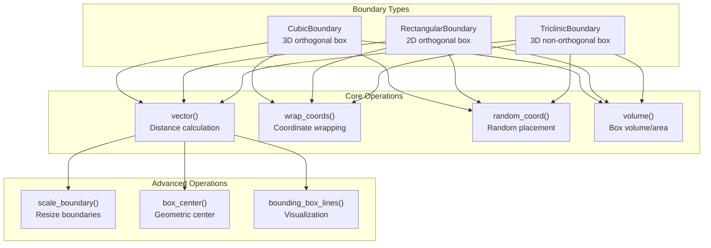
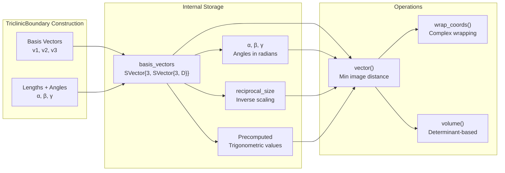
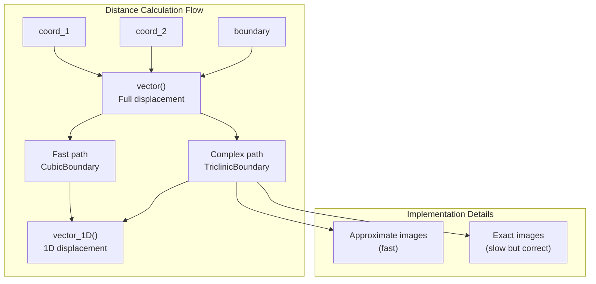
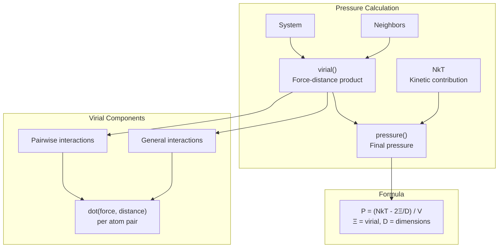
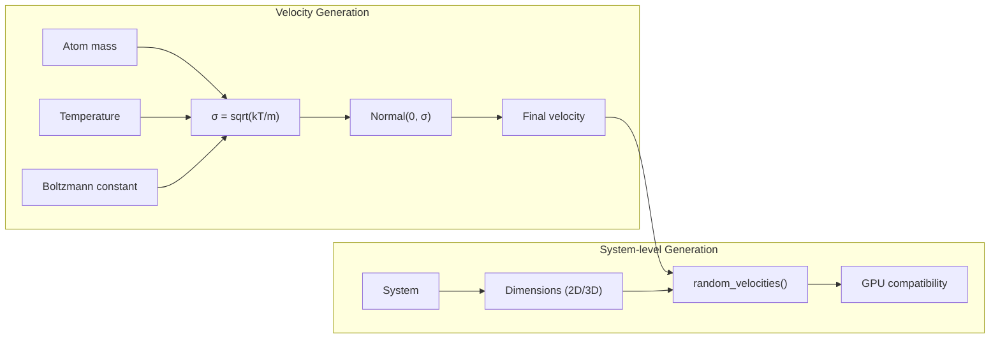
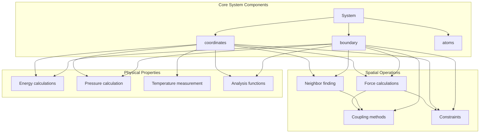

# Spatial Calculations and Boundaries

<details>
<summary>Relevant source files</summary>

The following files were used as context for generating this wiki page:

- [docs/src/documentation.md](docs/src/documentation.md)
- [src/coupling.jl](src/coupling.jl)
- [src/spatial.jl](src/spatial.jl)

</details>


This page covers the spatial infrastructure of Molly.jl, including periodic boundary conditions, coordinate transformations, and spatial utility functions. This system provides the fundamental geometric framework that underlies all molecular dynamics simulations, handling how atoms are positioned in space and how they interact across periodic boundaries.

For information about force calculations that use these spatial utilities, see [Force and Energy Calculations](#4.3). For details about the core System data structure that contains boundaries, see [System and Atoms](#3.1).

## Boundary Types

Molly.jl supports three types of boundary conditions for different simulation geometries. Each boundary type implements specific algorithms for coordinate wrapping and distance calculations.

### Boundary Type Overview



Sources: [src/spatial.jl:38-209](), [src/spatial.jl:210-254]()

### CubicBoundary

The `CubicBoundary` represents a 3D orthogonal simulation box with independent side lengths. It supports both periodic and infinite boundary conditions by setting dimensions to `Inf`.

**Key Properties:**
- Three independent side lengths stored as `SVector{3, T}`
- Supports infinite boundaries in any dimension
- Optimized distance calculations using `vector_1D()` for each axis
- Compatible with Chemfiles.jl for trajectory output

**Usage Examples:**
```julia
# Cubic periodic box
boundary = CubicBoundary(2.0u"nm")
# Rectangular box  
boundary = CubicBoundary(2.0u"nm", 3.0u"nm", 4.0u"nm")
# Infinite in z-direction
boundary = CubicBoundary(2.0u"nm", 2.0u"nm", Inf*u"nm")
```

Sources: [src/spatial.jl:38-70](), [src/spatial.jl:412-418]()

### RectangularBoundary

The `RectangularBoundary` provides 2D simulation capabilities with two orthogonal side lengths.

**Key Properties:**
- Two side lengths for x and y dimensions
- Supports 2D molecular dynamics simulations
- Infinite boundaries supported via `Inf` values
- Vector operations padded to 3D internally for compatibility

Sources: [src/spatial.jl:81-105](), [src/spatial.jl:420-425]()

### TriclinicBoundary

The `TriclinicBoundary` supports non-orthogonal 3D simulation boxes defined by three basis vectors, enabling simulations of crystal lattices and complex geometries.

**Key Properties:**
- Three basis vectors defining the parallelpiped
- Approximate or exact minimum image convention
- Precomputed trigonometric values for performance
- Not compatible with infinite boundaries



Sources: [src/spatial.jl:127-209](), [src/spatial.jl:427-450]()

## Coordinate Operations

The spatial system provides fundamental operations for working with coordinates within different boundary conditions.

### Distance Calculations

The `vector()` function calculates the displacement between two coordinates using the minimum image convention, which finds the shortest distance accounting for periodic boundaries.



Sources: [src/spatial.jl:382-461]()

### Coordinate Wrapping

The `wrap_coords()` function ensures coordinates remain within the simulation box by applying periodic boundary conditions.

**Algorithm Variations:**
- **Cubic/Rectangular:** Simple modulo operation per dimension
- **Triclinic:** Complex sequential wrapping accounting for basis vector relationships

Sources: [src/spatial.jl:481-500]()

### Random Coordinate Generation

The `random_coord()` function generates uniformly distributed random coordinates within the boundary volume.

Sources: [src/spatial.jl:365-379]()

## Physical Property Calculations

The spatial system implements several important physical calculations that depend on the geometric configuration.

### Pressure and Virial Calculations



Sources: [src/spatial.jl:726-855]()

### Density and Volume

The system calculates density using the total mass and boundary volume:

```julia
density(sys) = total_mass(sys) / volume(sys.boundary)
```

Volume calculations are boundary-type specific:
- **Cubic/Rectangular:** Product of side lengths
- **Triclinic:** Determinant of basis vectors

Sources: [src/spatial.jl:268-292]()

### Molecular Properties

The spatial system provides calculations for molecular-scale properties:

- `molecule_centers()` - Center of mass for each molecule using circular mean for periodic boundaries
- `dipole_moment()` - Electric dipole moment from charges and coordinates
- `scale_coords!()` - Coordinated scaling of coordinates and boundary

Sources: [src/spatial.jl:857-960]()

## Velocity Generation

The spatial system includes Maxwell-Boltzmann velocity generation for thermal equilibration.

### Maxwell-Boltzmann Distribution



The `maxwell_boltzmann()` function generates individual velocity components, while `random_velocities()` generates complete velocity vectors for all atoms in a system.

Sources: [src/spatial.jl:502-656]()

## Integration with Simulation System

The spatial calculations integrate deeply with the broader Molly.jl simulation infrastructure.

### System Integration



Sources: [src/spatial.jl:1-28](), [docs/src/documentation.md:41-50]()

### GPU Compatibility

The spatial calculation functions are designed to work transparently with both CPU and GPU array types. The boundary types are bits types, enabling efficient GPU kernels, while coordinate operations use broadcasting for GPU compatibility.

Sources: [src/spatial.jl:633-639](), [docs/src/documentation.md:142-194]()

---