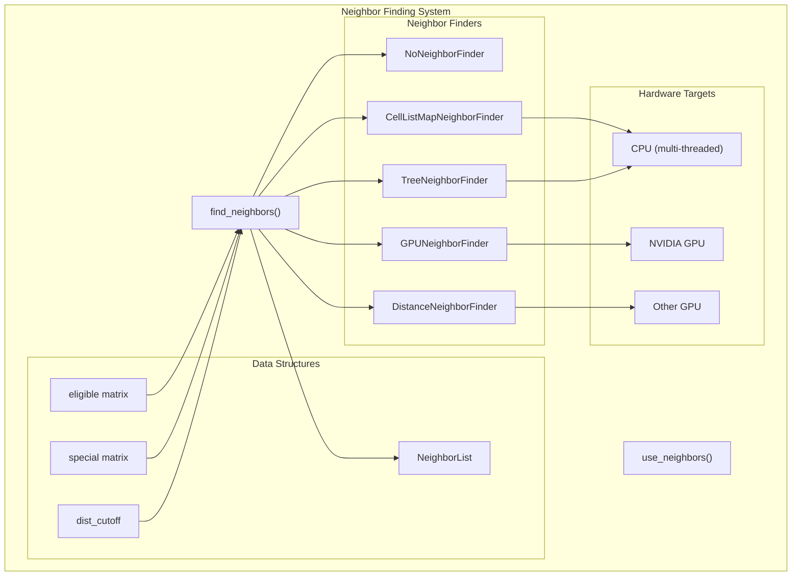
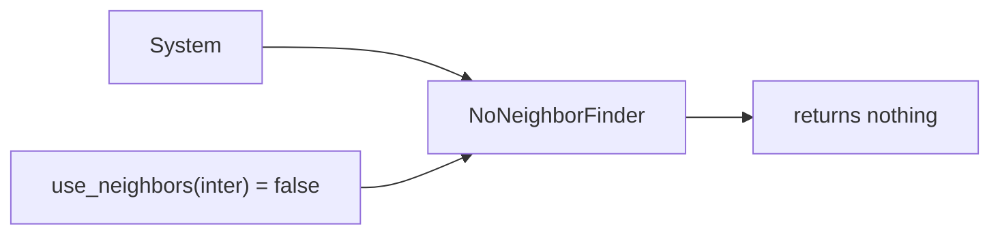
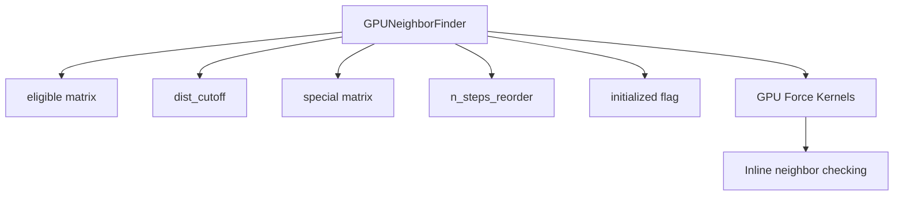
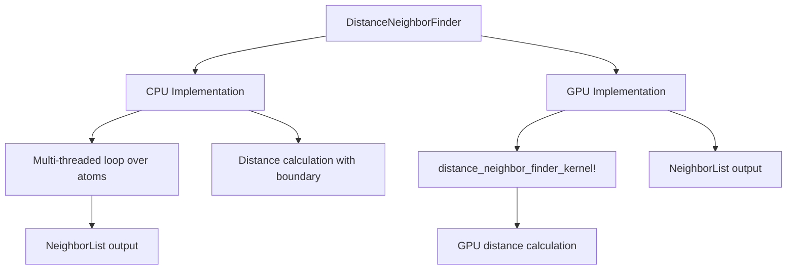
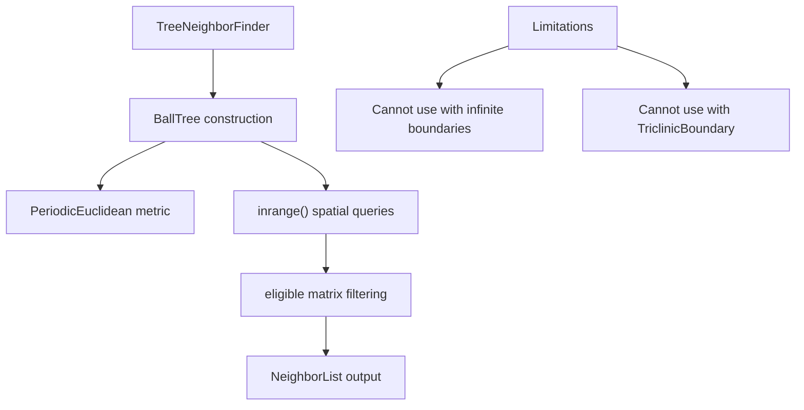
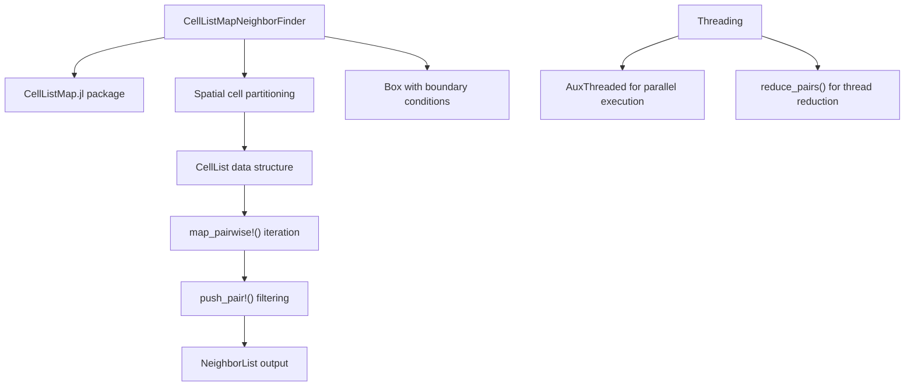
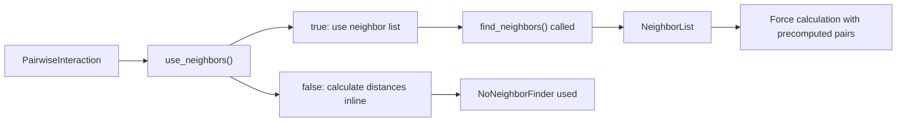

# Neighbor Finding

<details>
<summary>Relevant source files</summary>

The following files were used as context for generating this wiki page:

- [src/neighbors.jl](src/neighbors.jl)

</details>


## Purpose and Scope

This page covers the algorithms and data structures used in Molly.jl for efficiently identifying pairs of atoms within interaction range during molecular dynamics simulations. Neighbor finding is a critical performance bottleneck in MD simulations, as it determines which atom pairs need force and energy calculations.

For information about the actual force calculations that use these neighbor lists, see [Force and Energy Calculations](#4.3). For details on how pairwise interactions specify their neighbor requirements, see [Pairwise Interactions](#4.1).

## Overview

In molecular dynamics simulations, most pairwise interactions (such as Lennard-Jones or Coulomb forces) only contribute significantly when atoms are within a certain cutoff distance. Rather than checking all possible atom pairs at every timestep, neighbor finding algorithms efficiently identify only the relevant pairs within the cutoff distance.

Molly.jl provides several neighbor finding algorithms optimized for different hardware architectures and system characteristics:



Sources: [src/neighbors.jl:1-423]()

## Core Data Structures

### NeighborList

The `NeighborList` is the primary output of neighbor finding algorithms, containing a list of atom pairs within the cutoff distance. Each entry in the list is a tuple of `(i, j, special)` where `i` and `j` are atom indices and `special` indicates whether this is a special interaction (e.g., bonded atoms with modified interactions).

### Eligibility and Special Interaction Matrices

All neighbor finders use two key matrices to control which pairs are considered:

| Matrix | Type | Purpose |
|--------|------|---------|
| `eligible` | `BitArray{2}` or GPU equivalent | Determines which atom pairs can interact at all |
| `special` | `BitArray{2}` or GPU equivalent | Marks special interactions (e.g., 1-4 interactions in force fields) |

The `eligible` matrix is typically used to exclude bonded neighbors (1-2 and 1-3 interactions) that are handled by specific interactions rather than pairwise interactions.

Sources: [src/neighbors.jl:85-100](), [src/neighbors.jl:198-211](), [src/neighbors.jl:287-296]()

## Neighbor Finder Implementations

### NoNeighborFinder

A placeholder implementation that returns no neighbors. Used when pairwise interactions set `use_neighbors(inter) = false`, indicating they handle distance calculations internally.



Sources: [src/neighbors.jl:24-31](), [src/neighbors.jl:44]()

### GPUNeighborFinder

Implements the algorithm from Eastman and Pande (2010) that avoids explicit neighbor list construction. Instead, neighbor finding is performed within the force/energy calculation kernels themselves. This is the recommended approach for NVIDIA GPUs.

Key characteristics:
- No explicit neighbor list is constructed (`find_neighbors` returns `nothing`)
- Distance checks are performed during force calculations
- Includes atom reordering every `n_steps_reorder` steps for memory coalescing
- Requires specific GPU kernels that support this approach



Sources: [src/neighbors.jl:50-76]()

### DistanceNeighborFinder

A straightforward algorithm that checks all eligible pairs for distance. Supports both CPU (multi-threaded) and GPU implementations. This is the recommended neighbor finder for non-NVIDIA GPUs.

The algorithm:
1. Iterates through all atom pairs `(i,j)` where `i > j`
2. Checks if the pair is eligible using the `eligible` matrix
3. Calculates the squared distance using the appropriate boundary conditions
4. Adds pairs within `dist_cutoff` to the neighbor list



Sources: [src/neighbors.jl:79-135](), [src/neighbors.jl:142-188]()

### TreeNeighborFinder

Uses a `BallTree` from NearestNeighbors.jl for efficient spatial queries. Cannot be used with infinite boundaries or `TriclinicBoundary`.

The algorithm leverages spatial partitioning to avoid checking all pairs:
1. Constructs a `BallTree` with periodic boundary conditions
2. For each atom, queries the tree for neighbors within `dist_cutoff`
3. Filters results using the `eligible` matrix



Sources: [src/neighbors.jl:190-249]()

### CellListMapNeighborFinder

Uses the CellListMap.jl package for efficient neighbor finding on CPU. This is the recommended neighbor finder for CPU simulations.

The cell list algorithm divides space into cells and only checks pairs in neighboring cells:
1. Constructs a cell list dividing space into cells of size ≥ `dist_cutoff`
2. Uses `map_pairwise!` to iterate over pairs in neighboring cells
3. Supports both single-threaded and multi-threaded execution



Sources: [src/neighbors.jl:251-407]()

## Algorithm Comparison

| Algorithm | Best For | Limitations | Memory Usage | Computational Complexity |
|-----------|----------|-------------|--------------|--------------------------|
| `NoNeighborFinder` | Interactions that don't need neighbors | Only for `use_neighbors() = false` | Minimal | O(1) |
| `GPUNeighborFinder` | NVIDIA GPUs | Requires specialized kernels | Medium | O(N²) but GPU-optimized |
| `DistanceNeighborFinder` | Non-NVIDIA GPUs, small systems | O(N²) scaling | Low | O(N²) |
| `TreeNeighborFinder` | CPU, finite boundaries | No infinite/triclinic boundaries | Medium | O(N log N) |
| `CellListMapNeighborFinder` | CPU, large systems | Finite boundaries only | Medium | O(N) for uniform density |

## Update Frequency Control

All neighbor finders (except `NoNeighborFinder` and `GPUNeighborFinder`) support the `n_steps` parameter that controls how frequently the neighbor list is updated. This is a crucial performance optimization since neighbor lists change slowly compared to forces.

The `find_neighbors` function checks:
```julia
if !force_recompute && !iszero(step_n % nf.n_steps)
    return current_neighbors  # Reuse existing list
end
```

Typical values are `n_steps = 10`, meaning the neighbor list is updated every 10 simulation steps.

Sources: [src/neighbors.jl:108-111](), [src/neighbors.jl:219-222](), [src/neighbors.jl:364-366]()

## Integration with Interaction System

The neighbor finding system integrates with the interaction system through the `use_neighbors` function. Pairwise interactions can specify whether they need neighbor lists:



Sources: [src/neighbors.jl:12-21]()

---