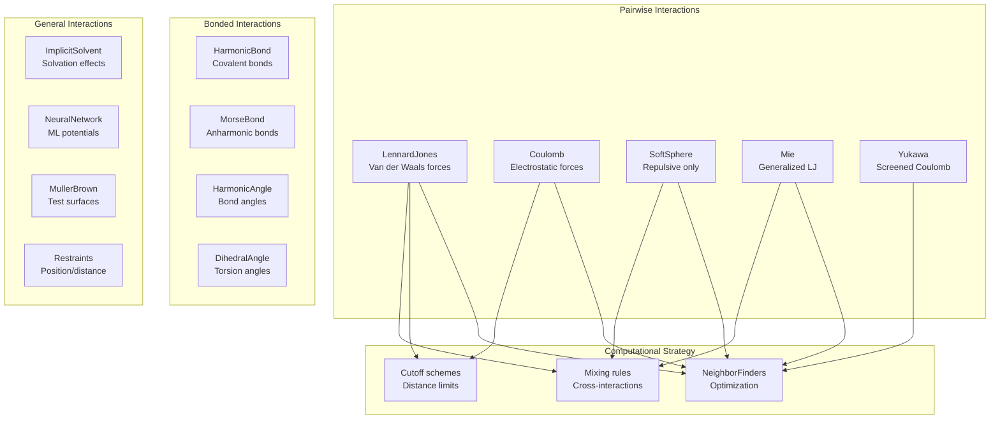
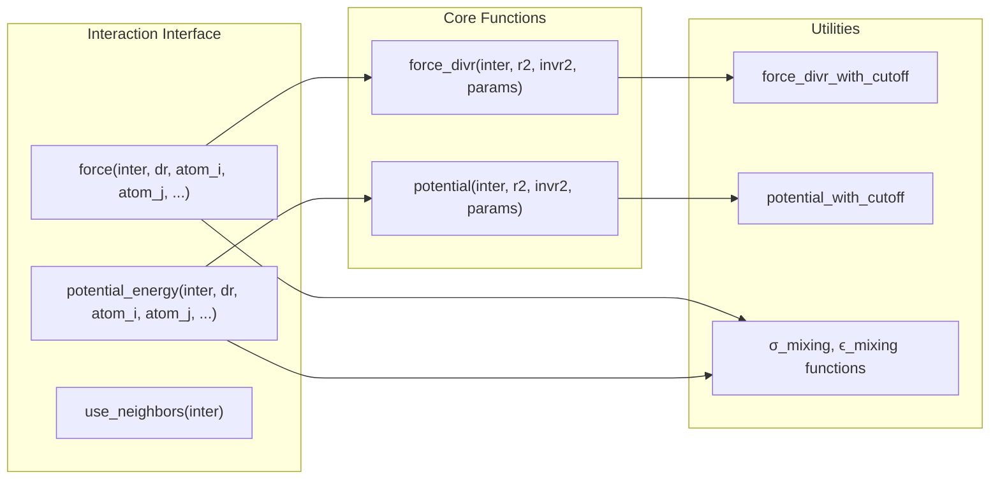
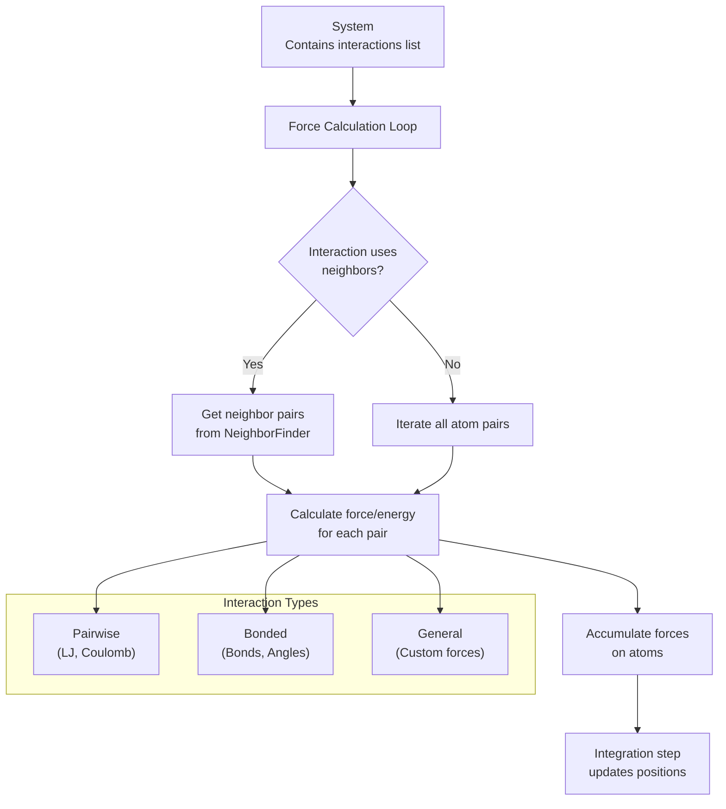
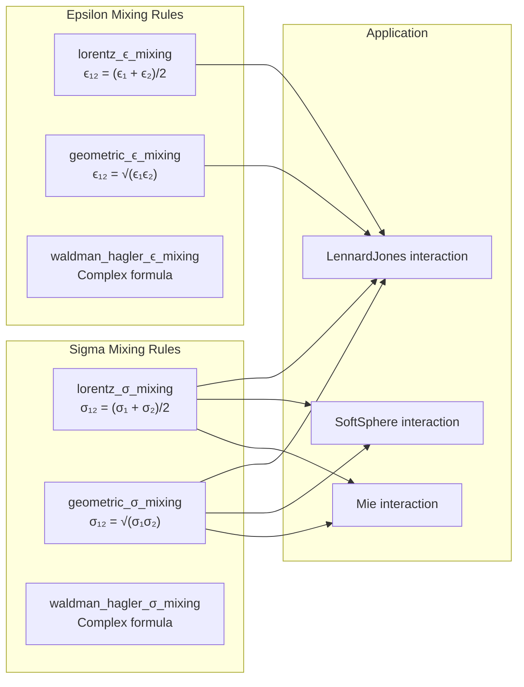
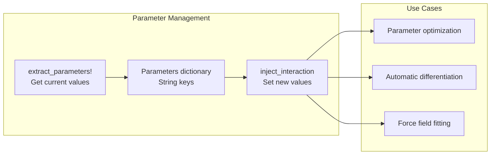

# Interaction System

Relevant source files

The following files were used as context for generating this wiki page:

- [src/interactions/coulomb.jl](src/interactions/coulomb.jl)
- [src/interactions/lennard_jones.jl](src/interactions/lennard_jones.jl)
- [src/interactions/mie.jl](src/interactions/mie.jl)
- [src/interactions/muller_brown.jl](src/interactions/muller_brown.jl)
- [src/interactions/soft_sphere.jl](src/interactions/soft_sphere.jl)
- [test/interactions.jl](test/interactions.jl)

The Interaction System defines how atoms and molecules interact with each other in Molly.jl simulations. This system provides a unified framework for calculating forces and potential energies from various types of molecular interactions, including non-bonded interactions like van der Waals and electrostatics, as well as bonded interactions like bonds, angles, and torsions.

For specific details about non-bonded pairwise interactions, see [Pairwise Interactions](#4.1). For bonded interactions between specific sets of atoms, see [Bonded Interactions](#4.2). For implementation details of force and energy calculations, see [Force and Energy Calculations](#4.3).

## Overview of Interaction Types

Molly.jl organizes molecular interactions into three main categories that correspond to different computational strategies and physical origins:

**Sources:** [src/interactions/lennard_jones.jl:1-418](), [src/interactions/coulomb.jl:1-440](), [src/interactions/mie.jl:1-132](), [src/interactions/soft_sphere.jl:1-81](), [src/interactions/muller_brown.jl:1-83]()

## Core Interaction Interface

All interactions in Molly.jl implement a common interface that enables uniform force and energy calculations regardless of the specific interaction type:

**Sources:** [src/interactions/lennard_jones.jl:74-98](), [src/interactions/coulomb.jl:58-77](), [src/interactions/mie.jl:65-93]()

The key methods that every interaction must implement are:

| Method | Purpose | Returns |
|--------|---------|---------|
| `force` | Calculate force between two atoms | Force vector with units |
| `potential_energy` | Calculate potential energy between atoms | Scalar energy with units |
| `use_neighbors` | Whether interaction requires neighbor lists | Boolean |

## Integration with Simulation Engine

The interaction system integrates seamlessly with Molly.jl's simulation engine through a standardized workflow:

**Sources:** [test/interactions.jl:1-511](), [src/interactions/lennard_jones.jl:32-33](), [src/interactions/coulomb.jl:26-26]()

## Common Features

### Cutoff Schemes

Most pairwise interactions support cutoff schemes to limit computational cost by ignoring interactions beyond a certain distance:

| Cutoff Type | Description | Use Case |
|-------------|-------------|----------|
| `NoCutoff` | No distance limit | Small systems, high accuracy |
| `DistanceCutoff` | Sharp cutoff at distance | Fast computation |
| `ShiftedPotentialCutoff` | Shifted to zero at cutoff | Energy conservation |
| `ShiftedForceCutoff` | Force and energy shifted | Smooth dynamics |

**Sources:** [src/interactions/lennard_jones.jl:23-30](), [src/interactions/coulomb.jl:19-24]()

### Mixing Rules

For interactions between different atom types, mixing rules determine cross-interaction parameters:

**Sources:** [test/interactions.jl:11-17](), [src/interactions/lennard_jones.jl:27-28](), [src/interactions/soft_sphere.jl:17-18]()

### Special Interactions

Many interactions support special weighting for 1-4 interactions (atoms separated by exactly 3 bonds):

- `weight_special` parameter scales interaction strength
- Commonly used in force fields for 1-4 non-bonded interactions
- Default value is typically 1 (full strength)

**Sources:** [src/interactions/lennard_jones.jl:29-29](), [src/interactions/coulomb.jl:22-23](), [test/interactions.jl:67-123]()

### Parameter Injection

Interactions support parameter injection for differentiable simulations and optimization:

**Sources:** [src/interactions/lennard_jones.jl:56-72](), [src/interactions/coulomb.jl:41-56]()

## Extensibility

The interaction system is designed for easy extension with new interaction types. Custom interactions need only implement the core interface methods (`force`, `potential_energy`, `use_neighbors`) to integrate seamlessly with the simulation engine.

**Sources:** [src/interactions/muller_brown.jl:46-82](), [test/interactions.jl:487-509]()

---