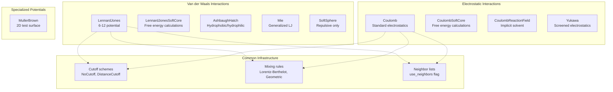
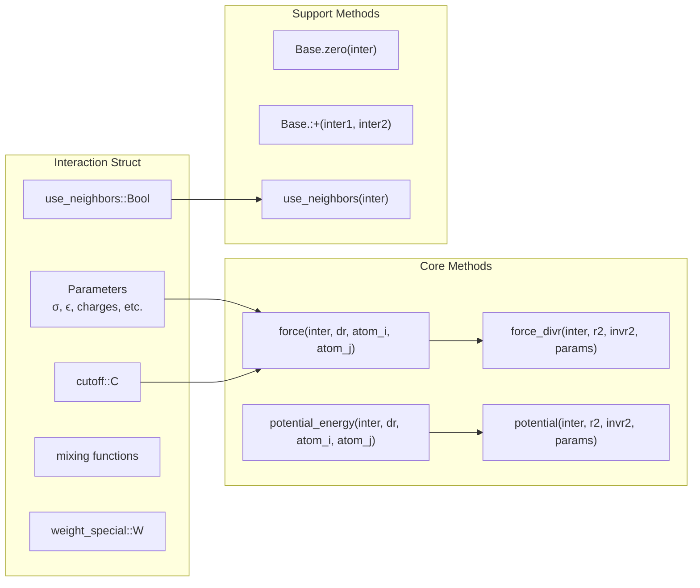
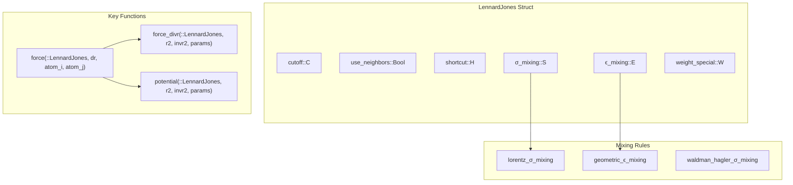
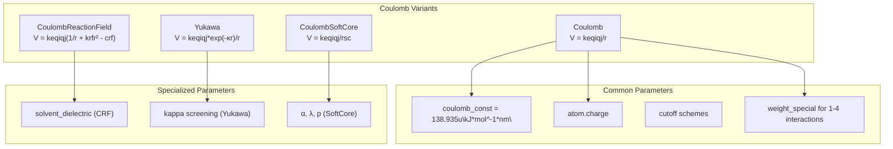
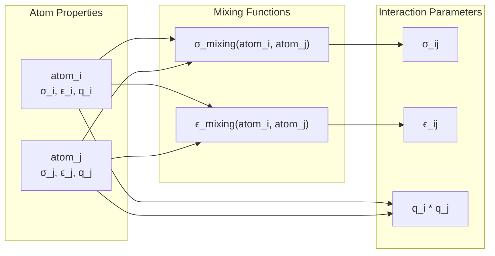
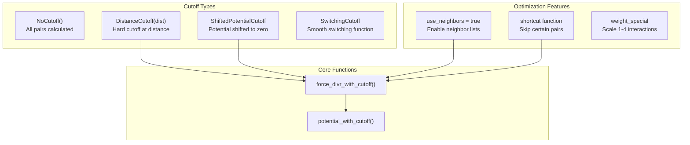

# Pairwise Interactions

Relevant source files

The following files were used as context for generating this wiki page:

- [src/interactions/coulomb.jl](src/interactions/coulomb.jl)
- [src/interactions/lennard_jones.jl](src/interactions/lennard_jones.jl)
- [src/interactions/mie.jl](src/interactions/mie.jl)
- [src/interactions/muller_brown.jl](src/interactions/muller_brown.jl)
- [src/interactions/soft_sphere.jl](src/interactions/soft_sphere.jl)
- [test/interactions.jl](test/interactions.jl)

This document describes the pairwise (non-bonded) interactions available in Molly.jl, which model the forces between pairs of atoms that are not connected by chemical bonds. These interactions form the foundation of most molecular dynamics force fields and include van der Waals forces, electrostatic interactions, and specialized potentials for different physical phenomena.

For information about bonded interactions (bonds, angles, torsions), see [Bonded Interactions](#4.2). For details on how forces and energies are calculated from these interactions, see [Force and Energy Calculations](#4.3). For neighbor finding algorithms that optimize pairwise calculations, see [Neighbor Finding](#3.3).

## Overview of Pairwise Interaction Types

Molly.jl provides several categories of pairwise interactions, each implementing specific physical models:

Sources: [src/interactions/lennard_jones.jl:1-418](), [src/interactions/coulomb.jl:1-440](), [src/interactions/mie.jl:1-132](), [src/interactions/soft_sphere.jl:1-81](), [src/interactions/muller_brown.jl:1-83]()

## Common Interface Structure

All pairwise interactions in Molly.jl follow a consistent interface pattern with standardized methods for force and energy calculations:

The key computational methods are:
- `force()` and `potential_energy()`: High-level interface taking displacement vectors and atoms
- `force_divr()` and `potential()`: Low-level kernels operating on squared distances and precomputed parameters

Sources: [src/interactions/lennard_jones.jl:74-98](), [src/interactions/coulomb.jl:58-77](), [test/interactions.jl:19-43]()

## Lennard-Jones Interactions

The Lennard-Jones family represents van der Waals interactions with both attractive and repulsive components:

| Interaction Type | Mathematical Form | Use Case |
|------------------|-------------------|----------|
| `LennardJones` | $V(r) = 4\varepsilon_{ij}[(\sigma_{ij}/r_{ij})^{12} - (\sigma_{ij}/r_{ij})^{6}]$ | Standard van der Waals |
| `LennardJonesSoftCore` | Modified with soft core: $r_{ij}^{sc} = (r_{ij}^6 + \alpha\sigma_{ij}^6\lambda^p)^{1/6}$ | Free energy calculations |
| `AshbaughHatch` | Piecewise LJ with $\lambda$ scaling | Hydrophobic/hydrophilic interactions |
| `Mie` | $V(r) = C\varepsilon_{ij}[(\sigma_{ij}/r_{ij})^n - (\sigma_{ij}/r_{ij})^m]$ | Generalized LJ (n≠12, m≠6) |
| `SoftSphere` | $V(r) = 4\varepsilon_{ij}(\sigma_{ij}/r_{ij})^{12}$ | Repulsive-only interactions |

Sources: [src/interactions/lennard_jones.jl:6-134](), [src/interactions/lennard_jones.jl:136-264](), [src/interactions/mie.jl:3-131](), [src/interactions/soft_sphere.jl:3-80]()

## Coulomb Interactions

Electrostatic interactions between charged atoms with various approximations and modifications:

The `CoulombReactionField` interaction implements a continuum solvent approximation where the region beyond the cutoff is treated as a dielectric medium with permittivity `solvent_dielectric`.

Sources: [src/interactions/coulomb.jl:7-106](), [src/interactions/coulomb.jl:108-216](), [src/interactions/coulomb.jl:218-343](), [src/interactions/coulomb.jl:345-440]()

## Parameter Mixing Rules

When atoms of different types interact, mixing rules combine their individual parameters:

| Mixing Rule | Function | Formula | Default Use |
|-------------|----------|---------|-------------|
| Lorentz | `lorentz_σ_mixing` | $\sigma_{ij} = (\sigma_i + \sigma_j)/2$ | σ parameters |
| Lorentz | `lorentz_ϵ_mixing` | $\varepsilon_{ij} = (\varepsilon_i + \varepsilon_j)/2$ | Alternative ϵ |
| Geometric | `geometric_σ_mixing` | $\sigma_{ij} = \sqrt{\sigma_i \sigma_j}$ | Alternative σ |
| Geometric | `geometric_ϵ_mixing` | $\varepsilon_{ij} = \sqrt{\varepsilon_i \varepsilon_j}$ | ϵ parameters |
| Waldman-Hagler | `waldman_hagler_σ_mixing` | More complex formula | Specialized cases |

Sources: [test/interactions.jl:11-17](), [src/interactions/lennard_jones.jl:27-28](), [src/interactions/coulomb.jl:125]()

## Cutoff Schemes and Optimization

Pairwise interactions support various cutoff schemes to limit computational cost and enable neighbor list optimizations:

The `use_neighbors` flag indicates whether an interaction can benefit from neighbor lists (see [Neighbor Finding](#3.3)). The `shortcut` function allows skipping calculations for specific atom pairs, while `weight_special` scales interactions between atoms separated by exactly three bonds (1-4 interactions) in molecular force fields.

Sources: [src/interactions/lennard_jones.jl:23-30](), [src/interactions/coulomb.jl:19-24](), [test/interactions.jl:487-509]()

---