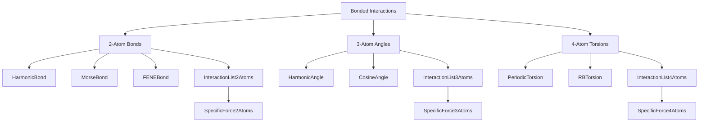
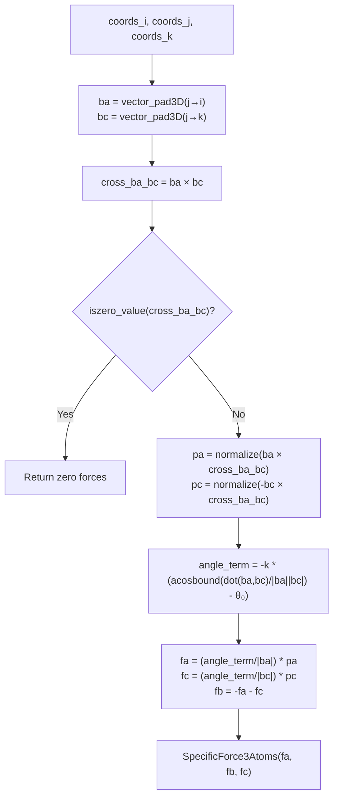
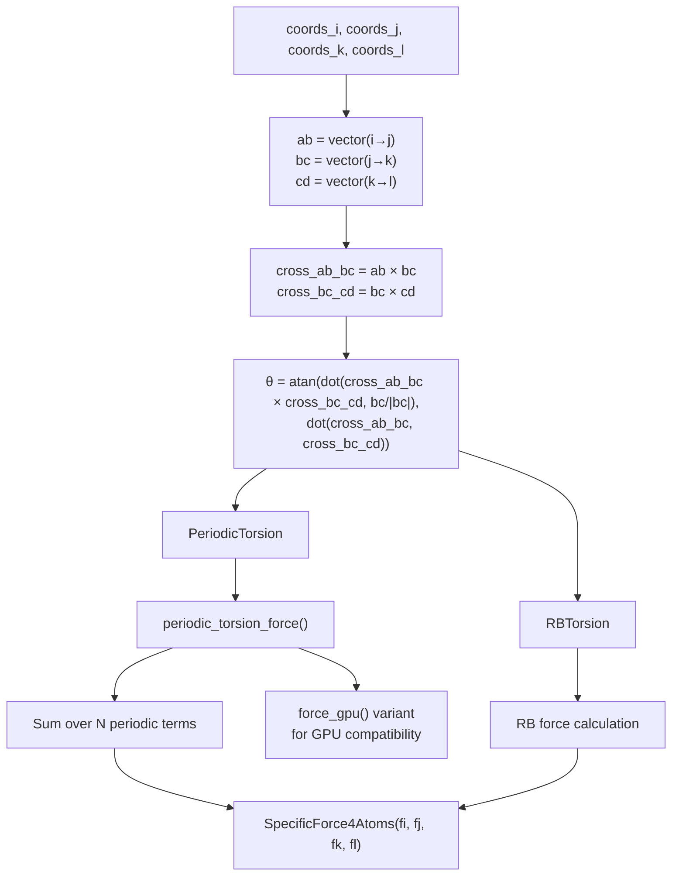
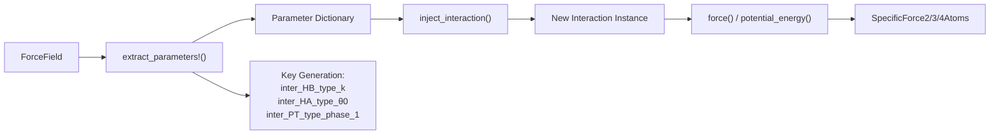

# Bonded Interactions

<details>
<summary>Relevant source files</summary>

The following files were used as context for generating this wiki page:

- [src/interactions/harmonic_angle.jl](src/interactions/harmonic_angle.jl)
- [src/interactions/harmonic_bond.jl](src/interactions/harmonic_bond.jl)
- [src/interactions/periodic_torsion.jl](src/interactions/periodic_torsion.jl)
- [src/interactions/rb_torsion.jl](src/interactions/rb_torsion.jl)

</details>


## Purpose and Scope

Bonded interactions represent the specific chemical interactions between atoms that are directly connected through covalent bonds, bond angles, and torsional arrangements in molecular systems. These interactions enforce the geometric constraints and internal energetics of molecular structures, distinct from the non-bonded pairwise interactions covered in [Pairwise Interactions](#4.1).

This page covers the implementation of bonds (2-atom), angles (3-atom), and torsions (4-atom) in Molly.jl, including their mathematical formulations, force calculations, and integration with force field parameters. For information about how these forces are computed and accumulated, see [Force and Energy Calculations](#4.3).

## Overview of Bonded Interaction Types

Bonded interactions in Molly.jl are organized by the number of atoms involved in each interaction:

| Interaction Type | Atoms | Primary Structs | Purpose |
|------------------|-------|-----------------|---------|
| Bonds | 2 | `HarmonicBond` | Maintain bond lengths |
| Angles | 3 | `HarmonicAngle` | Maintain bond angles |
| Torsions | 4 | `PeriodicTorsion`, `RBTorsion` | Control dihedral rotations |

**Bonded Interaction Type Hierarchy**


Sources: [src/interactions/harmonic_bond.jl:1-58](), [src/interactions/harmonic_angle.jl:1-71](), [src/interactions/periodic_torsion.jl:1-155](), [src/interactions/rb_torsion.jl:1-42]()

## Bond Interactions (2 Atoms)

Bond interactions maintain the chemical bonds between pairs of atoms. The primary implementation is `HarmonicBond`, which models bonds as harmonic springs.

### HarmonicBond

The `HarmonicBond` struct implements a simple harmonic potential between two atoms:

```
V(r) = (1/2) * k * (r - r₀)²
```

Where:
- `k`: Spring constant (force parameter)
- `r₀`: Equilibrium bond length
- `r`: Current bond distance

The force calculation returns a `SpecificForce2Atoms` object containing forces for both atoms:

```julia
# Force implementation from HarmonicBond
function force(b::HarmonicBond, coord_i, coord_j, boundary, args...)
    ab = vector(coord_i, coord_j, boundary)
    c = b.k * (norm(ab) - b.r0)
    f = c * normalize(ab)
    return SpecificForce2Atoms(f, -f)
end
```

Sources: [src/interactions/harmonic_bond.jl:3-16](), [src/interactions/harmonic_bond.jl:46-51](), [src/interactions/harmonic_bond.jl:53-57]()

## Angle Interactions (3 Atoms)

Angle interactions control the bond angles formed by three consecutive atoms, where the middle atom serves as the vertex.

### HarmonicAngle

The `HarmonicAngle` struct implements a harmonic potential for bond angles:

```
V(θ) = (1/2) * k * (θ - θ₀)²
```

Where:
- `k`: Angular force constant
- `θ₀`: Equilibrium angle (in radians)
- `θ`: Current bond angle

The force calculation is more complex than bonds, involving cross products to determine the force directions perpendicular to the angle bisector. The implementation returns a `SpecificForce3Atoms` object.

**Angle Force Calculation Flow**


Sources: [src/interactions/harmonic_angle.jl:3-18](), [src/interactions/harmonic_angle.jl:48-64](), [src/interactions/harmonic_angle.jl:66-71]()

## Torsion Interactions (4 Atoms)

Torsion interactions control the dihedral angles formed by four consecutive atoms, which are crucial for molecular conformational flexibility.

### PeriodicTorsion

The `PeriodicTorsion` struct supports multiple periodic terms with different periodicities:

```
V(φ) = Σₙ kₙ * (1 + cos(nφ - φₛ,ₙ))
```

Where:
- `periodicities`: Tuple of integer multiplicities
- `phases`: Tuple of phase shifts (in radians)  
- `ks`: Tuple of force constants
- `proper`: Boolean indicating proper vs improper torsion

The struct uses compile-time parameterization with `N` for the number of terms, enabling efficient force calculations.

### RBTorsion

The `RBTorsion` struct implements the Ryckaert-Bellemans functional form commonly used in biomolecular force fields:

```
V(θ) = (f₁(1+cos(θ)) + f₂(1-cos(2θ)) + f₃(1+cos(3θ)) + f₄) / 2
```

Where `f1`, `f2`, `f3`, `f4` are the Ryckaert-Bellemans coefficients.

**Torsion Force Calculation Architecture**


Sources: [src/interactions/periodic_torsion.jl:3-19](), [src/interactions/periodic_torsion.jl:88-100](), [src/interactions/periodic_torsion.jl:102-111](), [src/interactions/rb_torsion.jl:3-16]()

## Implementation Architecture

### InteractionList Structures

Bonded interactions are managed through specialized interaction list types that store collections of interactions along with the atom indices they act upon:

- `InteractionList2Atoms`: Manages bond interactions
- `InteractionList3Atoms`: Manages angle interactions  
- `InteractionList4Atoms`: Manages torsion interactions

Each interaction list contains:
- `inters`: Vector of interaction objects (e.g., `Vector{HarmonicBond}`)
- `types`: Vector of interaction type identifiers for force field lookup
- Atom index mappings for efficient force calculation

### Force Field Integration

The bonded interactions integrate with force field parameter systems through two key functions:

- `extract_parameters!()`: Extracts parameters from force field definitions into a parameter dictionary
- `inject_interaction()`: Creates new interaction instances with parameters from the dictionary

This system enables dynamic parameter modification for force field optimization and differentiable simulations.

**Parameter Management Flow**


Sources: [src/interactions/harmonic_bond.jl:24-30](), [src/interactions/harmonic_bond.jl:32-44](), [src/interactions/harmonic_angle.jl:26-32](), [src/interactions/harmonic_angle.jl:34-46](), [src/interactions/periodic_torsion.jl:54-66](), [src/interactions/periodic_torsion.jl:68-86]()

---