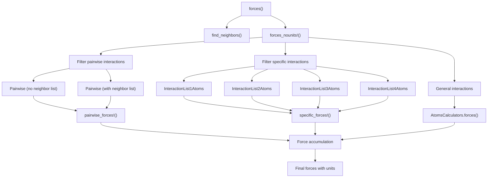
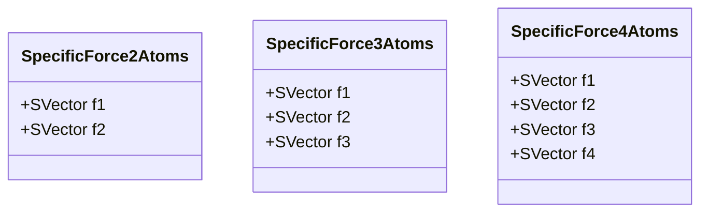
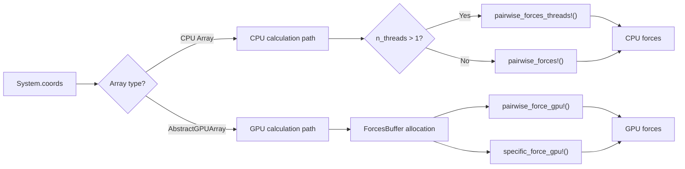
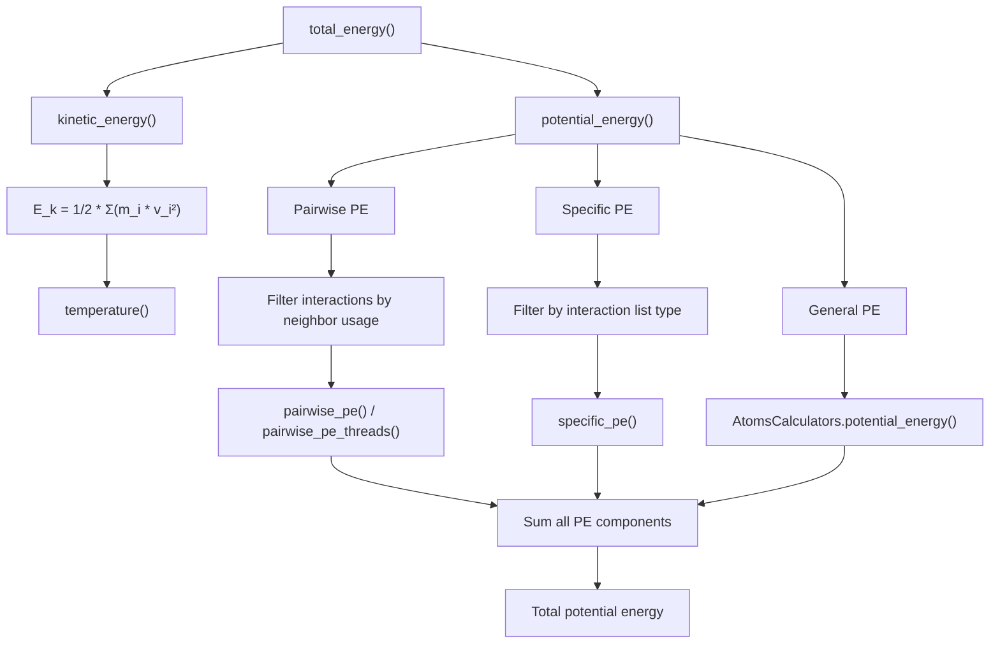
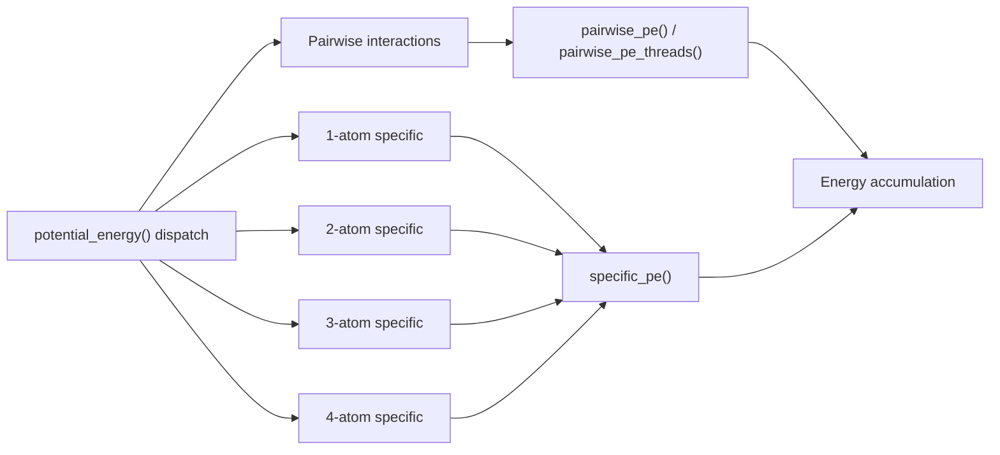
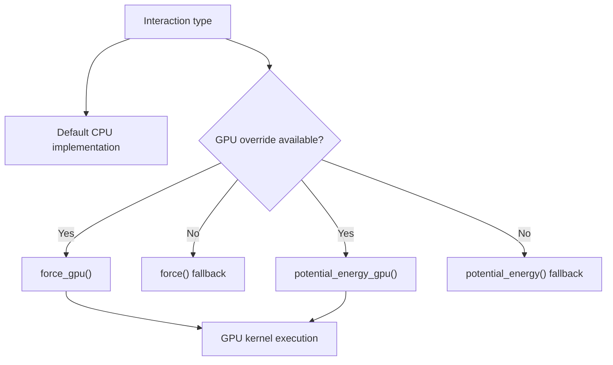
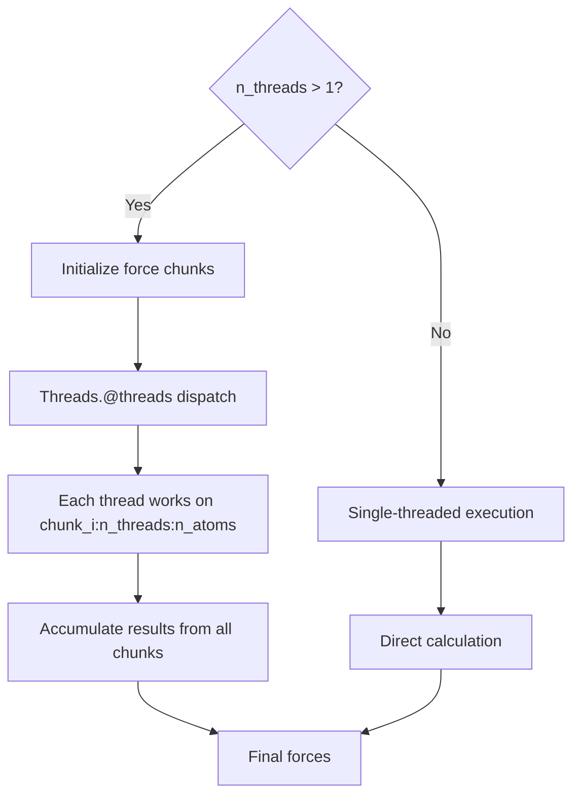
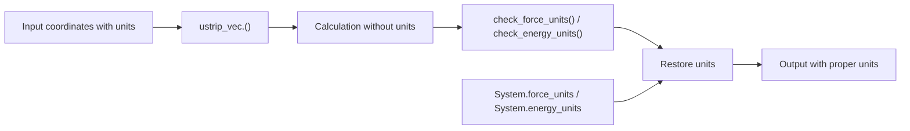

# Force and Energy Calculations

<details>
<summary>Relevant source files</summary>

The following files were used as context for generating this wiki page:

- [src/energy.jl](src/energy.jl)
- [src/force.jl](src/force.jl)

</details>


This page covers how forces and potential energies are computed from molecular interactions in Molly.jl. It details the computational engine that takes interaction definitions and calculates the resulting forces on atoms and system energies.

For information about the specific interaction types themselves, see [Pairwise Interactions](#4.1) and [Bonded Interactions](#4.2). For how these calculated forces are used in simulation algorithms, see [Integrators and Simulators](#5.1).

## Overview

Force and energy calculations in Molly.jl follow a modular architecture that separates the computational engine from the interaction definitions. The system supports three categories of interactions:

- **Pairwise interactions**: Non-bonded interactions like Lennard-Jones and Coulomb
- **Specific interactions**: Bonded interactions with fixed atom lists (bonds, angles, torsions)  
- **General interactions**: Complex interactions like implicit solvent models

All calculations support both CPU execution (with multi-threading) and GPU acceleration, with automatic unit handling throughout.

## Force Calculation Architecture

### Main Calculation Flow

The primary entry point for force calculations is the `forces()` function, which orchestrates the computation across all interaction types:



Sources: [src/force.jl:159-168](), [src/force.jl:170-206]()

### Force Calculation Methods

Individual interactions implement the `force()` function with multiple dispatch based on the number of atoms involved:

| Function Signature | Interaction Type | Returns |
|-------------------|------------------|---------|
| `force(inter, vec_ij, atom_i, atom_j, ...)` | Pairwise | Single force vector |
| `force(inter, coord_i, boundary, atom_i, ...)` | 1-atom specific | `SpecificForce1Atoms` |
| `force(inter, coord_i, coord_j, boundary, ...)` | 2-atom specific | `SpecificForce2Atoms` |
| `force(inter, coord_i, coord_j, coord_k, ...)` | 3-atom specific | `SpecificForce3Atoms` |
| `force(inter, coord_i, coord_j, coord_k, coord_l, ...)` | 4-atom specific | `SpecificForce4Atoms` |

The `SpecificForceNAtoms` structs contain force vectors for each participating atom:



Sources: [src/force.jl:44-51](), [src/force.jl:54-93]()

### CPU vs GPU Execution Paths

The system automatically selects appropriate calculation methods based on the array type:



Sources: [src/force.jl:372-405](), [src/force.jl:253-316]()

## Energy Calculation Architecture

### Energy Components

Total energy calculation combines kinetic and potential energy components:



Sources: [src/energy.jl:15-21](), [src/energy.jl:77-118]()

### Potential Energy Calculation Methods

Similar to force calculations, interactions implement `potential_energy()` methods:



Sources: [src/energy.jl:120-160](), [src/energy.jl:209-254]()

## GPU Acceleration

### GPU-Specific Data Structures

GPU calculations use specialized buffers and data structures for efficient memory management:

```mermaid
classDiagram
    class ForcesBuffer {
        +fs_mat : GPU matrix
        +box_mins : GPU array  
        +box_maxs : GPU array
        +morton_seq : GPU array
        +compressed_eligible : GPU array
        +compressed_special : GPU array
    }
    
    class GPUNeighborFinder {
        +initialized : Bool
    }
    
    ForcesBuffer --> "manages" : GPUNeighborFinder
```

Sources: [src/force.jl:126-151]()

### GPU Function Variants

The system provides GPU-specific variants of force and energy functions that can be overridden for optimization:



Sources: [src/force.jl:46-51](), [src/energy.jl:291-296]()

## Threading and Performance

### Multi-Threading Strategy

CPU calculations support multi-threading through work distribution across threads:



Sources: [src/force.jl:253-316](), [src/energy.jl:162-207]()

### Performance Considerations

| Aspect | Implementation | Performance Impact |
|--------|---------------|-------------------|
| Neighbor lists | Used by most pairwise interactions | O(N) vs O(N²) scaling |
| Threading | Work distribution by atom index | Near-linear speedup with cores |
| GPU acceleration | Kernel-based computation | High throughput for large systems |
| Unit handling | Stripped during calculation, restored at end | Minimal overhead |
| Memory allocation | Buffer reuse on GPU, chunks on CPU | Reduced GC pressure |

Sources: [src/force.jl:118-124](), [src/force.jl:135-151]()

## Unit Handling

Forces and energies maintain proper units throughout the calculation process:



The system ensures unit consistency by:
- Stripping units before calculation for performance
- Validating unit compatibility during accumulation  
- Restoring proper units to final results
- Supporting both dimensional and dimensionless calculations

Sources: [src/force.jl:164-167](), [src/force.jl:222-224](), [src/energy.jl:36-39]()

---