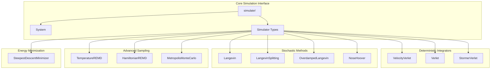
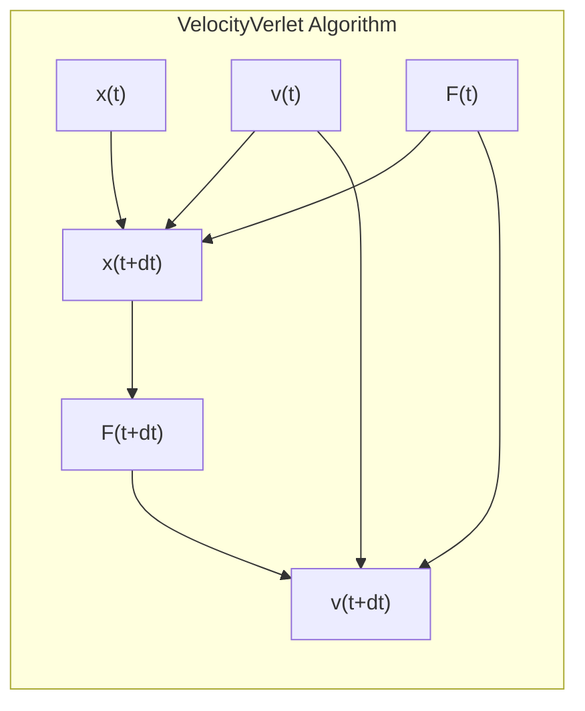
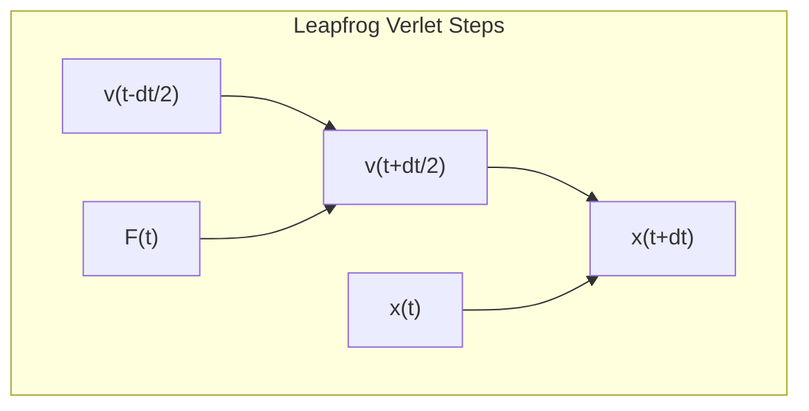
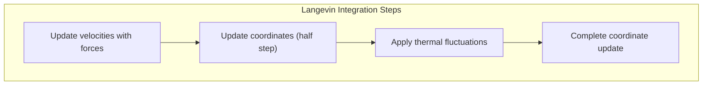
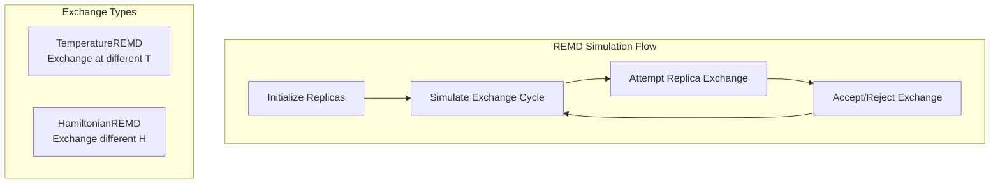
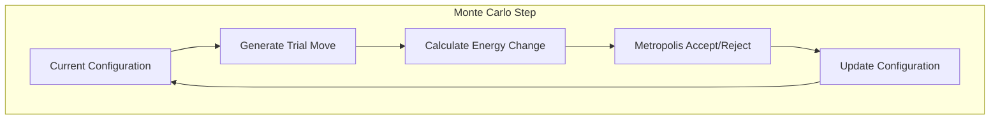
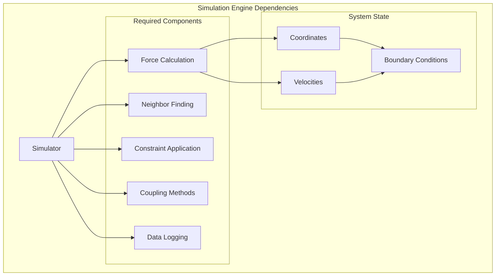

# Simulation Engine

Relevant source files

The following files were used as context for generating this wiki page:

- [src/simulators.jl](src/simulators.jl)
- [test/simulation.jl](test/simulation.jl)

The simulation engine is the core computational component that advances molecular systems through time using various numerical integration methods and sampling algorithms. This system takes a configured molecular system and applies the appropriate physics-based updates to coordinates, velocities, and other dynamic properties according to the selected simulation algorithm.

For information about setting up systems before simulation, see [System Setup and Configuration](#7). For details about force calculations that drive the simulation, see [Force and Energy Calculations](#4.3). For specific integration algorithms and constraint methods, see [Integrators and Simulators](#5.1) and [Constraints](#5.2).

## Overview

The simulation engine in Molly.jl centers around the `simulate!` function, which orchestrates the execution of molecular dynamics simulations according to the rules defined by specific simulator types. The engine supports multiple integration schemes, from basic deterministic methods to advanced stochastic and replica exchange algorithms.

Sources: [src/simulators.jl:1-1134](), [test/simulation.jl:1-1495]()

## Core Simulation Loop

The `simulate!` function serves as the universal interface for running simulations, with the specific behavior determined by the simulator type passed as an argument. All simulators implement the same basic pattern but with different physics and mathematical approaches.

```mermaid
graph TD
    subgraph "simulate! Function Flow"
        start["simulate!(sys, simulator, n_steps)"]
        init["Initialize System State"]
        neighbors["Find Initial Neighbors"]
        loggers_init["Apply Initial Loggers"]
        
        subgraph "Main Loop"
            loop_start["Step n = 1 to n_steps"]
            forces["Calculate Forces"]
            integration["Integration Step"]
            constraints["Apply Constraints"]
            coupling["Apply Coupling"]
            wrap["Wrap Coordinates"]
            update_neighbors["Update Neighbors"]
            loggers["Apply Loggers"]
            loop_end["Increment Step"]
        end
        
        finish["Return Updated System"]
    end
    
    start --> init
    init --> neighbors
    neighbors --> loggers_init
    loggers_init --> loop_start
    loop_start --> forces
    forces --> integration
    integration --> constraints
    constraints --> coupling
    coupling --> wrap
    wrap --> update_neighbors
    update_neighbors --> loggers
    loggers --> loop_end
    loop_end --> loop_start
    loop_end --> finish
```

The core simulation parameters are consistent across all simulators:

| Parameter | Type | Description |
|-----------|------|-------------|
| `n_threads` | `Integer` | Number of CPU threads for parallel execution |
| `run_loggers` | `Bool` or `:skipzero` | Controls logger execution during simulation |
| `rng` | `Random.AbstractRNG` | Random number generator for stochastic methods |

Sources: [src/simulators.jl:48-64](), [src/simulators.jl:142-207]()

## Deterministic Integration Methods

### Velocity Verlet Integrator

The `VelocityVerlet` simulator implements the velocity Verlet algorithm, which provides excellent energy conservation and stability for molecular dynamics simulations.

Key features:
- **Time-reversible**: Maintains symplectic properties
- **Constraint support**: Compatible with SHAKE/RATTLE algorithms
- **Coupling integration**: Supports thermostats and barostats
- **Center of mass removal**: Optional removal of translational drift

Sources: [src/simulators.jl:121-207]()

### Leapfrog Verlet Integrator

The `Verlet` simulator uses the leapfrog integration scheme where velocities are offset by half a time step from positions.

Sources: [src/simulators.jl:209-286]()

### Störmer-Verlet Integrator

The `StormerVerlet` simulator implements the Störmer-Verlet method, which directly updates positions using previous positions rather than storing velocities explicitly.

Sources: [src/simulators.jl:288-357]()

## Stochastic Integration Methods

### Langevin Dynamics

The `Langevin` simulator implements Langevin dynamics with proper treatment of the fluctuation-dissipation theorem, based on the Langevin Middle Integrator from OpenMM.

Key parameters:
- `temperature`: Equilibrium temperature for the thermal bath
- `friction`: Friction coefficient controlling coupling strength
- `vel_scale` and `noise_scale`: Pre-computed scaling factors for efficiency

Sources: [src/simulators.jl:359-451]()

### Langevin Splitting Schemes

The `LangevinSplitting` simulator provides flexible splitting schemes using **A** (position), **B** (force), and **O** (thermal) operators.

| Splitting | Description | Properties |
|-----------|-------------|------------|
| `"BAB"` | Velocity Verlet equivalent | Deterministic, symplectic |
| `"BAOA"` | Standard Langevin | Stochastic, good sampling |
| `"OABAO"` | Alternative scheme | Different sampling properties |

Sources: [src/simulators.jl:453-590]()

### Overdamped Langevin

The `OverdampedLangevin` simulator solves the overdamped Langevin equation using the Euler-Maruyama method, suitable for systems where inertial effects are negligible.

Sources: [src/simulators.jl:591-658]()

### Nosé-Hoover Thermostat

The `NoseHoover` simulator extends velocity Verlet with Nosé-Hoover temperature control, providing canonical (NVT) ensemble sampling.

Sources: [src/simulators.jl:660-760]()

## Advanced Sampling Methods

### Replica Exchange Molecular Dynamics

The simulation engine supports both temperature and Hamiltonian replica exchange methods through the `TemperatureREMD` and `HamiltonianREMD` simulators, which operate on `ReplicaSystem` objects.

The `remd_exchange!` function handles the Metropolis-based exchange attempts between replica pairs.

Sources: [src/simulators.jl:762-1027]()

### Monte Carlo Sampling

The `MetropolisMonteCarlo` simulator implements Metropolis algorithm sampling with configurable trial moves:

- `random_uniform_translation!`: Uniform random displacements
- `random_normal_translation!`: Gaussian random displacements

Sources: [src/simulators.jl:1037-1134]()

## Energy Minimization

The `SteepestDescentMinimizer` provides energy minimization functionality using the steepest descent algorithm with adaptive step sizing.

Key features:
- **Adaptive step size**: Increases on successful steps, decreases on rejections
- **Force tolerance**: Convergence criterion based on maximum force magnitude
- **Progress logging**: Optional output stream for monitoring convergence

Algorithm steps:
1. Calculate forces and current potential energy
2. Propose new coordinates along steepest descent direction
3. Accept/reject based on energy decrease
4. Adjust step size based on acceptance

Sources: [src/simulators.jl:21-119]()

## Integration with System Components

The simulation engine integrates tightly with other system components:

Sources: [src/simulators.jl:1-1134](), [test/simulation.jl:1-1495]()

---