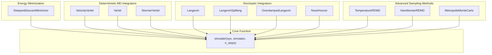
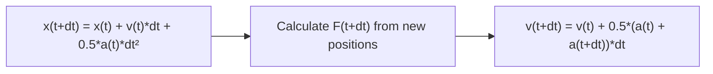
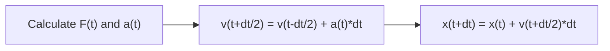
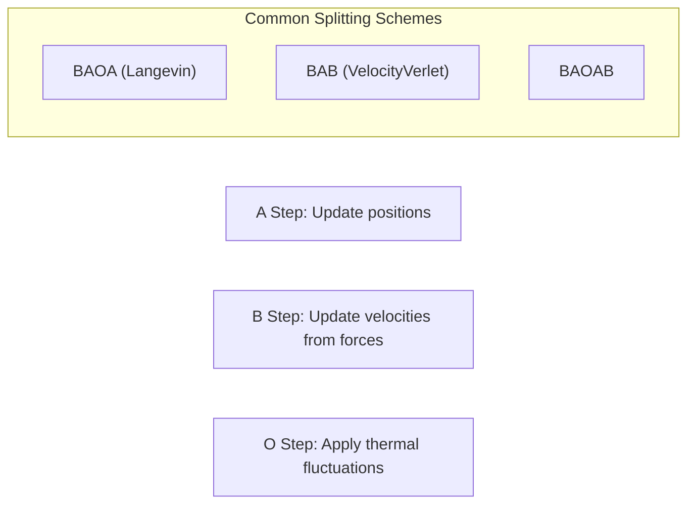
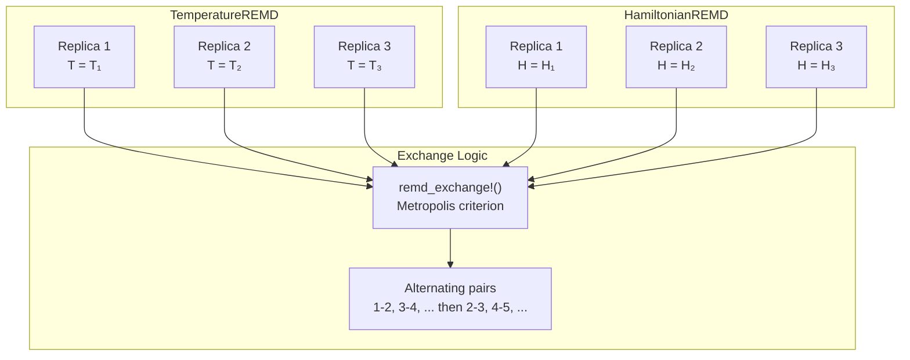
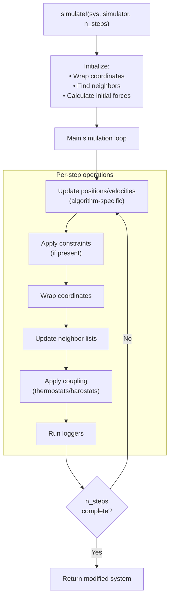
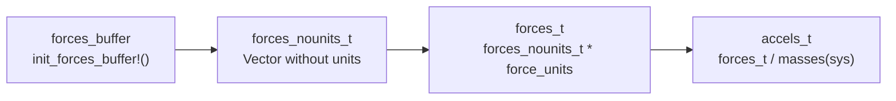

# Integrators and Simulators

Relevant source files

The following files were used as context for generating this wiki page:

- [src/simulators.jl](src/simulators.jl)

This page covers the simulation algorithms and numerical integration methods that drive molecular dynamics simulations in Molly.jl. These components implement the core time-stepping algorithms that update atomic positions and velocities over time, including deterministic integrators, stochastic methods, and advanced sampling techniques.

For information about constraints that modify these integration steps, see [Constraints](#5.2). For details about the force calculations that drive these integrators, see [Force and Energy Calculations](#4.3).

## Simulator Type Hierarchy

All simulators in Molly.jl implement the `simulate!` function with their specific integration algorithms. The following diagram shows the main simulator types and their classification:

Sources: [src/simulators.jl:3-19](), [src/simulators.jl:49-64]()

## Deterministic Molecular Dynamics Integrators

The core MD integrators implement different variants of the Verlet algorithm for integrating Newton's equations of motion. Each has specific advantages for different simulation scenarios.

### VelocityVerlet

The `VelocityVerlet` integrator is the most commonly used algorithm for molecular dynamics simulations, providing good stability and energy conservation:

| Parameter | Type | Description |
|-----------|------|-------------|
| `dt` | Time | Integration time step |
| `coupling` | Coupling | Temperature/pressure control method |
| `remove_CM_motion` | Int | Frequency to remove center-of-mass motion |

The integration scheme follows the standard velocity Verlet algorithm:

Sources: [src/simulators.jl:121-140](), [src/simulators.jl:142-207]()

### Verlet (Leapfrog)

The `Verlet` integrator uses a leapfrog scheme where velocities are offset by half a time step:

Sources: [src/simulators.jl:209-232](), [src/simulators.jl:233-286]()

### StormerVerlet

The `StormerVerlet` integrator provides an alternative implementation with O(dt) velocity accuracy:

Sources: [src/simulators.jl:288-307](), [src/simulators.jl:309-357]()

## Stochastic Simulation Methods

Stochastic integrators incorporate random forces to simulate temperature effects and sample different statistical ensembles.

### Langevin Dynamics

The `Langevin` integrator implements the Langevin Middle Integrator from OpenMM, combining deterministic forces with random thermal fluctuations:

| Parameter | Type | Description |
|-----------|------|-------------|
| `dt` | Time | Integration time step |
| `temperature` | Temperature | Target temperature |
| `friction` | Friction | Friction coefficient |
| `vel_scale` | Scalar | Velocity scaling factor = exp(-dt*friction) |
| `noise_scale` | Scalar | Noise scaling factor = sqrt(1-vel_scale²) |

Sources: [src/simulators.jl:359-391](), [src/simulators.jl:393-451]()

### LangevinSplitting

The `LangevinSplitting` integrator implements general splitting schemes using **A** (position), **B** (velocity/force), and **O** (thermal) steps:

Sources: [src/simulators.jl:453-491](), [src/simulators.jl:493-565]()

### Specialized Stochastic Methods

- **OverdampedLangevin**: Implements the overdamped Langevin equation using Euler-Maruyama method [src/simulators.jl:591-658]()
- **NoseHoover**: Extends velocity Verlet with deterministic temperature control [src/simulators.jl:660-760]()

## Advanced Sampling Techniques

### Replica Exchange Molecular Dynamics (REMD)

REMD methods run multiple simulations in parallel and periodically attempt to exchange configurations between replicas to enhance sampling.

Sources: [src/simulators.jl:762-810](), [src/simulators.jl:870-909](), [src/simulators.jl:965-1027]()

### Monte Carlo Methods

The `MetropolisMonteCarlo` simulator implements the Metropolis algorithm for configuration space sampling:

| Component | Function | Description |
|-----------|----------|-------------|
| `trial_moves` | Function | Generates new configurations |
| `trial_args` | Dict | Arguments for trial move function |
| Energy evaluation | `potential_energy()` | Calculates system energy |
| Acceptance criterion | Metropolis | Accept if ΔE < 0 or rand() < exp(-ΔE/kT) |

Included trial move functions:
- `random_uniform_translation!`: Uniform displacement within sphere
- `random_normal_translation!`: Gaussian-distributed displacement

Sources: [src/simulators.jl:1037-1089](), [src/simulators.jl:1091-1133]()

## Simulation Execution Flow

The `simulate!` function provides a unified interface for all simulators:

Sources: [src/simulators.jl:142-207](), [src/simulators.jl:233-286](), [src/simulators.jl:393-451]()

## Implementation Details

### Common Simulation Parameters

All simulators accept standard keyword arguments:

| Parameter | Default | Description |
|-----------|---------|-------------|
| `n_threads` | `Threads.nthreads()` | Number of CPU threads |
| `run_loggers` | `true` | Whether to execute loggers |
| `rng` | `Random.default_rng()` | Random number generator |

### Force and Energy Buffers

Simulators use preallocated buffers for efficient force calculations:

### Center of Mass Motion Removal

Most integrators support periodic removal of center-of-mass motion to prevent system drift:

Sources: [src/simulators.jl:149](), [src/simulators.jl:185-187](), [src/simulators.jl:273-275]()

Sources: [src/simulators.jl:1-1134]()

---