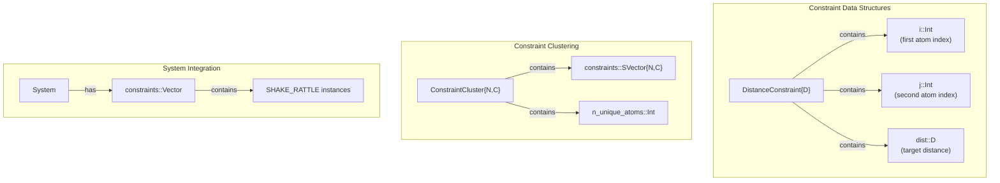
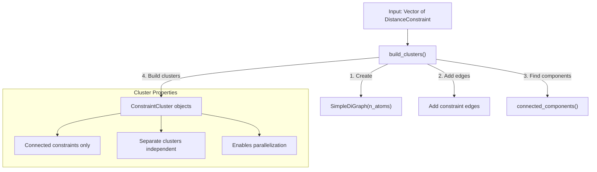
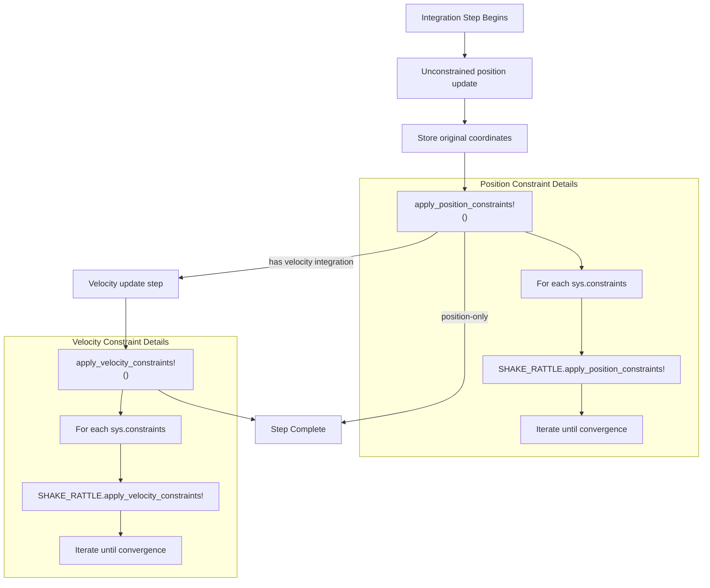
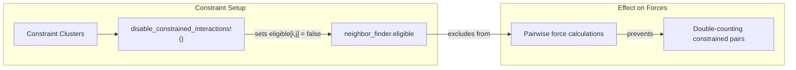

# Constraints

Relevant source files

The following files were used as context for generating this wiki page:

- [data/initial_hydrogen_data.atom](data/initial_hydrogen_data.atom)
- [src/constraints/constraints.jl](src/constraints/constraints.jl)
- [src/constraints/shake.jl](src/constraints/shake.jl)

## Purpose and Scope

The constraints system in Molly.jl maintains geometric constraints during molecular dynamics simulations, primarily fixed distances between atoms. This is essential for rigid molecular structures where certain bond lengths should remain constant throughout the simulation. The system implements the SHAKE and RATTLE algorithms to enforce position and velocity constraints respectively.

For information about integrators that work with constraints, see [Integrators and Simulators](#5.1). For details on the core simulation loop, see [Simulation Engine](#5).

## Constraint Types and Data Structures

The constraint system is built around distance constraints between atom pairs. The core data structure is `DistanceConstraint`, which specifies two atoms and their required separation distance.

### Distance Constraints

Sources: [src/constraints/constraints.jl:7-16](), [src/constraints/constraints.jl:26-29]()

Individual constraints are grouped into `ConstraintCluster` objects based on connectivity. Atoms within a cluster are interconnected by constraints, while atoms in different clusters have no constraint relationships. This clustering approach enables efficient parallel processing and proper constraint solving.

## Constraint Clustering System

The constraint system automatically organizes individual distance constraints into clusters using graph connectivity analysis. This clustering is crucial for both computational efficiency and mathematical correctness of the constraint algorithms.

### Cluster Building Process

Sources: [src/constraints/constraints.jl:58-94]()

The `build_clusters` function creates a directed graph where constraint relationships define edges between atoms. Connected components in this graph become individual constraint clusters. Each cluster contains only constraints that are interconnected, ensuring that constraint solving within one cluster doesn't interfere with other clusters.

## SHAKE and RATTLE Algorithms

The `SHAKE_RATTLE` struct implements both position (SHAKE) and velocity (RATTLE) constraint algorithms. These iterative methods ensure that constraints are satisfied at each simulation step while maintaining the dynamics of the system.

### Algorithm Structure

```mermaid
graph TB
    subgraph "SHAKE_RATTLE Structure"
        SR["SHAKE_RATTLE{C,D,V}"] --> Clusters["clusters::C"]
        SR --> DistTol["dist_tolerance::D"]
        SR --> VelTol["vel_tolerance::V"]
    end
    
    subgraph "Position Constraints (SHAKE)"
        SHAKE1["apply_position_constraints!"] --> |"iterate until converged"| PosLoop["For each cluster/constraint"]
        PosLoop --> Vector["Calculate s12, r12 vectors"]
        Vector --> Quadratic["Solve quadratic for λ"]
        Quadratic --> UpdatePos["Update atom positions"]
        UpdatePos --> Check1["check_position_constraints()"]
    end
    
    subgraph "Velocity Constraints (RATTLE)"
        RATTLE1["apply_velocity_constraints!"] --> |"iterate until converged"| VelLoop["For each cluster/constraint"]
        VelLoop --> VelCalc["Calculate velocity corrections"]
        VelCalc --> Lambda["Solve for λ coefficient"]
        Lambda --> UpdateVel["Update atom velocities"]
        UpdateVel --> Check2["check_velocity_constraints()"]
    end
```

Sources: [src/constraints/shake.jl:28-38](), [src/constraints/shake.jl:40-88](), [src/constraints/shake.jl:90-124]()

### SHAKE Position Algorithm

The SHAKE algorithm corrects positions after an unconstrained integration step. For each constraint, it calculates the deviation from the target distance and applies position corrections to both atoms involved:

1. Calculate vectors between atoms before (`r12`) and after (`s12`) unconstrained update
2. Solve quadratic equation to find Lagrange multiplier `g`
3. Apply position corrections proportional to masses and the constraint vector
4. Iterate until all constraints satisfy distance tolerance

The quadratic equation solved is: `aλ² + bλ + c = 0` where the discriminant ensures a real solution exists.

Sources: [src/constraints/shake.jl:40-88]()

### RATTLE Velocity Algorithm

The RATTLE algorithm ensures velocity constraints are satisfied after SHAKE position corrections:

1. Calculate velocity differences between constrained atoms
2. Project out velocity components along constraint direction
3. Apply velocity corrections using Lagrange multipliers
4. Iterate until velocity constraints are satisfied

Sources: [src/constraints/shake.jl:90-124]()

## Integration with Simulation Loop

Constraints integrate seamlessly with Molly.jl's simulation integrators, applying corrections at appropriate points in the integration cycle.

### Simulation Integration Flow

Sources: [src/constraints/constraints.jl:105-126](), [src/constraints/constraints.jl:133-138]()

The constraint system provides both single-constraint and system-level application functions. Integrators call `apply_position_constraints!` and `apply_velocity_constraints!` at appropriate points in their update cycles.

## Neighbor List Integration

Constrained atom pairs are automatically excluded from neighbor list calculations to avoid double-counting interactions that are already handled by constraints.

### Neighbor List Modification

Sources: [src/constraints/constraints.jl:44-56]()

The `disable_constrained_interactions!` function modifies the neighbor finder's eligibility matrix to exclude constrained atom pairs from pairwise interaction calculations, preventing double-counting of forces.

## Degrees of Freedom Calculation

The constraint system affects the total degrees of freedom in the system by removing vibrational modes. The `n_dof_lost` function calculates this reduction based on molecular structure assumptions.

### DOF Reduction Logic

| Structure Type | Translational DOF | Rotational DOF | Vibrational DOF | Constraints Remove |
|----------------|-------------------|----------------|-----------------|-------------------|
| Monoatomic | D | 0 | 0 | 0 |
| Linear (N=2) | D | D-1 | D*N-(2D-1) | D*N-(2D-1) |
| Non-linear (N>2) | D | D | D*N-2D | D*(N-2) |

Sources: [src/constraints/constraints.jl:158-168]()

This calculation is important for proper temperature scaling and thermodynamic calculations in constrained systems.

## Implementation Notes

The constraint implementation includes several important technical details:

- **Thread Safety**: Constraint clusters cannot be parallelized internally due to interdependencies, but different clusters can be processed in parallel
- **Numerical Stability**: The quadratic solver includes checks for negative discriminants and selects the smaller magnitude root
- **GPU Compatibility**: Current implementation is CPU-only, as noted in the documentation
- **Convergence Criteria**: Both position and velocity constraints use absolute tolerance checks with appropriate units

Sources: [src/constraints/shake.jl:18](), [src/constraints/shake.jl:64-68](), [src/constraints/shake.jl:41]()

---