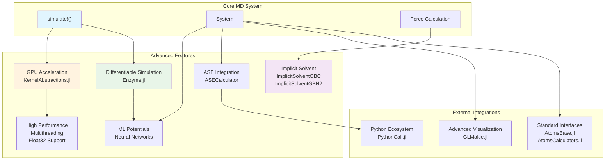
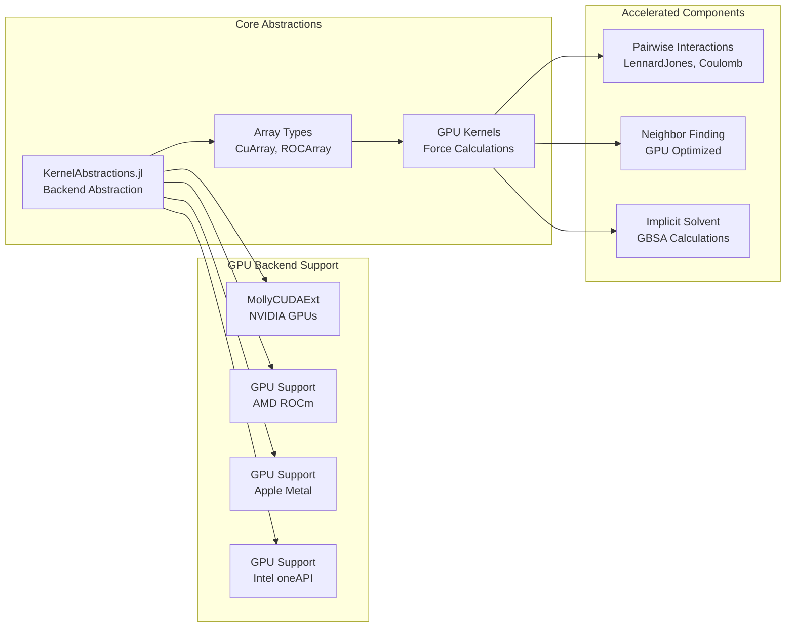
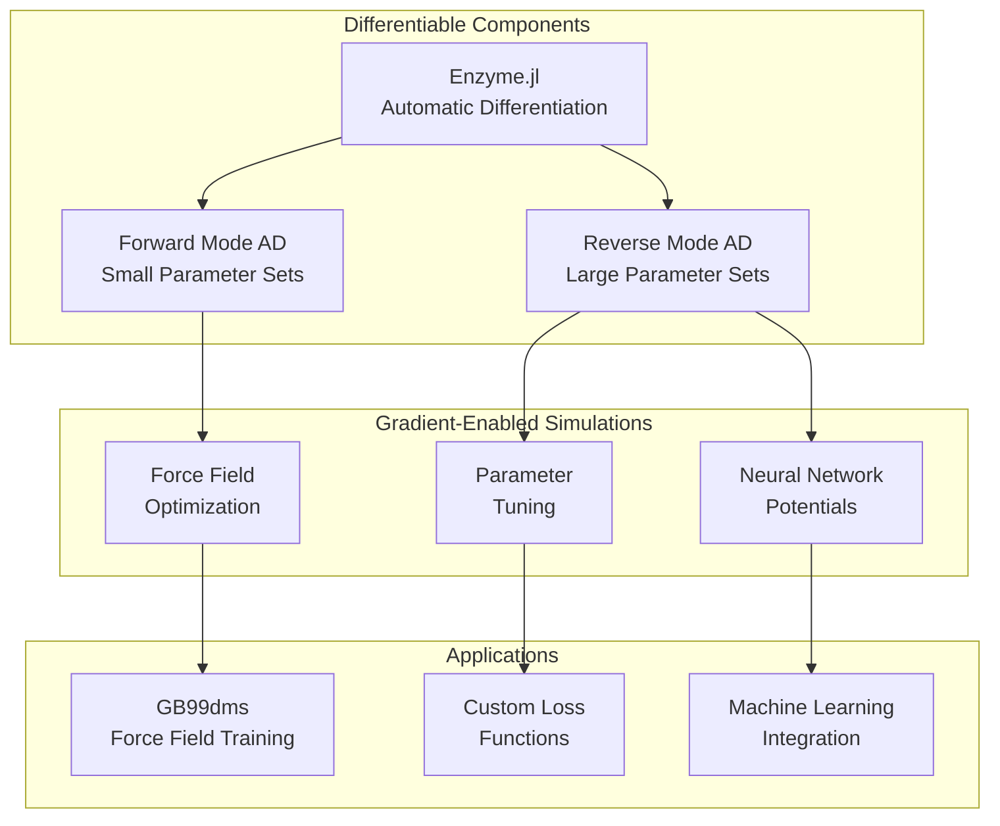
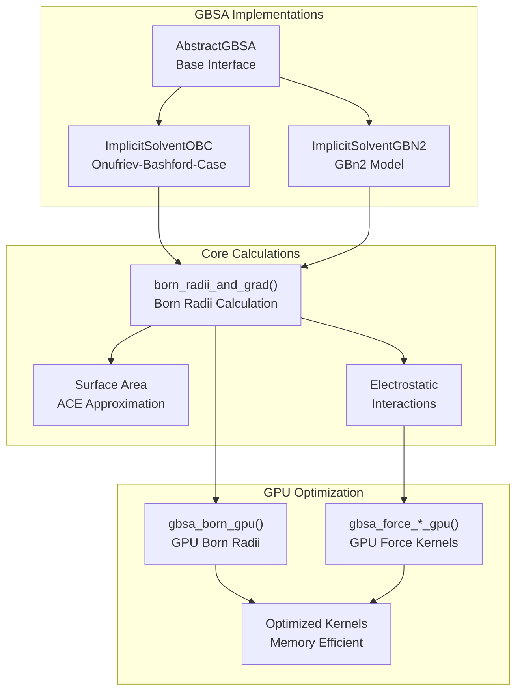
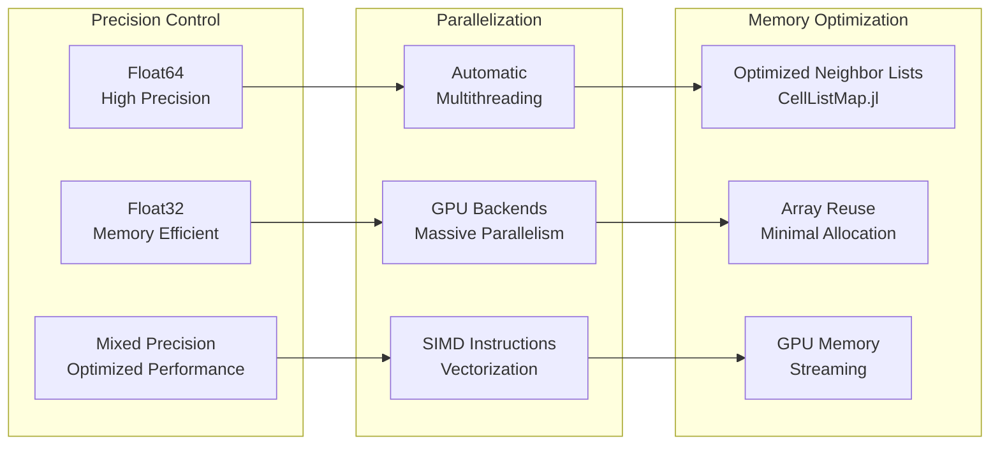

# Advanced Features

<details>
<summary>Relevant source files</summary>

The following files were used as context for generating this wiki page:

- [README.md](README.md)
- [docs/src/differentiable.md](docs/src/differentiable.md)
- [docs/src/examples.md](docs/src/examples.md)
- [src/interactions/implicit_solvent.jl](src/interactions/implicit_solvent.jl)

</details>


This page covers sophisticated capabilities that extend basic molecular dynamics functionality in Molly.jl. These features enable high-performance computing, machine learning integration, and advanced simulation techniques that go beyond standard MD simulations.

For basic simulation setup and core molecular dynamics concepts, see [Core Architecture](#3) and [Simulation Engine](#5). For system configuration and force field setup, see [System Setup and Configuration](#7).

## Overview

Molly.jl provides several advanced capabilities that distinguish it from traditional molecular dynamics packages:



**Advanced Features Architecture Overview**

Sources: [README.md:17-46](), [docs/src/differentiable.md:1-20]()

## GPU Acceleration

Molly.jl supports GPU acceleration across all major GPU backends through `KernelAbstractions.jl`. This includes NVIDIA CUDA, AMD ROCm, Apple Metal, and Intel oneAPI devices. GPU acceleration is automatically enabled when appropriate array types are used.



**GPU Acceleration Architecture**

For detailed information on GPU setup, performance optimization, and backend-specific considerations, see [GPU Acceleration](#6.1).

Sources: [README.md:38-39]()

## Differentiable Simulation

Differentiable molecular dynamics enables automatic differentiation through entire simulations using `Enzyme.jl`. This unique capability allows for gradient-based optimization of force field parameters, neural network potentials, and other simulation parameters.



**Differentiable Simulation Capabilities**

Key features include gradient calculation through:
- Pairwise and specific interactions
- Neighbor list updates  
- Stochastic thermostats
- Complex loss functions

For implementation details, training examples, and performance considerations, see [Differentiable Simulation](#6.2).

Sources: [README.md:45](), [docs/src/differentiable.md:9-21]()

## Implicit Solvent Models

Advanced implicit solvent models approximate solvent effects without explicit water molecules, significantly reducing computational cost while maintaining physical accuracy.



**Implicit Solvent Model Architecture**

Available models:
- **OBC (Onufriev-Bashford-Case)**: Parameter sets I and II with ACE surface area approximation
- **GBN2**: Advanced model with neck correction and optimized parameters

For model selection, parameterization, and usage examples, see [Implicit Solvent Models](#6.3).

Sources: [src/interactions/implicit_solvent.jl:1-600]()

## Machine Learning Integration

Molly.jl supports integration with machine learning frameworks and external calculators for advanced potential energy surfaces and force calculations.

| Integration Type | Implementation | Use Case |
|------------------|----------------|----------|
| Neural Network Potentials | `Flux.jl` models as general interactions | Custom ML potentials |
| Python ASE Calculators | `ASECalculator` with `PythonCall.jl` | MACE, psi4, other ASE-compatible tools |
| AtomsCalculators.jl | `MollyCalculator` interface | Cross-package compatibility |
| Custom Interactions | User-defined force functions | Domain-specific physics |

Example neural network integration pattern:
```julia
# Neural network as general interaction
struct NeuralNetworkPotential{T}
    model::T
end

function AtomsCalculators.forces(sys, inter::NeuralNetworkPotential; kwargs...)
    # Custom force calculation using neural network
    # Returns force vector for each atom
end
```

Sources: [docs/src/examples.md:442-535](), [README.md:42-44]()

## Performance and Hardware Optimization

Advanced performance features enable efficient simulations across different hardware configurations:



**Performance Optimization Strategies**

Key optimization features:
- **Precision flexibility**: Support for `Float64`, `Float32`, and custom numeric types
- **Automatic multithreading**: Thread-safe parallel force calculations
- **Memory management**: Efficient GPU memory usage and CPU cache optimization
- **Neighbor list optimization**: Integration with `CellListMap.jl` for efficient spatial searches

Sources: [README.md:37-40]()

## External Ecosystem Integration

Molly.jl integrates with the broader Julia and scientific computing ecosystems:

| Package | Integration | Purpose |
|---------|-------------|---------|
| `AtomsBase.jl` | Standard atomic system interface | Interoperability |
| `AtomsCalculators.jl` | Calculator interface | Force/energy computation |
| `Chemfiles.jl` | File I/O support | Trajectory reading/writing |
| `Unitful.jl` | Physical units | Type-safe calculations |
| `GLMakie.jl` | Visualization | Interactive simulation viewing |
| `SimpleCrystals.jl` | Crystal structure generation | Solid-state systems |

This ecosystem integration enables Molly.jl to serve as both a standalone simulation package and a component in larger computational workflows.

Sources: [README.md:21-22](), [README.md:35-36](), [README.md:41-42]()

---