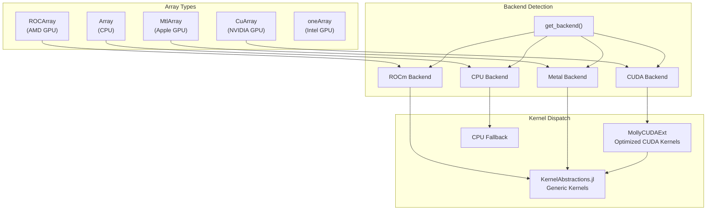
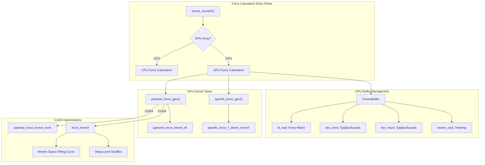
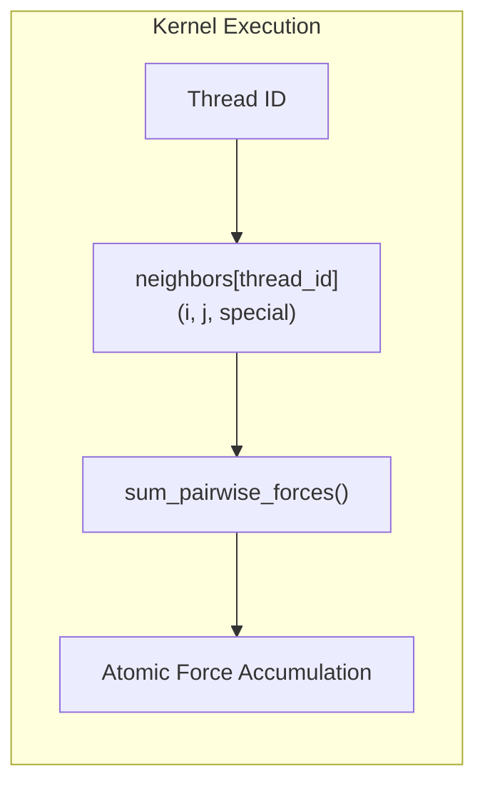
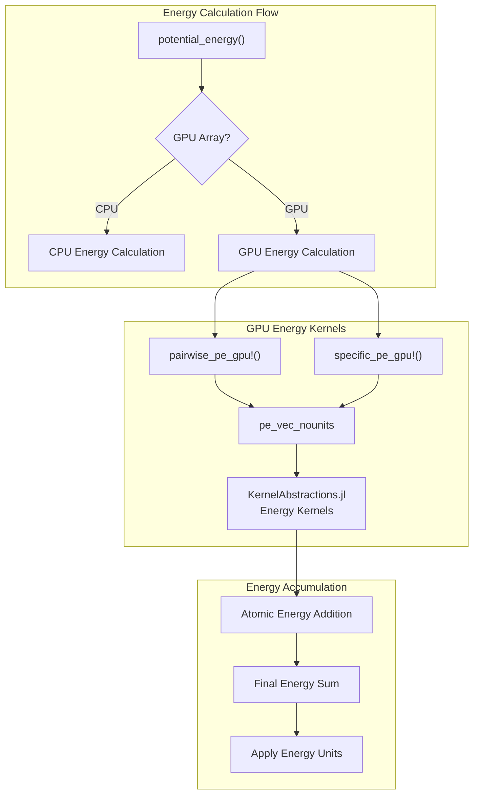
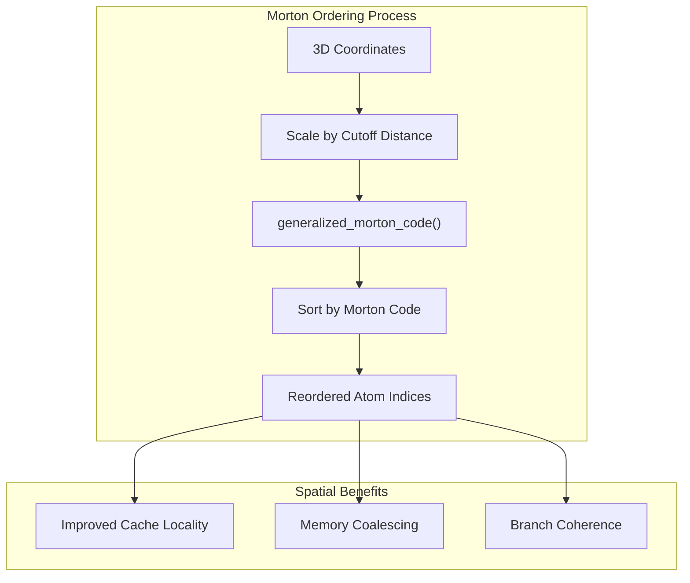
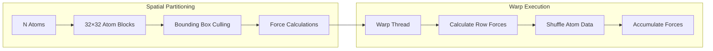

# GPU Acceleration

<details>
<summary>Relevant source files</summary>

The following files were used as context for generating this wiki page:

- [ext/MollyCUDAExt.jl](ext/MollyCUDAExt.jl)
- [ext/MollyGLMakieExt.jl](ext/MollyGLMakieExt.jl)
- [src/energy.jl](src/energy.jl)
- [src/force.jl](src/force.jl)
- [src/kernels.jl](src/kernels.jl)
- [test/gradients.jl](test/gradients.jl)

</details>


This section covers GPU acceleration capabilities in Molly.jl, including array type abstraction, GPU kernels for force and energy calculations, and hardware-specific optimizations. GPU acceleration enables high-performance molecular dynamics simulations by leveraging parallel computing architectures.

For information about the core force calculation algorithms, see [Force and Energy Calculations](#4.3). For details about neighbor finding algorithms, see [Neighbor Finding](#3.3).

## Array Type System and Backend Abstraction

Molly.jl uses an array type abstraction system that allows the same simulation code to run on different hardware backends without modification. The system automatically detects GPU arrays and dispatches to appropriate GPU kernels.



**Sources:** [src/force.jl:135-151](), [src/kernels.jl:35-43](), [ext/MollyCUDAExt.jl:13]()

The system determines GPU capability through the `uses_gpu_neighbor_finder` function, which returns `true` for CUDA arrays and enables GPU-specific neighbor finding algorithms.

## GPU Force Calculation Architecture

GPU force calculations use a two-level dispatch system: generic KernelAbstractions.jl kernels for broad GPU compatibility, and specialized CUDA kernels for optimal NVIDIA GPU performance.



**Sources:** [src/force.jl:372-405](), [src/kernels.jl:45-64](), [ext/MollyCUDAExt.jl:45-86]()

### GPU Buffer Initialization

GPU force calculations require specialized buffers managed by the `ForcesBuffer` struct:

- `fs_mat`: Force accumulation matrix with dimensions `(D, N)` where `D` is spatial dimensions and `N` is number of atoms
- `box_mins` and `box_maxs`: Spatial bounding boxes for neighbor finding optimization
- `morton_seq`: Morton-ordered atom indices for spatial locality
- `compressed_eligible` and `compressed_special`: Compressed boolean matrices for interaction eligibility

**Sources:** [src/force.jl:126-151]()

### Pairwise Force Kernels

The `pairwise_force_kernel_nl!` kernel processes neighbor lists in parallel, with each GPU thread handling one atom pair interaction:



**Sources:** [src/kernels.jl:66-83]()

### Specific Interaction Kernels

Specific interactions (bonds, angles, torsions) use separate kernels for each interaction type:

- `specific_force_1_atoms_kernel!`: Position restraints and external forces
- `specific_force_2_atoms_kernel!`: Bond interactions  
- `specific_force_3_atoms_kernel!`: Angle interactions
- `specific_force_4_atoms_kernel!`: Torsion interactions

Each kernel processes interaction lists in parallel with atomic force accumulation.

**Sources:** [src/kernels.jl:85-220]()

## GPU Energy Calculation Architecture

GPU potential energy calculations follow a similar pattern to force calculations but accumulate scalar energy values instead of vector forces.



**Sources:** [src/energy.jl:256-289](), [src/kernels.jl:222-365]()

Energy kernels use `Atomix.@atomic` operations to safely accumulate energy contributions from multiple threads into a single scalar value.

## CUDA-Specific Optimizations

The `MollyCUDAExt` extension provides highly optimized CUDA kernels that leverage NVIDIA GPU-specific features for maximum performance.

### Morton Space-Filling Curve Ordering

CUDA kernels use Morton space-filling curves to improve spatial locality and memory access patterns:



**Sources:** [ext/MollyCUDAExt.jl:111-131]()

### Warp-Level Optimizations

CUDA kernels use warp-level primitives for efficient data sharing and reduced memory traffic:

- `CUDA.shfl_sync()`: Share data between threads in a warp without shared memory
- Diagonal force calculation patterns to maximize data reuse
- Atomic operations for safe force accumulation across warps

**Sources:** [ext/MollyCUDAExt.jl:325-606]()

### No-Neighbor-List Algorithm

For systems with dense interactions, CUDA kernels can bypass neighbor lists entirely using an optimized O(N²) algorithm with spatial partitioning:



**Sources:** [ext/MollyCUDAExt.jl:840-906]()

## GPU Neighbor Finding

GPU systems use specialized neighbor finding strategies depending on the hardware backend:

| Backend | Neighbor Finder | Algorithm |
|---------|----------------|-----------|
| CUDA | `GPUNeighborFinder` | Optimized spatial hashing |
| Other GPUs | `DistanceNeighborFinder` | Distance-based culling |
| CPU Fallback | Any neighbor finder | Standard CPU algorithms |

The `GPUNeighborFinder` is only available for CUDA arrays and provides the best performance for NVIDIA GPUs.

**Sources:** [src/kernels.jl:47-50](), [ext/MollyCUDAExt.jl:13]()

## Configuration and Performance Tuning

GPU acceleration can be configured through environment variables:

| Variable | Default | Purpose |
|----------|---------|---------|
| `MOLLY_GPUNTHREADS_PAIRWISE` | 512 | GPU threads for pairwise interactions |
| `MOLLY_GPUNTHREADS_SPECIFIC` | 128 | GPU threads for specific interactions |

The system automatically selects appropriate thread counts and block sizes based on GPU capabilities and interaction counts.

**Sources:** [src/kernels.jl:35-43](), [ext/MollyCUDAExt.jl:33-43]()

### Usage Example

To use GPU acceleration, simply pass GPU arrays to the system constructor:

```julia
# CPU simulation
system = System(atoms=atoms, coords=coords, ...)

# GPU simulation  
system = System(atoms=CuArray(atoms), coords=CuArray(coords), ...)
```

The simulation algorithms automatically detect GPU arrays and dispatch to appropriate GPU kernels without code changes.

**Sources:** [test/gradients.jl:89-90]()

---