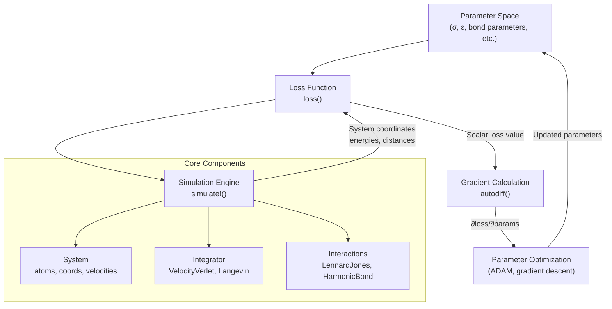
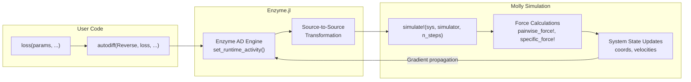
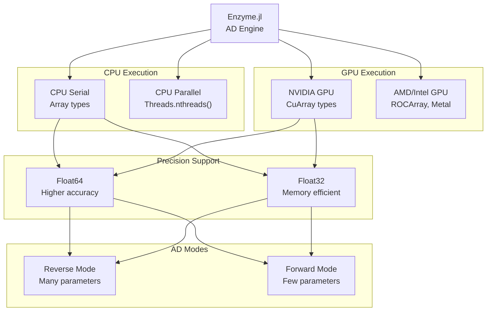
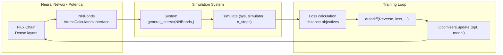

# Differentiable Simulation

<details>
<summary>Relevant source files</summary>

The following files were used as context for generating this wiki page:

- [README.md](README.md)
- [docs/src/differentiable.md](docs/src/differentiable.md)
- [docs/src/examples.md](docs/src/examples.md)
- [ext/MollyCUDAExt.jl](ext/MollyCUDAExt.jl)
- [ext/MollyGLMakieExt.jl](ext/MollyGLMakieExt.jl)
- [src/interactions/implicit_solvent.jl](src/interactions/implicit_solvent.jl)
- [src/kernels.jl](src/kernels.jl)
- [test/gradients.jl](test/gradients.jl)

</details>


Differentiable simulation in Molly.jl enables automatic differentiation (AD) through molecular dynamics simulations, allowing exact gradients to be computed with respect to simulation parameters. This capability supports applications such as force field parameterization, neural network potential training, and optimization of molecular properties through simulation outcomes.

For information about GPU acceleration of simulations, see [GPU Acceleration](#6.1). For details about specific interaction types used in differentiable simulations, see [Interaction System](#4).

## Overview and Architecture

Differentiable simulation integrates automatic differentiation capabilities into the core simulation engine using Enzyme.jl for source-to-source transformations. The system supports both forward and reverse mode AD across CPU and GPU platforms.

### Differentiable Simulation Workflow



Sources: [docs/src/differentiable.md:9-16](), [test/gradients.jl:74-104]()

### Integration with Enzyme.jl



Sources: [docs/src/differentiable.md:13-16](), [test/gradients.jl:111-115](), [test/gradients.jl:191-209]()

## Core Implementation Components

### Gradient Testing Framework

The differentiable simulation system includes comprehensive testing that validates gradients against finite difference methods:

| Test Type | Purpose | File Location |
|-----------|---------|---------------|
| Simple gradients | Validate force vs. potential energy gradients | [test/gradients.jl:1-35]() |
| Parameter gradients | Test gradients w.r.t. atomic parameters (σ, r0) | [test/gradients.jl:74-244]() |
| Protein gradients | Validate complex force field parameter gradients | [test/gradients.jl:246-451]() |

### Supported Interaction Types

```mermaid
graph TD
    DiffSim["Differentiable Simulation"]
    
    subgraph "Pairwise Interactions"
        LJ["LennardJones<br/>σ, ε parameters"]
        Coulomb["Coulomb/CoulombReactionField<br/>charge parameters"]
        SoftSphere["SoftSphere<br/>repulsive interactions"]
    end
    
    subgraph "Specific Interactions"
        HarmonicBond["HarmonicBond<br/>k, r0 parameters"]
        HarmonicAngle["HarmonicAngle<br/>k, θ0 parameters"] 
        PeriodicTorsion["PeriodicTorsion<br/>k, phase parameters"]
    end
    
    subgraph "General Interactions"
        ImplicitOBC["ImplicitSolventOBC<br/>radius, screen parameters"]
        ImplicitGBN2["ImplicitSolventGBN2<br/>α, β, γ parameters"]
        NeuralNet["Neural Network Potentials<br/>model parameters"]
    end
    
    DiffSim --> LJ
    DiffSim --> Coulomb
    DiffSim --> SoftSphere
    DiffSim --> HarmonicBond
    DiffSim --> HarmonicAngle
    DiffSim --> PeriodicTorsion
    DiffSim --> ImplicitOBC
    DiffSim --> ImplicitGBN2
    DiffSim --> NeuralNet
```



Sources: [test/gradients.jl:123-175](), [docs/src/differentiable.md:168-229](), [docs/src/differentiable.md:292-368]()

## Implementation Details

### Loss Function Structure

The core pattern for differentiable simulation involves wrapping the simulation in a loss function that returns a scalar value:

```julia
function loss(params, coords, velocities, ...)
    # Create system with parameterized interactions
    sys = System(atoms=atoms, coords=coords, ...)
    
    # Run simulation
    simulate!(sys, simulator, n_steps)
    
    # Calculate loss from final state
    return scalar_loss_value
end
```

This pattern is implemented across multiple examples in [docs/src/differentiable.md:73-99]() and [test/gradients.jl:74-104]().

### Gradient Calculation Methods

| Mode | Function Call | Use Case | Memory | Performance |
|------|---------------|----------|---------|-------------|
| Reverse | `autodiff(set_runtime_activity(Reverse), loss, Active, ...)` | Many parameters | High | ~10x slower |
| Forward | `autodiff(set_runtime_activity(Forward), loss, Duplicated, ...)` | Few parameters | Constant | ~2-5x slower |

Sources: [test/gradients.jl:191-209](), [docs/src/differentiable.md:111-115]()

### Platform Support Matrix



Sources: [test/gradients.jl:38-57](), [test/gradients.jl:106]()

## Advanced Applications

### Neural Network Integration

Differentiable simulation supports integration with Flux.jl neural networks as general interactions:



Sources: [docs/src/differentiable.md:292-368](), [docs/src/differentiable.md:372-396]()

### Implicit Solvent Parameter Optimization

The system supports gradient-based optimization of complex implicit solvent models:

| Parameter Type | Examples | Implementation |
|----------------|----------|----------------|
| Atomic radii | `inter_GB_radius_C`, `inter_GB_radius_N` | [src/interactions/implicit_solvent.jl:271-291]() |
| Screening factors | `inter_GB_screen_C`, `inter_GB_screen_O` | [src/interactions/implicit_solvent.jl:48-68]() |
| Model parameters | `inter_GB_params_C_α`, `inter_GB_neck_scale` | [src/interactions/implicit_solvent.jl:81-100]() |

Sources: [test/gradients.jl:320-400](), [src/interactions/implicit_solvent.jl:602-638]()

## Memory and Performance Considerations

### GPU Memory Management

Differentiable simulation on GPUs requires careful memory management due to the storage requirements for intermediate values:

- Memory usage scales with simulation length
- Gradient checkpointing may be required for long simulations
- Performance typically within an order of magnitude of primal simulation

Sources: [docs/src/differentiable.md:18-21]()

### Optimization Strategies

| Strategy | When to Use | Implementation |
|----------|-------------|----------------|
| Short simulation chunks | Long total simulations | Split into sequential short runs |
| Forward mode AD | Few parameters (<10) | Use `Duplicated` annotations |
| Gradient checkpointing | GPU memory constraints | Use Checkpointing.jl |
| Stable thermostats | Exploding gradients | Use `RescaleThermostat`, `BerendsenThermostat` |

Sources: [docs/src/differentiable.md:163-167](), [docs/src/differentiable.md:454-458]()

## Current Limitations

The differentiable simulation system has several important limitations:

- **Units**: Does not work with Unitful.jl quantities; requires `NoUnits` force and energy units
- **Loggers**: Logger data is not available for gradient computation
- **GPU Issues**: Some instabilities exist in certain GPU configurations
- **Memory**: High memory usage, especially on GPU platforms

Sources: [docs/src/differentiable.md:6-8](), [docs/src/differentiable.md:18-21](), [test/gradients.jl:97-99]()

---