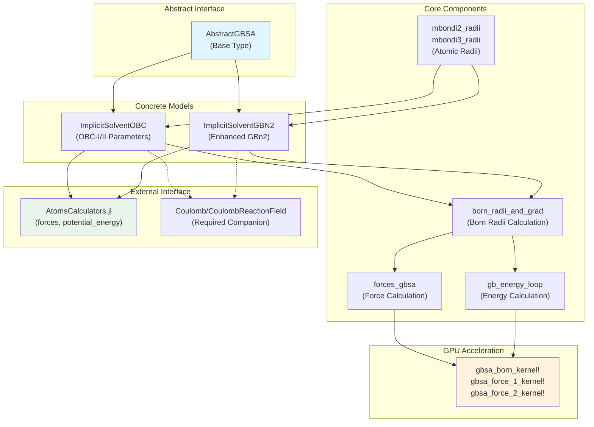
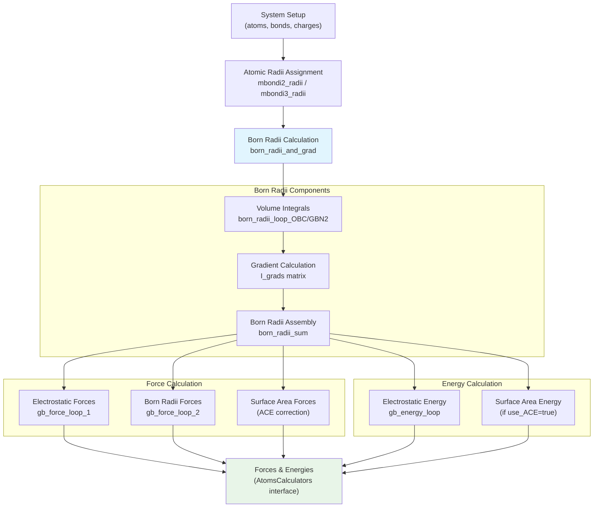
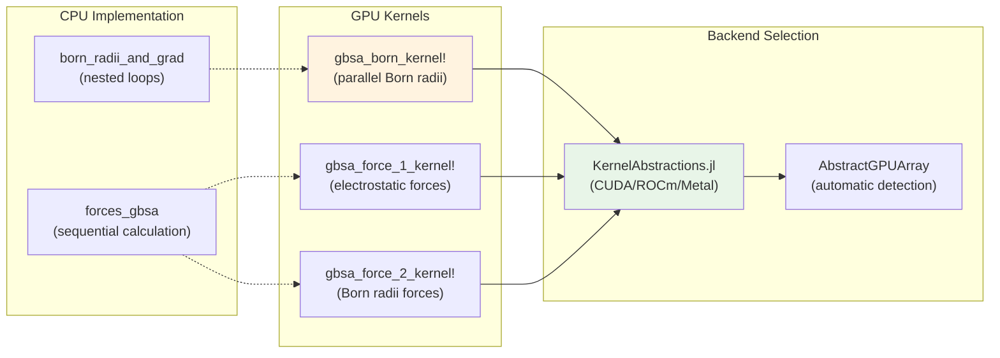

# Implicit Solvent Models

<details>
<summary>Relevant source files</summary>

The following files were used as context for generating this wiki page:

- [src/interactions/implicit_solvent.jl](src/interactions/implicit_solvent.jl)

</details>


This page covers the implicit solvent models implemented in Molly.jl, specifically the Generalized Born/Surface Area (GBSA) models. These models approximate solvent effects without explicitly simulating individual solvent molecules, providing computational efficiency for solvated molecular dynamics simulations.

For information about pairwise electrostatic interactions, see [Pairwise Interactions](#4.1). For details on the force calculation engine, see [Force and Energy Calculations](#4.3).

## Overview and Model Types

Molly.jl implements two major GBSA implicit solvent models through the `AbstractGBSA` abstract type hierarchy:

- **`ImplicitSolventOBC`**: Onufriev-Bashford-Case GBSA model with two parameter sets (OBC-I and OBC-II)
- **`ImplicitSolventGBN2`**: GBn2 solvation model with enhanced accuracy for proteins and nucleic acids

Both models integrate with the AtomsCalculators.jl interface and should be used alongside explicit electrostatic interactions like `Coulomb` or `CoulombReactionField`.

## GBSA Model Architecture



**Sources:** [src/interactions/implicit_solvent.jl:1-50]()

## Computational Workflow

The GBSA calculation follows a multi-step process involving Born radii calculation, force computation, and energy evaluation:



**Sources:** [src/interactions/implicit_solvent.jl:680-781](), [src/interactions/implicit_solvent.jl:920-962]()

## Model Parameters and Constants

Both GBSA models use carefully parameterized physical constants and element-specific parameters:

| Parameter Category | OBC Model | GBN2 Model | Purpose |
|-------------------|-----------|------------|---------|
| **Offset** | `obc_offset = 0.009 nm` | `gbn2_offset = 0.0195141 nm` | Born radii adjustment |
| **Dielectric Constants** | `gb_solvent_dielectric = 78.5` | Same | Solvent/solute dielectric |
| **Probe Radius** | `gb_probe_radius = 0.14 nm` | Same | Surface area calculation |
| **Element Radii** | `mbondi2_element_to_radius` | `mbondi2_element_to_radius` | Atomic van der Waals radii |
| **Screening Parameters** | `obc_element_to_screen` | `gbn2_element_to_screen` | Element-specific screening |
| **Model Parameters** | α, β, γ constants | `gbn2_atom_params` lookup tables | Born radii integral parameters |

**Sources:** [src/interactions/implicit_solvent.jl:18-100]()

## OBC Model Implementation

The `ImplicitSolventOBC` struct implements the Onufriev-Bashford-Case model with support for both OBC-I and OBC-II parameter sets:

```julia
struct ImplicitSolventOBC{T, D, V, K, S, F, I, DI} <: AbstractGBSA
    offset_radii::V
    scaled_offset_radii::V
    solvent_dielectric::T
    solute_dielectric::T
    kappa::K                    # Debye-Hückel screening parameter
    offset::D
    dist_cutoff::D
    use_ACE::Bool              # Analytical Continuum Electrostatics
    α::T, β::T, γ::T          # OBC parameters
    probe_radius::D
    sa_factor::S               # Surface area factor
    # ... GPU-optimized arrays
end
```

The Born radii calculation for OBC uses the integral:

```
I_i = (1/2) * ∫∫∫ (1/|r⃗ - r⃗'|) * H(|r⃗' - R⃗_j| - ρ_j) * dV'
```

where `H` is the Heaviside function and the integration excludes volume occupied by other atoms.

**Sources:** [src/interactions/implicit_solvent.jl:340-442](), [src/interactions/implicit_solvent.jl:640-656]()

## GBN2 Model Implementation

The `ImplicitSolventGBN2` model provides enhanced accuracy through:

1. **Neck Correction**: Additional terms for close atomic contacts
2. **Lookup Tables**: Pre-computed `d0` and `m0` parameters from `gbn2_data_d0` and `gbn2_data_m0`
3. **Element-Specific Parameters**: Separate parameters for proteins vs. nucleic acids

```julia
struct ImplicitSolventGBN2{T, D, VT, VD, K, S, F, I, TD, TM, DI} <: AbstractGBSA
    offset_radii::VD
    scaled_offset_radii::VD
    # ... standard GBSA parameters
    αs::VT, βs::VT, γs::VT     # Atom-specific parameters
    d0s::TD, m0s::TM           # Lookup table matrices
    neck_scale::T, neck_cut::D  # Neck correction parameters
    # ... GPU arrays
end
```

The neck correction adds an integral term for atom pairs within `neck_cut` distance:

```
I_neck = neck_scale * m0 / (1 + (r-d0)^2 + 3*(r-d0)^6/10)
```

**Sources:** [src/interactions/implicit_solvent.jl:451-600](), [src/interactions/implicit_solvent.jl:714-745]()

## GPU Acceleration

Both models support GPU acceleration through specialized kernels:



The GPU kernels use atomic operations (`Atomix.@atomic`) to handle race conditions when multiple threads update the same memory locations.

**Sources:** [src/interactions/implicit_solvent.jl:783-857](), [src/interactions/implicit_solvent.jl:999-1095]()

## Usage with Force Fields

GBSA models require careful integration with electrostatic interactions. The recommended pattern is:

```julia
# Implicit solvent must be used WITH explicit electrostatics
pairwise_inters = (
    Coulomb(; cutoff=1.2u"nm"),
    LennardJones(; cutoff=1.2u"nm")
)

# Add implicit solvent as general interaction
implicit_solvent = ImplicitSolventOBC(atoms, atoms_data, bonds)
general_inters = (implicit_solvent,)
```

The GBSA models provide the solvation contribution while the explicit `Coulomb` interaction handles the vacuum electrostatics. The total electrostatic energy becomes:

```
E_total = E_vacuum + E_solvation
```

where `E_solvation` includes both the Born solvation energy and surface area correction terms.

**Sources:** [src/interactions/implicit_solvent.jl:334-339](), [src/interactions/implicit_solvent.jl:444-450]()

---