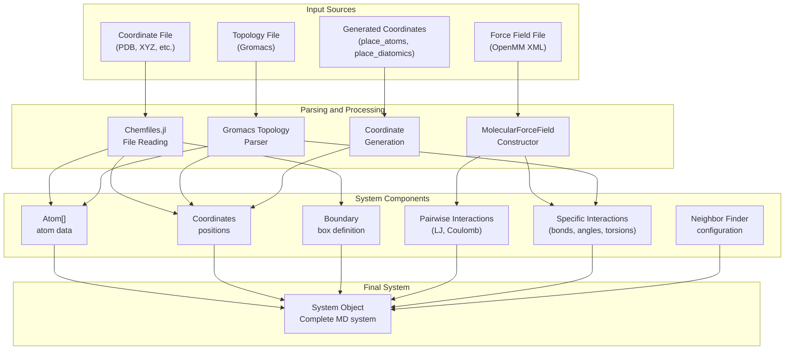
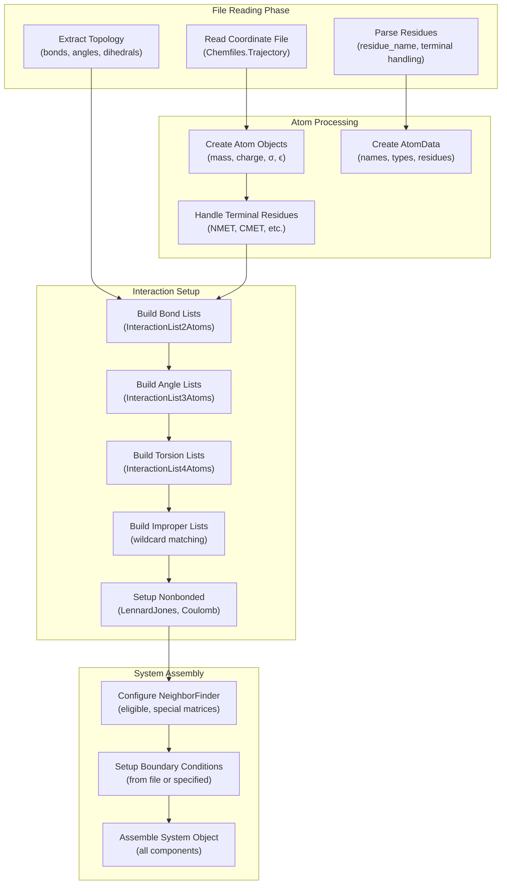
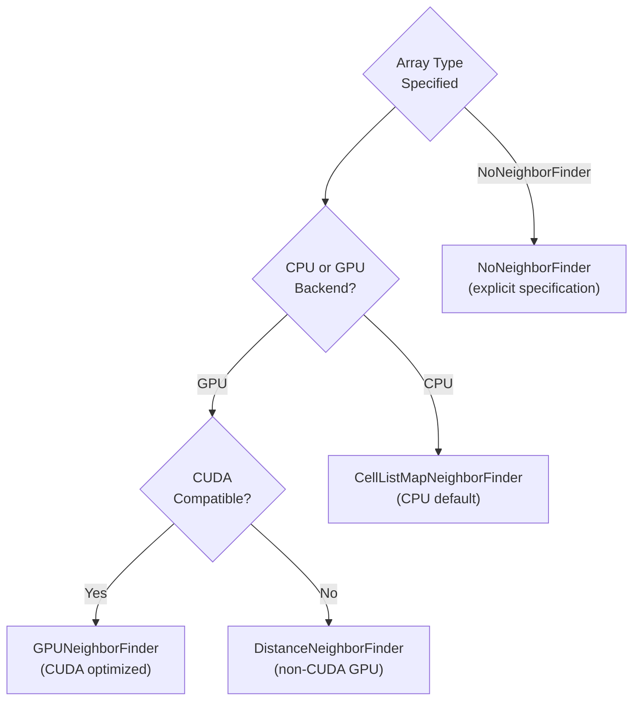

# System Setup and Configuration

<details>
<summary>Relevant source files</summary>

The following files were used as context for generating this wiki page:

- [src/setup.jl](src/setup.jl)

</details>


This document covers the initialization and configuration of molecular dynamics systems in Molly.jl. It explains how to create `System` objects from coordinate files, force field definitions, and topology information, as well as utility functions for generating initial configurations. For information about the core `System` data structure itself, see [System and Atoms](#3.1). For details about force field file formats and file I/O operations, see [Force Fields and File I/O](#7.1).

## System Creation Overview

The system setup process in Molly.jl centers around creating `System` objects that contain all the information needed for molecular dynamics simulations. The main entry point is through `System` constructors that can read various file formats.



Sources: [src/setup.jl:471-1009](), [src/setup.jl:1011-1403]()

## Force Field Definition

The `MolecularForceField` type serves as the central container for all force field parameters. It is constructed by parsing OpenMM XML force field files.

| Component | Type | Description |
|-----------|------|-------------|
| `atom_types` | `Dict{String, AtomType}` | Atom type definitions with σ, ϵ, mass, charge |
| `residue_types` | `Dict{String, ResidueType}` | Residue templates with atom mappings |
| `bond_types` | `Dict{Tuple{String, String}, HarmonicBond}` | Bond parameter definitions |
| `angle_types` | `Dict{Tuple{String, String, String}, HarmonicAngle}` | Angle parameter definitions |
| `torsion_types` | `Dict{Tuple{String, String, String, String}, PeriodicTorsionType}` | Torsion parameter definitions |

The force field constructor parses various XML sections:

- **AtomTypes**: Defines basic atom properties [src/setup.jl:209-220]()
- **Residues**: Maps atom names to types within residues [src/setup.jl:221-245]()
- **HarmonicBondForce**: Bond parameters [src/setup.jl:246-257]()
- **HarmonicAngleForce**: Angle parameters [src/setup.jl:258-270]()
- **PeriodicTorsionForce**: Torsion parameters [src/setup.jl:271-297]()
- **NonbondedForce**: Lennard-Jones and electrostatic parameters [src/setup.jl:298-344]()

Sources: [src/setup.jl:171-378]()

## System Construction Process

The `System` constructor follows a detailed process to build complete molecular systems from input files:



Sources: [src/setup.jl:471-1009]()

### Coordinate Processing

Coordinates are read using Chemfiles.jl and undergo several processing steps:

1. **File Reading**: `Chemfiles.Trajectory` reads various formats [src/setup.jl:493-496]()
2. **Unit Conversion**: Conversion from Ångström to nanometer [src/setup.jl:918-922]()
3. **Coordinate Centering**: Optional centering in simulation box [src/setup.jl:923-925]()
4. **Boundary Wrapping**: Ensure coordinates are within periodic boundaries [src/setup.jl:926]()

### Topology Construction

The system automatically builds interaction lists from the molecular topology:

- **Bond Detection**: From `Chemfiles.bonds()` or topology file [src/setup.jl:604-623]()
- **Angle Detection**: From `Chemfiles.angles()` [src/setup.jl:625-648]()
- **Torsion Handling**: Includes wildcard matching for force field types [src/setup.jl:650-713]()
- **Improper Handling**: Complex matching with permutation rules [src/setup.jl:716-819]()

Sources: [src/setup.jl:508-819]()

## Configuration Options

The `System` constructor accepts numerous configuration options:

| Parameter | Default | Description |
|-----------|---------|-------------|
| `boundary` | `nothing` | Simulation box (read from file if `nothing`) |
| `velocities` | `nothing` | Initial velocities (zero if `nothing`) |
| `units` | `true` | Whether to use Unitful.jl quantities |
| `array_type` | `Array` | Array backend (`CuArray`, `ROCArray`, etc.) |
| `dist_cutoff` | `1.0u"nm"` | Cutoff for long-range interactions |
| `dist_neighbors` | `1.2u"nm"` | Neighbor list cutoff distance |
| `center_coords` | `true` | Whether to center coordinates in box |
| `neighbor_finder_type` | `nothing` | Specific neighbor finder implementation |
| `implicit_solvent` | `nothing` | Implicit solvent model ("obc1", "obc2", "gbn2") |
| `rename_terminal_res` | `true` | Rename terminal residues (e.g., "MET" → "NMET") |

Sources: [src/setup.jl:471-485]()

### Neighbor Finder Selection

The system automatically selects appropriate neighbor finders based on the array type:



Sources: [src/setup.jl:928-960]()

## Coordinate Generation Utilities

Molly.jl provides utilities for generating initial coordinate configurations:

### `place_atoms` Function

Generates random atomic coordinates with minimum distance constraints:

```julia
place_atoms(n_atoms, boundary; min_dist=0.0, max_attempts=100, rng=default_rng())
```

- Ensures no two atoms are closer than `min_dist`
- Accounts for periodic boundary conditions
- Fails after `max_attempts` placement attempts

Sources: [src/setup.jl:16-64]()

### `place_diatomics` Function

Generates coordinates for diatomic molecules:

```julia
place_diatomics(n_molecules, boundary, bond_length; 
                min_dist=0.0, max_attempts=100, aligned=false, rng=default_rng())
```

- Creates pairs of atoms separated by `bond_length`
- Optional alignment control via `aligned` parameter
- Maintains minimum distance between all atoms

Sources: [src/setup.jl:66-129]()

## System Modification Utilities

### Position Restraints

The `add_position_restraints` function adds harmonic restraints to existing systems:

```julia
add_position_restraints(sys, k; atom_selector=is_any_atom, restrain_coords=sys.coords)
```

- `k`: Force constant (scalar or per-atom array)
- `atom_selector`: Function to determine which atoms to restrain
- Built-in selectors: `is_any_atom`, `is_heavy_atom`

The function creates `HarmonicPositionRestraint` interactions and returns a modified system copy.

Sources: [src/setup.jl:1425-1477]()

### Atom Selection Functions

| Function | Purpose |
|----------|---------|
| `is_any_atom` | Selects all atoms (placeholder function) |
| `is_heavy_atom` | Selects non-hydrogen atoms based on mass or element |

Sources: [src/setup.jl:1405-1423]()

---