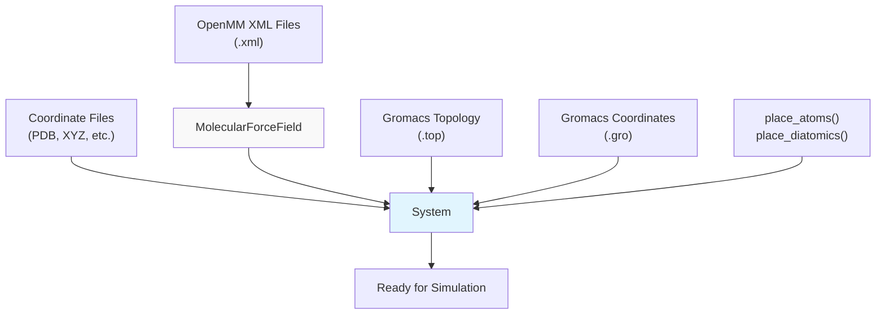
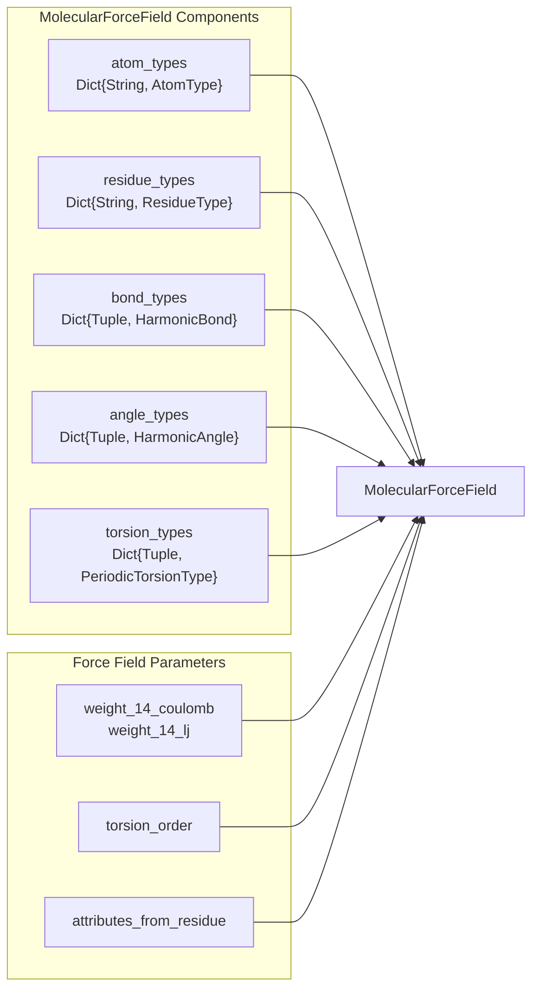
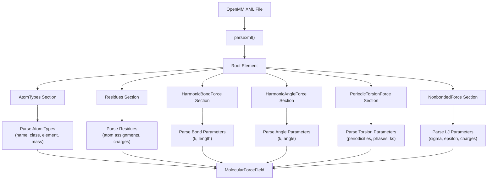
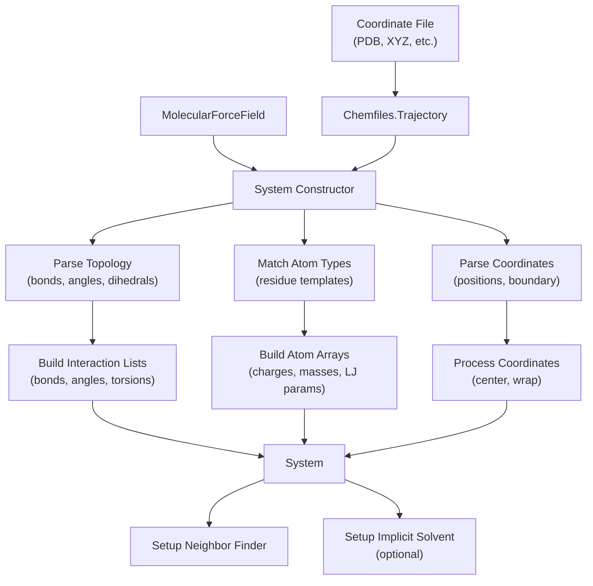
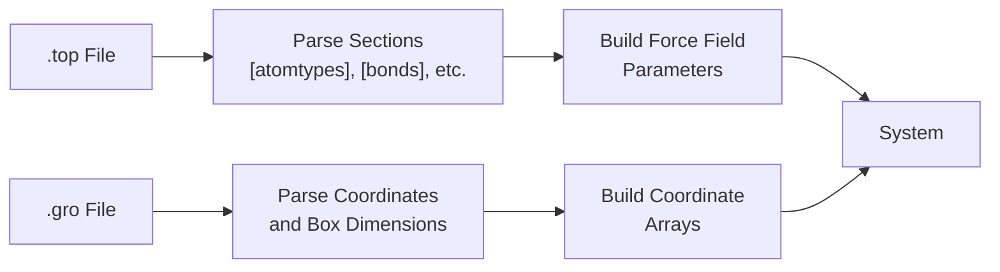
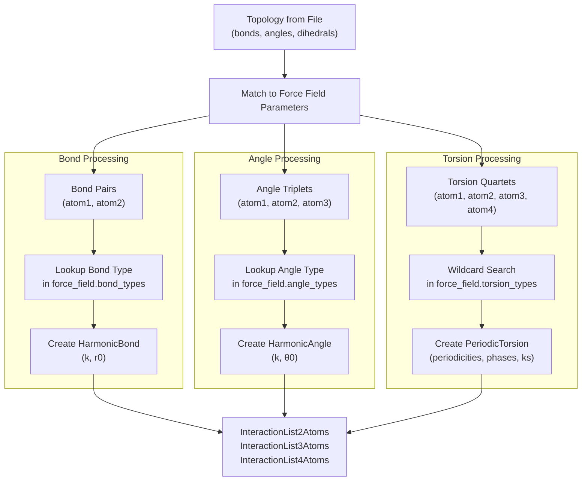
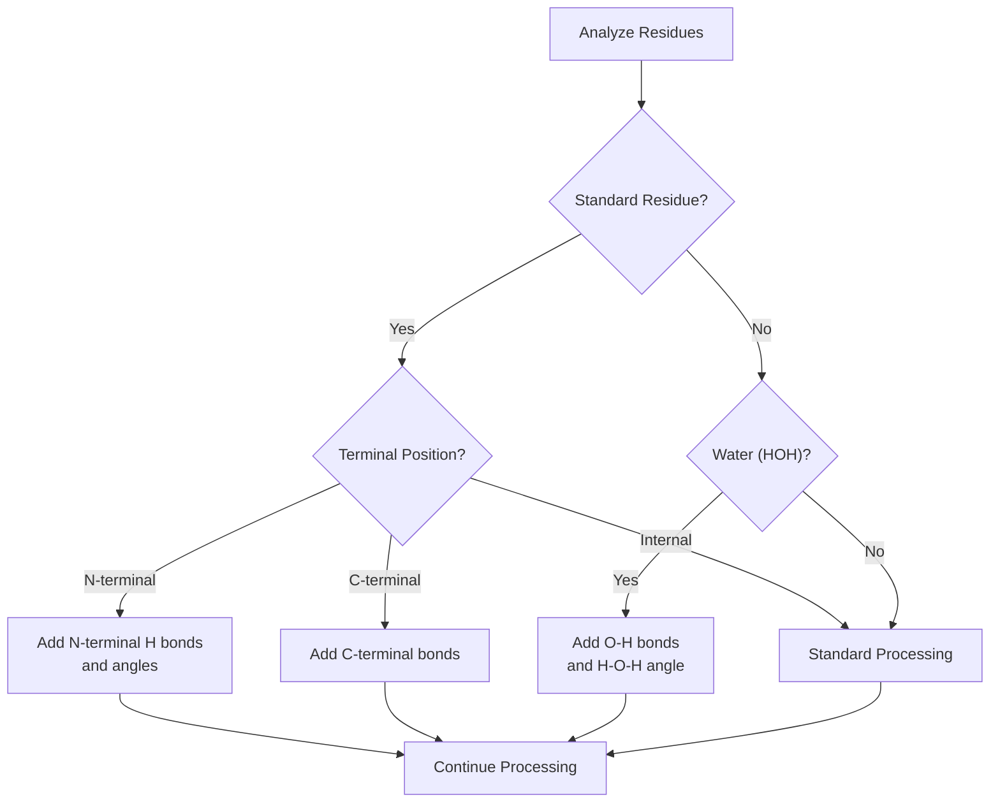
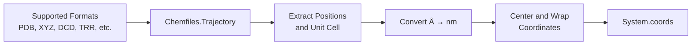
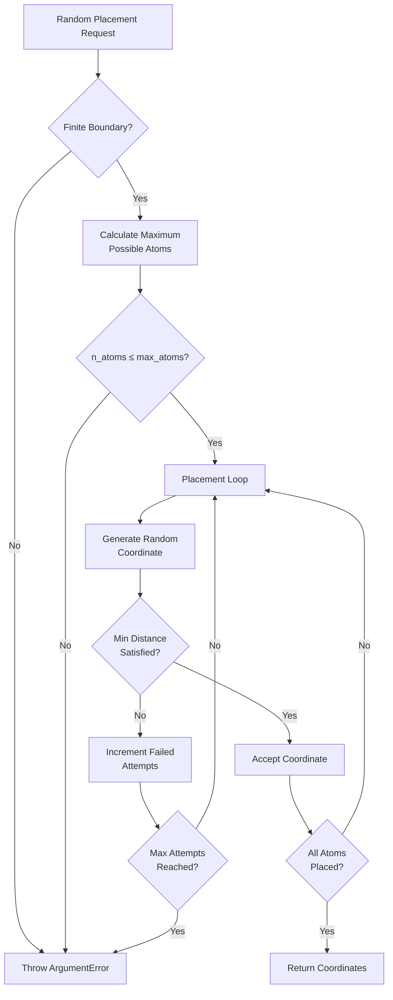
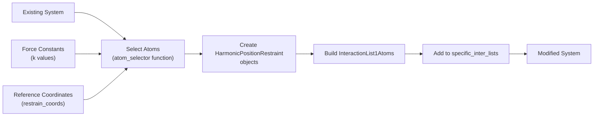

# Force Fields and File I/O

Relevant source files

The following files were used as context for generating this wiki page:

- [src/setup.jl](src/setup.jl)

This page covers the loading and parsing of molecular force fields from XML files and the reading of coordinate data to set up molecular systems. It focuses on the file I/O capabilities that allow Molly.jl to interface with standard molecular simulation file formats, particularly OpenMM force field XML files and various coordinate formats supported by Chemfiles.

For information about the `System` data structure itself, see [System and Atoms](#3.1). For details about how interactions are calculated once loaded, see [Interaction System](#4). For unit handling in file I/O, see [Units and Physical Quantities](#7.2).

## Overview of Force Field and File I/O System

Molly.jl provides comprehensive support for reading molecular systems from files, with two main pathways for system setup:

The system supports two primary workflows: the OpenMM-compatible pathway using XML force fields with Chemfiles-readable coordinate formats, and the Gromacs pathway reading native Gromacs topology and coordinate files.

Sources: [src/setup.jl:1-1478]()

## Force Field Data Structures

### MolecularForceField

The `MolecularForceField` type serves as the central container for all force field parameters parsed from OpenMM XML files:

The `AtomType` struct contains fundamental atomic parameters:

| Field | Type | Description |
|-------|------|-------------|
| `type` | `String` | Atom type identifier |
| `class` | `String` | Atom class (currently unused) |
| `element` | `String` | Chemical element symbol |
| `charge` | `Union{T, Missing}` | Partial charge |
| `mass` | `M` | Atomic mass |
| `σ` | `S` | Lennard-Jones sigma parameter |
| `ϵ` | `E` | Lennard-Jones epsilon parameter |

Sources: [src/setup.jl:136-144](), [src/setup.jl:181-191]()

### XML Parsing Process

The force field XML parsing follows OpenMM conventions and extracts parameters for different interaction types:

Sources: [src/setup.jl:204-356]()

## System Construction from Files

### OpenMM-Style System Construction

The primary `System` constructor reads coordinate files and applies force field parameters:

The constructor performs several key operations:

1. **Topology Analysis**: Extracts bonds, angles, and dihedrals from the coordinate file using Chemfiles
2. **Residue Matching**: Matches atoms to force field residue templates by name
3. **Parameter Assignment**: Applies force field parameters to create interaction objects
4. **Coordinate Processing**: Centers and wraps coordinates according to boundary conditions

Sources: [src/setup.jl:471-1009]()

### Gromacs File Support

Molly.jl also supports reading Gromacs topology and coordinate files directly:

The Gromacs reader processes topology sections sequentially:

| Section | Purpose | Data Extracted |
|---------|---------|----------------|
| `[atomtypes]` | Atom type definitions | Mass, charge, σ, ϵ |
| `[atoms]` | Atom assignments | Type mapping, charges |
| `[bonds]` | Bond definitions | Harmonic bond parameters |
| `[angles]` | Angle definitions | Harmonic angle parameters |
| `[dihedrals]` | Torsion definitions | RB torsion parameters |
| `[pairs]` | 1-4 interactions | Special pair listings |

Sources: [src/setup.jl:1011-1399]()

## Interaction List Construction

### Topology Processing

The system construction process builds interaction lists by matching atomic connectivity to force field parameters:

The torsion parameter matching uses a sophisticated wildcard system where empty strings in the force field type keys act as wildcards, allowing flexible parameter assignment.

Sources: [src/setup.jl:604-818]()

### Special Topology Handling

The system handles several special cases during topology construction:

1. **N-terminal Residues**: Automatically adds missing hydrogen bonds and angles for N-terminal amino acids
2. **Water Molecules**: Adds missing O-H bonds and H-O-H angles for HOH residues  
3. **Terminal Residue Renaming**: Modifies residue names (e.g., "MET" → "NMET") to match appropriate force field templates

Sources: [src/setup.jl:521-565]()

## Coordinate and Random Placement

### File-based Coordinate Reading

Coordinate files are read using the Chemfiles library, which supports numerous formats:

The coordinate processing includes automatic unit conversion from Ångströms to nanometers and optional coordinate centering within the simulation box.

Sources: [src/setup.jl:917-926]()

### Random Coordinate Generation

For system initialization without coordinate files, Molly.jl provides functions to generate random atomic positions:

| Function | Purpose | Key Parameters |
|----------|---------|----------------|
| `place_atoms` | Random monatomic placement | `n_atoms`, `boundary`, `min_dist` |
| `place_diatomics` | Random diatomic molecules | `n_molecules`, `bond_length`, `aligned` |

Both functions ensure minimum distance constraints and account for periodic boundary conditions.

Sources: [src/setup.jl:27-129]()

## Position Restraints and System Modification

### Adding Position Restraints

The `add_position_restraints` function demonstrates how to modify existing systems by adding new interaction types:

The function supports flexible atom selection through callback functions like `is_heavy_atom` and `is_any_atom`.

Sources: [src/setup.jl:1437-1477]()

---