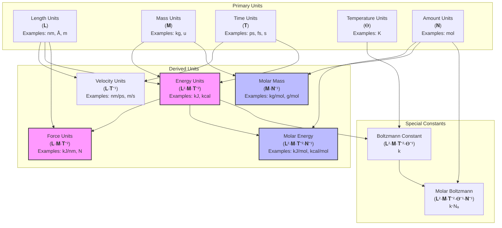
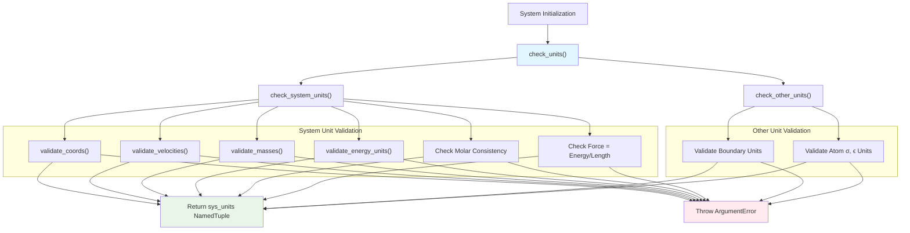
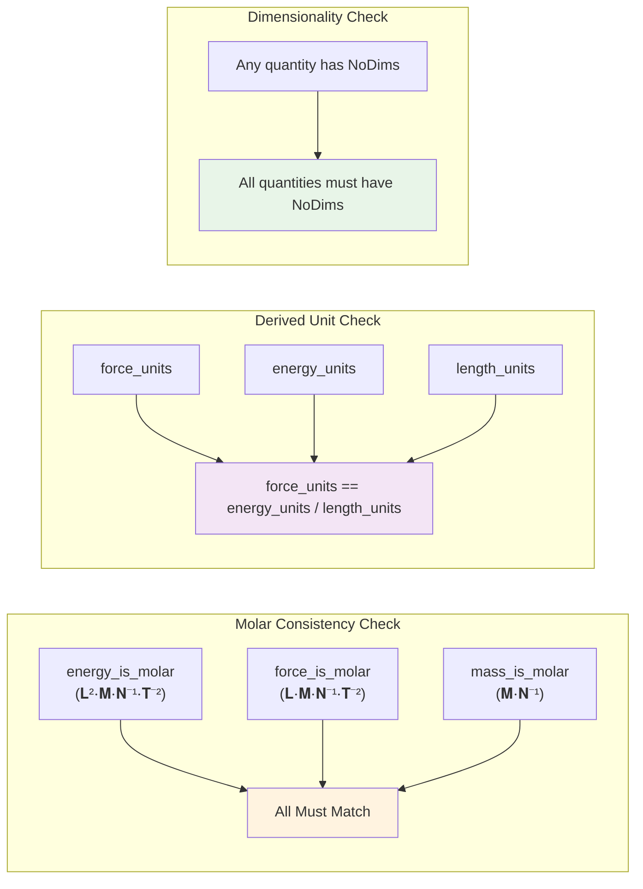

# Units and Physical Quantities

<details>
<summary>Relevant source files</summary>

The following files were used as context for generating this wiki page:

- [docs/Project.toml](docs/Project.toml)
- [docs/make.jl](docs/make.jl)
- [docs/src/index.md](docs/src/index.md)
- [src/units.jl](src/units.jl)

</details>


This page covers how Molly.jl handles physical units and quantities using Unitful.jl. It explains the unit validation system, consistency requirements, and supported unit types for molecular dynamics simulations.

For information about system initialization and configuration, see [System Setup and Configuration](#7). For details on force field parameters and their units, see [Force Fields and File I/O](#7.1).

## Overview

Molly.jl integrates with Unitful.jl to provide comprehensive unit handling for molecular dynamics simulations. The package enforces strict unit consistency throughout the system to prevent physics errors and ensure meaningful calculations. All physical quantities must have compatible units, and the system validates unit consistency during initialization.

The unit system supports both molar and non-molar quantities, allowing users to work with traditional molecular dynamics units (e.g., `kcal/mol`) or absolute units (e.g., `kcal`). However, mixing molar and non-molar units within a single system is not permitted.

Sources: [src/units.jl:1-214]()

## Unit Types and Dimensions

### Unit Types and Their Relationships



Molly.jl defines several derived dimensions for molecular dynamics calculations. The system recognizes both molar and non-molar variants of energy and mass units, with strict consistency enforcement between related quantities.

Sources: [src/units.jl:6-8](), [src/units.jl:92-96](), [src/units.jl:105-111]()

### Supported Unit Dimensions

| Quantity | Valid Dimensions | Examples | Notes |
|----------|------------------|----------|--------|
| Length | `𝐋`, `NoDims` | `1.0u"nm"`, `1.0` | All coordinates must use same units |
| Velocity | `𝐋⋅𝐓⁻¹`, `NoDims` | `1.0u"nm/ps"`, `1.0` | Derived from length and time |
| Mass | `𝐌`, `𝐌⋅𝐍⁻¹`, `NoDims` | `1.0u"kg"`, `1.0u"kg/mol"`, `1.0` | Atomic or molar mass |
| Energy | `𝐋²⋅𝐌⋅𝐓⁻²`, `𝐋²⋅𝐌⋅𝐓⁻²⋅𝐍⁻¹`, `NoDims` | `1.0u"kJ"`, `1.0u"kJ/mol"`, `1.0` | Absolute or molar energy |
| Force | `𝐋⋅𝐌⋅𝐓⁻²`, `𝐋⋅𝐌⋅𝐓⁻²⋅𝐍⁻¹`, `NoDims` | `1.0u"kJ/nm"`, `1.0u"kJ/(mol⋅nm)"`, `1.0` | Derived from energy/length |

Sources: [src/units.jl:125-131](), [src/units.jl:145-151](), [src/units.jl:105-111](), [src/units.jl:92-96]()

## Unit Validation System

### Validation Flow



The unit validation system performs comprehensive checks during system initialization. The main entry point `check_units()` coordinates validation of system units and cross-checks with other components like boundary conditions and atom parameters.

Sources: [src/units.jl:20-26](), [src/units.jl:28-63](), [src/units.jl:65-89]()

### Consistency Requirements

The system enforces several critical consistency rules:

1. **Molar Consistency**: All quantities must be either molar, non-molar, or unitless. Mixing is not allowed.
2. **Unit Homogeneity**: All atoms must have the same mass units, all coordinates must have the same length units.
3. **Derived Unit Relationships**: Force units must equal energy units divided by length units.
4. **No Mixed Dimensionality**: Cannot mix dimensioned and dimensionless quantities.



Sources: [src/units.jl:36-44](), [src/units.jl:46-53](), [src/units.jl:56-59]()

## Boltzmann Constant Handling

Molly.jl provides special handling for the Boltzmann constant, which is essential for temperature coupling and thermodynamic calculations. The system automatically determines the appropriate form of the Boltzmann constant based on the energy units.

### Boltzmann Constant Selection

| Energy Unit Type | Boltzmann Constant Used | Value |
|------------------|-------------------------|--------|
| Molar Energy (`𝐋²⋅𝐌⋅𝐓⁻²⋅𝐍⁻¹`) | `Unitful.k * Unitful.Na` | Gas constant R |
| Non-molar Energy (`𝐋²⋅𝐌⋅𝐓⁻²`) | `Unitful.k` | Boltzmann constant k |
| Unitless (`NoUnits`) | Stripped value | `ustrip(u"u * nm^2 * ps^-2 * K^-1", Unitful.k)` |

The `default_k()` function selects the appropriate Boltzmann constant, while `convert_k_units()` handles unit conversion and validation for user-supplied values.

Sources: [src/units.jl:156-168](), [src/units.jl:172-190]()

## Utility Functions

### Unit Stripping and Conversion

The `ustrip_vec()` function provides a broadcasted version of Unitful's `ustrip()` for efficient unit removal from arrays:

```julia
# Example usage
coordinates_unitless = ustrip_vec.(coordinates)
coordinates_in_nm = ustrip_vec.(u"nm", coordinates)
```

### Energy Unit Conversion

The `energy_remove_mol()` function converts molar energies to per-particle energies by dividing by Avogadro's number. This is useful for certain calculations that require per-particle rather than per-mole quantities.

Sources: [src/units.jl:14-16](), [src/units.jl:206-213]()

## Error Handling and Validation

The unit system provides comprehensive error messages for common unit mismatches:

### Common Error Scenarios

| Error Type | Cause | Error Message Pattern |
|------------|-------|----------------------|
| Mixed Units | Coordinates with different units | "coordinates have mixed units" |
| Molar Inconsistency | Mixing molar and non-molar quantities | "inconsistent energy, force and mass units" |
| Dimension Mismatch | Wrong physical dimensions | "do not have dimensions of energy/mass/etc." |
| Unit Incompatibility | Force/energy unit mismatch | "force_units was specified as X, but that is different from energy_units divided by..." |

The validation functions use `dimension()` from Unitful.jl to check physical dimensions and `unit()` to verify specific unit consistency.

Sources: [src/units.jl:117-123](), [src/units.jl:40-44](), [src/units.jl:56-59]()

## Best Practices

1. **Consistent Unit Sets**: Choose a consistent set of units for your simulation (e.g., nm, ps, u, K, kJ/mol).
2. **Molar vs Non-molar**: Decide whether to use molar quantities throughout or stick to absolute quantities.
3. **Unit Validation**: Let the system validate units during initialization rather than trying to bypass checks.
4. **Default Units**: When in doubt, use the common molecular dynamics units: nm for length, ps for time, u for mass, and kJ/mol for energy.

The unit system in Molly.jl is designed to prevent physical errors while maintaining flexibility for different simulation contexts and unit preferences.

Sources: [src/units.jl:1-214]()

---