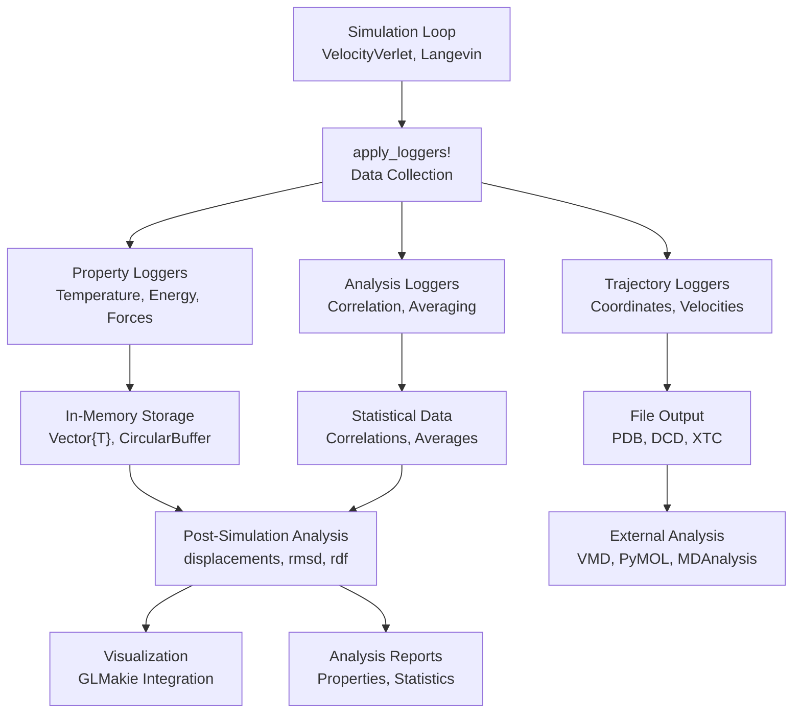
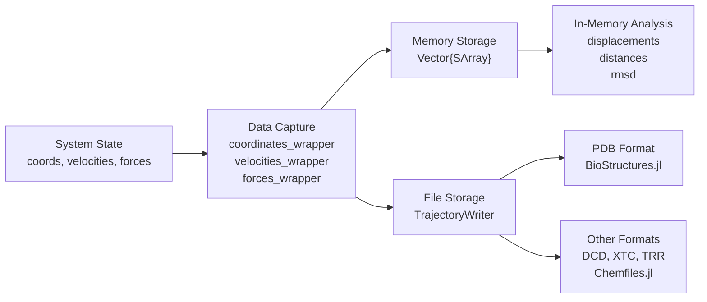
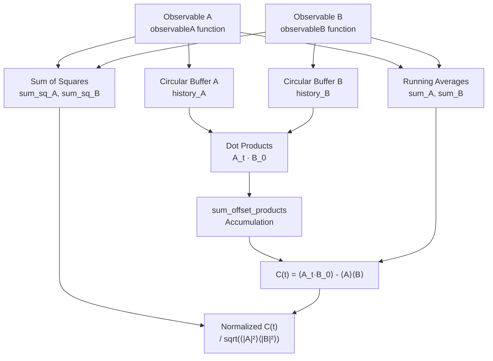
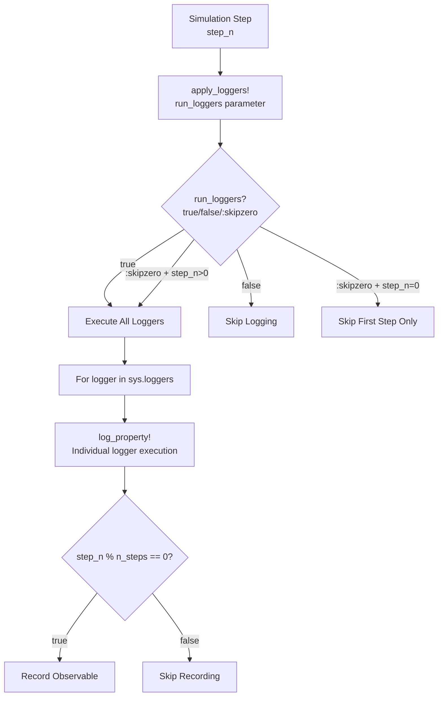

# Data Management

Relevant source files

The following files were used as context for generating this wiki page:

- [src/analysis.jl](src/analysis.jl)
- [src/loggers.jl](src/loggers.jl)

Data management in Molly.jl encompasses the collection, storage, analysis, and visualization of simulation data throughout molecular dynamics runs. This system provides comprehensive tools for monitoring simulation properties, recording trajectories, performing post-simulation analysis, and generating output files in various formats.

For detailed information about specific logging mechanisms and analysis functions, see [Logging and Analysis](#8.1). For visualization capabilities and output file formats, see [Visualization and Output](#8.2).

## Data Flow Architecture

The data management system in Molly.jl follows a structured pipeline where simulation data is collected during runtime, processed through analysis tools, and output in various formats.

**Data Flow Through Molly.jl**

Sources: [src/loggers.jl:28-47](), [src/analysis.jl:1-11]()

## Logger System Architecture

The logging system is built around a flexible architecture that allows different types of data to be collected at specified intervals during simulation.

**Logger Type Hierarchy**

```mermaid
graph TB
    BaseLogger["Logger Interface<br/>log_property!"]
    
    BaseLogger --> GeneralObservableLogger["GeneralObservableLogger<br/>Generic observable recording"]
    BaseLogger --> SpecializedLoggers["Specialized Loggers"]
    BaseLogger --> FileWriters["File Writers"]
    BaseLogger --> StatisticalLoggers["Statistical Loggers"]
    
    GeneralObservableLogger --> TemperatureLogger["TemperatureLogger<br/>temperature_wrapper"]
    GeneralObservableLogger --> EnergyLoggers["Energy Loggers<br/>KineticEnergyLogger<br/>PotentialEnergyLogger<br/>TotalEnergyLogger"]
    GeneralObservableLogger --> PropertyLoggers["Property Loggers<br/>VolumeLogger<br/>DensityLogger<br/>PressureLogger"]
    
    SpecializedLoggers --> CoordinatesLogger["CoordinatesLogger<br/>coordinates_wrapper"]
    SpecializedLoggers --> VelocitiesLogger["VelocitiesLogger<br/>velocities_wrapper"]
    SpecializedLoggers --> ForcesLogger["ForcesLogger<br/>forces_wrapper"]
    
    FileWriters --> TrajectoryWriter["TrajectoryWriter<br/>Chemfiles, BioStructures"]
    FileWriters --> StructureWriter["StructureWriter<br/>PDB format"]
    
    StatisticalLoggers --> TimeCorrelationLogger["TimeCorrelationLogger<br/>Green-Kubo analysis"]
    StatisticalLoggers --> AverageObservableLogger["AverageObservableLogger<br/>Block averaging"]
    StatisticalLoggers --> ReplicaExchangeLogger["ReplicaExchangeLogger<br/>Exchange statistics"]
    StatisticalLoggers --> MonteCarloLogger["MonteCarloLogger<br/>Acceptance statistics"]
```

Sources: [src/loggers.jl:57-97](), [src/loggers.jl:102-116](), [src/loggers.jl:526-584]()

## Data Collection Mechanisms

### Observable Logging

The core logging mechanism is the `GeneralObservableLogger` which provides a template for recording any system property that can be computed as a function of the system state.

| Logger Type | Observable Function | Data Type | Purpose |
|------------|-------------------|-----------|---------|
| `TemperatureLogger` | `temperature_wrapper` | Energy units | System temperature |
| `KineticEnergyLogger` | `kinetic_energy_wrapper` | Energy units | Kinetic energy |
| `PotentialEnergyLogger` | `potential_energy_wrapper` | Energy units | Potential energy |
| `TotalEnergyLogger` | `total_energy_wrapper` | Energy units | Total system energy |
| `VolumeLogger` | `volume_wrapper` | Volume units | System volume |
| `DensityLogger` | `density_wrapper` | Density units | System density |
| `VirialLogger` | `virial_wrapper` | Energy units | Virial tensor |
| `PressureLogger` | `pressure_wrapper` | Pressure units | System pressure |

Sources: [src/loggers.jl:99-111](), [src/loggers.jl:166-183](), [src/loggers.jl:194-227]()

### Trajectory Recording

Coordinate and velocity data are handled by specialized loggers that store arrays of `SVector` objects representing atomic positions and velocities over time.

Sources: [src/loggers.jl:118-141](), [src/loggers.jl:142-164](), [src/loggers.jl:228-258]()

## Statistical Analysis Tools

### Time Correlation Analysis

The `TimeCorrelationLogger` implements Green-Kubo correlation function calculations for transport property estimation.

**Time Correlation Calculation Flow**

Sources: [src/loggers.jl:644-721](), [src/loggers.jl:748-784](), [src/loggers.jl:786-800]()

### Block Averaging

The `AverageObservableLogger` implements block averaging for statistical error estimation following the Flyvbjerg-Petersen method.

Sources: [src/loggers.jl:802-847](), [src/loggers.jl:849-867]()

## Analysis Functions

Post-simulation analysis tools provide standard molecular dynamics analysis capabilities.

| Function | Purpose | Input | Output |
|----------|---------|-------|---------|
| `displacements` | Pairwise displacement vectors | Coordinates, boundary | Vector array |
| `distances` | Pairwise distance matrix | Coordinates, boundary | Distance matrix |
| `rmsd` | Root-mean-square deviation | Two coordinate sets | Scalar distance |
| `radius_gyration` | Radius of gyration | Coordinates, atoms | Scalar radius |
| `hydrodynamic_radius` | Hydrodynamic radius | Coordinates, boundary | Scalar radius |
| `rdf` | Radial distribution function | Coordinates, boundary | Distance bins, densities |

Sources: [src/analysis.jl:12-96](), [src/analysis.jl:142-152]()

## Integration with Simulation Loop

The logger system integrates seamlessly with the main simulation loop through the `apply_loggers!` function, which is called at each simulation step.

**Logger Execution Control**

Sources: [src/loggers.jl:28-47](), [src/loggers.jl:77-91]()

---