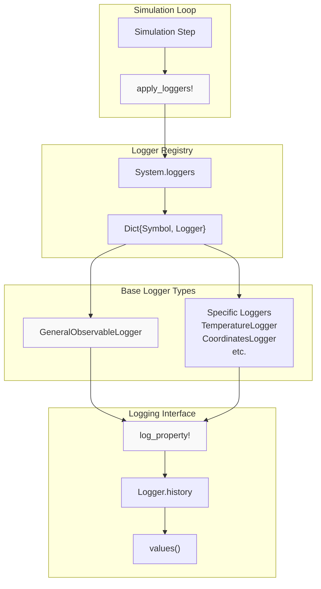
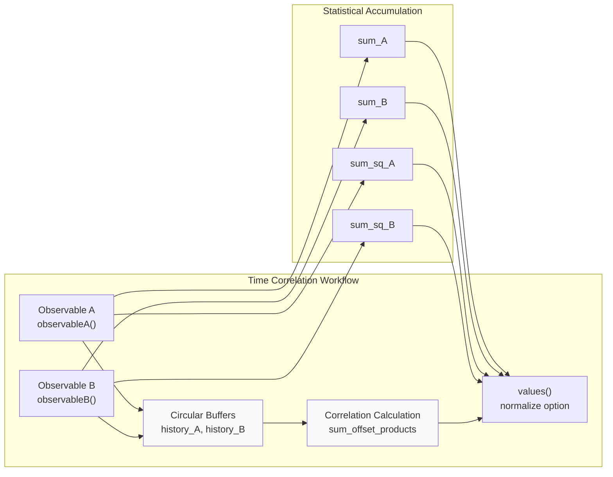
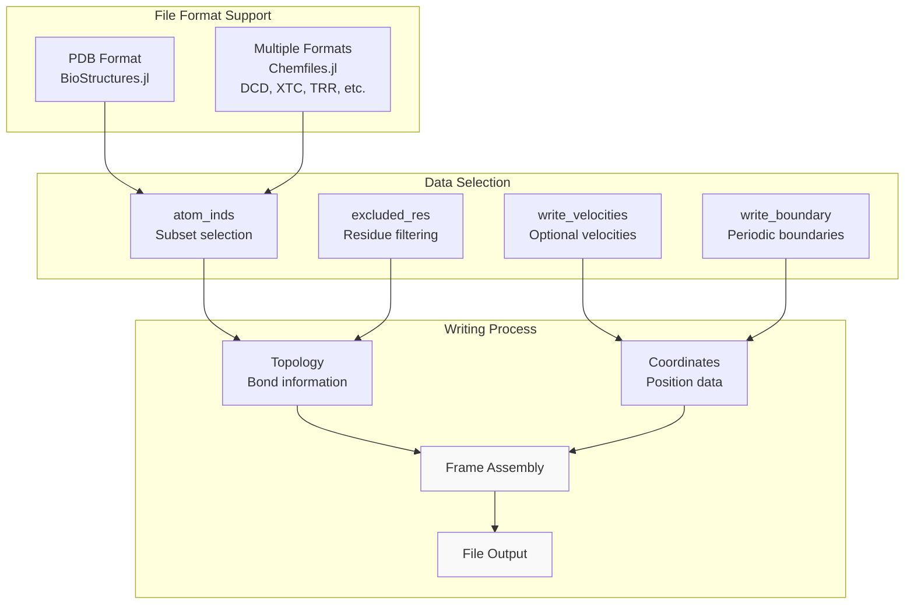
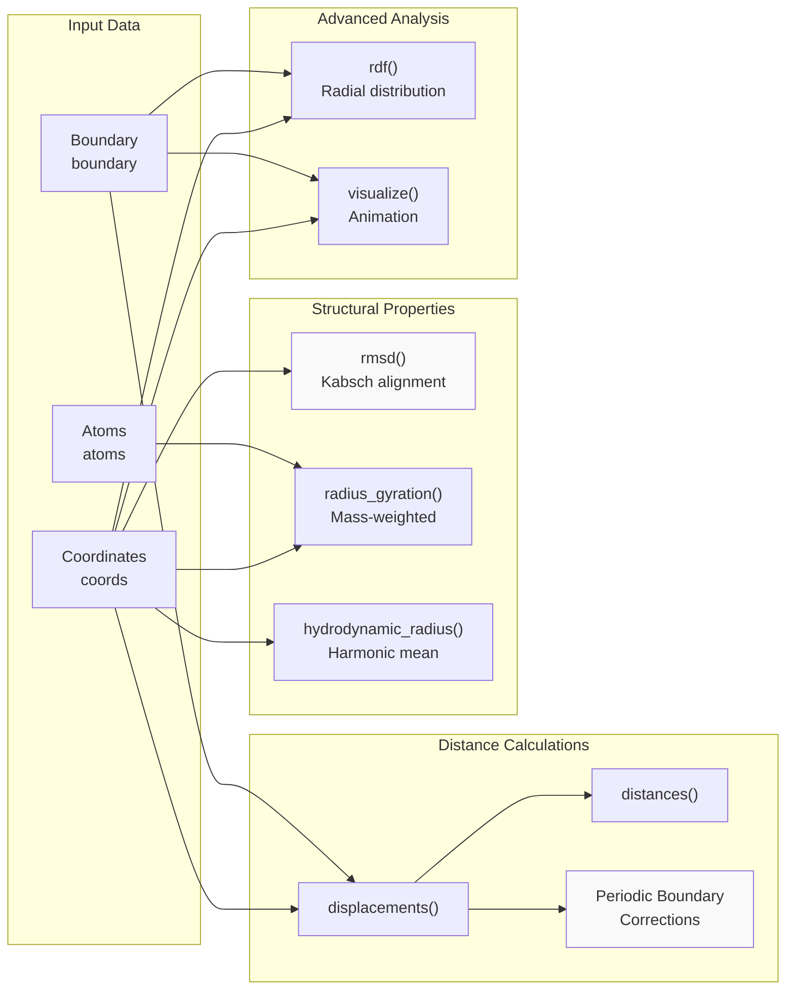

# Logging and Analysis

<details>
<summary>Relevant source files</summary>

The following files were used as context for generating this wiki page:

- [src/analysis.jl](src/analysis.jl)
- [src/loggers.jl](src/loggers.jl)

</details>


This document covers the data collection and analysis capabilities in Molly.jl, including the logging system for recording simulation properties during runtime and post-simulation analysis tools for processing collected data. The logging framework provides both real-time property monitoring and trajectory storage, while analysis functions enable calculation of structural and dynamical properties.

For information about visualization and output file formats, see [Visualization and Output](#8.2). For details about setting up simulations that generate data to log, see [System Setup and Configuration](#7).

## Logging System Architecture

The logging system in Molly.jl is built around a flexible observer pattern that allows properties to be recorded at specified intervals during simulation. The core mechanism uses the `apply_loggers!` function to execute all registered loggers on each simulation step.

### Core Logging Framework



Sources: [src/loggers.jl:39-47]()

The logging system operates through several key components:

- **`apply_loggers!`**: Central dispatcher that executes all loggers in `system.loggers` [src/loggers.jl:39-47]()
- **`GeneralObservableLogger`**: Base logger type that records arbitrary observable functions [src/loggers.jl:57-65]()
- **`log_property!`**: Interface function that each logger implements to record data [src/loggers.jl:85-91]()

## Built-in Logger Types

Molly.jl provides a comprehensive set of pre-built loggers for common simulation properties:

| Logger Type | Purpose | Data Type | Usage |
|-------------|---------|-----------|--------|
| `TemperatureLogger` | System temperature | Energy units | `TemperatureLogger(n_steps)` |
| `CoordinatesLogger` | Atomic positions | Position vectors | `CoordinatesLogger(n_steps)` |
| `VelocitiesLogger` | Atomic velocities | Velocity vectors | `VelocitiesLogger(n_steps)` |
| `KineticEnergyLogger` | Kinetic energy | Energy units | `KineticEnergyLogger(n_steps)` |
| `PotentialEnergyLogger` | Potential energy | Energy units | `PotentialEnergyLogger(n_steps)` |
| `TotalEnergyLogger` | Total energy | Energy units | `TotalEnergyLogger(n_steps)` |
| `ForcesLogger` | Forces on atoms | Force vectors | `ForcesLogger(n_steps)` |
| `VolumeLogger` | System volume | Volume units | `VolumeLogger(n_steps)` |
| `DensityLogger` | System density | Density units | `DensityLogger(n_steps)` |
| `VirialLogger` | Virial tensor | Energy units | `VirialLogger(n_steps)` |
| `PressureLogger` | System pressure | Pressure units | `PressureLogger(n_steps)` |

Sources: [src/loggers.jl:102-333]()

### Energy and Thermodynamic Loggers

The energy loggers demonstrate the system's optimization for computational efficiency:

- **`PotentialEnergyLogger`**: Can reuse pre-calculated potential energy via `current_potential_energy` parameter [src/loggers.jl:185-192]()
- **`ForcesLogger`**: Can reuse pre-calculated forces via `current_forces` parameter [src/loggers.jl:229-236]()
- **`TotalEnergyLogger`**: Combines kinetic and potential energy calculations [src/loggers.jl:211-213]()

## Statistical and Advanced Loggers

### Time Correlation Analysis

The `TimeCorrelationLogger` provides sophisticated statistical analysis capabilities for computing time correlations between observables:



Sources: [src/loggers.jl:644-800]()

The `TimeCorrelationLogger` computes normalized correlations of the form:
```
C(t) = ⟨A_t·B_0⟩ - ⟨A⟩·⟨B⟩ / √(⟨|A|²⟩⟨|B|²⟩)
```

### Block Averaging for Error Estimation

The `AverageObservableLogger` implements block averaging for statistical error estimation:

- **Adaptive block sizing**: Automatically doubles block size when buffer fills [src/loggers.jl:861-865]()
- **Memory efficient**: Stores block averages rather than full observation history [src/loggers.jl:824-836]()
- **Error estimation**: Returns both mean and standard deviation via `values(logger; std=true)` [src/loggers.jl:838-847]()

Sources: [src/loggers.jl:802-873]()

## Trajectory and Structure Output

### TrajectoryWriter System

The `TrajectoryWriter` provides comprehensive trajectory output capabilities:



Sources: [src/loggers.jl:526-617]()

Key features of trajectory writing:
- **Format detection**: Automatic format detection from file extension [src/loggers.jl:576-581]()
- **Topology calculation**: Optional topology generation from system bond information [src/loggers.jl:408-436]()
- **Unit conversion**: Automatic unit conversion to standard file formats (Å for coordinates) [src/loggers.jl:449-455]()

## Analysis Functions

The analysis module provides post-simulation calculation tools for structural and dynamical properties:

### Structural Analysis Tools



Sources: [src/analysis.jl:1-153]()

### Key Analysis Functions

**Distance Calculations**: The `displacements` and `distances` functions properly handle periodic boundary conditions [src/analysis.jl:18-32]()

**RMSD Calculation**: Uses the Kabsch algorithm for optimal superimposition of coordinate sets [src/analysis.jl:43-59]()

**Radius of Gyration**: Mass-weighted calculation for polymer and protein analysis [src/analysis.jl:71-77]()

**Hydrodynamic Radius**: Implements the harmonic mean formula for diffusion properties [src/analysis.jl:89-96]()

## Integration with Simulation Workflow

The logging system integrates seamlessly with the simulation loop through the `apply_loggers!` mechanism:

### Logger Execution Control

The `run_loggers` parameter in `apply_loggers!` provides flexible control:
- **`true`**: Always run loggers [src/loggers.jl:41]()
- **`false`**: Skip all loggers [src/loggers.jl:41]()
- **`:skipzero`**: Skip loggers on step 0 [src/loggers.jl:41]()

### Performance Considerations

- **Automatic differentiation**: Loggers are ignored during gradient calculations [src/loggers.jl:37]()
- **Threading support**: Multi-threaded execution for computationally expensive loggers [src/loggers.jl:40]()
- **Memory efficiency**: Circular buffers prevent unlimited memory growth in correlation loggers [src/loggers.jl:687-688]()

### Specialized Simulation Loggers

**ReplicaExchangeLogger**: Tracks exchange attempts and success rates in replica exchange simulations [src/loggers.jl:875-920]()

**MonteCarloLogger**: Records acceptance rates and energy statistics for Monte Carlo methods [src/loggers.jl:921-956]()

Sources: [src/loggers.jl:39-47](), [src/loggers.jl:875-956]()

---