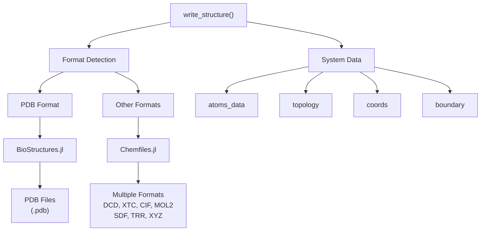
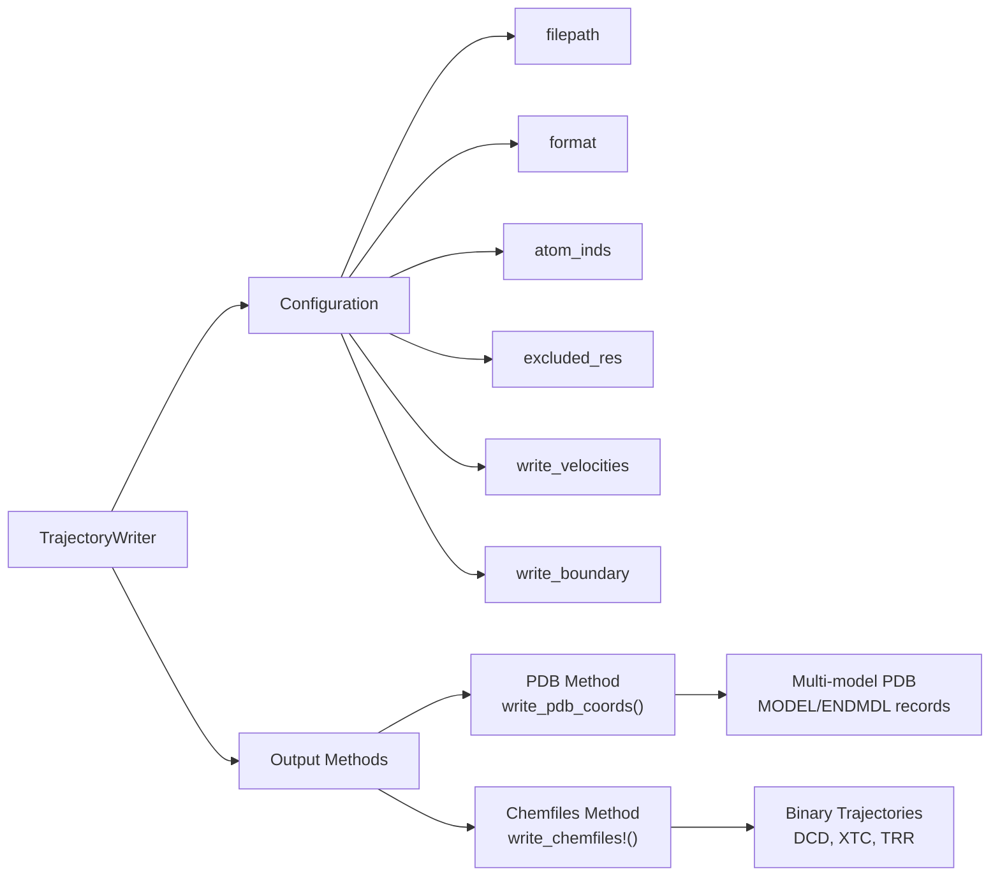
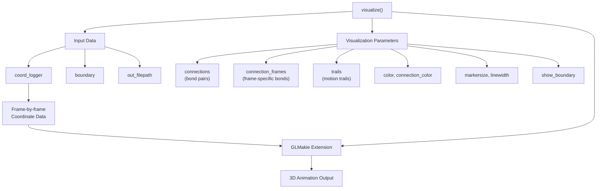
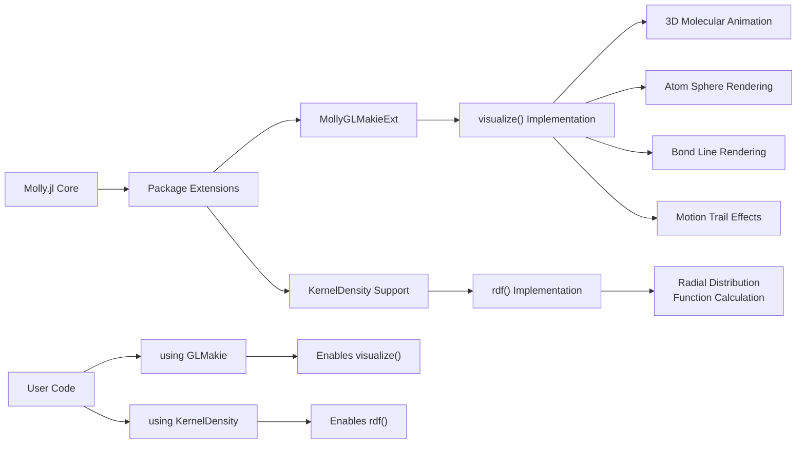
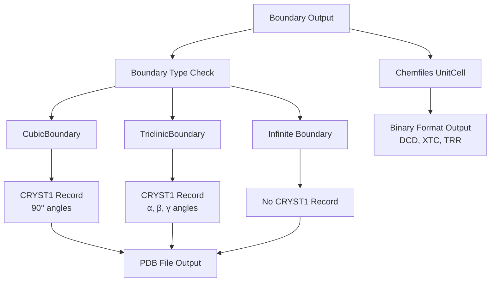
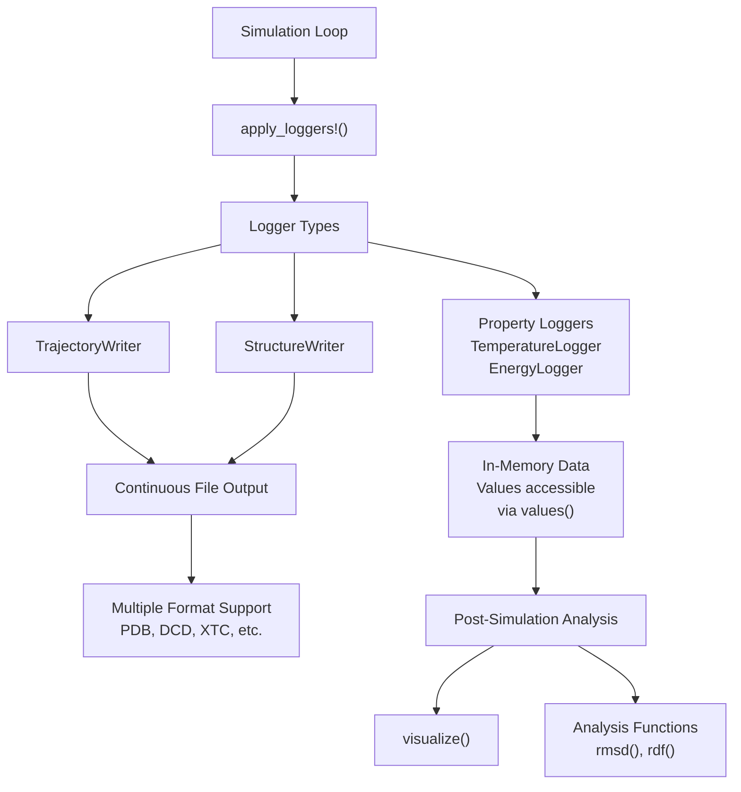

# Visualization and Output

<details>
<summary>Relevant source files</summary>

The following files were used as context for generating this wiki page:

- [docs/src/api.md](docs/src/api.md)
- [src/analysis.jl](src/analysis.jl)
- [src/loggers.jl](src/loggers.jl)
- [test/Project.toml](test/Project.toml)

</details>


This page covers the data export and visualization capabilities in Molly.jl, including writing trajectory files, creating structure outputs, and generating visual representations of molecular dynamics simulations. For information about data collection during simulations, see [Logging and Analysis](#8.1).

## File Output System

Molly.jl provides comprehensive file writing capabilities through two main approaches: direct structure writing and trajectory logging during simulations.

### Structure Writing

The `write_structure` function provides one-time structure output to various file formats:



Sources: [src/loggers.jl:479-524]()

### Trajectory Writers

The `TrajectoryWriter` logger enables continuous output during simulations:



Sources: [src/loggers.jl:526-617]()

## Supported File Formats

Molly.jl supports a wide range of molecular file formats through integration with established Julia packages:

| Format | Extension | Library | Coordinates | Velocities | Topology | Notes |
|--------|-----------|---------|-------------|------------|----------|-------|
| PDB | `.pdb` | BioStructures.jl | ✓ | ✗ | ✓ | Special handling for residue info |
| DCD | `.dcd` | Chemfiles.jl | ✓ | ✓* | ✗ | Binary trajectory format |
| XTC | `.xtc` | Chemfiles.jl | ✓ | ✗ | ✗ | Compressed trajectory |
| TRR | `.trr` | Chemfiles.jl | ✓ | ✓* | ✗ | Full precision trajectory |
| CIF | `.cif` | Chemfiles.jl | ✓ | ✗ | ✓ | Crystallographic format |
| MOL2 | `.mol2` | Chemfiles.jl | ✓ | ✗ | ✓ | Tripos format |
| SDF | `.sdf` | Chemfiles.jl | ✓ | ✗ | ✓ | Structure data format |
| XYZ | `.xyz` | Chemfiles.jl | ✓ | ✗ | ✗ | Simple coordinate format |

*Velocity support depends on format capabilities

Sources: [src/loggers.jl:488-489](), [src/loggers.jl:533-537]()

## Coordinate and Unit Handling

The output system automatically handles unit conversions and coordinate transformations:

```mermaid
graph TD
    InputCoords["System Coordinates"] --> UnitCheck["Unit Detection"]
    UnitCheck --> NoUnits["NoUnits<br/>(assume nm)"]
    UnitCheck --> WithUnits["With Units"]
    
    NoUnits --> ConvertNm["Convert nm → Å<br/>(× 10)"]
    WithUnits --> ConvertUnit["ustrip(u\"Å\", coord)"]
    
    ConvertNm --> OutputCoords["Output Coordinates"]
    ConvertUnit --> OutputCoords
    
    InputVelocities["System Velocities"] --> VelUnitCheck["Velocity Unit Check"]
    VelUnitCheck --> NoVelUnits["NoUnits<br/>(assume nm/ps)"]
    VelUnitCheck --> WithVelUnits["With Units"]
    
    NoVelUnits --> ConvertVelNm["Convert nm/ps → Å/ps<br/>(× 10)"]
    WithVelUnits --> ConvertVelUnit["ustrip(u\"Å * ps^-1\", vel)"]
    
    ConvertVelNm --> OutputVelocities["Output Velocities"]
    ConvertVelUnit --> OutputVelocities
```

Sources: [src/loggers.jl:378-384](), [src/loggers.jl:448-470]()

## Visualization System

Molly.jl provides molecular visualization through the GLMakie extension. The visualization system is accessed via the `visualize` function:



Sources: [src/analysis.jl:110-140]()

## Analysis and Visualization Extensions

Molly.jl uses package extensions to provide optional visualization and analysis capabilities:



Sources: [docs/src/api.md:7-10](), [src/analysis.jl:142-152]()

## Boundary Handling in Output

The output system provides specific support for different boundary condition types:



Sources: [src/loggers.jl:343-364](), [src/loggers.jl:441-443]()

## Integration with Logging System

The output system integrates seamlessly with Molly.jl's logging infrastructure:



Sources: [src/loggers.jl:28-47](), [src/loggers.jl:558-617]()

---