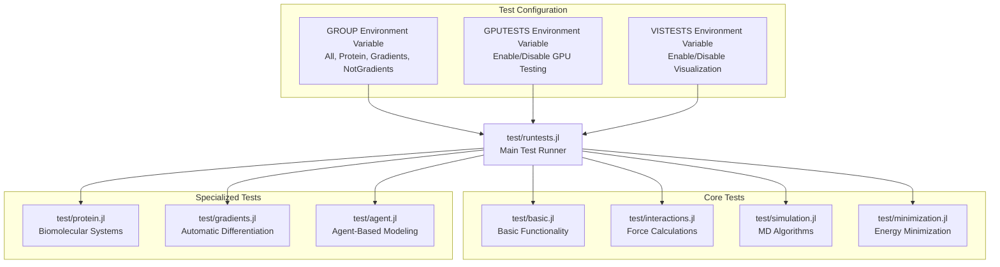
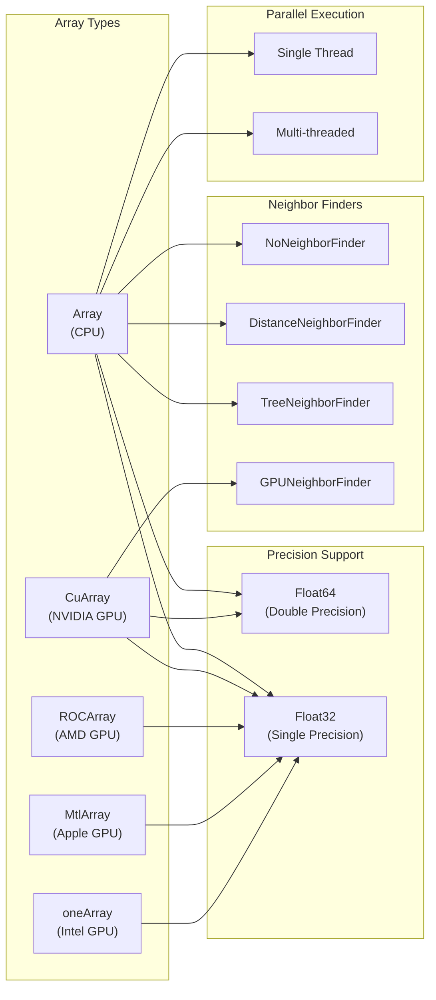
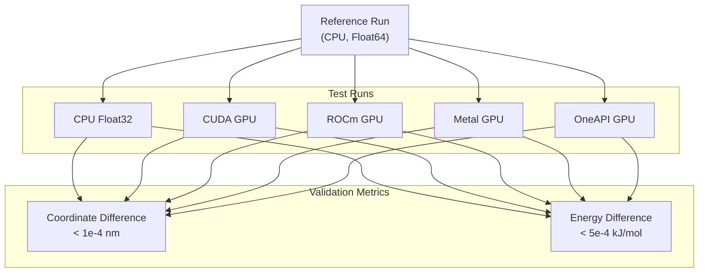
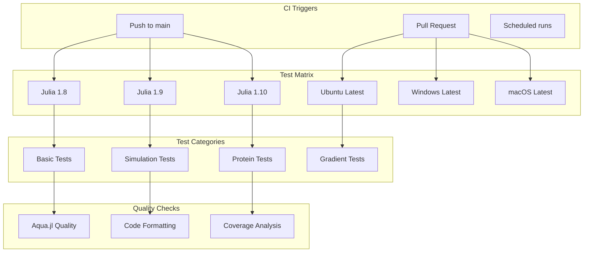

# Development and Testing

<details>
<summary>Relevant source files</summary>

The following files were used as context for generating this wiki page:

- [test/runtests.jl](test/runtests.jl)
- [test/simulation.jl](test/simulation.jl)

</details>


This page covers the testing framework, development practices, and contribution guidelines for Molly.jl. It details how the comprehensive test suite is organized, how tests are executed across different hardware backends, and the benchmarking infrastructure used to ensure performance and correctness.

For information about specific simulation algorithms and their implementation, see [Simulation Engine](#5). For details about GPU acceleration features, see [GPU Acceleration](#6.1).

## Test Framework Organization

Molly.jl uses a comprehensive testing framework built on Julia's standard `Test` package, organized into several categories based on functionality and computational requirements.

### Test Categories

The test suite is divided into logical groups that can be run independently or together:

| Test Group | Purpose | Key Files |
|------------|---------|-----------|
| Basic | Core data structures and utilities | `test/basic.jl` |
| Interactions | Force calculations and energy functions | `test/interactions.jl` |
| Simulation | Integration algorithms and dynamics | `test/simulation.jl` |
| Protein | Biomolecular force fields and structures | `test/protein.jl` |
| Gradients | Automatic differentiation functionality | `test/gradients.jl` |
| Minimization | Energy minimization algorithms | `test/minimization.jl` |
| Agent | Agent-based modeling features | `test/agent.jl` |



Sources: [test/runtests.jl:30-35](), [test/runtests.jl:113-136]()

### Test Selection and Configuration

Tests can be selectively executed using environment variables:

- `GROUP` - Controls which test categories to run (`All`, `Protein`, `Gradients`, `NotGradients`)
- `GPUTESTS` - Enables or disables GPU testing (`0` to disable, `1` to enable)
- `VISTESTS` - Controls visualization tests (`0` to disable, `1` to enable)
- `DEVICE` - Specifies which GPU device to use for testing

Sources: [test/runtests.jl:30-35](), [test/runtests.jl:43-48](), [test/runtests.jl:58-61]()

## Testing Infrastructure and Hardware Support

The testing framework supports multiple hardware backends and array types to ensure compatibility across different computational environments.

### Hardware Backend Testing Matrix



Sources: [test/runtests.jl:67-98](), [test/simulation.jl:1454-1482]()

### GPU Testing Configuration

The framework automatically detects available GPU backends and configures testing accordingly:

```julia
const run_cuda_tests   = run_gpu_tests && CUDA.functional()
const run_rocm_tests   = run_gpu_tests && AMDGPU.functional()
const run_oneapi_tests = run_gpu_tests && oneAPI.functional()
const run_metal_tests  = run_gpu_tests && Metal.functional()
```

Each GPU backend is tested with appropriate array types and precision levels. CUDA supports both Float32 and Float64, while other backends primarily use Float32 for optimal performance.

Sources: [test/runtests.jl:62-65](), [test/runtests.jl:69-98]()

## Simulation Testing Framework

The simulation tests form the core of the testing infrastructure, validating molecular dynamics algorithms across different scenarios and hardware configurations.

### Key Test Scenarios

The simulation test suite covers a comprehensive range of molecular dynamics scenarios:

| Test Set | System Size | Duration | Key Features |
|----------|-------------|----------|--------------|
| Lennard-Jones 2D | 10 atoms | 20,000 steps | 2D boundary conditions, temperature control |
| Lennard-Jones 3D | 100 atoms | 20,000 steps | Full 3D simulation, multiple loggers |
| Infinite Boundaries | 100 atoms | 2,000 steps | Non-periodic boundary conditions |
| Different Simulators | 100 atoms | 20,000 steps | Verlet, Langevin, OverdampedLangevin |
| Pairwise Interactions | 100 atoms | 20,000 steps | LJ, Coulomb, SoftSphere, Mie potentials |
| Constraints | 400 atoms | 10,000 steps | SHAKE/RATTLE algorithms |
| REMD | 100 atoms | 10,000 steps | Temperature and Hamiltonian exchange |

### Cross-Platform Validation

A critical aspect of the testing framework is ensuring identical results across different hardware backends and precision levels:



Sources: [test/simulation.jl:1483-1494]()

### Test System Generation

The framework includes utilities for generating test systems with controlled properties:

- `place_atoms()` - Generates random atomic positions with minimum distance constraints
- `place_diatomics()` - Creates diatomic molecule configurations
- `random_velocity()` - Generates Maxwell-Boltzmann distributed velocities
- Crystal structures via `SimpleCrystals.jl` integration

Sources: [test/simulation.jl:24-27](), [test/simulation.jl:1390-1393](), [test/simulation.jl:1322-1325]()

## Performance Benchmarking and Validation

### Timing and Performance Metrics

Test execution includes timing measurements to monitor performance across different implementations:

```julia
@time simulate!(s, simulator, n_steps; n_threads=n_threads)
```

The framework tracks:
- Simulation step timing
- Force calculation performance
- Neighbor list construction time
- Memory allocation patterns
- GPU kernel execution times

### Correctness Validation

Multiple validation approaches ensure simulation correctness:

1. **Energy Conservation** - Monitoring total energy drift in NVE simulations
2. **Temperature Control** - Validating thermostat effectiveness
3. **Structural Properties** - Checking radial distribution functions and bond lengths
4. **Statistical Mechanics** - Verifying ensemble averages match theoretical predictions

Sources: [test/simulation.jl:188](), [test/simulation.jl:474]()

## Continuous Integration and Quality Assurance

### CI Testing Matrix

The continuous integration system runs tests across multiple Julia versions and operating systems:



### Special CI Considerations

The CI environment has specific configurations to handle resource constraints:

- CPU gradient tests are limited due to memory constraints
- GPU tests run only when appropriate hardware is available
- Visualization tests are disabled by default
- Long-running tests use reduced step counts

Sources: [test/runtests.jl:37-41]()

### Code Quality Assurance

The framework integrates several quality assurance tools:

- **Aqua.jl** - Detects common package issues like method ambiguities and unbound arguments
- **Coverage analysis** - Monitors test coverage across the codebase
- **Formatting checks** - Ensures consistent code style
- **Dependency analysis** - Validates package dependencies and load times

Sources: [test/runtests.jl:114-121]()

## Development Workflow and Contributing

### Running Tests Locally

Developers can run specific test categories:

```julia
# Run all tests
julia test/runtests.jl

# Run only simulation tests  
GROUP="NotGradients" julia test/runtests.jl

# Run with GPU tests disabled
GPUTESTS="0" julia test/runtests.jl

# Run on specific GPU device
DEVICE="1" julia test/runtests.jl
```

### Adding New Tests

When contributing new functionality:

1. **Add unit tests** in the appropriate test file
2. **Include cross-platform validation** for GPU-compatible features  
3. **Add performance benchmarks** for computationally intensive functions
4. **Test multiple precision levels** (Float32/Float64) where applicable
5. **Validate against reference implementations** when available

### Test Data and Resources

The testing framework uses standardized test data:

- Force field files in `data/force_fields/`
- Molecular structures in `data/openmm_6mrr/`
- Reference simulation data for validation
- Temporary files for I/O testing

Sources: [test/runtests.jl:100-109]()

---