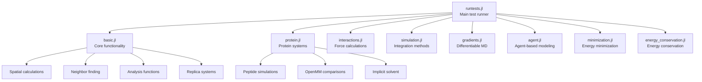
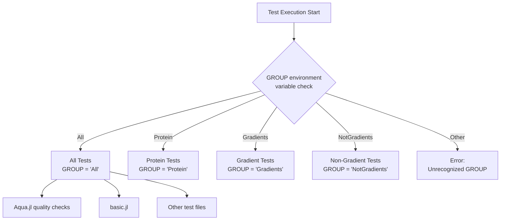
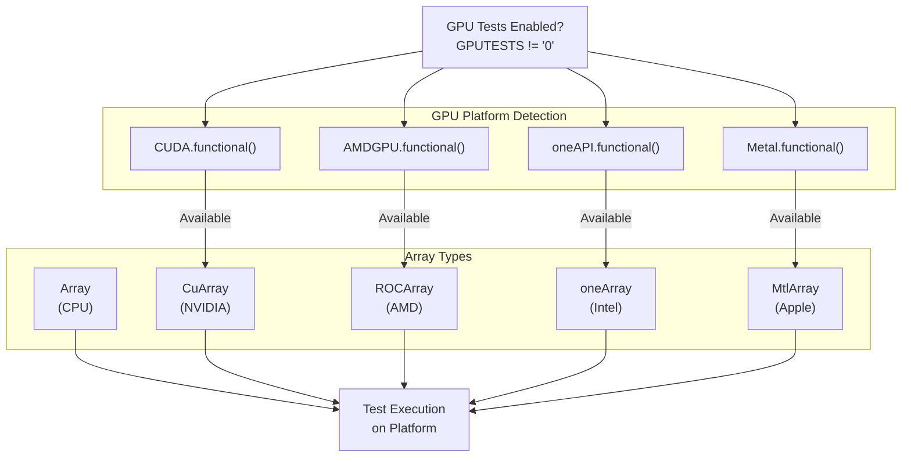
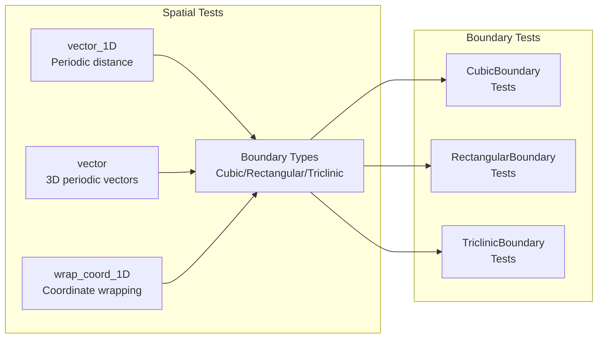
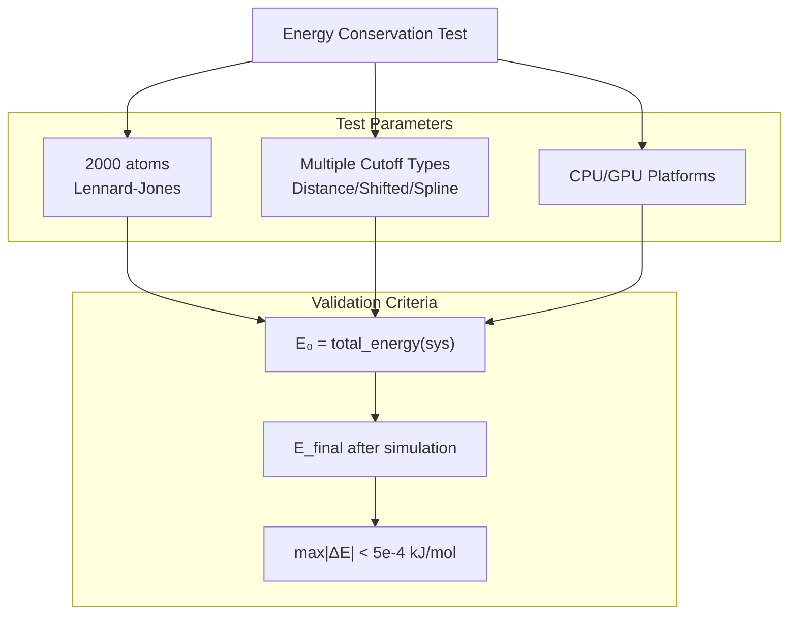
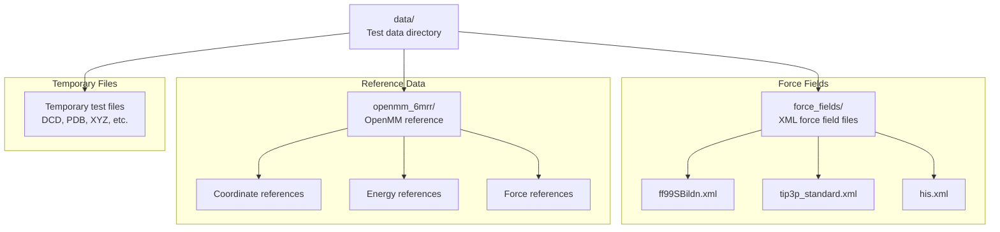

# Testing Framework

<details>
<summary>Relevant source files</summary>

The following files were used as context for generating this wiki page:

- [test/basic.jl](test/basic.jl)
- [test/energy_conservation.jl](test/energy_conservation.jl)
- [test/protein.jl](test/protein.jl)
- [test/runtests.jl](test/runtests.jl)

</details>


## Purpose and Scope

The testing framework in Molly.jl provides comprehensive validation of molecular dynamics functionality across different hardware platforms, numerical precision levels, and use cases. This framework ensures correctness, performance, and compatibility of simulations on CPU and GPU architectures while maintaining numerical accuracy and energy conservation properties.

For information about performance benchmarking and optimization strategies, see [Benchmarking and Performance](#9.2).

## Test Organization and Structure

The test suite is organized into specialized test files that cover different aspects of the molecular dynamics package:



The main test runner coordinates execution based on environment variables and available hardware capabilities.

Sources: [test/runtests.jl:1-136](), [test/basic.jl:1-524](), [test/protein.jl:1-298]()

## Test Groups and Conditional Execution

Tests are organized into groups that can be selectively executed based on the `GROUP` environment variable:

| Group | Description | Files Included |
|-------|-------------|----------------|
| `All` | Complete test suite | All test files |
| `Protein` | Protein-specific tests | `protein.jl` |
| `Gradients` | Differentiable simulation tests | `gradients.jl` |
| `NotGradients` | All tests except gradients | `basic.jl`, `interactions.jl`, `simulation.jl`, `agent.jl`, `minimization.jl`, `protein.jl` |



Sources: [test/runtests.jl:29-35](), [test/runtests.jl:113-136]()

## Hardware Platform Testing

The testing framework supports multiple hardware platforms and array types through conditional execution based on hardware availability:

### CPU Testing
- **Single-threaded**: Always available with `Array` type
- **Multi-threaded**: Conditional on `Threads.nthreads() > 1`
- **Parallel tests**: Executed when Julia runs with multiple threads

### GPU Testing
GPU tests are controlled by the `GPUTESTS` environment variable and hardware availability:



The framework maintains an `array_list` tuple that contains all available array types for testing across platforms.

Sources: [test/runtests.jl:58-98](), [test/runtests.jl:67-98]()

## Test Environment Configuration

### Environment Variables
Key environment variables control test behavior:

| Variable | Default | Purpose |
|----------|---------|---------|
| `GROUP` | `"All"` | Selects test group to run |
| `GPUTESTS` | `"1"` | Enables/disables GPU tests |
| `DEVICE` | `"0"` | Specifies GPU device number |
| `VISTESTS` | `"1"` | Enables/disables visualization tests |
| `CI` | - | Indicates CI environment (affects memory-intensive tests) |

### CI-Specific Behavior
Tests adapt to CI environments to handle memory constraints:

```julia
const running_CI = haskey(ENV, "CI")
if running_CI
    @warn "Some CPU gradient tests will not be run as this is CI"
end
```

Sources: [test/runtests.jl:37-41](), [test/runtests.jl:29-35](), [test/runtests.jl:58-61]()

## Core Test Categories

### Spatial and Boundary Tests
Tests for coordinate systems, periodic boundaries, and spatial utility functions:



Sources: [test/basic.jl:1-216]()

### Neighbor Finding Tests
Comprehensive testing of neighbor finding algorithms:

- **DistanceNeighborFinder**: Brute force O(N²) algorithm
- **TreeNeighborFinder**: Tree-based spatial partitioning
- **CellListMapNeighborFinder**: Cell list algorithm
- **GPUNeighborFinder**: GPU-optimized neighbor finding

Tests verify consistency across different algorithms and hardware platforms.

Sources: [test/basic.jl:218-338]()

### Protein System Tests
Complex molecular system validation including:

- **Peptide simulations**: Small protein systems with full force fields
- **OpenMM comparisons**: Force and energy validation against OpenMM reference
- **Implicit solvent**: OBC2 and GBN2 implicit solvent models
- **Multi-precision**: Float32 and Float64 testing

Sources: [test/protein.jl:1-298]()

## Energy Conservation Testing

Dedicated energy conservation tests ensure numerical stability:



Sources: [test/energy_conservation.jl:1-95]()

## External Integration Testing

### AtomsBase.jl Integration
Tests conversion between Molly systems and AtomsBase standard:

```julia
# AtomsBase conversion testing
ab_sys = make_test_system().system
molly_sys = System(ab_sys; energy_units=u"kJ", force_units=u"kJ/Å")
test_approx_eq(ab_sys, molly_sys; common_only=true)
```

### AtomsCalculators.jl Interface
Validates calculator interface compliance:

```julia
calc = MollyCalculator(pairwise_inters=(coul,), force_units=u"kJ/Å", energy_units=u"kJ")
pe = AtomsCalculators.potential_energy(ab_sys, calc)
fs = AtomsCalculators.forces(ab_sys, calc)
```

Sources: [test/basic.jl:483-523]()

## Test Data and Fixtures

### Test Data Organization


Sources: [test/runtests.jl:100-109]()

---