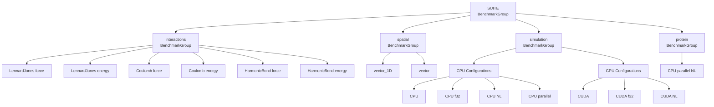
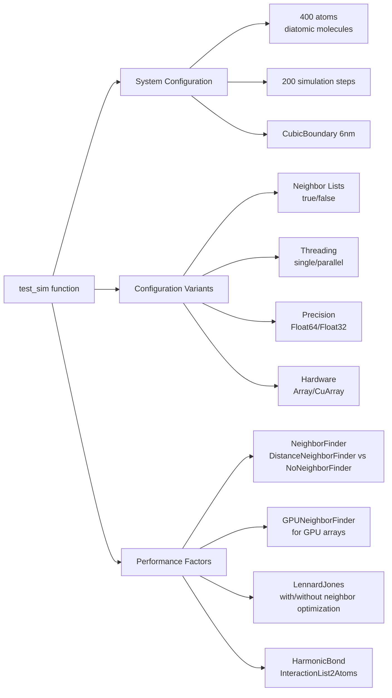
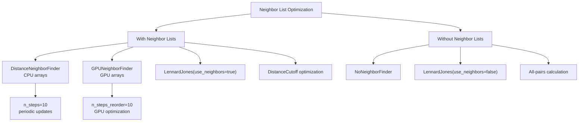

# Benchmarking and Performance

<details>
<summary>Relevant source files</summary>

The following files were used as context for generating this wiki page:

- [benchmark/benchmarks.jl](benchmark/benchmarks.jl)
- [test/agent.jl](test/agent.jl)

</details>


This page covers the benchmarking framework used to measure Molly.jl's performance and provides guidance on optimization strategies for molecular dynamics simulations. The benchmarking suite evaluates performance across different hardware configurations, precision levels, and algorithmic choices to help users understand the computational characteristics of their simulations.

For information about the testing framework used for correctness validation, see [Testing Framework](#9.1). For details about GPU acceleration implementation, see [GPU Acceleration](#6.1).

## Benchmarking Framework

Molly.jl includes a comprehensive benchmarking suite based on BenchmarkTools.jl that systematically measures performance across different simulation components and configurations. The benchmarking framework is designed to evaluate performance on both CPU and GPU hardware with various optimization settings.



The benchmarking system automatically detects available hardware and adjusts the test suite accordingly. CUDA benchmarks run only when a CUDA-enabled device is available, and parallel benchmarks execute only when Julia is running with multiple threads.

Sources: [benchmark/benchmarks.jl:1-157]()

## Benchmark Categories

### Interaction Benchmarks

The interaction benchmarks measure the computational cost of individual force and energy calculations for different interaction types. These microbenchmarks provide insight into the fundamental performance characteristics of the force calculation kernels.

| Interaction Type | Force Benchmark | Energy Benchmark |
|------------------|-----------------|------------------|
| `LennardJones` | `LennardJones force` | `LennardJones energy` |
| `Coulomb` | `Coulomb force` | `Coulomb energy` |
| `HarmonicBond` | `HarmonicBond force` | `HarmonicBond energy` |

Each benchmark measures a single force or energy evaluation using pre-defined atomic coordinates and parameters. The benchmarks use consistent test data including two atoms with defined positions, charges, and Lennard-Jones parameters.

Sources: [benchmark/benchmarks.jl:39-52]()

### Spatial Calculation Benchmarks

Spatial benchmarks evaluate the performance of coordinate manipulation functions that are fundamental to molecular dynamics calculations:

- `vector_1D`: Measures 1D distance calculations with periodic boundary conditions
- `vector`: Measures 3D vector calculations between atom pairs with boundary conditions

These benchmarks test the efficiency of the spatial utility functions used throughout force calculations and neighbor finding algorithms.

Sources: [benchmark/benchmarks.jl:54-55]()

### Simulation Benchmarks

The simulation benchmarks provide comprehensive performance measurements for complete molecular dynamics simulations under different computational configurations. The `test_sim` function creates standardized test systems and measures end-to-end simulation performance.



The simulation benchmarks test eight different configurations on CPU and four on GPU, allowing systematic comparison of optimization strategies:

**CPU Configurations:**
- `CPU`: Basic single-threaded simulation
- `CPU f32`: Single-threaded with Float32 precision
- `CPU NL`: Single-threaded with neighbor lists
- `CPU f32 NL`: Single-threaded, Float32, with neighbor lists
- `CPU parallel`: Multi-threaded simulation
- `CPU parallel f32`: Multi-threaded with Float32 precision
- `CPU parallel NL`: Multi-threaded with neighbor lists
- `CPU parallel f32 NL`: Multi-threaded, Float32, with neighbor lists

**GPU Configurations:**
- `CUDA`: Basic GPU simulation
- `CUDA f32`: GPU with Float32 precision
- `CUDA NL`: GPU with neighbor lists
- `CUDA f32 NL`: GPU, Float32, with neighbor lists

Sources: [benchmark/benchmarks.jl:65-143]()

### Protein Simulation Benchmarks

The protein benchmarks measure performance on realistic biological systems using the 6MRR protein structure with full force field interactions. This benchmark represents production-level molecular dynamics simulations with:

- Complete protein system loaded from PDB file
- `MolecularForceField` with multiple force field files (ff99SBildn.xml, tip3p_standard.xml, his.xml)
- Realistic simulation parameters (0.0005 ps timestep, 25 steps)
- Multi-threaded execution with neighbor lists

The protein benchmark provides performance metrics for real-world usage scenarios and validates the scalability of the simulation engine on complex molecular systems.

Sources: [benchmark/benchmarks.jl:145-156]()

## Performance Optimization Strategies

### Neighbor List Optimization

Neighbor lists provide significant performance improvements by reducing the number of pairwise distance calculations. The benchmarking system compares simulations with and without neighbor lists to quantify this optimization:



The neighbor finder selection adapts automatically based on the array type using `Molly.uses_gpu_neighbor_finder(AT)` to determine the appropriate algorithm for the hardware.

Sources: [benchmark/benchmarks.jl:80-99]()

### Precision and Memory Optimization

The benchmarking suite evaluates both Float64 and Float32 precision to measure the performance impact of reduced precision calculations. Float32 can provide significant speedups, especially on GPU hardware, while maintaining sufficient accuracy for many molecular dynamics applications.

Key considerations for precision optimization:
- **Memory bandwidth**: Float32 reduces memory usage and improves cache efficiency
- **GPU performance**: Modern GPUs often have higher Float32 throughput
- **Numerical stability**: Protein folding and long simulations may require Float64 precision

The benchmarks use separate coordinate and velocity arrays (`starting_coords_f32`, `starting_velocities_f32`) to ensure fair comparison between precision levels.

Sources: [benchmark/benchmarks.jl:62-63](), [benchmark/benchmarks.jl:68-72]()

### Thread Parallelization

Multi-threaded execution provides substantial performance improvements on multi-core CPUs. The benchmarking framework automatically detects the number of available threads and includes parallel benchmarks when `Threads.nthreads() > 1`.

The parallel simulations use the `n_threads` parameter in the `simulate!` function to control thread utilization:

```julia
n_threads = parallel ? Threads.nthreads() : 1
simulate!(sys, simulator, n_steps; n_threads=n_threads)
```

Thread parallelization primarily benefits force calculations and neighbor finding operations, with effectiveness depending on system size and interaction complexity.

Sources: [benchmark/benchmarks.jl:13-18](), [benchmark/benchmarks.jl:116-117](), [benchmark/benchmarks.jl:127-132]()

## Hardware Acceleration

### GPU Device Management

The benchmarking system includes sophisticated GPU device management that allows specification of the target CUDA device through the `DEVICE` environment variable. The framework automatically detects CUDA availability and configures the appropriate device:

```julia
const DEVICE = parse(Int, get(ENV, "DEVICE", "0"))
const run_cuda_tests = CUDA.functional()
if run_cuda_tests
    device!(DEVICE)
    @info "The CUDA benchmarks will be run on device $DEVICE"
end
```

This approach enables benchmarking on specific GPU devices in multi-GPU systems and allows for systematic performance comparison across different hardware configurations.

Sources: [benchmark/benchmarks.jl:20-29]()

### Array Type Abstraction

The benchmarking framework uses Julia's array type system to seamlessly switch between CPU (`Array`) and GPU (`CuArray`) computations. The `test_sim` function accepts an array type parameter `AT` that determines the computational backend:

- **CPU execution**: Uses `Array` for all data structures
- **GPU execution**: Uses `CuArray` for coordinates, velocities, atoms, and interaction lists

This abstraction allows identical simulation logic to run on different hardware while measuring the performance characteristics of each platform.

Sources: [benchmark/benchmarks.jl:65](), [benchmark/benchmarks.jl:75-77](), [benchmark/benchmarks.jl:101-104]()

## Running Benchmarks

### Basic Execution

Benchmarks can be executed using the PkgBenchmark.jl framework with control over thread count and device selection:

```julia
using Molly, PkgBenchmark
results = benchmarkpkg(Molly, BenchmarkConfig(env=Dict("JULIA_NUM_THREADS" => 16)))
export_markdown(out_file, results)
```

### Environment Configuration

The benchmarking system respects several environment variables for configuration:
- `JULIA_NUM_THREADS`: Controls the number of threads for parallel benchmarks
- `DEVICE`: Specifies the CUDA device index for GPU benchmarks

### Performance Monitoring

Individual benchmark results can be monitored during development using the `@time` macro for quick performance assessment, as demonstrated in test files for custom simulation scenarios.

Sources: [benchmark/benchmarks.jl:2-5](), [test/agent.jl:104]()

---