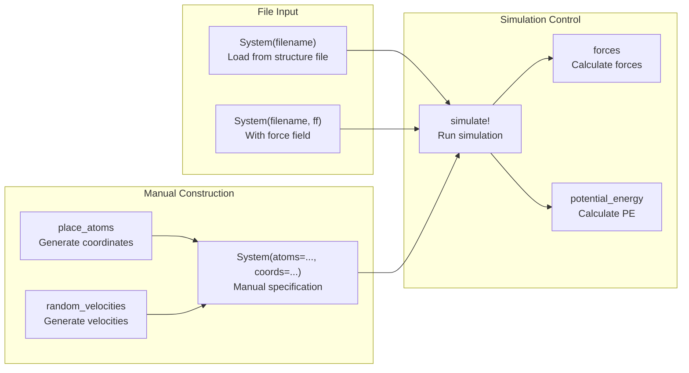
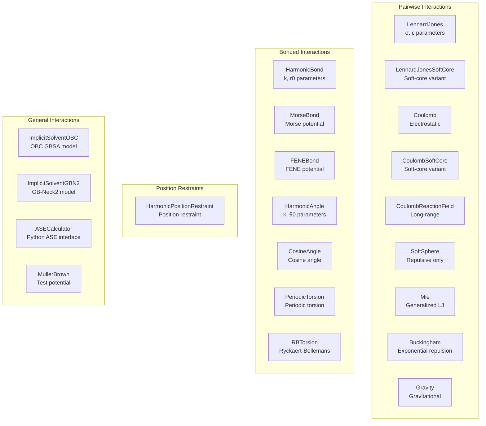

# API Reference

<details>
<summary>Relevant source files</summary>

The following files were used as context for generating this wiki page:

- [NEWS.md](NEWS.md)
- [Project.toml](Project.toml)
- [docs/src/api.md](docs/src/api.md)
- [src/Molly.jl](src/Molly.jl)
- [test/Project.toml](test/Project.toml)

</details>


This page provides comprehensive reference documentation for all exported functions, types, and constants in Molly.jl. It covers the complete public API surface that users interact with when using the package.

For system setup and configuration details, see [System Setup and Configuration](#7). For information about the underlying architecture, see [Core Architecture](#3). For package dependencies and optional extensions, see [Dependencies and Extensions](#10.1).

## Module Structure and Exports

Molly.jl organizes its functionality across multiple included files and re-exports key dependencies to provide a unified interface.

### Core Module Organization

```mermaid
graph TB
    subgraph "Main Module"
        Molly["Molly.jl<br/>Main module"]
    end
    
    subgraph "Re-exported Dependencies"
        StaticArrays["StaticArrays.jl<br/>SVector, SMatrix"]
        Unitful["Unitful.jl<br/>Physical units"]
    end
    
    subgraph "Core Components"
        Types["types.jl<br/>System, Atom, AtomData"]
        Units["units.jl<br/>Unit handling"]
        Spatial["spatial.jl<br/>Coordinate functions"]
        Force["force.jl<br/>Force calculation"]
        Energy["energy.jl<br/>Energy calculation"]
    end
    
    subgraph "Interaction Types"
        LJ["interactions/lennard_jones.jl<br/>LennardJones"]
        Coulomb["interactions/coulomb.jl<br/>Coulomb, CoulombReactionField"]
        Bonds["interactions/harmonic_bond.jl<br/>HarmonicBond"]
        Angles["interactions/harmonic_angle.jl<br/>HarmonicAngle"]
        Torsions["interactions/periodic_torsion.jl<br/>PeriodicTorsion"]
        ImplicitSolv["interactions/implicit_solvent.jl<br/>ImplicitSolventOBC"]
    end
    
    subgraph "Simulation Engine"
        Simulators["simulators.jl<br/>VelocityVerlet, Langevin"]
        Neighbors["neighbors.jl<br/>DistanceNeighborFinder"]
        Loggers["loggers.jl<br/>CoordinatesLogger"]
        Analysis["analysis.jl<br/>rdf, rmsd"]
    end
    
    Molly --> StaticArrays
    Molly --> Unitful
    Molly --> Types
    Molly --> Units
    Molly --> Spatial
    Molly --> Force
    Molly --> Energy
    Molly --> LJ
    Molly --> Coulomb
    Molly --> Bonds
    Molly --> Angles
    Molly --> Torsions
    Molly --> ImplicitSolv
    Molly --> Simulators
    Molly --> Neighbors
    Molly --> Loggers
    Molly --> Analysis
```



Sources: [src/Molly.jl:1-65](), [docs/src/api.md:5-6]()

## Core Data Types

The fundamental data structures that form the foundation of molecular simulations in Molly.jl.

### Primary System Types

| Type | Purpose | Key Fields |
|------|---------|------------|
| `System` | Central container for simulation state | `atoms`, `coords`, `velocities`, `boundary` |
| `Atom` | Individual atom representation | `mass`, `charge`, `σ`, `ε`, `atom_type` |
| `AtomData` | Extended atom properties | Additional metadata storage |
| `ReplicaSystem` | Container for replica exchange | Multiple `System` instances |

### Boundary Conditions

| Type | Geometry | Constructor Example |
|------|----------|-------------------|
| `CubicBoundary` | Cubic periodic box | `CubicBoundary(2.0u"nm")` |
| `RectangularBoundary` | Rectangular box | `RectangularBoundary(2.0u"nm", 3.0u"nm")` |
| `TriclinicBoundary` | General triclinic cell | `TriclinicBoundary(basis_vectors)` |

### Interaction Lists

| Type | Atom Count | Purpose |
|------|------------|---------|
| `InteractionList2Atoms` | 2 | Bonds, pairwise constraints |
| `InteractionList3Atoms` | 3 | Bond angles |
| `InteractionList4Atoms` | 4 | Torsion angles |

Sources: [src/types.jl](), [NEWS.md:266-267]()

## Core Exported Functions

### System Construction and Setup



Sources: [src/setup.jl](), [src/simulators.jl](), [src/force.jl](), [src/energy.jl]()

### Spatial and Analysis Functions

| Function | Purpose | Return Type |
|----------|---------|-------------|
| `distance` | Calculate distance between coordinates | Scalar |
| `vector` | Displacement vector with PBC | `SVector` |
| `wrap_coords` | Apply periodic boundary conditions | Coordinates |
| `rdf` | Radial distribution function | `Tuple` |
| `rmsd` | Root mean square deviation | Scalar |
| `radius_gyration` | Radius of gyration | Scalar |

Sources: [src/spatial.jl](), [src/analysis.jl]()

## Interaction Types Hierarchy

The interaction system in Molly.jl is organized into distinct categories based on how they calculate forces and energies.

### Interaction Type Classification



Sources: [src/interactions/](), [NEWS.md:112-113]()

## Simulation Components

### Integrators and Simulators

| Simulator | Algorithm | Use Case |
|-----------|-----------|----------|
| `VelocityVerlet` | Velocity Verlet | Standard MD |
| `Langevin` | Langevin dynamics | NVT ensemble |
| `LangevinSplitting` | Configurable splitting | Custom integrators |
| `NoseHoover` | Nosé-Hoover thermostat | NVT ensemble |
| `StormerVerlet` | Störmer-Verlet | Position-only |
| `OverdampedLangevin` | Overdamped dynamics | High friction |
| `MetropolisMonteCarlo` | Monte Carlo | Sampling |

### Neighbor Finding Algorithms

| Type | Algorithm | Best For |
|------|-----------|----------|
| `DistanceNeighborFinder` | Distance cutoff | Small systems |
| `TreeNeighborFinder` | KD-tree search | Medium systems |
| `CellListMapNeighborFinder` | Cell lists | Large systems |
| `GPUNeighborFinder` | GPU kernels | GPU acceleration |

Sources: [src/simulators.jl](), [src/neighbors.jl](), [NEWS.md:50]()

## Dependencies and Extensions

The package uses a modular design with optional extensions to minimize required dependencies.

### Dependency Structure

```mermaid
graph TB
    subgraph "Core Dependencies"
        AtomsBase["AtomsBase.jl<br/>Standard interface"]
        AtomsCalc["AtomsCalculators.jl<br/>Calculator interface"]
        Unitful_dep["Unitful.jl<br/>Physical units"]
        StaticArrays_dep["StaticArrays.jl<br/>Static vectors"]
        KernelAbs["KernelAbstractions.jl<br/>GPU abstraction"]
    end
    
    subgraph "File I/O Dependencies"
        Chemfiles_dep["Chemfiles.jl<br/>Structure files"]
        BioStructures_dep["BioStructures.jl<br/>PDB files"]
        EzXML_dep["EzXML.jl<br/>XML parsing"]
    end
    
    subgraph "Performance Dependencies"
        CellListMap_dep["CellListMap.jl<br/>Neighbor lists"]
        NearestNeighbors_dep["NearestNeighbors.jl<br/>Tree search"]
        GPUArrays_dep["GPUArrays.jl<br/>GPU arrays"]
    end
    
    subgraph "Optional Extensions"
        CUDA_ext["MollyCUDAExt<br/>NVIDIA GPU support"]
        GLMakie_ext["MollyGLMakieExt<br/>Visualization"]
        Enzyme_ext["MollyEnzymeExt<br/>Auto-differentiation"]
        Python_ext["MollyPythonCallExt<br/>ASE integration"]
        KernelDensity_ext["MollyKernelDensityExt<br/>RDF calculation"]
    end
    
    AtomsBase --> AtomsCalc
    KernelAbs --> CUDA_ext
    GLMakie_ext -.-> "GLMakie + Colors"
    Python_ext -.-> "PythonCall"
    Enzyme_ext -.-> "Enzyme"
    KernelDensity_ext -.-> "KernelDensity"
```

Sources: [Project.toml:6-48](), [docs/src/api.md:7-11]()

### Extension Activation

Extensions are automatically loaded when their trigger packages are imported:

| Extension | Trigger Package | Functionality |
|-----------|-----------------|---------------|
| `MollyCUDAExt` | `CUDA.jl` | GPU acceleration on NVIDIA hardware |
| `MollyGLMakieExt` | `GLMakie.jl` + `Colors.jl` | 3D visualization |
| `MollyEnzymeExt` | `Enzyme.jl` | Automatic differentiation |
| `MollyPythonCallExt` | `PythonCall.jl` | Python ASE calculator interface |
| `MollyKernelDensityExt` | `KernelDensity.jl` | Radial distribution functions |

Sources: [Project.toml:42-47](), [NEWS.md:33]()

## Logging and Analysis Functions

### Built-in Loggers

| Logger | Purpose | Output |
|--------|---------|---------|
| `CoordinatesLogger` | Record positions | Trajectory |
| `VelocitiesLogger` | Record velocities | Velocity data |
| `ForcesLogger` | Record forces | Force data |
| `TemperatureLogger` | Record temperature | Scalar time series |
| `PotentialEnergyLogger` | Record potential energy | Scalar time series |
| `KineticEnergyLogger` | Record kinetic energy | Scalar time series |
| `TotalEnergyLogger` | Record total energy | Scalar time series |
| `PressureLogger` | Record pressure | Scalar time series |
| `VolumeLogger` | Record box volume | Scalar time series |

### Analysis Functions

| Function | Purpose | Dependencies |
|----------|---------|--------------|
| `rdf` | Radial distribution function | `KernelDensity.jl` |
| `rmsd` | Root mean square deviation | Core |
| `radius_gyration` | Radius of gyration | Core |
| `bond_angle` | Calculate bond angles | Core |
| `torsion_angle` | Calculate torsion angles | Core |
| `hydrodynamic_radius` | Hydrodynamic radius | Core |

Sources: [src/loggers.jl](), [src/analysis.jl](), [NEWS.md:163]()

---