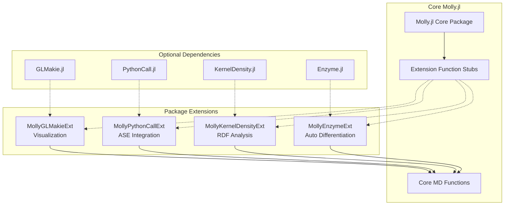
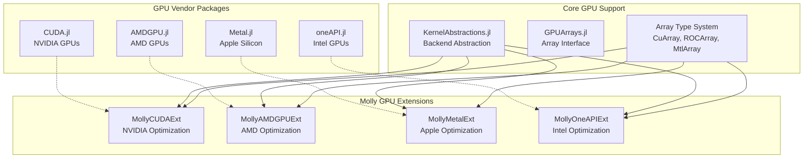
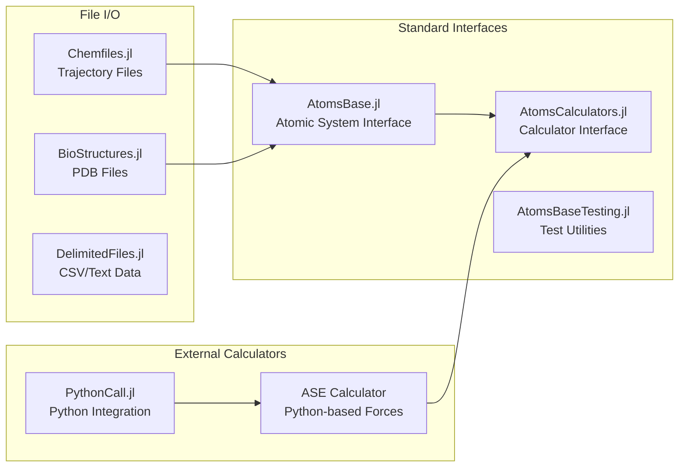
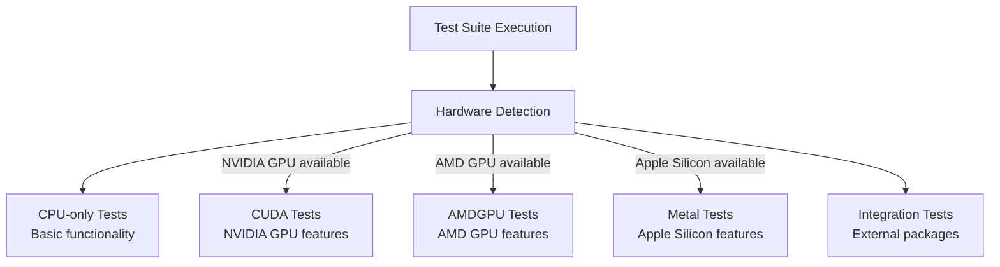

# Dependencies and Extensions

<details>
<summary>Relevant source files</summary>

The following files were used as context for generating this wiki page:

- [docs/src/api.md](docs/src/api.md)
- [test/Project.toml](test/Project.toml)

</details>


This document covers the dependency architecture and optional extension system in Molly.jl. It explains how core dependencies are managed, how package extensions provide optional functionality without increasing the base dependency footprint, and how GPU backends and external interfaces are integrated.

For information about GPU acceleration implementation details, see [GPU Acceleration](#6.1). For details about differentiable simulation capabilities, see [Differentiable Simulation](#6.2).

## Core Dependencies

Molly.jl maintains a minimal set of core dependencies that are always loaded with the package. These provide fundamental functionality for molecular dynamics simulations.

### Essential Julia Packages

The core dependencies include standard library packages and key external packages:

| Dependency | Purpose | Type |
|------------|---------|------|
| `StaticArrays.jl` | Fixed-size arrays for coordinates and vectors | Re-exported |
| `Unitful.jl` | Physical units system | Re-exported |
| `LinearAlgebra` | Matrix operations and linear algebra | Standard library |
| `Random` | Random number generation | Standard library |
| `Statistics` | Statistical functions | Standard library |

Molly.jl re-exports `StaticArrays.jl` and `Unitful.jl`, making types like `SVector` and units like `1.0u"nm"` directly available when calling `using Molly`.

Sources: [docs/src/api.md:5]()

## Package Extensions System

Molly.jl uses Julia's package extension system to provide optional functionality without requiring all users to install heavy dependencies. Extensions are automatically loaded when the corresponding packages are available.

### Extension Architecture



### Major Extensions

The following table shows the main package extensions and their activation requirements:

| Extension | Trigger Package | Functionality | Key Functions |
|-----------|----------------|---------------|---------------|
| `MollyGLMakieExt` | `GLMakie.jl` | 3D visualization | `visualize` |
| `MollyPythonCallExt` | `PythonCall.jl` | ASE calculator interface | `ASECalculator` |
| `MollyKernelDensityExt` | `KernelDensity.jl` | Radial distribution functions | `rdf` |
| `MollyEnzymeExt` | `Enzyme.jl` | Automatic differentiation | Differentiable simulation |

To use extension functionality, users must explicitly load the corresponding package:

```julia
using Molly
using GLMakie  # Enables visualize function
using PythonCall  # Enables ASECalculator
```

Sources: [docs/src/api.md:7-10]()

## GPU Backend Extensions

Molly.jl supports multiple GPU backends through a unified extension system built on `KernelAbstractions.jl`. Each GPU vendor has dedicated extension packages for optimal performance.

### GPU Extension Architecture



### GPU Backend Dependencies

| Backend | Package | Array Type | Extension | Compatibility |
|---------|---------|------------|-----------|---------------|
| NVIDIA | `CUDA.jl` | `CuArray` | `MollyCUDAExt` | CUDA 5+ |
| AMD | `AMDGPU.jl` | `ROCArray` | `MollyAMDGPUExt` | ROCm |
| Apple | `Metal.jl` | `MtlArray` | `MollyMetalExt` | Apple Silicon |
| Intel | `oneAPI.jl` | `oneArray` | `MollyOneAPIExt` | Intel GPUs |

Sources: [test/Project.toml:2,8,17,23]()

## External Interface Dependencies

Molly.jl integrates with several external packages and standards to provide interoperability with the broader molecular simulation ecosystem.

### Molecular Data Standards



### Interface Dependencies

| Interface | Package | Purpose | Integration Point |
|-----------|---------|---------|-------------------|
| Atomic Systems | `AtomsBase.jl` | Standard atomic system interface | `System` conversion |
| Force Calculators | `AtomsCalculators.jl` | Calculator interface standard | `ASECalculator` |
| File I/O | `Chemfiles.jl` | Trajectory and structure files | File reading/writing |
| PDB Structures | `BioStructures.jl` | Protein structure handling | Biomolecular setup |
| Python Integration | `PythonCall.jl` | Python calculator access | ASE interface |

Sources: [test/Project.toml:4-6,9]()

## Testing Dependencies

The test suite includes additional dependencies for comprehensive testing across different hardware configurations and integration scenarios.

### Testing Infrastructure

| Category | Dependencies | Purpose |
|----------|-------------|---------|
| Quality Assurance | `Aqua.jl` | Package quality checks |
| GPU Testing | `CUDA.jl`, `AMDGPU.jl`, `Metal.jl`, `oneAPI.jl` | Multi-GPU backend testing |
| Automatic Differentiation | `Enzyme.jl`, `FiniteDifferences.jl` | AD correctness testing |
| Visualization | `GLMakie.jl` | Rendering and visualization tests |
| Analysis | `KernelDensity.jl` | Statistical analysis testing |
| Utilities | `Suppressor.jl` | Output suppression for clean tests |

### Test Environment Configuration

The test environment is configured to conditionally load GPU packages based on hardware availability:



Sources: [test/Project.toml:1-36]()

## Dependency Management

### Version Compatibility

Molly.jl specifies compatibility constraints for testing dependencies to ensure stable operation across Julia versions:

| Package | Version Constraint | Compatibility |
|---------|-------------------|---------------|
| `AMDGPU.jl` | `1` | Latest major version |
| `CUDA.jl` | `5` | CUDA.jl v5.x series |
| `Metal.jl` | `1.5` | Metal.jl v1.5+ |
| `oneAPI.jl` | `2.0.2` | Specific version requirement |
| `Aqua.jl` | `0.8` | Testing framework compatibility |

### Conditional Loading Strategy

The package extension system allows Molly.jl to:

1. **Minimize Core Dependencies**: Only essential packages are loaded by default
2. **Enable Optional Features**: Advanced functionality loads only when needed
3. **Support Multiple Backends**: GPU support activates based on available hardware
4. **Maintain Compatibility**: Extensions handle version differences across backends

This architecture ensures that basic molecular dynamics functionality remains lightweight while providing access to advanced features for users who need them.

Sources: [test/Project.toml:25-35]()