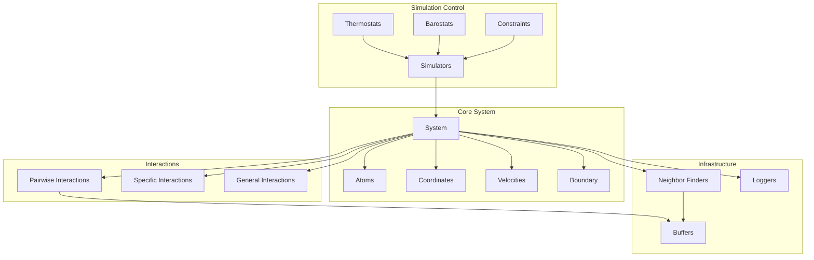

Molly.jl is a pure Julia package designed for molecular dynamics (MD) simulation and the study of physical systems more broadly. Built from first principles in Julia, it provides a modular, high-performance framework for exploring molecular behavior from noble gases to biological macromolecules. The package emphasizes **extensibility**, **performance**, and **reproducibility**, making it particularly suitable for both research applications and educational purposes.


Sources: [README.md](/README.md#L1-L15), [src/Molly.jl](/src/Molly.jl#L1-L74)

## Key Features

Molly.jl implements a comprehensive suite of molecular simulation capabilities, distinguishing itself through several unique features in the Julia ecosystem:

| Category | Features |
|----------|----------|
| **Non-bonded Interactions** | Lennard-Jones, Coulomb potential, reaction field, gravitational potential, soft sphere, Mie, Buckingham potentials, soft core variants for alchemical simulation |
| **Bonded Interactions** | Harmonic and Morse bonds, bond angles, torsion angles, harmonic position restraints, FENE bonds |
| **Electrostatics** | Ewald and Particle Mesh Ewald (PME) summation methods |
| **Integration Methods** | Verlet, Velocity Verlet, Störmer-Verlet, flexible Langevin, Nosé-Hoover integrators |
| **Temperature Control** | Andersen, Berendsen, and velocity rescaling thermostats |
| **Pressure Control** | C-rescale, Monte Carlo, and Berendsen barostats |
| **Constraints** | SHAKE and RATTLE constraint algorithms |
| **Boundary Conditions** | Periodic, triclinic, and infinite boundary conditions |
| **Optimization** | Steepest descent energy minimization |
| **Advanced Methods** | Replica exchange molecular dynamics (REMD), Monte Carlo simulation |
| **Performance** | Automatic multithreading, GPU acceleration (CUDA, other KernelAbstractions backends), neighbor list algorithms, cell list implementation via CellListMap.jl |
| **Analysis & I/O** | Flexible loggers, trajectory output (DCD, XTC via Chemfiles.jl), OpenMM force field file reading, RDF and other analysis functions |
| **Integration** | Unitful.jl compatibility, AtomsBase.jl and AtomsCalculators.jl interfaces, Python ASE calculator interface |
| **Differentiable** | **Unique feature**: full automatic differentiation support via Enzyme.jl for force field optimization and gradient-based parameter learning |
| **Visualization** | Animation support with Makie.jl |

Sources: [README.md](/README.md#L17-L52), [Project.toml](/Project.toml#L1-L89)

## Architecture Overview

Molly.jl follows a **modular design principle** where all major components of a simulation can be customized. The architecture centers around the `System` object, which encapsulates all simulation state, and the `simulate!` function, which orchestrates time evolution.



Sources: [src/types.jl](/src/types.jl#L1-L150), [src/Molly.jl](/src/Molly.jl#L1-L74)

## Modular Component System

The package's power derives from its extensible interface design. Each component category follows specific patterns that allow users to define custom implementations with the same performance characteristics as built-in versions.

**Interaction Types** follow a hierarchical type system rooted in `AbstractInteraction`. Pairwise interactions (between all or most atom pairs) subtype `PairwiseInteraction`, which is an alias for `NBodyInteraction{2}`. Specific interactions between predetermined atom groups use `InteractionListNAtoms` types where N specifies the atom count (1 for position restraints, 2 for bonds, 3 for angles, 4 for torsions).

Sources: [src/types.jl](/src/types.jl#L1-L80)

**The System Object** serves as the central data structure containing atoms, coordinates, velocities, boundary conditions, interactions, constraints, neighbor finders, loggers, and unit specifications. It implements the `AtomsBase.AbstractSystem` interface for interoperability with the broader Julia molecular simulation ecosystem. The System can run on CPU or GPU arrays, with automatic type inference determining the appropriate code paths.

Sources: [src/types.jl](/src/types.jl#L900-L1100), [docs/src/documentation.md](/docs/src/documentation.md#L65-L95)

**Simulators** define the time evolution algorithm. Built-in options include deterministic integrators (VelocityVerlet, Verlet, StörmerVerlet), stochastic integrators (Langevin variants), minimization (SteepestDescentMinimizer), and advanced sampling (TemperatureREMD, HamiltonianREMD, MetropolisMonteCarlo). Custom simulators implement the `simulate!` function interface.

Sources: [src/simulators.jl](/src/simulators.jl#L1-L100)

## Performance Architecture

Molly.jl achieves competitive performance through several architectural decisions:

**CPU Optimization** leverages Julia's native multithreading capabilities with automatic parallelization of force calculations and neighbor finding. StaticArrays store coordinates and velocities for stack-allocated small vectors, avoiding heap allocation overhead during inner loops.

**GPU Acceleration** uses KernelAbstractions.jl for cross-platform GPU support, with optimized CUDA kernels in the `MollyCUDAExt` extension. The implementation employs warp-level operations and Morton code spatial sorting for efficient neighbor finding on GPUs. Cell list algorithms reduce the O(N²) pairwise complexity to approximately O(N) for sparse systems.

**Neighbor Finding** provides multiple strategies including brute force (NoNeighborFinder), distance-based cell lists, and more sophisticated algorithms for large systems. The neighbor finder automatically updates periodically to balance accuracy and performance.

Sources: [ext/MollyCUDAExt.jl](/ext/MollyCUDAExt.jl#L1-L200), [README.md](/README.md#L17-L52)

## Extension System

Molly.jl uses Julia's package extension system to provide optional functionality:

| Extension | Purpose | Key Dependencies |
|-----------|---------|------------------|
| MollyCUDAExt | GPU acceleration on NVIDIA devices | CUDA.jl, KernelAbstractions.jl |
| MollyEnzymeExt | Automatic differentiation | Enzyme.jl |
| MollyGLMakieExt | Interactive visualization | GLMakie.jl, Colors.jl |
| MollyKernelDensityExt | Density estimation | KernelDensity.jl |
| MollyPythonCallExt | Python interoperability | PythonCall.jl |

This design allows users to install only the extensions they need, keeping the core package lightweight while enabling powerful capabilities when required.

Sources: [Project.toml](/Project.toml#L42-L57)

## Differentiable Simulation

A **unique and defining feature** of Molly.jl is full support for differentiable molecular dynamics. Through the Enzyme.jl integration, gradients can be computed through entire simulations with respect to force field parameters, atomic coordinates, or other system properties. This capability enables:

- Gradient-based force field optimization
- Inverse design of molecular systems
- Neural network-enhanced potentials trained end-to-end
- Sensitivity analysis of simulation outcomes

The differentiability is achieved without sacrificing the performance optimizations described above, making it practical for research applications requiring many gradient evaluations.

Sources: [README.md](/README.md#L17-L52), [Project.toml](/Project.toml#L46-L47)

## Quick Start Example

The following example demonstrates Molly.jl's core workflow for simulating a Lennard-Jones fluid:

```julia
using Molly

# Define atoms with LJ parameters
n_atoms = 100
atom_mass = 10.0u"g/mol"
atoms = [Atom(mass=atom_mass, σ=0.3u"nm", ϵ=0.2u"kJ * mol^-1") for i in 1:n_atoms]

# Set up simulation box and initial conditions
boundary = CubicBoundary(2.0u"nm")
coords = place_atoms(n_atoms, boundary; min_dist=0.3u"nm")
temp = 298.0u"K"
velocities = [random_velocity(atom_mass, temp) for i in 1:n_atoms]

# Configure interactions and simulator
pairwise_inters = (LennardJones(),)
simulator = VelocityVerlet(
    dt=0.002u"ps",
    coupling=AndersenThermostat(temp, 1.0u"ps"),
)

# Create system and run simulation
sys = System(
    atoms=atoms,
    coords=coords,
    boundary=boundary,
    velocities=velocities,
    pairwise_inters=pairwise_inters,
    loggers=(temp=TemperatureLogger(100),),
)

simulate!(sys, simulator, 10_000)
```

Sources: [README.md](/README.md#L54-L85), [docs/src/documentation.md](/docs/src/documentation.md#L20-L70)

## Installation

Molly.jl requires Julia 1.10 or later. Install from the Julia REPL in package mode:

```julia
using Pkg
Pkg.add("Molly")
```

For GPU acceleration, install the appropriate backend package (e.g., `Pkg.add("CUDA")` for NVIDIA GPUs). The optional extensions are loaded automatically when the corresponding packages are available.

Sources: [README.md](/README.md#L86-L92)

## Example Applications

The package demonstrates versatility across application domains:

**Biomolecular Simulation** can simulate proteins with full atomic detail, reading OpenMM force fields and running PME electrostatics for accurate long-range interactions. GPU acceleration enables microsecond-scale simulations of biologically relevant systems.


Sources: [README.md](/README.md#L100-L130)

**Materials Science** applications include crystal systems via SimpleCrystals.jl integration, polymer chains with bonded interactions, and implicit solvent methods for solvation free energies.

**Exotic Systems** like gravitational many-body problems demonstrate Molly's flexibility beyond traditional molecular dynamics. The solar system simulation example shows how custom potentials can model planetary orbits.

Sources: [docs/src/examples.md](/docs/src/examples.md#L50-L100)

> [!TIP]
> The modular design allows you to mix and match components—use GPU-accelerated pairwise forces with CPU-based specific interactions, or combine deterministic integrators with stochastic thermostats. This flexibility enables experiments that would be difficult in more monolithic MD packages.

## Development and Community

Molly.jl maintains an active development roadmap and welcomes contributions. The package follows semantic versioning but notes that API stability is not yet guaranteed as it approaches maturity. Key areas for community contribution include new interaction types, simulators, performance optimizations, and example applications.

Sources: [README.md](/README.md#L131-L160), [docs/src/development.md](/docs/src/development.md#L1-L18)

## Next Steps

To continue exploring Molly.jl, follow this logical progression through the documentation:

1. **[Quick Start](2-quick-start)** - Get Molly installed and running your first simulation
2. **[Installation and Setup](3-installation-and-setup)** - Detailed setup instructions and dependency management
3. **[Lennard-Jones Fluid Simulation](4-lennard-jones-fluid-simulation)** - Complete tutorial for basic MD workflows
4. **[Protein Simulation Setup](5-protein-simulation-setup)** - Biomedical applications with realistic force fields

For deeper understanding, proceed to the **Deep Dive** sections covering system architecture, interactions, simulation algorithms, and performance optimization.
